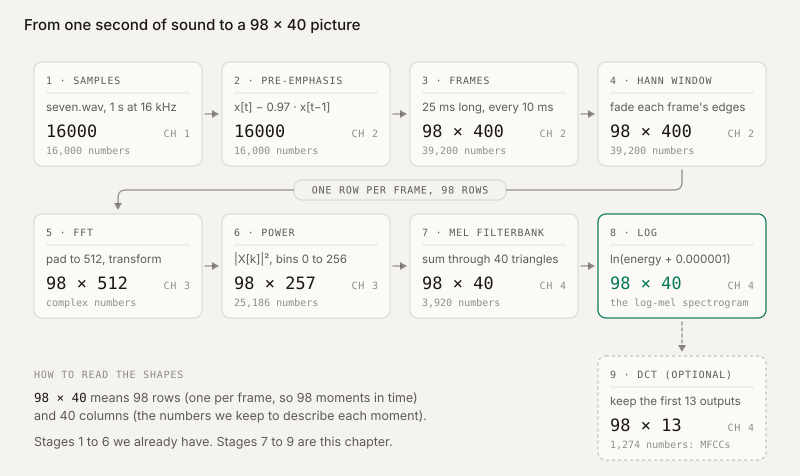

## Building A Speech Recognizer From Scratch

*From sound waves to words, in Rust.*

Welcome to Building a Speech Recognizer from Scratch. This is a book that walks you through building a program that listens to a person talking and writes down what they said. We start with a file full of numbers that happens to be a recording of somebody saying "seven", and we end with a command line tool that transcribes speech from a file or from your microphone.

There is one rule, and we keep it for the whole book: **we write everything ourselves.** No PyTorch, no TensorFlow, no signal processing crates, no linear algebra crates, and no pretrained model until we have built and trained a small working recognizer of our own. The `[dependencies]` section of our `Cargo.toml` is empty on page one and it is still empty on the last page. If we need a Fourier transform, a matrix multiply, a random number generator, backpropagation, or a JSON parser, we write it, and we test it.

You do not need to know any signal processing or any machine learning. You need to be comfortable reading Rust and you need the maths you had at sixteen. Everything else is built up from nothing, one piece at a time, and every piece is something you can run.



*A figure from chapter 4: the first third of the book in one picture. By then we have written every box.*

### What Are We Building?

Four things, each one standing on the one before it.

1. **Ears.** Code that turns a WAV file into the picture a recognizer actually looks at. We parse the file by hand, cut the sound into short frames, write the Fourier transform twice (slowly, then fast), and squeeze the result through a model of the human ear. (Chapters 1 to 4.)
2. **A recognizer that learns nothing.** Dynamic time warping: keep a few recordings of each digit, and compare a new recording against all of them. A short function and no training at all, and it recognizes spoken digits. This is our first "it works" moment and it arrives early on purpose. (Chapter 5.)
3. **A recognizer that learns.** A neural network library with backpropagation written by hand and checked numerically: linear layers, convolutions, recurrent layers, Adam, and the CTC loss that lets a network learn to spell without being told which sound goes with which letter. We train it on a laptop CPU in about forty minutes, and it spells out short phrases from files and live from a microphone. (Chapters 6 to 11.)
4. **Somebody else's brain in our skull.** Our model knows 35 words, because that is what a laptop and a free dataset can teach it. So in the last part we write an inference engine for OpenAI's Whisper and load the published weights into it. Same rule: we parse the weight file ourselves, write attention ourselves, and feed it with the kind of front end we built in part one, rebuilt to Whisper's constants. At that point our program transcribes ordinary English. (Chapters 12 and 13.)

We try to be honest about numbers throughout. Our own recognizer gets about one word in ten wrong on its own test set, and it only knows 35 words. The book says so, shows where it fails, and explains what separates it from Whisper: a great deal of data and compute, and a small number of ideas (attention, and a decoder that reads its own output) that the last chapters run but do not train.

### How To Read This Book

In order. Each chapter assumes the ones before it.

**Part I: Hearing**
* [Chapter 1 - Sound Is Just Numbers](chapters/01-sound-is-just-numbers.md)
* [Chapter 2 - Slicing Time](chapters/02-slicing-time.md)
* [Chapter 3 - The Fourier Transform, By Hand](chapters/03-the-fourier-transform-by-hand.md)
* [Chapter 4 - Hearing Like A Human](chapters/04-hearing-like-a-human.md)

**Part II: A Recognizer With No Learning**
* [Chapter 5 - Our First Recognizer: Dynamic Time Warping](chapters/05-dynamic-time-warping.md)

**Part III: Learning**
* [Chapter 6 - A Neural Network From Nothing](chapters/06-a-neural-network-from-nothing.md)
* [Chapter 7 - Layers That Understand Time](chapters/07-layers-that-understand-time.md)
* [Chapter 8 - The Alignment Problem: CTC](chapters/08-the-alignment-problem-ctc.md)
* [Chapter 9 - Training The Recognizer](chapters/09-training-the-recognizer.md)
* [Chapter 10 - Decoding: From Probabilities To Words](chapters/10-decoding.md)
* [Chapter 11 - Listening Live](chapters/11-listening-live.md)

**Part IV: Standing On Shoulders**
* [Chapter 12 - Reading Someone Else's Weights](chapters/12-reading-someone-elses-weights.md)
* [Chapter 13 - A Transformer That Listens](chapters/13-a-transformer-that-listens.md)
* [Chapter 14 - Where To Go From Here](chapters/14-where-to-go-from-here.md)

The chapters show the code function by function, in the order you would write it, and the finished code for the whole book is in [`code/`](code/). I would encourage you to type it rather than copy it. Every chapter ends with a few things to try yourself; they are where most of the learning happens.

Some ideas are easier to play with than to read about, so several chapters link to a small interactive page. They are plain HTML files in [`interactive/`](interactive/); open [`interactive/index.html`](interactive/index.html) in a browser to see them all: sampling and aliasing, windowing, the Fourier transform as a spinning correlation, the mel filterbank, the DTW grid, the CTC lattice, and beam search.

### Running The Code

You need Rust 1.88 or newer (installed with [rustup](https://rustup.rs)). Nothing else for most of the book. Chapter 11 uses `ffmpeg` to read the microphone.

```
git clone <this repository>
cd <this repository>/code
cargo test --release
cargo run --release --example ch01_wav -- ../samples/seven.wav
```

Every chapter with something to run has an example named after it (`ch01_wav`, `ch03_fft`, `ch05_digits`, `ch09_train`, and so on). A handful of short recordings ship in [`samples/`](samples/), and the models we train ship in [`models/`](models/), so you can try the finished recognizer before reading a word:

```
cargo run --release --bin speech -- transcribe ../samples/utt_yes_right.wav
cargo run --release --bin speech -- listen --from-file ../samples/utterances_with_pauses.wav
```

### The Datasets

The samples are enough to follow Part I. From chapter 5 on, we need real data, and it is too big to keep in git. Everything goes in a `data/` directory next to `code/` (or anywhere you like, if you set the `SPEECH_DATA` environment variable to it). Each chapter repeats the download instructions at the point you need them.

| What | Used in | Size | Where from |
|---|---|---|---|
| Free Spoken Digit Dataset: 3,000 clips of the digits zero to nine | Chapters 5 and 6 | 26 MB | `git clone https://github.com/Jakobovski/free-spoken-digit-dataset data/fsdd` |
| Google Speech Commands v0.02: about 105,000 one-second clips of 35 words | Chapters 7 to 11 | 2.3 GB download, 3.2 GB unpacked | `http://download.tensorflow.org/data/speech_commands_v0.02.tar.gz`, unpacked into `data/speech_commands/` |
| OpenAI Whisper `tiny.en` weights | Chapters 12 and 13 | 151 MB | [`openai/whisper-tiny.en`](https://huggingface.co/openai/whisper-tiny.en) on Hugging Face, into `data/whisper-tiny.en/` |

### What Is In This Repository

| Directory | What it holds |
|---|---|
| [`chapters/`](chapters/) | The book |
| [`code/`](code/) | One Rust crate, `speech`, with no dependencies: the library in `src/`, one example per chapter in `examples/`, and the `speech` command line tool |
| [`figures/`](figures/) | Every figure in the book. Most of them are drawn by our own code from real audio, so they are the pictures your program will produce too |
| [`interactive/`](interactive/) | The interactive pages |
| [`models/`](models/) | The weights we trained, and the logs of the training runs the chapters quote |
| [`samples/`](samples/) | Short recordings to experiment with |
| [`web/`](web/) | A few lines that compile the recognizer to WebAssembly, so the website can run it in the page |
| [`site/`](site/) | The program that turns the chapters into the book's website, with the interactive pages embedded where the chapters link to them. It has no dependencies either |

### The Website

The book is online at [speech.tobiokewole.com](https://speech.tobiokewole.com). The chapters are plain Markdown and read fine here on GitHub, but GitHub cannot run the interactive pages inside a chapter. The website can: it is built from the same Markdown files, and wherever a chapter says "Play with it", the page is right there in the text.

```
cargo run --release --manifest-path site/Cargo.toml
```

That writes the whole site to `_site/`; open `_site/index.html` in a browser. One page, the recognizer running in the browser from chapter 11, also needs `rustup target add wasm32-unknown-unknown` before the build and a local web server to view it (for example `python3 -m http.server` inside `_site/`), because browsers do not load WebAssembly or open the microphone from a file on disk.

The published site is hosted on Cloudflare as static files. `site/publish.sh` builds it and uploads it (`wrangler.jsonc` is the whole configuration), and sets the two things the public copy adds: links from the listings to this repository, and Cloudflare Web Analytics, a visit counter that sets no cookies. A site you build yourself with the plain command above has neither and loads nothing from elsewhere.

### Credits

The recordings in `samples/` come from the [Free Spoken Digit Dataset](https://github.com/Jakobovski/free-spoken-digit-dataset) (CC BY-SA 4.0) and from Google's [Speech Commands](https://arxiv.org/abs/1804.03209) dataset (CC BY 4.0); [`samples/README.md`](samples/README.md) lists each file and its origin. The Whisper weights used in Part IV are OpenAI's, published under the MIT license, and are downloaded by you rather than included here.

### License

The code is under the [MIT license](LICENSE): everything in `code/`, `site/` and `web/`, the scripts in the interactive pages, and the listings printed in the chapters. The text and the figures are under [Creative Commons Attribution 4.0](LICENSE-CC-BY-4.0.txt): the chapters, this page, the figures in `figures/` and the prose of the interactive pages. The trained models in `models/` are under the MIT license too. The recordings in `samples/` keep the licenses of the datasets they come from, as the credits above say.

If you find a mistake, or something that is explained badly, please open an issue.
