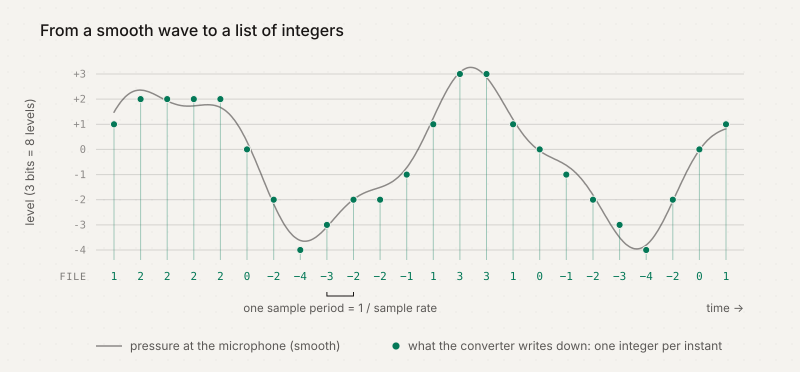
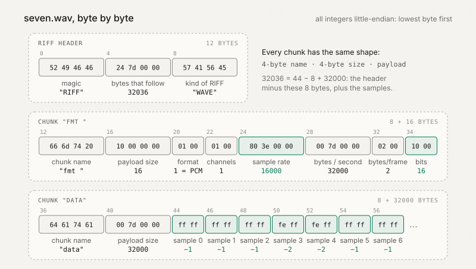
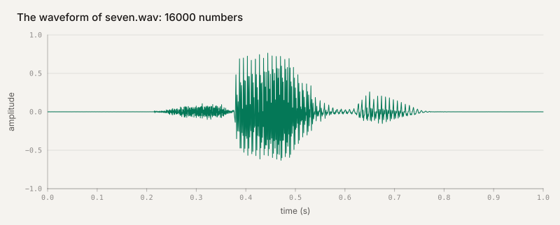
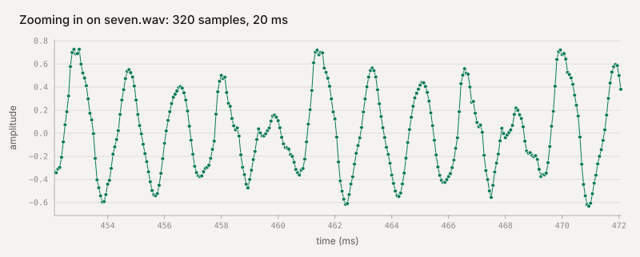

## Sound Is Just Numbers

Here is the plan for this whole book: by the end of it we will hand a WAV file to a program we wrote ourselves and get text back. There will be no machine-learning framework underneath and no signal-processing crate. If we need a Fourier transform, a matrix multiply or a neural network layer, we write it, in Rust, and we understand every line. We start with small things (reading a sound file, today), then build a recognizer that needs no learning at all, then train a small neural network of our own, and at the very end we run OpenAI's Whisper weights through an inference engine we wrote.

I did not know how any of this worked before starting, so we are learning it together. And the first thing to learn is what a recognizer actually receives. It does not receive "speech". It receives a file, and the file is full of numbers. So today's question is: what are those numbers, where do they come from, and how do we get them out of the file and into a `Vec<f32>`?

### Setting Up The Project

Let's get the boring part out of the way so we can follow along from an empty directory. We want one library crate called `speech`, living in a directory called `code`, with a `samples` directory next to it for audio clips.

```
mkdir speech-rust && cd speech-rust
cargo new --lib code --name speech
mkdir code/examples samples
```

Copy [`samples/seven.wav`](../samples/seven.wav) from the book's repository into `samples/`. It is one second of someone saying "seven", and it is the running example for the whole book. (The other clips in that directory are worth grabbing too; [`samples/README.md`](../samples/README.md) says where they come from.)

Why a library and not a binary? Because every chapter adds a module to the same crate (`wav` today, an FFT in chapter 3, a neural network in chapter 6) and also has a small program that shows the new module doing something. Cargo has a ready-made place for those: any file in `examples/` is its own little `main` that can use the library, and we run it with `cargo run --example name`. Today's is `examples/ch01_wav.rs`.

Now open `Cargo.toml` and make it look like this:

```toml
# Cargo.toml
[package]
name = "speech"
version = "0.1.0"
edition = "2021"
description = "A speech recognizer built from scratch: no ML frameworks, no DSP crates, only std."
license = "MIT"

# This section is empty on purpose, and it stays empty for the whole book.
[dependencies]

[profile.release]
opt-level = 3
codegen-units = 1

# Numeric tests (FFT, gradient checks) are painfully slow without optimization.
[profile.dev]
opt-level = 1

[profile.test]
opt-level = 2
```

Look at `[dependencies]`. There is nothing under it, and there never will be: when our program turns sound into text in the last chapters, every instruction between the file and the answer will be one we wrote or one that ships with Rust's standard library. The `[profile]` sections only turn the optimizer on, because from chapter 3 onward we do a lot of arithmetic in loops.

The crate root, `src/lib.rs`, is the table of contents of the book:

```rust
// src/lib.rs
//! A speech recognizer built from scratch, one chapter at a time.
//!
//! Every module here is written in the book. There are no dependencies:
//! if we need an FFT, a matrix multiply or a random number, we write it.

pub mod mat; // a tiny matrix type                       (chapter 6)
pub mod rng; // a tiny random number generator           (chapter 6)

pub mod wav; // reading and writing WAV files            (chapter 1)
pub mod dsp; // framing, windows, FFT, mel, MFCC         (chapters 2-4)
pub mod plot; // SVG and terminal plots for the book's figures

pub mod dtw; // dynamic time warping                     (chapter 5)
pub mod nn; // layers, backprop, optimizers              (chapters 6-7)
pub mod ctc; // connectionist temporal classification    (chapter 8)
pub mod decode; // greedy and beam search decoding       (chapter 10)
pub mod metrics; // edit distance, WER, CER              (chapter 10)

pub mod data; // dataset loaders                         (chapters 5, 7, 9)
pub mod mic; // live audio capture                       (chapter 11)
pub mod whisper; // running a pretrained model ourselves (chapter 12)
```

That is the finished file. If you are typing along, yours has one line today, `pub mod wav;`, and gains a line per chapter.

**Aside** <br>
There is one module we use but never walk through: `plot`, a small helper that draws the book's figures as SVG files and draws waveforms in the terminal. Today's example calls it, so if you are building from an empty directory, copy [`src/plot.rs`](../code/src/plot.rs) from the repository and add `pub mod plot;`. It leans on the matrix type from chapter 6 to draw heatmaps, so copy [`src/mat.rs`](../code/src/mat.rs) and add `pub mod mat;` too.

### What Is Sound, Physically?

When someone says "seven", their vocal cords, tongue and lips push the air around. Air that is pushed gets slightly squashed, the squashed air pushes on the air next to it, and a ripple of *slightly higher, then slightly lower pressure* travels across the room. That ripple is sound. There is nothing else to it: at any one point in the room, sound is **air pressure changing over time**, wobbling a tiny amount above and below its resting value.

A microphone sits at one point in the room and has a thin membrane that the pressure pushes back and forth. The microphone turns the position of the membrane into a voltage. So out of the microphone comes a wire, and on the wire is a voltage that goes up when the pressure goes up and down when it goes down. Same wobble, different units.

A voltage is a smooth thing. Between any two moments there are infinitely many other moments, and at each one the voltage has some value with endless decimal places. A computer can store neither. So the last piece of hardware, the *analog-to-digital converter*, makes two compromises:

1. It only looks at the voltage at regular instants, for example 16,000 times every second. Each look is called a **sample**, and the number of looks per second is the **sample rate**. Rates are measured in hertz (Hz), which just means "per second": 16,000 Hz, or 16 kHz.
2. It rounds every measurement to an integer. How many different integers it may choose from is set by the **bit depth**: with 16 bits there are 2^16 = 65,536 levels, from -32,768 to 32,767. This rounding is called **quantization**.



*Sampling decides when we look; quantization decides how finely we measure. What goes in the file is the row of integers at the bottom.*

The figure uses 3 bits (8 levels) so that the rounding is visible; with 16 bits the steps are 8,192 times finer. The consequence is the same either way: once the converter is done, there is no wave anymore. There is a list of integers, plus one extra fact needed to make sense of it (how many of them per second). That is all a recognizer ever sees.

### How Many Samples Per Second?

Why 16,000? Why not 100, or a million?

Think about what happens between two samples: we are not looking. A slow wobble does not care, because it barely moves between two looks. A fast wobble can go up and come back down entirely between two looks, and we would never know. To catch a wobble that repeats `f` times per second we need at least one look on its way up and one on its way down, every cycle, so we need **more than `2 × f` samples per second**. Turn it around: a sample rate of `R` can faithfully capture frequencies below `R / 2`, and that limit is called the **Nyquist frequency**. This is a theorem (Shannon's sampling theorem, see the references), and the surprising part of it is the positive half: below the limit we lose *nothing*. The samples pin down the smooth wave exactly.

Now the numbers fall out. The parts of speech that tell words apart live below about 8,000 Hz (telephones got by for a century with less than 4,000), so 16,000 samples per second is enough for a recognizer, and it is the rate of our clip, of the dataset we train on later, and of Whisper. Human hearing reaches up to roughly 20,000 Hz, so music wants more than 40,000 samples per second, and the CD settled on 44,100.

What happens to a wobble *above* the limit? It does not vanish, which would be the polite thing to do. It shows up in the samples disguised as a lower frequency: a 10,000 Hz tone sampled at 16,000 Hz produces exactly the same list of numbers as a 6,000 Hz tone would. This is called **aliasing**, and once it has happened no program can undo it, because the two lists are identical. Real converters prevent it by filtering out everything above the Nyquist frequency *before* sampling.

This is much easier to believe when you see the dots land on the wrong wave and hear the wrong note come out:

> **Play with it:** [sampling and aliasing](../interactive/sampling.html). Push the tone frequency past half the sample rate and watch the sampled curve turn into a different, lower tone. Then drop the bit depth to 3 or 4 and listen to what quantization sounds like.

### A Real File, Byte By Byte

Enough theory. We have a file, so let's look at what is actually in it. Not with an audio tool: with a hex dump.

```
$ xxd -l 64 ../samples/seven.wav
00000000: 5249 4646 247d 0000 5741 5645 666d 7420  RIFF$}..WAVEfmt 
00000010: 1000 0000 0100 0100 803e 0000 007d 0000  .........>...}..
00000020: 0200 1000 6461 7461 007d 0000 ffff ffff  ....data.}......
00000030: ffff feff feff ffff ffff ffff ffff ffff  ................
```

(`hexdump -C -n 64` shows the same thing.) The right-hand column gives the game away: `RIFF`, `WAVE`, `fmt `, `data`. A WAV file is a **RIFF** container (Resource Interchange File Format, a Microsoft and IBM design from 1991), and a RIFF file has a very simple shape. It starts with a 12-byte header, and after that it is a list of **chunks**. Every chunk looks the same:

```text
4 bytes   the chunk's name, as ASCII letters        e.g. "fmt "
4 bytes   the size of the payload, as an integer    e.g. 16
n bytes   the payload
(1 byte   of padding, if n is odd, so the next chunk starts at an even offset)
```

A program that does not know a chunk's name can read its size and jump over it. That is the whole trick of the format: people have been adding new chunk types for decades without breaking old readers.

Here are the first 44 bytes of our file, field by field.

| Offset | Bytes | Read as | Meaning |
|---|---|---|---|
| 0 | `52 49 46 46` | `"RIFF"` | this is a RIFF file |
| 4 | `24 7d 00 00` | 32,036 | how many bytes follow this field (file size minus 8) |
| 8 | `57 41 56 45` | `"WAVE"` | the kind of RIFF file: audio |
| 12 | `66 6d 74 20` | `"fmt "` | chunk name (with a trailing space to make four letters) |
| 16 | `10 00 00 00` | 16 | this chunk's payload is 16 bytes |
| 20 | `01 00` | 1 | format tag: 1 means plain integers |
| 22 | `01 00` | 1 | channels: 1 is mono, 2 is stereo |
| 24 | `80 3e 00 00` | 16,000 | sample rate |
| 28 | `00 7d 00 00` | 32,000 | bytes of audio per second (16,000 × 2) |
| 32 | `02 00` | 2 | bytes for one sample of every channel |
| 34 | `10 00` | 16 | bits per sample |
| 36 | `64 61 74 61` | `"data"` | chunk name |
| 40 | `00 7d 00 00` | 32,000 | this chunk's payload is 32,000 bytes |
| 44 | `ff ff` | -1 | the first sample |
| 46 | `ff ff` | -1 | the second sample |
| 48 | `ff ff` | -1 | the third |
| 50 | `fe ff` | -2 | the fourth, and so on for 16,000 samples |



*The same bytes as a picture. Two chunks, each with a name, a size and a payload.*

Everything checks out against everything else. The `data` chunk holds 32,000 bytes; at 2 bytes per sample that is 16,000 samples; at 16,000 samples per second that is exactly one second. And 44 bytes of headers plus 32,000 bytes of samples is 32,044 bytes, which is what `ls -l` says the file weighs.

If you have been paying attention, you'll notice that the numbers look backwards. The sample rate 16,000 is `0x3E80` in hexadecimal, but the file says `80 3e 00 00`. That is **little-endian** byte order: the least significant byte comes first. Every integer in a WAV file is stored this way. It is also why the first sample, `ff ff`, is -1 and its neighbor `fe ff` is -2: read low byte first you get `0xFFFF` and `0xFFFE`, and as signed 16-bit integers those are -1 and -2.

The format tag 1 has a grand name, **PCM** (pulse code modulation), which means nothing more than what the converter did earlier: the samples are stored as plain integers, one after another, uncompressed. And those four samples, -1, -1, -1, -2 out of a possible ±32,768? That is the microphone listening to a quiet room before the speaker starts. Sound really is just numbers, and silence is small ones.

**Aside** <br>
Why would anyone store numbers backwards? Because that is how the Intel processors of 1991 kept integers in memory, so a PC could copy the bytes straight from disk into a variable. Network protocols went the other way: if you read the TCP book, you will remember converting from big-endian "network order". Rust makes neither choice for us, which is good: `u32::from_le_bytes` says exactly what we mean, and it works the same on every machine.

### A First Reader

Enough of the talk, let's write some code! The hex dump told us where everything is in *this* file, so the most direct reader possible goes straight to those offsets.

We need a type to return. A recognizer wants two things: the samples and the sample rate. And it would rather not have integers: all the arithmetic in the coming chapters is floating point, and a 16-bit file and a 24-bit file of the same sound should give the same numbers. So we scale: divide each 16-bit integer by 32,768 and every sample lands between -1.0 and 1.0, whatever the bit depth was.

```rust
// src/wav.rs (first version: reads exactly one kind of file)
use std::fs;
use std::io;
use std::path::Path;

/// A mono recording: a sample rate and the samples themselves.
#[derive(Clone, Debug, PartialEq)]
pub struct Wav {
    /// Samples per second, e.g. 16000.
    pub sample_rate: u32,
    /// Air pressure over time, one number per sample, in `[-1.0, 1.0]`.
    pub samples: Vec<f32>,
}

impl Wav {
    pub fn read(path: impl AsRef<Path>) -> io::Result<Wav> {
        let bytes = fs::read(path)?;

        // We saw in the hex dump where everything is, so we just go there.
        let sample_rate = read_u32(&bytes, 24);

        // The samples start at byte 44 and run to the end of the file,
        // two bytes each, low byte first.
        let mut samples = Vec::new();
        for pair in bytes[44..].chunks_exact(2) {
            let integer = i16::from_le_bytes([pair[0], pair[1]]);
            samples.push(integer as f32 / 32768.0);
        }
        Ok(Wav { sample_rate, samples })
    }
}

fn read_u32(bytes: &[u8], at: usize) -> u32 {
    u32::from_le_bytes([bytes[at], bytes[at + 1], bytes[at + 2], bytes[at + 3]])
}
```

And a throwaway program to try it:

```rust
// examples/first.rs
use speech::wav::Wav;

fn main() -> std::io::Result<()> {
    let path = std::env::args().nth(1).unwrap_or("../samples/seven.wav".to_string());
    let wav = Wav::read(&path)?;
    println!("sample rate  {} Hz", wav.sample_rate);
    println!("samples      {}", wav.samples.len());
    println!("first eight  {:?}", &wav.samples[..8]);
    Ok(())
}
```

```
$ cargo run --release --example first
sample rate  16000 Hz
samples      16000
first eight  [-3.0517578e-5, -3.0517578e-5, -3.0517578e-5, -6.1035156e-5, -6.1035156e-5, -3.0517578e-5, -3.0517578e-5, -3.0517578e-5]
```

Not bad for twenty lines. 16,000 samples at 16,000 Hz, and the first values are -1/32768 = -0.0000305 and -2/32768 = -0.000061, exactly the `ff ff` and `fe ff` from the dump.

### Where The First Reader Breaks

The trouble is the phrase "exactly this file". Let's make another WAV the way much of the world's audio gets made, with `ffmpeg`, and ask for stereo at the CD rate while we are at it:

```
$ ffmpeg -i ../samples/seven.wav -ac 2 -ar 44100 seven_stereo.wav
$ cargo run --release --example first -- seven_stereo.wav
sample rate  44100 Hz
samples      88217
first eight  [0.6116028, 0.61932373, 0.6506653, 0.65838623, 0.00039672852, 0.0, 0.76013184, 0.8004761]
```

The sample rate is right, and everything else is wrong. One second of audio at 44,100 Hz should be 44,100 samples, not 88,217, and a recording that begins in a quiet room should not begin at 0.61. The hex dump shows what happened:

```
$ xxd -l 96 seven_stereo.wav
00000000: 5249 4646 56b1 0200 5741 5645 666d 7420  RIFFV...WAVEfmt 
00000010: 1000 0000 0100 0200 44ac 0000 10b1 0200  ........D.......
00000020: 0400 1000 4c49 5354 1a00 0000 494e 464f  ....LIST....INFO
00000030: 4953 4654 0d00 0000 4c61 7666 3633 2e31  ISFT....Lavf63.1
00000040: 2e31 3032 0000 6461 7461 10b1 0200 ffff  .102..data......
00000050: ffff ffff ffff ffff ffff ffff ffff ffff  ................
```

There is a chunk called `LIST` sitting between `fmt ` and `data`: 26 bytes (`1a 00 00 00`) of metadata in which ffmpeg signs its work. Our reader assumed samples start at byte 44, so it turned the letters `IN`, `FO`, `IS`, `FT` into four loud samples. And even if it had found the real `data` chunk, the channel count at offset 22 is now 2: the samples alternate left, right, left, right, and we would have returned them as one double-length recording.

So here is the list of things real files do that our first reader ignores:

- **Extra chunks.** `LIST`, `fact`, `cue `, `bext` and others can appear anywhere after the header. We must walk the chunk list and not assume offsets.
- **Other bit depths.** 8, 24 and 32-bit integers are all in use.
- **Floating point samples.** Format tag 3 means the samples are already `f32` (or `f64`). Audio editors love this.
- **More than one channel.** A recognizer wants one. We will average the channels into one ("downmix to mono").
- **Sizes that lie.** A program that writes a WAV to a pipe does not know the length in advance, and a recording can be cut off mid-write.
- **Things that are not WAV files at all**, where we owe the user an error that says so.

The lying sizes are worth seeing. Here is ffmpeg writing a WAV to a pipe; look at offset 4 and at the size after `data`:

```
$ ffmpeg -i ../samples/seven.wav -f wav - | xxd -l 80
00000000: 5249 4646 ffff ffff 5741 5645 666d 7420  RIFF....WAVEfmt 
00000010: 1000 0000 0100 0100 803e 0000 007d 0000  .........>...}..
00000020: 0200 1000 4c49 5354 1a00 0000 494e 464f  ....LIST....INFO
00000030: 4953 4654 0d00 0000 4c61 7666 3633 2e31  ISFT....Lavf63.1
00000040: 2e31 3032 0000 6461 7461 ffff ffff ffff  .102..data......
```

Both sizes say `ff ff ff ff`, four gigabytes, for 32 kilobytes of audio. Audio arrives through pipes all the time (in chapter 11 our microphone will be an ffmpeg process on the other end of one), so a reader that trusts the sizes is not much of a reader.

Let's rewrite the reader to handle all of it.

### The Real Reader

We keep the `Wav` struct exactly as it is: whatever the file holds, we hand back mono `f32` samples in `[-1.0, 1.0]` and a sample rate, and the rest of the book never has to think about file formats again. First, names for the format tags, and a small type that remembers how the file stored its samples before we converted them (only today's example program prints it):

```rust
// src/wav.rs
use std::fs;
use std::io;
use std::path::Path;

/// Format tag for plain integer samples ("pulse code modulation").
const WAVE_FORMAT_PCM: u16 = 1;
/// Format tag for IEEE floating point samples.
const WAVE_FORMAT_IEEE_FLOAT: u16 = 3;
/// Format tag that means "the real tag is further down, in the extension".
const WAVE_FORMAT_EXTENSIBLE: u16 = 0xFFFE;
/// The last 14 bytes of an extensible "sub-format" id that stands for an
/// ordinary format tag. The tag itself is the two bytes in front of them.
const SUBFORMAT_TAIL: [u8; 14] = [0x00, 0x00, 0x00, 0x00, 0x10, 0x00, 0x80, 0x00, 0x00, 0xAA, 0x00, 0x38, 0x9B, 0x71];

/// How the samples were stored in the file, before we converted them.
/// `Wav` itself is always mono `f32`; this is only for the curious
/// (chapter 1 prints it).
#[derive(Clone, Copy, Debug, PartialEq, Eq)]
pub struct WavFormat {
    /// How each number is encoded.
    pub encoding: Encoding,
    /// Number of interleaved channels (1 = mono, 2 = stereo).
    pub channels: u16,
    /// Samples per second, per channel.
    pub sample_rate: u32,
    /// Bits used to store one sample of one channel.
    pub bits_per_sample: u16,
}

/// The two families of sample encodings we understand.
#[derive(Clone, Copy, Debug, PartialEq, Eq)]
pub enum Encoding {
    /// Integers. 8-bit is unsigned, everything wider is signed.
    Pcm,
    /// IEEE floating point (32 or 64 bit).
    Float,
}
```

Three tiny helpers that everything else leans on: two little-endian readers, and a shortcut for "this file is malformed" errors. We use `io::Error` with `InvalidData` so that callers have a single error type for "could not open it" and "opened it, but it is nonsense".

```rust
// src/wav.rs
fn read_u16(bytes: &[u8], at: usize) -> u16 {
    u16::from_le_bytes([bytes[at], bytes[at + 1]])
}

fn read_u32(bytes: &[u8], at: usize) -> u32 {
    u32::from_le_bytes([bytes[at], bytes[at + 1], bytes[at + 2], bytes[at + 3]])
}

fn bad(message: impl Into<String>) -> io::Error {
    io::Error::new(io::ErrorKind::InvalidData, message.into())
}
```

Now the heart of it: walking the chunk list. We work on a byte slice that is already in memory, not on a file, because that makes the function trivial to test (a test can build a "file" in a `Vec<u8>`) and because a one-second clip is 32 kilobytes. The loop keeps a position, reads a name and a size, looks at the payload if the name is one we know, and jumps to the next chunk.

```rust
// src/wav.rs
impl Wav {
    /// Like [`Wav::from_bytes`], but also reports how the file stored its samples.
    pub fn from_bytes_with_format(bytes: &[u8]) -> io::Result<(Wav, WavFormat)> {
        if bytes.len() < 12 || &bytes[0..4] != b"RIFF" {
            return Err(bad("not a WAV file: it does not start with \"RIFF\""));
        }
        if &bytes[8..12] != b"WAVE" {
            return Err(bad("a RIFF file, but not a WAVE one (it may be an AVI or WebP)"));
        }
        // Bytes 4..8 hold the size of the rest of the file. We ignore it:
        // programs that stream audio to a pipe do not know it in advance and
        // write 0 or 0xFFFFFFFF, and the real length of `bytes` is what counts.

        let mut format: Option<WavFormat> = None;
        let mut pos = 12;
        // Walk the chunk list. Each iteration looks at one 8-byte chunk header.
        // `pos` never passes the end of `bytes`, so the subtraction is safe,
        // and no sum below can exceed `bytes.len() + 1`.
        while bytes.len() - pos >= 8 {
            let id = &bytes[pos..pos + 4];
            let declared_size = read_u32(bytes, pos + 4);
            let body_start = pos + 8;
            // A chunk can claim more bytes than the file has (a recording that
            // was cut short, or a streamed file with a placeholder size).
            // Take what is really there. The size from the file is only ever
            // compared, never added to anything, so a hostile value has
            // nothing to overflow. (The comparison is done in `u64`, which
            // holds both numbers whatever the width of `usize`.)
            let available = bytes.len() - body_start;
            let body_len = (declared_size as u64).min(available as u64) as usize;
            let body = &bytes[body_start..body_start + body_len];

            match id {
                b"fmt " => format = Some(parse_format(body)?),
                b"data" => {
                    let format = format.ok_or_else(|| bad("the \"data\" chunk came before the \"fmt \" chunk"))?;
                    let samples = decode_samples(body, &format);
                    return Ok((Wav { sample_rate: format.sample_rate, samples }, format));
                }
                _ => {} // "LIST", "fact", "cue ", "bext"...: not our business.
            }

            // Chunks are aligned to even offsets: an odd-sized chunk is
            // followed by one padding byte that its size does not count.
            // The padding byte may be missing at the very end of a file,
            // hence the `min`.
            let padding = (declared_size & 1) as usize;
            pos = (body_start + body_len + padding).min(bytes.len());
        }

        Err(bad(if format.is_some() {
            "no \"data\" chunk: the file has a header but no samples"
        } else {
            "no \"fmt \" chunk found"
        }))
    }
}
```

Most of our list of problems is solved right here. Unknown chunks fall into the `_ => {}` arm and are stepped over. Lying sizes are handled by two decisions: we never read the size at offset 4 at all, and we clamp every payload to the bytes that really exist (the `.min(available as u64)`). The clamp is written with some care. The obvious `body_start + declared_size` is an overflow waiting to happen: on a 32-bit machine (and WebAssembly in a browser is one) `usize` tops out just under four gigabytes, which is exactly the size ffmpeg's placeholder claims. So the size from the file is never added to a position. We work out how many bytes are left (`available`), take the smaller of that and the declared size, and from then on every number in the loop is a length we have checked against the real file. `pos` can never pass the end of `bytes`, which is why the loop condition is the subtraction `bytes.len() - pos >= 8` and not `pos + 8 <= bytes.len()`. The padding rule is the `declared_size & 1`, which is 1 for odd sizes and 0 for even ones. You can see padding in ffmpeg's dump above, one level down: the text `Lavf63.1.102` plus its terminating zero is 13 bytes (`0d 00 00 00`), so one more zero byte follows before `data` begins.

The `fmt ` payload is the 16 bytes we annotated by hand earlier, so parsing it is a matter of reading four fields at the offsets from our table (minus 20, because offsets now count from the start of the payload). Most of this function is saying no politely.

```rust
// src/wav.rs
/// Parse the body of a `fmt ` chunk.
fn parse_format(body: &[u8]) -> io::Result<WavFormat> {
    if body.len() < 16 {
        return Err(bad(format!("the \"fmt \" chunk is {} bytes long, it needs at least 16", body.len())));
    }
    let mut tag = read_u16(body, 0);
    let channels = read_u16(body, 2);
    let sample_rate = read_u32(body, 4);
    // bytes 8..12: average bytes per second, bytes 12..14: block align.
    // Both can be derived from the other fields, so we do not read them.
    let bits_per_sample = read_u16(body, 14);

    // WAVE_FORMAT_EXTENSIBLE is used for more than two channels or more than
    // 16 bits. The fields above keep their meaning, and 24 more bytes follow:
    // the size of the extension (at least 22), the number of bits that carry
    // signal, a speaker layout, and a 16-byte "sub-format" id that says how
    // the samples are really encoded. For the encodings that have an ordinary
    // format tag, that id is the tag followed by 14 fixed bytes. Any other
    // id is some vendor's own format, and we cannot read it.
    if tag == WAVE_FORMAT_EXTENSIBLE {
        if body.len() < 40 || read_u16(body, 16) < 22 {
            return Err(bad("WAVE_FORMAT_EXTENSIBLE header is cut short"));
        }
        if body[26..40] != SUBFORMAT_TAIL {
            return Err(bad("unsupported WAVE_FORMAT_EXTENSIBLE sub-format (we read PCM and float)"));
        }
        tag = read_u16(body, 24);
    }

    let encoding = match tag {
        WAVE_FORMAT_PCM => Encoding::Pcm,
        WAVE_FORMAT_IEEE_FLOAT => Encoding::Float,
        6 => return Err(bad("A-law compressed audio is not supported, convert the file to PCM first")),
        7 => return Err(bad("mu-law compressed audio is not supported, convert the file to PCM first")),
        other => return Err(bad(format!("unsupported WAV format tag {other} (we read PCM = 1 and float = 3)"))),
    };
    if channels == 0 {
        return Err(bad("the header says the file has 0 channels"));
    }
    if sample_rate == 0 {
        return Err(bad("the header says the sample rate is 0"));
    }
    match (encoding, bits_per_sample) {
        (Encoding::Pcm, 8 | 16 | 24 | 32) | (Encoding::Float, 32 | 64) => {}
        (Encoding::Pcm, bits) => return Err(bad(format!("unsupported PCM bit depth {bits} (we read 8, 16, 24 and 32)"))),
        (Encoding::Float, bits) => return Err(bad(format!("unsupported float bit depth {bits} (we read 32 and 64)"))),
    }
    Ok(WavFormat { encoding, channels, sample_rate, bits_per_sample })
}
```

The `WAVE_FORMAT_EXTENSIBLE` branch draws a line between two kinds of extra information. The speaker layout and the count of valid bits describe the same samples in more detail, and we skip them. The sub-format id decides what the bytes *are*, so we check all 16 bytes of it: an id we do not know is a format we cannot decode, even if its first two bytes happen to say 1.

The zero checks matter: in a moment we divide by the channel count, and later chapters divide by the sample rate. A corrupt header should produce an error message here, not a `NaN` three modules away. The final `match` is also a promise to the next function: once a `WavFormat` exists, its bit depth is one we can decode.

Now the samples. In a multi-channel file they are interleaved: one sample for the left channel, one for the right, then the next pair. WAV calls one such group a *sample frame*. (Careful: chapter 2 uses the word "frame" for something else entirely, a short slice of time. Here it only means "one sample for every channel".) We cut the payload into sample frames, cut each sample frame into channels, and average.

```rust
// src/wav.rs
/// Turn the raw bytes of a `data` chunk into mono `f32` samples.
fn decode_samples(data: &[u8], format: &WavFormat) -> Vec<f32> {
    let bytes_per_sample = (format.bits_per_sample / 8) as usize;
    let channels = format.channels as usize;
    // One "sample frame" is one sample for every channel, stored side by side.
    let bytes_per_frame = bytes_per_sample * channels;

    // `chunks_exact` quietly drops a trailing partial frame, which is exactly
    // what we want for a file that was cut off mid-sample.
    let mut samples = Vec::with_capacity(data.len() / bytes_per_frame);
    for frame in data.chunks_exact(bytes_per_frame) {
        // Downmix to mono: the average of the channels.
        let mut sum = 0.0f32;
        for channel in frame.chunks_exact(bytes_per_sample) {
            sum += decode_one(channel, format.encoding);
        }
        samples.push(sum / channels as f32);
    }
    samples
}
```

And finally one sample, 1 to 8 bytes of it, to a number in `[-1.0, 1.0]`. The rule for integers is the one from our first reader: divide by the size of the negative half of the range, which for `n` bits is 2^(n-1). For 16 bits that is 32,768.

```rust
// src/wav.rs
/// Decode one little-endian sample of 1, 2, 3, 4 or 8 bytes to `[-1, 1]`.
fn decode_one(b: &[u8], encoding: Encoding) -> f32 {
    match (encoding, b.len()) {
        // 8-bit WAV is the odd one out: unsigned, with silence at 128.
        (Encoding::Pcm, 1) => (b[0] as f32 - 128.0) / 128.0,
        (Encoding::Pcm, 2) => i16::from_le_bytes([b[0], b[1]]) as f32 / 32768.0,
        // There is no i24, so we put the three bytes in the *top* of an i32
        // (which gets the sign right) and divide by 2^31 instead of 2^23.
        (Encoding::Pcm, 3) => i32::from_le_bytes([0, b[0], b[1], b[2]]) as f32 / 2_147_483_648.0,
        (Encoding::Pcm, 4) => i32::from_le_bytes([b[0], b[1], b[2], b[3]]) as f32 / 2_147_483_648.0,
        (Encoding::Float, 4) => sanitize(f32::from_le_bytes([b[0], b[1], b[2], b[3]])),
        (Encoding::Float, 8) => sanitize(f64::from_le_bytes([b[0], b[1], b[2], b[3], b[4], b[5], b[6], b[7]]) as f32),
        _ => unreachable!("parse_format only lets supported sizes through"),
    }
}
```

The two float lines pass through one more function. An integer divided by the size of its range cannot leave `[-1.0, 1.0]`, but a float file can hold anything its writer put there: peaks above full scale, infinities, `NaN`. We promised the rest of the book samples between -1 and 1, so we enforce it at the door:

```rust
// src/wav.rs
/// Make a float sample keep the promise the integer formats keep for free.
///
/// Integer PCM cannot leave `[-1, 1]`, but a float file can hold anything:
/// peaks above full scale, infinities, NaN. One NaN would poison every sum
/// it later takes part in (an energy, an FFT, a whole feature matrix), so it
/// becomes silence here, and everything else is clamped into range.
fn sanitize(sample: f32) -> f32 {
    if sample.is_nan() {
        0.0
    } else {
        sample.clamp(-1.0, 1.0)
    }
}
```

The `NaN` check has to come first: `clamp` hands a `NaN` straight back, because every comparison with `NaN` is false.

**Aside** <br>
The 24-bit line deserves a second look, because the obvious version is wrong. If we put the three bytes in the *bottom* of an `i32` (`[b[0], b[1], b[2], 0]`), a negative sample such as `ff ff ff` (-1) becomes `0x00FFFFFF`, which is +16,777,215: the sign bit of a 24-bit number is not where an `i32` looks for its sign. Putting the bytes at the top instead multiplies the value by 256 and lands the sign bit in the right place, and we compensate by dividing by 2^31 where we would have divided by 2^23. One line, no branches.

Notice that because 16-bit integers run from -32,768 to +32,767, dividing by 32,768 gives a range of -1.0 to +0.99997: nothing maps to exactly +1.0. That lopsidedness is harmless, and it will come back when we write files.

What is left of `impl Wav` is wrappers: read from a path (adding the file name to any error, so that "not a WAV file" tells you *which* file), and versions that drop the `WavFormat`, for every caller after this chapter.

```rust
// src/wav.rs
impl Wav {
    /// Wrap samples we already have in memory.
    pub fn new(sample_rate: u32, samples: Vec<f32>) -> Self {
        Wav { sample_rate, samples }
    }

    /// Read and decode a WAV file.
    pub fn read(path: impl AsRef<Path>) -> io::Result<Wav> {
        Self::read_with_format(path).map(|(wav, _)| wav)
    }

    /// Like [`Wav::read`], but also reports how the file stored its samples.
    pub fn read_with_format(path: impl AsRef<Path>) -> io::Result<(Wav, WavFormat)> {
        let path = path.as_ref();
        let bytes = fs::read(path).map_err(|e| io::Error::new(e.kind(), format!("{}: {e}", path.display())))?;
        Self::from_bytes_with_format(&bytes).map_err(|e| io::Error::new(e.kind(), format!("{}: {e}", path.display())))
    }

    /// Decode a WAV file that is already in memory.
    pub fn from_bytes(bytes: &[u8]) -> io::Result<Wav> {
        Self::from_bytes_with_format(bytes).map(|(wav, _)| wav)
    }

    // from_bytes_with_format: shown above.

    /// Length of the recording in seconds.
    pub fn duration_secs(&self) -> f32 {
        self.samples.len() as f32 / self.sample_rate as f32
    }
}
```

### How Do We Know It Works?

We claimed to handle stereo, padding and truncated files, but our sample clip exercises none of that. So we test with files we build by hand, byte by byte. The helper below writes a header, any extra chunks we ask for (with their padding), and a `data` chunk. It does not use the WAV writer we are about to add: a writer of ours should not be the judge of a reader of ours.

```rust
// src/wav.rs
#[cfg(test)]
mod tests {
    use super::*;

    /// Build a WAV file byte by byte, so the tests do not depend on `to_bytes`.
    fn build(tag: u16, channels: u16, rate: u32, bits: u16, extra_chunks: &[(&[u8; 4], &[u8])], data: &[u8]) -> Vec<u8> {
        let mut f = Vec::new();
        f.extend_from_slice(b"RIFF\0\0\0\0WAVE");
        f.extend_from_slice(b"fmt ");
        f.extend_from_slice(&16u32.to_le_bytes());
        f.extend_from_slice(&tag.to_le_bytes());
        f.extend_from_slice(&channels.to_le_bytes());
        f.extend_from_slice(&rate.to_le_bytes());
        let block = channels * bits / 8;
        f.extend_from_slice(&(rate * block as u32).to_le_bytes());
        f.extend_from_slice(&block.to_le_bytes());
        f.extend_from_slice(&bits.to_le_bytes());
        for (id, body) in extra_chunks {
            f.extend_from_slice(*id);
            f.extend_from_slice(&(body.len() as u32).to_le_bytes());
            f.extend_from_slice(body);
            if body.len() % 2 == 1 {
                f.push(0);
            }
        }
        f.extend_from_slice(b"data");
        f.extend_from_slice(&(data.len() as u32).to_le_bytes());
        f.extend_from_slice(data);
        let riff_size = (f.len() - 8) as u32;
        f[4..8].copy_from_slice(&riff_size.to_le_bytes());
        f
    }
```

The first test pins down the scaling with four values chosen so that the answers are exact in floating point: zero, half scale, the most negative integer and the most positive one.

```rust
    #[test]
    fn pcm16_values_are_scaled_by_32768() {
        // 0, +16384 (half scale), -32768 (most negative), +32767.
        let data = [0x00, 0x00, 0x00, 0x40, 0x00, 0x80, 0xFF, 0x7F];
        let wav = Wav::from_bytes(&build(1, 1, 8000, 16, &[], &data)).unwrap();
        assert_eq!(wav.sample_rate, 8000);
        assert_eq!(wav.samples, vec![0.0, 0.5, -1.0, 32767.0 / 32768.0]);
    }
```

Stereo. The first sample frame is worth reading closely: left is +0.5, right is -0.5, and the mono result is 0. That is the known weakness of averaging: channels that are mirror images of each other cancel. Recordings of one person talking do not do this, so we live with it.

```rust
    #[test]
    fn stereo_is_averaged_to_mono() {
        // Two frames: (L=+0.5, R=-0.5) -> 0, (L=+0.5, R=+0.25) -> 0.375.
        let mut data = Vec::new();
        for v in [16384i16, -16384, 16384, 8192] {
            data.extend_from_slice(&v.to_le_bytes());
        }
        let (wav, format) = Wav::from_bytes_with_format(&build(1, 2, 8000, 16, &[], &data)).unwrap();
        assert_eq!(format.channels, 2);
        assert_eq!(wav.samples, vec![0.0, 0.375]);
    }
```

Extra chunks, one of them 5 bytes long so that the padding rule matters. If we forgot the `declared_size & 1`, the walker would land one byte early, read garbage as the next chunk name and never find `data`.

```rust
    #[test]
    fn unknown_and_odd_sized_chunks_are_skipped() {
        // A 5-byte LIST chunk needs one padding byte before the next chunk.
        let extra: [(&[u8; 4], &[u8]); 2] = [(b"LIST", b"hello"), (b"fact", &[1, 2, 3, 4])];
        let wav = Wav::from_bytes(&build(1, 1, 8000, 16, &extra, &[0x00, 0x40])).unwrap();
        assert_eq!(wav.samples, vec![0.5]);
    }
```

And the file that lies: we overwrite the `data` size with `0xFFFFFFFF`, as ffmpeg did above, and then chop the last byte off so the file ends halfway through its third sample. We want the two whole samples back and no panic.

```rust
    #[test]
    fn truncated_data_chunk_yields_the_samples_that_are_there() {
        let mut file = build(1, 1, 8000, 16, &[], &[0x00, 0x40, 0x00, 0xC0, 0x00, 0x40]);
        // Lie about the size (as a streaming encoder would) and cut the file
        // in the middle of the third sample.
        let size_at = file.len() - 6 - 4;
        file[size_at..size_at + 4].copy_from_slice(&0xFFFF_FFFFu32.to_le_bytes());
        file.truncate(file.len() - 1);
        let wav = Wav::from_bytes(&file).unwrap();
        assert_eq!(wav.samples, vec![0.5, -0.5]);
    }
```

The repository has more in the same style: 8-bit (unsigned, silence at 128), 24 and 32-bit sign handling, float samples (ordinary ones, and a file full of `NaN`, infinities and out-of-range values that must come back as 0 and ±1), a chunk that claims `0xFFFFFFFF` bytes and must produce an error and no overflow, a file whose size fields are overwritten with hostile values and that is then cut off at every possible length (the reader may refuse it, but it may never panic), hand-written `WAVE_FORMAT_EXTENSIBLE` headers (good ones, truncated ones and one with a vendor's sub-format id), and a test that every error message names the actual problem (an MP3 renamed to `.wav` should hear about `RIFF`, not about an index out of bounds).

```
$ cargo test wav::
running 13 tests
test wav::tests::a_huge_chunk_size_does_not_overflow ... ok
test wav::tests::errors_say_what_is_wrong ... ok
test wav::tests::float32_is_read_as_is ... ok
test wav::tests::float_samples_are_sanitized_on_read ... ok
...
test wav::tests::truncated_data_chunk_yields_the_samples_that_are_there ... ok
test wav::tests::unknown_and_odd_sized_chunks_are_skipped ... ok
test wav::tests::write_then_read_round_trips_within_one_pcm16_step ... ok

test result: ok. 13 passed; 0 failed; 0 ignored; 0 measured; 290 filtered out; finished in 0.00s
```

(The "290 filtered out" are the tests of the chapters to come. You will have fewer. Two of the thirteen test the writer, which we get to shortly.)

### Looking At "Seven"

Time for the chapter's real program. [`examples/ch01_wav.rs`](../code/examples/ch01_wav.rs) reads a clip with `Wav::read_with_format`, prints what the header said, a few statistics (smallest and largest sample, the mean) and a handful of actual samples, and draws the waveform in the terminal. Most of the file is `println!` and a hand-rolled command line, so we will not walk through it; copy it from the repository. One function in it is worth a look.

Printing the *first* ten samples would be dull, as we saw: -1, -1, -1, -2. So the program goes looking for the loudest 20 milliseconds instead. "Loud" here means the sum of the squared samples is large (chapter 2 has more to say about this quantity). A sliding window finds it in one pass: move one step right, add the square of the sample that entered, subtract the square of the one that left.

```rust
// examples/ch01_wav.rs
/// Start index of the `len` consecutive samples with the most energy.
fn loudest_stretch(samples: &[f32], len: usize) -> usize {
    let energy = |s: &[f32]| s.iter().map(|x| x * x).sum::<f32>();
    let mut current = energy(&samples[..len]);
    let (mut best, mut best_start) = (current, 0);
    // Slide the window one sample at a time: add the new one, drop the old one.
    for start in 1..=samples.len() - len {
        current += samples[start + len - 1].powi(2) - samples[start - 1].powi(2);
        if current > best {
            (best, best_start) = (current, start);
        }
    }
    best_start
}
```

Go ahead and run it. With no arguments it reads `../samples/seven.wav`:

```
$ cargo run --release --example ch01_wav
file         ../samples/seven.wav
stored as    16-bit integer PCM, 1 channel(s)
sample rate  16000 Hz
samples      16000
duration     1.000 s
min / max    -0.6312 / +0.7634
mean         -0.00014   (close to zero: air pressure wobbles around its resting value)

10 samples from the loudest part, starting at sample 7234:
  -0.3333 -0.3423 -0.3098 -0.2957 -0.2082 -0.0752 +0.0731 +0.1866 +0.3227 +0.5776
   -10921 -11218 -10150  -9689  -6821  -2464  +2395  +6115 +10575 +18927   (as 16-bit integers)

waveform (1.00 s across, +1 at the top, -1 at the bottom; scaled to the peak if quiet):


                           █████████
                           ██████████▄▄
                           ████████████▄▄    ▄█▄▄▄▄▄
▄▄▄▄▄▄▄▄▄▄▄▄▄▄▄▄▄▄▄███████▄██████████████▄▄▄▄████████▄▄▄▄▄▄▄▄▄▄▄▄▄▄▄▄▄▄▄
                           ████████████▀     ▀▀▀▀▀
                           █████████▀
                             ▀▀▀▀▀▀▀


wrote ../figures/ch01-waveform.svg
wrote ../figures/ch01-waveform-zoom.svg
```

The header facts match what we read off the hex dump by hand. The mean is almost exactly zero, as physics promised: pressure wobbles *around* its resting value, so the ups and downs cancel. And there is a shape! A low smear, then a tall block, then a smaller bump. If you say "seven" slowly you can feel all three: the hissing "s", the loud "e" where your voice switches on, and the "en" after the brief "v".

Do we believe the samples it printed? We can check against the raw bytes, with no code of ours in the way. Sample 7,234 lives at byte 44 + 2 × 7,234 = 14,512:

```
$ xxd -s 14512 -l 20 ../samples/seven.wav
000038b0: 57d5 2ed4 5ad8 27da 5be5 60f6 5b09 e317  W...Z.'.[.`.[...
000038c0: 4f29 ef49                                O).I
```

`57 d5`, low byte first, is `0xD557`, which as a signed 16-bit integer is -10,921. The last pair, `ef 49`, is `0x49EF` = 18,927. Both match.

The program also draws the waveform properly, as SVG (that is what the small `plot` helper is for). Here is the whole second:



*One second, 16,000 numbers. The "s" starts at about 0.22 s, the vowel at 0.38 s.*

At this scale it looks like a solid shape, because 16,000 points are squeezed into a few hundred pixels. So let's zoom in on those loudest 20 milliseconds, 320 samples, and draw each one as a dot:



*The same file, 20 ms of it. Every dot is one number from the `data` chunk.*

This is the picture I would like you to keep from this chapter. There is no curve in the file. There are dots, 320 of them here, each one a 16-bit integer, and the line between them is something we drew. The first ten dots on the left are the ten values the program printed.

Look a bit longer and something else appears: the pattern repeats. There is a tall peak near 453 ms, another near 461.5 ms, another near 470 ms. That repetition, roughly every 8.5 ms, is the speaker's vocal cords opening and closing, and the smaller wiggles inside each repetition are shaped by the mouth. Hold that thought. Pulling those two things apart is what chapters 3 and 4 are for.

And our problem file from earlier? The real reader walks past ffmpeg's `LIST` chunk and averages the two channels:

```
$ cargo run --release --example ch01_wav -- seven_stereo.wav
file         seven_stereo.wav
stored as    16-bit integer PCM, 2 channel(s)
sample rate  44100 Hz
samples      44100
duration     1.000 s
min / max    -0.4471 / +0.5447
...
```

44,100 samples and one second, as it should be. (The peaks are lower than in the original because ffmpeg turns the level down when it spreads a mono recording over two channels. That is ffmpeg's decision, not our parser's.)

### Making A Sound Of Our Own

We can read numbers that came from air. Can we go the other way, and make air move from numbers we invented?

Writing a WAV file is much easier than reading one, because we get to choose a single format. We choose the format of `seven.wav` itself: 16-bit PCM, mono, 44 bytes of header. The code is our annotated table from earlier, turned into `extend_from_slice` calls in the same order.

```rust
// src/wav.rs
impl Wav {
    /// Encode as a 16-bit PCM mono WAV file, the most widely understood kind.
    ///
    /// Samples outside `[-1, 1]` are clipped. Each sample is rounded to one of
    /// 65,536 levels, so reading the file back gives values within half a
    /// level (1/65536) of what was written. The exception is the very top:
    /// the highest level is 32767/32768, so +1.0 comes back a whole level low.
    pub fn to_bytes(&self) -> Vec<u8> {
        let data_size = (self.samples.len() * 2) as u32;
        let mut out = Vec::with_capacity(44 + self.samples.len() * 2);

        out.extend_from_slice(b"RIFF");
        out.extend_from_slice(&(36 + data_size).to_le_bytes()); // everything after these 8 bytes
        out.extend_from_slice(b"WAVE");

        out.extend_from_slice(b"fmt ");
        out.extend_from_slice(&16u32.to_le_bytes()); // size of the fmt chunk
        out.extend_from_slice(&WAVE_FORMAT_PCM.to_le_bytes());
        out.extend_from_slice(&1u16.to_le_bytes()); // channels
        out.extend_from_slice(&self.sample_rate.to_le_bytes());
        out.extend_from_slice(&(self.sample_rate * 2).to_le_bytes()); // bytes per second
        out.extend_from_slice(&2u16.to_le_bytes()); // bytes per sample frame ("block align")
        out.extend_from_slice(&16u16.to_le_bytes()); // bits per sample

        out.extend_from_slice(b"data");
        out.extend_from_slice(&data_size.to_le_bytes());
        for &sample in &self.samples {
            // The mirror image of reading: multiply by 32768. That makes
            // +1.0 land on 32768, one past the largest i16, hence the clamp.
            let scaled = (sample * 32768.0).round().clamp(-32768.0, 32767.0) as i16;
            out.extend_from_slice(&scaled.to_le_bytes());
        }
        out
    }

    /// Write a 16-bit PCM mono WAV file. See [`Wav::to_bytes`].
    pub fn write(&self, path: impl AsRef<Path>) -> io::Result<()> {
        fs::write(path, self.to_bytes())
    }
}
```

The one interesting line is the conversion back to an integer, and it is where the lopsided range from earlier returns. Multiplying +1.0 by 32,768 gives 32,768, which does not fit in an `i16`. The `clamp` pulls it back to 32,767, and the same clamp deals with any sample a careless caller left outside `[-1, 1]`. Limiting samples this way is called *clipping*. It sounds harsh, but an integer that wraps around (a loud positive peak becoming a loud negative one) sounds far worse.

This is also quantization happening in front of us, in software. `round()` moves each sample to the nearest of 65,536 levels, so it moves it by at most half a level. A round trip through a file should therefore return a sample to within 0.5/32768 of where it started, as long as the level it rounds to exists. The one that does not is +32,768: samples from 32767.5/32768 up to +1.0 are clamped to 32,767, and +1.0 itself comes back a whole level low. (Samples outside `[-1, 1]` come back clipped, as far off as they were out of range.) That is a claim we can test, with a sine wave that stays inside ±0.9:

```rust
    #[test]
    fn write_then_read_round_trips_within_one_pcm16_step() {
        let original = Wav::new(16000, (0..1000).map(|i| (i as f32 * 0.05).sin() * 0.9).collect());
        let bytes = original.to_bytes();
        assert_eq!(bytes.len(), 44 + 2000);
        let back = Wav::from_bytes(&bytes).unwrap();
        assert_eq!(back.sample_rate, 16000);
        assert_eq!(back.samples.len(), 1000);
        for (a, b) in original.samples.iter().zip(&back.samples) {
            assert!((a - b).abs() <= 0.5 / 32768.0 + 1e-6, "{a} vs {b}");
        }
        assert!((original.duration_secs() - 0.0625).abs() < 1e-6);
    }
```

Now, what numbers shall we write? The simplest sound there is: a pure tone, pressure going up and down as a sine wave. In words: at time `t` seconds, a tone of frequency `f` has completed `f × t` cycles, one cycle is `2π` radians, so the sample is `sin(2π f t)`. Sample number `i` happens at time `t = i / sample_rate`.

```text
sample[i] = amplitude × sin(2π × f × i / sample_rate)
```

We pick `f` = 440 Hz (the A that orchestras tune to), an amplitude of 0.5 to be kind to your ears, and one extra touch: a 10 ms fade at each end. A tone that starts or stops abruptly makes an audible click, and the fade (the `envelope` below, which ramps from 0 to 1 over the first 160 samples and back down over the last 160) removes it.

```rust
// examples/ch01_wav.rs
/// A sine wave: `amplitude * sin(2 pi f t)`, with a short fade in and out so
/// that it does not start and stop with a click.
fn sine_beep(frequency: f32, seconds: f32, sample_rate: u32) -> Wav {
    let n = (seconds * sample_rate as f32) as usize;
    let fade = sample_rate as usize / 100; // 10 ms
    let samples = (0..n)
        .map(|i| {
            let t = i as f32 / sample_rate as f32;
            let envelope = (i.min(n - 1 - i) as f32 / fade as f32).min(1.0);
            0.5 * envelope * (2.0 * PI * frequency * t).sin()
        })
        .collect();
    Wav::new(sample_rate, samples)
}
```

With `--beep beep.wav` the example writes one second of this tone to a file and then, because we have a reader, immediately reads the file back and reports the largest difference between a sample it wrote and the sample it got back:

```
$ cargo run --release --example ch01_wav -- --beep beep.wav
...
wrote beep.wav: 1.0 s of 440 Hz at 16000 Hz, 16000 samples
read it back: 16000 samples, largest difference 0.000015 (one 16-bit step is 0.000031)
```

The largest difference is half a step, which is the best that rounding can do. (The beep peaks at 0.5, nowhere near the clamp.) And the file itself:

```
$ xxd -l 64 beep.wav
00000000: 5249 4646 247d 0000 5741 5645 666d 7420  RIFF$}..WAVEfmt 
00000010: 1000 0000 0100 0100 803e 0000 007d 0000  .........>...}..
00000020: 0200 1000 6461 7461 007d 0000 0000 1200  ....data.}......
00000030: 4500 9800 0501 8501 1102 9f02 2503 9903  E...........%...
```

The first 44 bytes are identical to the first 44 bytes of `seven.wav`, down to the last bit. Same format, same rate, same length, so the same header. After that come our samples: 0, 18 (`12 00`), 69 (`45 00`), 152 (`98 00`), a sine wave creeping up from zero under its fade-in.

Now the moment of truth. Play it:

```
afplay beep.wav        # macOS
aplay beep.wav         # Linux (ALSA)
```

A clean, steady tone for one second.

That is amazing, if you stop to think about what just happened. We did not record anything. We evaluated a formula 16,000 times, rounded the results, put 44 bytes we now understand individually in front of them, and a loudspeaker pushed the air in your room back and forth 440 times a second. The path from air to numbers runs in both directions, and we have now walked both by hand.

### Try It Yourself

1. **Hear aliasing.** In `run`, change `sine_beep(440.0, ...)` to `sine_beep(15560.0, ...)` and listen. 15,560 Hz is above the Nyquist frequency of 8,000 Hz, and 16,000 - 15,560 = 440, so you should hear the same A as before, not a piercing whistle. Then try 10,000 and predict the note first.
2. **Hear clipping.** Raise the amplitude in `sine_beep` from `0.5` to `3.0`. The `clamp` in `to_bytes` flattens the top and bottom of every cycle; the tone should get louder and turn buzzy. Run the example on `beep.wav` afterwards and look at `min / max`.
3. **Hear quantization.** Read `seven.wav`, replace each sample `s` with `(s * 8.0).round() / 8.0` (that leaves 4 bits' worth of levels), write it out and play it. The word should still be understandable under a layer of gritty noise, and the quiet "s" suffers most. Try `128.0` (8 bits) and compare.
4. **The sample rate is only a label.** Read `seven.wav` and write the very same samples with `Wav::new(8000, ...)`. Nothing about the numbers changed, but the player now takes two seconds over them: a slow, deep "seven". Then keep every second sample *and* say 8,000: normal speed again, but duller, and the "s" is damaged, because we threw samples away without filtering first.
5. **Read a header by hand.** Run `xxd -l 48 ../samples/seven_jackson.wav` and work out the sample rate, the number of samples and the duration with pen and paper before letting `ch01_wav` tell you. (Hint: `0x1F40`.)

### Loose Ends

- **We only read uncompressed audio.** A-law, mu-law, ADPCM and anything else with a format tag other than 1 or 3 gets an error message, not a decoder. MP3, FLAC and Ogg are different containers altogether. `ffmpeg -i input.mp3 -ar 16000 -ac 1 out.wav` converts nearly anything into the format we like.
- **We only write one format:** 16-bit PCM mono. It is all the book needs.
- **We read the whole file into memory.** Fine for clips of a second or a minute. Files over 4 GB need the RF64 extension, which we do not parse.
- **No resampling.** `Wav` reports whatever rate the file has and it is up to the caller to deal with it. Our clips come in two rates (the spoken digits in `samples/` are 8,000 Hz), so we have to stay aware of this until chapter 4, where we write a resampler.
- **The Nyquist paragraph was the short version.** The exact statement needs the idea of the frequency content of a signal, which we only build in chapter 3.

What's next on our agenda? Let's take stock. We know what the numbers in a sound file are: air pressure, measured 16,000 times a second, rounded to 16 bits. We can find them inside a RIFF container whatever it throws at us, we have them as `f32` values between -1 and 1, we can draw them, and we can write our own and listen to the result.

But look again at what we have for "seven": 16,000 numbers. Staring at all of them at once told us *where* something happens, and nothing about *what*. No single sample means anything, and the interesting structure showed up only when we zoomed in to 20 milliseconds. In the next chapter, [Slicing Time](02-slicing-time.md), we take that hint seriously: we cut the recording into short overlapping pieces and start describing each piece instead of each sample.

### References

- Our code for this chapter: [`code/src/wav.rs`](../code/src/wav.rs), [`code/examples/ch01_wav.rs`](../code/examples/ch01_wav.rs), [`code/Cargo.toml`](../code/Cargo.toml), [`code/src/lib.rs`](../code/src/lib.rs).
- The interactive page: [sampling and aliasing](../interactive/sampling.html).
- C. E. Shannon, [*Communication in the Presence of Noise*](https://doi.org/10.1109/JRPROC.1949.232969), Proceedings of the IRE, 1949. The sampling theorem is Theorem 1.
- [*Multimedia Programming Interface and Data Specifications 1.0*](https://www.aelius.com/njh/wavemetatools/doc/riffmci.pdf), IBM and Microsoft, 1991: the original RIFF and WAVE specification.
- McGill University's [WAVE file format notes](https://www.mmsp.ece.mcgill.ca/Documents/AudioFormats/WAVE/WAVE.html): the most readable summary of the `fmt ` chunk, including `WAVE_FORMAT_EXTENSIBLE`.
- Pete Warden, [*Speech Commands: A Dataset for Limited-Vocabulary Speech Recognition*](https://arxiv.org/abs/1804.03209), 2018: where `seven.wav` comes from.
- Wikipedia on the [Nyquist–Shannon sampling theorem](https://en.wikipedia.org/wiki/Nyquist%E2%80%93Shannon_sampling_theorem) and on [aliasing](https://en.wikipedia.org/wiki/Aliasing), for more pictures.

[← Contents](../README.md) · [Next: Slicing Time →](02-slicing-time.md)
