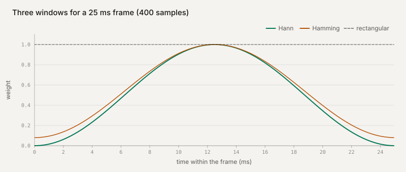
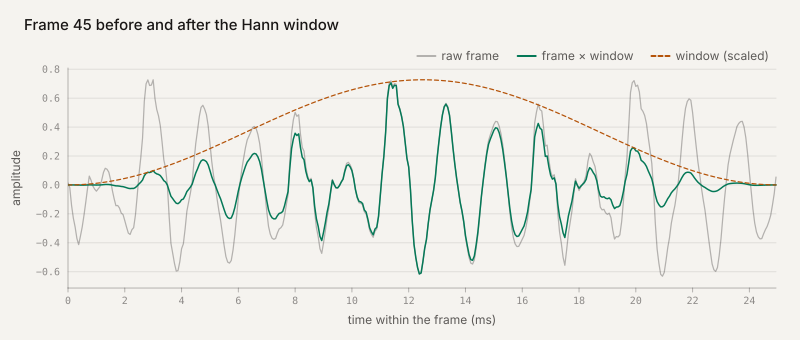

## Slicing Time

In the previous chapter we opened a WAV file by hand and found nothing mysterious inside: one second of speech is 16,000 numbers between -1 and 1, sitting in a `Wav { sample_rate, samples: Vec<f32> }`. Our running example is still `samples/seven.wav`, one second of somebody saying "seven".

Now we want to *measure* something about those 16,000 numbers, and right away we hit a problem: measure it over what? "Seven" is not one sound. It is a sequence of sounds, roughly "s", "eh", "v", "uh", "n", each lasting somewhere between a few tens of milliseconds and a couple of hundred. Compute one number over the whole second and we blend a hiss, two vowels and a lot of silence into an average that describes none of them. Look at a single sample and we learn that the microphone's membrane was at position 0.013 at that instant, which says nothing about the sound being made. One sample has no pitch, no loudness, no character.

The way out is the idea every later chapter rests on: cut the signal into short pieces, short enough that the sound does not change much inside one piece, and describe each piece separately. The pieces are called **frames**. In this chapter we write the code that cuts them, take our first two measurements per frame (how loud, how hissy), meet the window function, and finish with something useful: a detector that finds where in a recording the speech starts and stops.

### Frames And Hops

How short is short enough? Your tongue, lips and jaw are physical objects and can only move so fast. Over 20 to 30 milliseconds they barely move, so the sound they shape is close to steady. Speech recognition has used the same two numbers for decades, and we will too:

- A frame is **25 ms** long. At 16,000 samples per second that is `16000 * 0.025 = 400` samples.
- We start a new frame every **10 ms**, which is 160 samples. This step is called the **hop**.

You will notice that the hop is smaller than the frame, so consecutive frames overlap: frame 0 covers samples 0 to 399, frame 1 covers 160 to 559, frame 2 covers 320 to 719, and so on.

```text
samples   0        160       320       480       640       800
          |---------|---------|---------|---------|---------|----
frame 0   [=======================]                               0..400
frame 1             [=======================]                     160..560
frame 2                       [=======================]           320..720
          <-- hop -->
          <----- frame_len ------>
```

Why overlap? A sound that straddles the boundary between two non-overlapping frames would be split in half and seen properly by neither. And later in this chapter we are going to fade the edges of every frame toward zero, so whatever sits at the edge of one frame had better sit in the middle of another. Hold that thought.

How many frames do we get out of a clip? Frame `i` starts at sample `i * hop_len` and needs `frame_len` samples. The first frame needs the clip to be at least `frame_len` long, and after that every further `hop_len` samples buy us one more frame:

```text
num_frames = 0                                        if n_samples < frame_len
           = 1 + (n_samples - frame_len) / hop_len    otherwise (integer division)
```

For our one-second clip: `1 + (16000 - 400) / 160 = 1 + 97 = 98`.

Not 100, even though a second contains one hundred 10 ms hops. The last frame we keep starts at sample `97 * 160 = 15520` and ends at 15920. The next one would need samples up to 16080, and the clip stops at 16000. So we get 98 frames, and the last 80 samples (5 ms) get no frame of their own.

This is a choice. Many libraries pad the signal with zeros or a mirrored copy of its ends so that frames are centered on multiples of the hop, and get `1 + n_samples / hop_len` frames (101 for our clip). We keep only frames that fit entirely inside the signal: the simplest rule that never invents samples nobody recorded, at the cost of a few milliseconds at the very end. If you compare frame counts with another tool and are off by two or three, this is why.

Enough of the talk, let's write some code!

```rust
// src/dsp/frame.rs

/// How many frames [`frames`] produces.
pub fn num_frames(n_samples: usize, frame_len: usize, hop_len: usize) -> usize {
    assert!(frame_len > 0 && hop_len > 0, "frame_len and hop_len must be at least 1");
    if n_samples < frame_len {
        0
    } else {
        1 + (n_samples - frame_len) / hop_len
    }
}

/// Cut `samples` into overlapping frames of `frame_len` samples, each starting
/// `hop_len` samples after the previous one. See [`num_frames`] for the edge
/// policy. The frames borrow from `samples`; nothing is copied.
pub fn frames(samples: &[f32], frame_len: usize, hop_len: usize) -> Vec<&[f32]> {
    (0..num_frames(samples.len(), frame_len, hop_len)).map(|i| &samples[i * hop_len..i * hop_len + frame_len]).collect()
}
```

That is all of framing. (The "edge policy" in the comment is the rule we just worked out: whole frames only, no padding.) Rust's slices make it pleasant: a frame is a `&[f32]` pointing into the original samples, so 98 overlapping frames cost us 98 pointer-and-length pairs and not one copied sample.

How do we know it works? We ask it small questions that we can answer by hand:

```rust
// src/dsp/frame.rs (tests)

#[test]
fn frame_count_follows_the_documented_formula() {
    assert_eq!(num_frames(16000, 400, 160), 98);
    assert_eq!(num_frames(400, 400, 160), 1);
    assert_eq!(num_frames(399, 400, 160), 0);
    assert_eq!(num_frames(559, 400, 160), 1);
    assert_eq!(num_frames(560, 400, 160), 2);
    assert_eq!(num_frames(0, 400, 160), 0);
}

#[test]
fn frames_overlap_and_drop_the_ragged_tail() {
    let samples: Vec<f32> = (0..10).map(|i| i as f32).collect();
    let f = frames(&samples, 4, 3);
    assert_eq!(f, vec![&[0.0, 1.0, 2.0, 3.0][..], &[3.0, 4.0, 5.0, 6.0][..], &[6.0, 7.0, 8.0, 9.0][..]]);
    assert_eq!(frames(&samples[..9], 4, 3).len(), 2); // sample 8 is dropped
}
```

The edge cases are the interesting ones: 399 samples give no frame at all, 559 samples give one, and the 560th sample is the one that completes the second.

### How Loud Is A Frame?

The first thing to ask of a frame is how loud it is. We cannot just average the samples: sound swings above and below zero, so the average is close to zero no matter how loud it is. Squaring each sample first makes everything positive. The mean of the squared samples is what we will call the **energy** of a frame:

```text
energy = (x[0]² + x[1]² + ... + x[N-1]²) / N
```

where `x[0]` to `x[N-1]` are the `N` samples of the frame.

```rust
// src/dsp/frame.rs

/// The energy of a frame: the mean of its squared samples.
///
/// (Strictly speaking this is *power*, energy per sample. Dividing by the
/// length makes frames of different sizes comparable.) A full-scale sine has
/// energy 0.5; silence has energy 0.
pub fn energy(frame: &[f32]) -> f32 {
    if frame.is_empty() {
        return 0.0;
    }
    frame.iter().map(|x| x * x).sum::<f32>() / frame.len() as f32
}
```

The parenthesis in that comment is an apology to the physicists: a sum of squares is energy, and energy divided by the number of samples is *power*. We keep calling it energy because the speech literature does.

There is a practical problem with this number. For the loudest frame of "seven" the energy is about 0.12. For a frame of the "s" it is about 0.0006. For the room noise before the word, about 0.000000003. All three are meaningful and they span a factor of forty million. Plot them on one axis and you see the vowel and a flat line.

Our ears have the same problem and solved it long ago: we hear loudness in *ratios*. Going from energy 0.001 to 0.01 sounds like about the same step up as going from 0.01 to 0.1. The unit built on that idea is the **decibel**, written dB. We will use it for the rest of the book, so let's define it carefully.

A decibel value always compares an energy to a reference energy:

```text
level in dB = 10 * log10(energy / reference)
```

`log10` asks "ten to the power of what gives this number?". So:

- 10 times the energy is `10 * log10(10) = +10 dB`.
- 100 times the energy is +20 dB, 1000 times is +30 dB. Every factor of ten adds 10.
- Twice the energy is `10 * log10(2) = +3.01 dB`, which everyone rounds to "+3 dB".
- A tenth of the energy is -10 dB. Less than the reference means a negative number, and there is nothing wrong with a negative number of decibels.

Decibels turn multiplication into addition. One more fact for later: energy goes with the *square* of the amplitude, so making every sample ten times bigger makes the energy a hundred times bigger, which is +20 dB. When you see `20 * log10(...)` somewhere, it is the same decibel computed from an amplitude.

A dB number means nothing until you know the reference. Ours is energy 1.0, the loudest thing our sample format can hold (a square wave slamming between -1 and +1). So 0 dB is the ceiling and every real signal comes out negative. A full-scale sine has energy 0.5, which is -3 dB.

```rust
// src/dsp/frame.rs

/// The energy of a frame in decibels: `10 log10(energy)`.
pub fn energy_db(frame: &[f32]) -> f32 {
    10.0 * (energy(frame) + 1e-10).log10()
}

/// Energy of every frame: the loudness contour of the signal.
pub fn short_time_energy(samples: &[f32], frame_len: usize, hop_len: usize) -> Vec<f32> {
    frames(samples, frame_len, hop_len).into_iter().map(energy).collect()
}
```

The `+ 1e-10` is a numerical seatbelt. A frame of exact zeros has energy 0, `log10(0)` is minus infinity, and one infinity in a vector of features poisons every sum and average downstream. Adding a tiny constant puts a floor at `10 * log10(1e-10) = -100 dB`. That is a practical floor for our purposes, not a limit of the format: a frame in which every sample is one 16-bit step has energy (1/32768)², about -90 dB, but a 400-sample frame of zeros with a single such step in it has a 400th of that, -116 dB, and reads as -99.9. The constant also nudges the quietest real frames up a little (the -90 dB frame reads as -89.9). Nothing we build looks that far down.

The test pins down the numbers we just worked out by hand:

```rust
// src/dsp/frame.rs (tests)

#[test]
fn energy_of_known_signals() {
    assert_eq!(energy(&[0.5, -0.5, 0.5, -0.5]), 0.25);
    assert_eq!(energy(&[]), 0.0);
    // A full-scale sine has mean square 1/2, which is -3.01 dB.
    let sine: Vec<f32> = (0..800).map(|t| (2.0 * PI * 10.0 * t as f32 / 800.0).sin()).collect();
    assert!((energy(&sine) - 0.5).abs() < 1e-4);
    assert!((energy_db(&sine) + 3.0103).abs() < 1e-2);
    assert!((energy_db(&[0.0; 10]) + 100.0).abs() < 1e-3);
    assert_eq!(short_time_energy(&[1.0, 1.0, 0.0, 0.0, 2.0, 2.0], 2, 2), vec![1.0, 0.0, 4.0]);
}
```

### How Hissy Is A Frame?

Loudness cannot tell an "s" from a quiet vowel. Here is a second measurement that can, and it is almost free: count how often the signal changes sign.

A slow wave crosses zero rarely. A fast one crosses it all the time. A sine of frequency `f` crosses zero twice per cycle, so `2f` times per second, and at `sample_rate` samples per second that is a fraction `2f / sample_rate` of all the steps from one sample to the next. That fraction is the **zero-crossing rate**: 0 if the signal never changes sign, 1 if it flips at every single sample.

```rust
// src/dsp/frame.rs

/// Zero-crossing rate: the fraction of neighboring sample pairs that have
/// opposite signs, between 0 and 1.
pub fn zero_crossing_rate(frame: &[f32]) -> f32 {
    if frame.len() < 2 {
        return 0.0;
    }
    let crossings = frame.windows(2).filter(|pair| (pair[0] >= 0.0) != (pair[1] >= 0.0)).count();
    crossings as f32 / (frame.len() - 1) as f32
}
```

`windows(2)` hands us every pair of neighbors, `(x0, x1)`, `(x1, x2)` and so on, and we count the pairs whose two members sit on opposite sides of zero. The test uses the formula from a moment ago: a 440 Hz sine at 16 kHz must come out at `2 * 440 / 16000 = 0.055`.

```rust
// src/dsp/frame.rs (tests)

#[test]
fn zero_crossing_rate_of_a_sine_is_twice_its_frequency() {
    assert_eq!(zero_crossing_rate(&[1.0, -1.0, 1.0, -1.0, 1.0]), 1.0);
    assert_eq!(zero_crossing_rate(&[0.1, 0.2, 0.3]), 0.0);
    // 440 Hz at 16 kHz: 2 * 440 / 16000 = 0.055.
    let sine: Vec<f32> = (0..16000).map(|t| (2.0 * PI * 440.0 * t as f32 / 16000.0 + 0.1).sin()).collect();
    assert!((zero_crossing_rate(&sine) - 0.055).abs() < 1e-3);
}
```

Why does this separate "s" from "eh"? A vowel is made by your vocal cords buzzing a hundred or two hundred times per second, which gives a fairly slow, regular wave. Sounds like that are called **voiced**. An "s" is made with the vocal cords at rest: air is forced through a narrow gap behind your teeth and comes out as fast, irregular noise. Sounds like that are **unvoiced**. Put a finger on your throat, say "zzzz" and then "ssss", and you can feel the difference.

### Reading "Seven" Frame By Frame

The example for this chapter, `examples/ch02_frames.rs`, runs all of this on a clip. We will see its full output at the end; here is the part we can already read. Each character is one frame, 10 ms after the one before, and taller means bigger:

```text
energy per frame, in dB (one bar per 10 ms):
  ▁▁▁▁▁▁▁▁▁▁▁▁▁▁▁▁▁▁▁▂▄▄▅▅▆▆▆▆▆▆▆▆▆▆▆▆▇████████████████▇▇▇▆▆▆▆▆▇▇▇▇▇▇▇▇▇▇▇▇▆▆▅▄▄▃▃▃▂▁▁▁▁▁▁▁▁▁▁▁▁▁▁▁▁
zero-crossing rate per frame:
  ▂▂▃▃▃▃▂▁▁▂▂▁▂▂▃▃▂▂▂▂▃▅▇███████████▇▅▃▁▁▁▁▁▁▁▁▁▁▁▁▁▁▁▁▁▁▁▁▁▁▁▁▁▁▁▁▁▁▁▁▁▁▁▁▁▁▁▁▁▁▁▁▁▁▁▁▁▁▁▁▂▁▂▂▂▃▂▂▃
  loudest frame:  #45  at 0.45 s    -9.2 dB  zero-crossing rate 0.09
  hissiest frame: #26  at 0.26 s   -32.4 dB  zero-crossing rate 0.76
```

Let's read it together, left to right. The values below are the numbers behind the bars.

- **Frames 0 to 18: nothing.** The energy sits at -85 dB. That is the room and the microphone's own noise, and it is a quiet recording: the other one-second clips in `samples/` rest at about the same level, while a noisier room or a cheaper microphone sits 20 to 30 dB higher.
- **Frames 21 to 35: the "s".** The energy climbs to about -30 dB and the zero-crossing rate jumps to about 0.75. Three sign changes for every four samples: this is noise with its weight near the top of what a 16 kHz recording can hold.
- **Frames 37 to 52: the first vowel, "eh".** In the space of two frames the energy leaps by 20 dB to around -10 dB, and the zero-crossing rate collapses to 0.06 to 0.09. Loud and slow: a voiced sound. Twenty decibels means the vowel carries a hundred times the energy of the "s", which is why the "s" is a thin smear in the waveform plot and the vowel is a solid block.
- **Frames 57 to 60: the "v".** The energy dips to -35 dB, as quiet as the "s" was, but the zero-crossing rate stays at 0.02 to 0.03. Your lower lip is against your teeth and almost closes off the sound, while your vocal cords keep buzzing. Quiet and slow.
- **Frames 62 to 72: "uh-n".** Back up to about -21.5 dB for the second syllable, quieter than the first because the stress in "seven" is on the first, then a long slide down as the "n" fades away around frame 80.

Two numbers per frame, and we can already see the syllables of the word and tell its hiss from its vowels. Not bad for forty lines.

Compare that with measuring the whole second at once: the energy of all 16,000 samples is -18.8 dB and their zero-crossing rate is 0.19. No frame in the word looks like that.

One caveat about the second sparkline. Look at its two ends: in the silence the zero-crossing rate wobbles between 0.1 and 0.2, *higher* than during the vowel. Background noise crosses zero often too. The rate only means something when there is a sound to measure, which is why the example looks for the "hissiest" frame only among frames within 30 dB of the loudest.

### Pre-Emphasis

Before we go on, one small traditional step. You saw that the vowel is about 20 dB louder than the "s". This is typical of speech: most of its energy is at low frequencies (slow waves), and the high frequencies, where the consonants live, are much weaker. Yet the consonants are what tell "seven" from "heaven". Classic speech front ends therefore boost the high frequencies a little before doing anything else. The filter that does it is called **pre-emphasis** and it is one line:

```text
y[t] = x[t] - 0.97 * x[t-1]
```

Each output sample is the input sample minus 97% of the one before it. Think about what that does to two extreme signals. If the input is constant, say 1, 1, 1, 1, every output is `1 - 0.97 = 0.03`: a signal that does not change is almost wiped out. If the input alternates as fast as it can, +1, -1, +1, -1, every output is `±1.97`: a signal that flips at every sample is almost doubled. Everything in between gets something in between. Slow things are turned down, fast things are turned up. The 0.97 is a parameter, `coeff`, and a `coeff` of 0.0 returns the signal unchanged.

```rust
// src/dsp/frame.rs

/// Pre-emphasis: `y[t] = x[t] - coeff * x[t-1]`, with `y[0] = x[0]`.
pub fn preemphasis(samples: &[f32], coeff: f32) -> Vec<f32> {
    let mut out = Vec::with_capacity(samples.len());
    let mut previous = 0.0;
    for &x in samples {
        out.push(x - coeff * previous);
        previous = x;
    }
    out
}
```

```rust
// src/dsp/frame.rs (tests)

#[test]
fn preemphasis_by_hand() {
    let y = preemphasis(&[1.0, 1.0, 1.0, 0.0], 0.5);
    assert_eq!(y, vec![1.0, 0.5, 0.5, -0.5]);
    assert_eq!(preemphasis(&[0.3, -0.2], 0.0), vec![0.3, -0.2]);
}

#[test]
fn preemphasis_removes_a_constant_offset_almost_entirely() {
    let y = preemphasis(&[1.0; 100], 0.97);
    assert!(y[1..].iter().all(|v| (v - 0.03).abs() < 1e-6));
}
```

On "seven" the effect is easy to measure. Before pre-emphasis, the loudest vowel frame (45) is at -9.2 dB and the hissiest "s" frame (26) at -32.4 dB, a gap of 23 dB. After it, the vowel frame drops to -21.3 dB and the "s" frame *rises* to -27.2 dB. The gap shrinks to 6 dB. The zero-crossing rate of the vowel frame goes from 0.09 to 0.15, because the fast wiggles riding on the slow wave now carry more weight.

I should be honest about where this leaves us. "Low frequencies" and "high frequencies" are words we have not earned yet: we have a feeling for them (slow waves, fast waves) but no way to look at a frame and say how much of each is in it. That tool is the next chapter's. For now, take pre-emphasis as a tradition with a plausible story. Our feature code in chapter 4 applies it by default with the classic 0.97, and there it is easy to switch off and see whether it matters.

### The Trouble With Sharp Edges

Now to the thought we put on hold. When we cut a frame out of a recording, the cut falls wherever the frame boundary happens to be, and the sound does not care about our boundaries. Frame 45 of "seven" starts while the wave is at +0.013 and ends, 25 ms later, at +0.054 and climbing steeply. Our cut goes straight through the middle of a swing.

Why is that a problem? In the next chapter we hand each frame to the Fourier transform to find out which frequencies are in it, and the Fourier transform treats a frame as if it were one cycle of something that repeats forever (chapter 3 shows why). Lay copies of frame 45 end to end and at every seam the signal jumps from where the frame ended to where it began. That jump was never in the sound. Our scissors made it. A sudden jump is the fastest change a signal can make, so it shows up as a sprinkling of energy at all frequencies that the speaker never produced. The name for this is **spectral leakage**, and we will see it with our own eyes in chapter 3.

The fix: before analyzing a frame, fade it in and fade it out. Multiply every sample by a weight that is 1 in the middle of the frame and falls smoothly toward 0 at both ends. Then every frame starts and ends at (very nearly) zero, the seams always match, and there is no jump. The list of weights is called a **window function**, or just a **window**.

The most common window is one cycle of a cosine, flipped upside down and lifted so it runs from 0 up to 1 and back. It is called the **Hann window**, after the Austrian meteorologist Julius von Hann:

```text
w[i] = 0.5 - 0.5 * cos(2π * i / n)        for i = 0, 1, ..., n-1
```

where `n` is the frame length. At `i = 0` the cosine is 1 and the weight is 0; in the middle the cosine is -1 and the weight is 1. The last weight, at `i = n - 1`, stops one step short of the cosine's return to 1, so it is small but not zero: 0.00006 for `n = 400`. That is on purpose, and the aside below says why.

Its close relative is the **Hamming window** (after Richard Hamming), the same curve squashed so that the ends sit at 0.08 instead of 0: `0.54 - 0.46 * cos(2π * i / n)`. Not going all the way to zero looks like a mistake, but it cancels the largest remaining bit of leakage, at the price of the rest fading more slowly. Classic speech toolkits use Hamming; we use Hann; the difference is small in practice. For comparison there is also the **rectangular window**, all ones, a polite name for "no window at all".


*Hann, Hamming and rectangular windows for a 400-sample frame.*

Hann and Hamming are the same formula with a different constant, so the code has one private function for the whole family and thin wrappers around it:

```rust
// src/dsp/window.rs

use std::f32::consts::PI;

/// The periodic Hann window: `0.5 - 0.5 cos(2 pi i / n)`.
///
/// One full period of a raised cosine. It starts at exactly 0, peaks at 1 in
/// the middle, ends one step short of 0, and is our default for everything.
pub fn hann(n: usize) -> Vec<f32> {
    raised_cosine(n, n, 0.5)
}

/// The symmetric Hann window: `0.5 - 0.5 cos(2 pi i / (n - 1))`.
pub fn hann_symmetric(n: usize) -> Vec<f32> {
    raised_cosine(n, n.saturating_sub(1), 0.5)
}

/// The periodic Hamming window: `0.54 - 0.46 cos(2 pi i / n)`.
pub fn hamming(n: usize) -> Vec<f32> {
    raised_cosine(n, n, 0.54)
}

/// The symmetric Hamming window: `0.54 - 0.46 cos(2 pi i / (n - 1))`.
pub fn hamming_symmetric(n: usize) -> Vec<f32> {
    raised_cosine(n, n.saturating_sub(1), 0.54)
}

/// The rectangular window: all ones, i.e. "no window at all". It is here so
/// that we can compare the others against it.
pub fn rectangular(n: usize) -> Vec<f32> {
    vec![1.0; n]
}

/// The family both Hann and Hamming belong to:
/// `a - (1 - a) cos(2 pi i / denominator)` for `i` in `0..n`.
fn raised_cosine(n: usize, denominator: usize, a: f32) -> Vec<f32> {
    if denominator == 0 {
        return vec![1.0; n]; // a window of length 0 or 1 has no shape
    }
    (0..n).map(|i| a - (1.0 - a) * (2.0 * PI * i as f32 / denominator as f32).cos()).collect()
}

/// Multiply a frame by a window, sample by sample.
pub fn apply(frame: &[f32], window: &[f32]) -> Vec<f32> {
    assert_eq!(frame.len(), window.len(), "frame has {} samples but the window has {}", frame.len(), window.len());
    frame.iter().zip(window).map(|(x, w)| x * w).collect()
}

/// The average height of a window.
pub fn coherent_gain(window: &[f32]) -> f32 {
    window.iter().sum::<f32>() / window.len() as f32
}
```

The last function is there because windowing makes a frame quieter: we multiplied most of it by something less than 1. The average height of a Hann window is 0.5, of a Hamming window 0.54. When we later read amplitudes off a spectrum, we divide by this number to undo the loss. Its textbook name is **coherent gain**.

**Aside** <br>
Every window comes in two flavors, *periodic* and *symmetric*, which differ only in whether we divide by `n` or by `n - 1`. I found this confusing the first time. Dividing by `n - 1` puts the first and the last sample exactly on the two ends of the curve, so the window is a mirror image of itself: `[0, 0.5, 1, 0.5, 0]` for five points. Dividing by `n` gives the symmetric window of length `n + 1` with its last point dropped: `[0, 0.5, 1, 0.5]` for four. That looks lopsided until you lay copies of it end to end, `0, 0.5, 1, 0.5, 0, 0.5, 1, 0.5, ...`, and see the curve continue smoothly with no doubled zero at the seam. Laying copies end to end is how the Fourier transform thinks about a frame, so the plain `hann` and `hamming` are periodic. The symmetric form is right when the window shapes a filter, which our resampler in chapter 4 does. For 400 samples the two differ by less than 1%; it matters on the day you compare your numbers with another library's.

Small windows we can compute by hand make good tests:

```rust
// src/dsp/window.rs (tests)

#[test]
fn hann_matches_hand_computed_values() {
    // Periodic, n = 4: 0.5 - 0.5 cos(pi i / 2) = 0, 0.5, 1, 0.5.
    assert_close(&hann(4), &[0.0, 0.5, 1.0, 0.5]);
    // Symmetric, n = 5: 0.5 - 0.5 cos(pi i / 2) = 0, 0.5, 1, 0.5, 0.
    assert_close(&hann_symmetric(5), &[0.0, 0.5, 1.0, 0.5, 0.0]);
}

#[test]
fn periodic_is_symmetric_of_one_more_with_the_last_dropped() {
    assert_close(&hann(64), &hann_symmetric(65)[..64]);
    assert_close(&hamming(64), &hamming_symmetric(65)[..64]);
}

#[test]
fn coherent_gains_are_the_textbook_ones() {
    assert!((coherent_gain(&rectangular(400)) - 1.0).abs() < 1e-6);
    assert!((coherent_gain(&hann(400)) - 0.5).abs() < 1e-5);
    assert!((coherent_gain(&hamming(400)) - 0.54).abs() < 1e-5);
}
```

(`assert_close` is a small helper in the test module that compares two slices element by element, to within a millionth.)

Here is what the Hann window does to frame 45, the loudest frame of "seven":


*The raw frame starts and ends mid-wave; the windowed frame fades to nothing at both ends (exactly zero at the first sample, 0.000003 at the last).*

And now the overlap pays off. You might worry that we are throwing sound away: whatever happened in the first and last few milliseconds of a frame has been multiplied by almost zero. It has, in *that* frame. But frames start every 160 samples, so every sample of the recording (apart from a few milliseconds at the two ends of the clip) lies within 80 samples of the center of some frame, and 80 samples from the center the Hann weight is still 0.65. What one frame fades out, its neighbors see at nearly full strength.

> **Play with it:** [slicing and windowing](../interactive/windowing.html). Drag a frame along a signal, switch between rectangular, Hann and Hamming, and watch the windows of all the frames add up. The page also shows the spectrum of the frame, which is a preview of the next chapter; come back to it after reading that one.

### Where Is The Word?

Time to build something with all this. Our clip is one second long and the word takes up about six tenths of it. The rest is room noise. When we listen to a live microphone in chapter 11 it gets worse: nobody hands us a clip with a word in the middle, there is just an endless stream, and we have to decide when somebody started talking and when they stopped. This job is called **endpoint detection**.

The obvious idea: speech is loud, silence is quiet, so pick a threshold and call every frame above it speech. Looking at the energy contour of "seven", -40 dB seems comfortable, far above the -85 dB background and far below the vowels. Take the first and the last frame above the threshold and we are done.

I tried exactly that, and it breaks in three instructive ways.

**The threshold is only right for one recording.** `samples/zero_george.wav` comes from a different dataset, recorded with a different microphone and trimmed tightly around the word. Its *quietest* frame is at -30.1 dB, so all 28 of its frames are above our threshold. No fixed number can be right, because "quiet" depends on the room, the microphone and the recording level.

**Quiet parts of the word get cut off.** Even on `seven.wav`, the first frame above -40 dB is frame 23 and the last is frame 74. But we read the contour together: the "s" begins around frame 20, and the "n" keeps fading until about frame 80. Words begin and end softly, and a threshold high enough to be safe from noise trims the soft edges away. What goes first is usually a consonant, the very thing that tells similar words apart.

**One frame's loudness means little.** A key press or a click in the electronics is one or two loud frames, and a per-frame threshold calls it speech. In the other direction, some words contain real gaps. Say "stop" slowly: before the "p" your lips close completely and for a few hundredths of a second no sound comes out at all. A per-frame threshold ends the word right there.

The detector in the repository answers each of these in turn. Here is the list of ideas, and then the code:

1. **A noise floor instead of a fixed threshold.** The detector estimates how loud the background is, and "loud" means "so many dB above the background": "10 dB above the noise" is "ten times the energy of the noise" in any room.
2. **Two thresholds.** To *start* speech a block must be 10 dB above the floor. Once speech has started, 5 dB is enough to *keep* it going, so a word that trails off is followed further down than the level it needed to get noticed. Using a different threshold depending on the state you are in is called **hysteresis**; a thermostat does the same so that the heating does not flicker on and off around the set temperature.
3. **A minimum speech length.** Speech only starts after 30 ms in a row were loud. A click is over before that.
4. **Hangover.** Speech only ends after 200 ms in a row were quiet. The closed lips of a "p" last nowhere near that long.
5. **Padding.** We keep an extra 30 ms on both sides of the loud part, for the soft onset that was below threshold.

All of these are knobs, so they live in a struct:

```rust
// src/dsp/frame.rs

/// Knobs of the endpoint detector. The defaults suit single words and short
/// phrases, on clean recordings and on a laptop microphone alike.
#[derive(Clone, Debug, PartialEq)]
pub struct EndpointConfig {
    /// Length of the blocks the detector measures, in milliseconds.
    pub block_ms: f32,
    /// A block is "loud" if it is this many dB above the noise floor.
    pub start_db: f32,
    /// Once speech has started, a block only has to be this many dB above the
    /// noise floor to count. Lower than `start_db`, so that a word that
    /// trails off is not cut short.
    pub end_db: f32,
    /// Blocks quieter than this (in dB, see [`energy_db`]) never count as
    /// loud, however quiet the background is. Without it, a background of
    /// pure digital silence would make the faintest rustle "10 dB above the
    /// noise".
    pub min_level_db: f32,
    /// Only used when the whole recording is available ([`find_speech`]):
    /// blocks more than this many dB below the loudest block of the clip
    /// never count as loud. It replaces `min_level_db`, which a live detector
    /// needs because it cannot know how loud the speaker is going to be.
    pub peak_range_db: f32,
    /// Speech starts once this many milliseconds in a row were loud. Guards
    /// against clicks and pops.
    pub min_speech_ms: f32,
    /// "Hangover": speech ends only after this many milliseconds in a row
    /// were quiet. Guards against cutting a word at a short internal pause,
    /// like the closed lips of the "p" in "happy".
    pub hangover_ms: f32,
    /// Extra audio kept before the first and after the last loud block, in
    /// milliseconds. The soft beginning of a word is often below threshold.
    pub padding_ms: f32,
}

impl Default for EndpointConfig {
    fn default() -> Self {
        EndpointConfig {
            block_ms: 10.0,
            start_db: 10.0,
            end_db: 5.0,
            min_level_db: -60.0,
            peak_range_db: 40.0,
            min_speech_ms: 30.0,
            hangover_ms: 200.0,
            padding_ms: 30.0,
        }
    }
}
```

Notice that the detector does not use our overlapping 25 ms frames. It measures plain 10 ms **blocks**, one after the other with no overlap: 160 samples at 16 kHz. A live stream can be consumed that way, one small block as soon as it has arrived.

### A Two-State Machine

Those five rules come out clean if we think of the detector as a machine that is always in one of two states, **silence** or **speech**, and looks at one block at a time.


*Two states, two counters, two thresholds.*

In silence, it counts loud blocks in a row; a single quiet block resets the count. Three in a row (30 ms) and it switches to speech. In speech, it counts quiet blocks in a row; a single loud block resets the count. Twenty in a row (200 ms) and it switches back. Every switch is reported to the caller as an event:

```rust
// src/dsp/frame.rs

/// What the endpoint detector has to say after a block.
#[derive(Clone, Copy, Debug, PartialEq, Eq)]
pub enum EndpointEvent {
    /// Speech began at this sample (counted from the start of the stream,
    /// padding included, so it lies a little in the past).
    SpeechStart { sample: usize },
    /// Speech ended at this sample (exclusive, padding included). Never
    /// more than the number of samples fed so far: the padding is cut short
    /// if the stream does not reach that far.
    SpeechEnd { sample: usize },
}
```

"A little in the past" is worth a second look. The machine cannot know that speech has started until it has heard 30 ms of it, and cannot know that it has ended until 200 ms of quiet have gone by. So both events arrive late, and both carry the sample position where the thing *actually* happened. Whoever uses the detector live has to keep the most recent audio around so that it can go back and fetch the beginning of the word.

The state the machine carries between blocks is small. The config speaks milliseconds and the machine counts samples and blocks, so `new` converts once:

```rust
// src/dsp/frame.rs

#[derive(Clone, Debug)]
pub struct Endpointer {
    config: EndpointConfig,
    block_len: usize,
    min_speech_blocks: usize,
    hangover_blocks: usize,
    padding_samples: usize,

    /// Estimated background level in dB; `None` until the first block.
    noise_db: Option<f32>,
    in_speech: bool,
    /// Blocks pushed so far.
    blocks_seen: usize,
    /// While in silence: how many loud blocks in a row we have just seen.
    loud_run: usize,
    /// While in speech: how many quiet blocks in a row we have just seen.
    quiet_run: usize,
}

impl Endpointer {
    /// A detector for audio at `sample_rate`.
    pub fn new(sample_rate: u32, config: EndpointConfig) -> Self {
        let ms_to_samples = |ms: f32| (ms * sample_rate as f32 / 1000.0).round() as usize;
        let block_len = ms_to_samples(config.block_ms).max(1);
        let ms_to_blocks = |ms: f32| ((ms / config.block_ms).round() as usize).max(1);
        Endpointer {
            block_len,
            min_speech_blocks: ms_to_blocks(config.min_speech_ms),
            hangover_blocks: ms_to_blocks(config.hangover_ms),
            padding_samples: ms_to_samples(config.padding_ms),
            config,
            noise_db: None,
            in_speech: false,
            blocks_seen: 0,
            loud_run: 0,
            quiet_run: 0,
        }
    }

    /// Start from a known noise floor (in dB) instead of learning it from the
    /// first block. Useful when the whole recording is available up front.
    pub fn with_noise_floor(mut self, noise_db: f32) -> Self {
        self.noise_db = Some(noise_db);
        self
    }

    // ... three one-line getters: block_len(), in_speech(), noise_floor_db()
}
```

Before the machine itself, one detail about how it measures a block. It does not use `energy_db` directly:

```rust
// src/dsp/frame.rs

/// The loudness of a block for endpointing, in dB: like [`energy_db`], but
/// measured around the block's own average instead of around zero.
fn level_db(block: &[f32]) -> f32 {
    if block.is_empty() {
        return -100.0;
    }
    let mean = block.iter().sum::<f32>() / block.len() as f32;
    let variance = block.iter().map(|x| (x - mean) * (x - mean)).sum::<f32>() / block.len() as f32;
    10.0 * (variance + 1e-10).log10()
}
```

Cheap sound cards add a small constant to every sample, so that "silence" is not a row of zeros but a row of, say, 0.05s. You cannot hear a constant offset, but squaring does not know that: an offset of 0.05 has energy 0.0025, which is -26 dB, and quiet speech would barely stick out of such a "background". Subtracting the block's average first removes the offset and leaves the wiggles, which are the sound. (In statistics this number is the *variance* of the block.) The test `a_constant_offset_does_not_hide_the_speech` covers exactly this case.

Now the heart of it. `push` takes one block and moves the machine one step:

```rust
// src/dsp/frame.rs

impl Endpointer {
    /// Feed the next block of audio (`block_len()` samples; the blocks do not
    /// overlap). Returns an event if this block changed the state.
    ///
    /// Panics if the block has any other length: every sample position the
    /// detector reports is a block count times `block_len()`.
    pub fn push(&mut self, block: &[f32]) -> Option<EndpointEvent> {
        assert_eq!(
            block.len(),
            self.block_len,
            "Endpointer::push takes blocks of exactly block_len() = {} samples, got {} (use chunks_exact)",
            self.block_len,
            block.len()
        );
        let level = level_db(block);
        let noise = *self.noise_db.get_or_insert(level);
        let block_index = self.blocks_seen;
        self.blocks_seen += 1;

        if self.in_speech {
            let still_loud = level > (noise + self.config.end_db).max(self.config.min_level_db);
            if still_loud {
                self.quiet_run = 0;
                return None;
            }
            self.quiet_run += 1;
            if self.quiet_run < self.hangover_blocks {
                return None;
            }
            // Quiet for long enough. Speech ended where the quiet run began.
            self.in_speech = false;
            let last_loud_end = (block_index + 1 - self.quiet_run) * self.block_len;
            self.quiet_run = 0;
            let fed = self.blocks_seen * self.block_len;
            return Some(EndpointEvent::SpeechEnd { sample: (last_loud_end + self.padding_samples).min(fed) });
        }

        let loud = level > (noise + self.config.start_db).max(self.config.min_level_db);
        if !loud {
            self.loud_run = 0;
            self.adapt_noise_floor(level);
            return None;
        }
        self.loud_run += 1;
        if self.loud_run < self.min_speech_blocks {
            return None;
        }
        // Loud for long enough. Speech started where the loud run began.
        self.in_speech = true;
        let first_loud_start = (block_index + 1 - self.loud_run) * self.block_len;
        self.loud_run = 0;
        Some(EndpointEvent::SpeechStart { sample: first_loud_start.saturating_sub(self.padding_samples) })
    }
}
```

It opens with a guard: every sample position the machine reports is a block count times the block length, so one block of the wrong size would quietly shift every later answer, and we would rather panic. Then `get_or_insert` settles the noise floor: if there is none yet, the very first block we ever hear is taken to be background.

After that the function has two halves, one per state, and every rule from our list is a line you can point at. The two thresholds are the `let` lines that compute `still_loud` (in speech, where the bar is `end_db` above the floor) and `loud` (in silence, where it is the higher `start_db`). The minimum speech length is `self.loud_run < self.min_speech_blocks`, the hangover is `self.quiet_run < self.hangover_blocks`. The padding is added to the end and subtracted from the start, and `saturating_sub` keeps us from asking for a sample before the beginning of the stream. The `.max(self.config.min_level_db)` is the guard from the config: however low the noise floor, nothing below -60 dB is ever called loud. And the end is clamped with `.min(fed)`, because a position beyond the audio we have been given points at nothing. With the default settings the clamp never bites (by the time 200 ms of hangover have gone by, 30 ms of padding lie well in the past); it is there for configurations with more padding than hangover.

The arithmetic for "where did it actually start?" deserves a worked example. Say blocks 21, 22 and 23 are the first loud ones. When block 23 arrives, `block_index` is 23 and `loud_run` has just become 3, so the run began at block `23 + 1 - 3 = 21`, which is sample `21 * 160 = 3360`. Minus 480 samples of padding: speech started at sample 2880, or 0.18 s.

That leaves the noise floor. Where does `noise` come from, and how does it keep up when somebody opens a window?

```rust
// src/dsp/frame.rs

impl Endpointer {
    /// Track the background level with a block we judged to be silence:
    /// follow it down at once, follow it up slowly, closing the gap with a
    /// time constant of one second. Slowly matters: a word that swells
    /// gently must not drag the floor up with it and go unnoticed.
    fn adapt_noise_floor(&mut self, level: f32) {
        let rise_per_block = self.config.block_ms / 1000.0;
        if let Some(noise) = self.noise_db.as_mut() {
            if level < *noise {
                *noise = level;
            } else {
                *noise += rise_per_block * (level - *noise);
            }
        }
    }
}
```

The floor is deliberately lopsided. If a block is quieter than the floor, the floor was too high and we lower it at once. If a block is louder than the floor (but not loud enough to count as speech), the floor moves 1% of the way toward it; at a hundred blocks per second that closes most of the gap in about a second. A word that swells gently from nothing would otherwise pull the floor up with it, stay just under the start threshold, and never be noticed. The test `a_slow_fade_in_is_still_detected` builds such a signal and checks that it is caught.

Notice also *when* the floor adapts: only in the silence state, and only on blocks that were not loud. During speech it is frozen, so the word itself is not mistaken for the new background.

Finally, a stream can end in the middle of a word, and somebody has to close it:

```rust
// src/dsp/frame.rs

impl Endpointer {
    /// Tell the detector the stream is over. If we were in the middle of
    /// speech, this closes it.
    pub fn finish(&mut self) -> Option<EndpointEvent> {
        self.finish_at(self.blocks_seen * self.block_len)
    }

    /// [`finish`](Self::finish) for a stream of `stream_len` samples in all.
    /// The reported end never lies beyond `stream_len`. For a live stream
    /// that is the number of samples pushed; [`find_speech_with`] passes the
    /// length of the whole clip, which can include a ragged tail shorter
    /// than one block that was never pushed.
    fn finish_at(&mut self, stream_len: usize) -> Option<EndpointEvent> {
        if !self.in_speech {
            return None;
        }
        self.in_speech = false;
        let last_loud_end = (self.blocks_seen - self.quiet_run) * self.block_len;
        self.quiet_run = 0;
        Some(EndpointEvent::SpeechEnd { sample: (last_loud_end + self.padding_samples).min(stream_len) })
    }
}
```

Here the clamp does bite. A stream that stops while somebody is still talking has its last loud block at the very end, and the 30 ms of padding would point past it. `finish` cuts the end off at what was pushed. The private `finish_at` lets a caller who knows the true length of the audio say so; we need it in a moment.

### The Whole Clip At Once

The `Endpointer` is built for a stream: it sees 10 ms at a time and cannot look ahead. Often we are more comfortable. The recording is a file, all of it is in memory, and we want to know where the word is. For that there is a second form of the same detector, `find_speech`, which gets to cheat in two ways a live detector cannot.

First, it can measure every block before deciding anything, sort the levels, and read the noise floor straight off the recording: the level that the quietest tenth of the blocks stay under. Second, it knows how loud the loudest block is, so in place of the absolute -60 dB guard it uses a relative one: nothing more than 40 dB below the loudest block counts as loud. That makes the result independent of the recording level.

```rust
// src/dsp/frame.rs

/// Find the stretch of speech in a recording: `Some((start, end))` as sample
/// indices (`end` exclusive), or `None` if nothing stands out from the
/// background.
pub fn find_speech(samples: &[f32], sample_rate: u32) -> Option<(usize, usize)> {
    find_speech_with(samples, sample_rate, &EndpointConfig::default())
}

/// [`find_speech`] with your own settings.
///
/// One field of `config` is not used as given: `min_level_db` is overridden
/// with "the loudest block of this clip minus `peak_range_db`" (see
/// [`EndpointConfig::peak_range_db`]). To move the absolute threshold of a
/// whole-clip search, change `peak_range_db`; `min_level_db` only matters to
/// a live [`Endpointer`].
pub fn find_speech_with(samples: &[f32], sample_rate: u32, config: &EndpointConfig) -> Option<(usize, usize)> {
    let block_len = Endpointer::new(sample_rate, config.clone()).block_len();
    let mut levels: Vec<f32> = samples.chunks_exact(block_len).map(level_db).collect();
    if levels.is_empty() {
        return None;
    }
    levels.sort_by(f32::total_cmp);
    // The noise floor: the level below which 10% of the blocks fall. A
    // percentile rather than the minimum, so that one freak block does not
    // decide everything.
    let noise_floor = levels[levels.len() / 10];
    let loudest = levels[levels.len() - 1];

    let config = EndpointConfig { min_level_db: loudest - config.peak_range_db, ..config.clone() };
    let mut endpointer = Endpointer::new(sample_rate, config).with_noise_floor(noise_floor);

    let (mut first_start, mut last_end) = (None, None);
    let events = samples.chunks_exact(block_len).filter_map(|block| endpointer.push(block)).collect::<Vec<_>>();
    for event in events.into_iter().chain(endpointer.finish_at(samples.len())) {
        match event {
            EndpointEvent::SpeechStart { sample } => first_start = first_start.or(Some(sample)),
            EndpointEvent::SpeechEnd { sample } => last_end = Some(sample),
        }
    }
    Some((first_start?, last_end?))
}

/// The part of `samples` that [`find_speech`] considers speech. If it finds
/// none, the whole input is returned unchanged: better a clip with silence
/// around it than no clip at all.
pub fn trim_silence(samples: &[f32], sample_rate: u32) -> &[f32] {
    match find_speech(samples, sample_rate) {
        Some((start, end)) => &samples[start..end],
        None => samples,
    }
}
```

There is no second detector here. `find_speech_with` prepares a noise floor and a guard level, builds the very same `Endpointer`, and pushes the clip through it block by block. If the machine fires more than once (two words with a long pause between them), the answer spans from the first start to the last end.

Two details. The guard level overwrites `min_level_db`, so whatever you put in that field of your own config is ignored here, as the comment warns; for a whole clip the knob to turn is `peak_range_db`. And the clip is closed with `finish_at(samples.len())`: `chunks_exact` never pushes a ragged tail shorter than one block, but those samples exist, so the padding may reach into them.

**Aside** <br>
`f32` does not implement `Ord`, because `NaN` refuses to be compared with anything, so `levels.sort()` does not compile. `sort_by(f32::total_cmp)` uses a total order that puts every float somewhere, `NaN` included.

The tests feed the detector signals where we know the answer, because we built them: one second of faint random noise with a 440 Hz tone switched on from sample `from` to sample `to`.

```rust
// src/dsp/frame.rs (tests)

#[test]
fn find_speech_brackets_a_tone_in_noise() {
    let samples = tone_in_noise(4800, 9600, 0.002);
    let (start, end) = find_speech(&samples, 16000).expect("the tone should be found");
    // Default padding is 30 ms = 480 samples; allow one 10 ms block of slack.
    assert!((4800 - 480 - 160..=4800).contains(&start), "start {start}");
    assert!((9600..=9600 + 480 + 160).contains(&end), "end {end}");
    assert_eq!(trim_silence(&samples, 16000).len(), end - start);
}

#[test]
fn a_short_click_is_ignored_and_a_short_pause_is_bridged() {
    // A 10 ms click: shorter than min_speech_ms.
    assert_eq!(find_speech(&tone_in_noise(8000, 8160, 0.002), 16000), None);
    // Two tones 100 ms apart: one segment thanks to the hangover.
    let mut samples = tone_in_noise(3200, 6400, 0.002);
    let second = tone_in_noise(8000, 11200, 0.0);
    for (a, b) in samples.iter_mut().zip(&second) {
        *a += b;
    }
    let mut endpointer = Endpointer::new(16000, EndpointConfig::default());
    let events: Vec<_> = samples.chunks_exact(endpointer.block_len()).filter_map(|b| endpointer.push(b)).collect();
    assert_eq!(events.len(), 2, "{events:?}");
    assert!(matches!(events[0], EndpointEvent::SpeechStart { sample } if (2560..=3200).contains(&sample)));
    assert!(matches!(events[1], EndpointEvent::SpeechEnd { sample } if (11200..=11840).contains(&sample)));
}
```

The second test is our list of failures turned into assertions: the click is ignored, the pause is bridged. Further tests check that pure noise and pure silence give `None`, that the streaming detector reports two separate utterances when the pause between them (400 ms) is longer than the hangover, that a reported end never lies beyond the samples fed (`speech_end_never_exceeds_the_samples_fed`), and that `push` panics on a block of the wrong length. Run them all with `cargo test dsp::frame`.

### Running It

Go ahead and run the example from the `code/` directory:

```text
$ cargo run --release --example ch02_frames
../samples/seven.wav: 16000 samples at 16000 Hz, 1.00 s

framing: 400 samples per frame (25 ms), hop 160 samples (10 ms)
  1 + (16000 - 400) / 160 = 98 frames (the function says 98)

... (the energy and zero-crossing lines we read above)

endpoint detection:
  speech from 0.18 s to 0.80 s (9920 of 16000 samples kept)
  ▁▁▁▁▁▁▁▁▁▁▁▁▁▁▁▁▁▁▁▂▄▄▅▅▆▆▆▆▆▆▆▆▆▆▆▆▇████████████████▇▇▇▆▆▆▆▆▇▇▇▇▇▇▇▇▇▇▇▇▆▆▅▄▄▃▃▃▂▁▁▁▁▁▁▁▁▁▁▁▁▁▁▁▁
                   ▔▔▔▔▔▔▔▔▔▔▔▔▔▔▔▔▔▔▔▔▔▔▔▔▔▔▔▔▔▔▔▔▔▔▔▔▔▔▔▔▔▔▔▔▔▔▔▔▔▔▔▔▔▔▔▔▔▔▔▔▔▔
  streaming, 160 samples (10 ms) at a time:
    at 0.24 s: speech started at 0.18 s
    at 0.99 s: speech ended at 0.82 s
    noise floor it settled on: -86.3 dB

windows of 400 samples:      first   quarter   middle   average height
  rectangular             1.000     1.000    1.000        1.000
  Hann                    0.000     0.500    1.000        0.500
  Hamming                 0.080     0.540    1.000        0.540
  loudest frame, first and last sample: +0.013 and +0.054; after the Hann window: +0.000 and +0.000

pre-emphasis (0.97) on the loudest frame: zero-crossing rate 0.09 -> 0.15 (the high frequencies now carry more weight)

wrote ../figures/ch02-energy-endpoints.svg
wrote ../figures/ch02-windows.svg
wrote ../figures/ch02-frame-windowed.svg
```

Most of this we have already met. The new part is the endpoint detection, and the figure the example draws shows it best (running the example regenerates this chapter's figures, through the small SVG helper `plot`):


*The energy contour of "seven" and the stretch the detector marked as speech.*

`find_speech` says the word runs from 0.18 s to 0.80 s and keeps 9,920 of the 16,000 samples. Our fixed -40 dB threshold would have started at frame 23 (0.23 s) and stopped after frame 74. The onset of the "s" and the fading "n" are back inside.

The streaming lines show the latency. The machine announced the start of speech when it had been fed 0.24 s of audio, and said that the speech started at 0.18 s: three loud blocks from 0.21 s, minus the padding. It announced the end at 0.99 s, after 200 ms of hangover, for an end at 0.82 s.

If you have been paying attention, you'll notice that the two forms disagree about the end: 0.80 s offline, 0.82 s streaming. Same machine, same clip. The difference is the guard level. Offline, "loud" stops 40 dB below the loudest block, at about -49 dB. The streaming detector cannot know how loud the speaker is going to get, so it uses the absolute -60 dB and follows the dying "n" for two more blocks. Neither is wrong. Where a fading sound "ends" is a matter of definition, and an endpoint is an estimate.

### Loose Ends

The detector is crude and we should say where its limits are.

* **It only knows loudness.** A slammed door that lasts longer than 30 ms is speech as far as it is concerned, and so is music, a cough or a dog. Real voice activity detectors look at what kind of sound a block contains. Ours does not even use the zero-crossing rate.
* **It fails on about 1% of real clips.** Run over the datasets we use later in the book, `find_speech` returns `None` for roughly one clip in a hundred. They are of two kinds: clips so noisy that the word does not stand 10 dB above the background, and clips trimmed so tightly that there is no background to measure, so the "quietest tenth" is already speech. This is why `trim_silence` hands back the whole clip when nothing is found, and why anything built on top must cope with untrimmed audio.
* **The first block is assumed to be background.** If the stream begins in the middle of a word, the streaming detector starts with a floor that is far too high. It recovers as soon as a quiet block arrives, but the first word may be lost.
* **Events arrive late**, by 30 ms at the start and 200 ms at the end. A shorter hangover responds faster and cuts more words in half.
* **The numbers are picked by hand.** 10 dB, 5 dB, 30 ms, 200 ms: none of them is derived from anything.
* **The noise floor only learns in silence.** If the background gets more than 10 dB louder for good (a fan switches on), the machine takes that for speech, freezes the floor, and never finds out that this is the new quiet. Chapter 11 runs into exactly this and adds a guard around the detector.
* **Pre-emphasis and windows are still unproven.** We gave a story for each. The evidence for windows comes in the next chapter. Pre-emphasis has to wait until chapter 4, where the features are built and you can switch it off and compare.

### Try It Yourself

1. **Other words.** Run `cargo run --release --example ch02_frames -- ../samples/yes.wav`, then `stop.wav` and `happy.wav`. Before looking, guess what the two sparklines will look like. "Yes" ends with the sound "seven" begins with, so its zero-crossing rate should peak at the end of the word, not the start.
2. **Other frame sizes.** In the example, change the frame to 5 ms and the hop to 2 ms, then to 100 ms and 50 ms. With tiny frames the energy contour becomes jagged: inside the vowel it ripples up and down by 2 to 4 dB, because a frame now holds less than one buzz of the vocal cords. With huge ones the dip at the "v" gets shallower, about -27 dB where we measured -35. 25 and 10 sit between the two.
3. **Break "stop" in two.** Feed `samples/stop.wav` to an `Endpointer` built with `EndpointConfig { hangover_ms: 30.0, min_level_db: -50.0, ..EndpointConfig::default() }` and print the events. You should get two utterances, roughly 0.34 to 0.67 s and 0.64 to 0.73 s: the closed lips before the "p" end the first one, and the little burst of the "p" becomes a second word (they overlap because each gets its own padding). Raise the hangover to 50 ms and they merge into one, 0.34 to 0.73 s.
4. **The fixed threshold.** Write the naive detector from the start of the endpoint section (first and last frame with `energy_db` above -40) and run it on `seven.wav` and on `zero_george.wav`. The first loses the edges of the word; the second keeps every frame, because the quietest frame of that clip is at -30 dB.
5. **Pre-emphasis in dB.** Apply `preemphasis(&wav.samples, 0.97)` and print `energy_db` of frames 26 and 45 before and after. The vowel should lose about 12 dB and the "s" should gain about 5. Then try a coefficient of 0.5 and of 1.0.

What's next on our agenda? Let's take stock. We can cut a recording into overlapping 25 ms frames, 98 of them for one second. For each frame we can say how loud it is, in decibels, and how often it crosses zero. We can tilt the balance toward the fast-changing parts with pre-emphasis, fade a frame's edges with a Hann window so that our own scissors leave no mark, and find where the word starts and stops, in a file or in a stream that arrives 10 ms at a time. `trim_silence` and `find_speech` come back in chapters 5 and 9 to cut clips down to their word. The streaming `Endpointer` waits in the library until [chapter 11](11-listening-live.md), where it cuts a live microphone stream into utterances, with a longer hangover because people pause between words.

However, a loudness contour can only do so much. "Seven" is a soft hiss, a loud hump, a dip and a smaller hump. Say "eleven" and you get humps and dips of much the same kind. Loudness tells us *that* something is being said and when, and the zero-crossing rate gives a one-number hint of whether it is hissy. Neither tells us *what* is being said. What distinguishes "eh" from "uh", or "s" from "sh", is which frequencies are present in the frame and how strong each one is, and we cannot measure that yet. In the next chapter, [The Fourier Transform, By Hand](03-the-fourier-transform-by-hand.md), we fix that.

### References

- [Corresponding code: `src/dsp/frame.rs`](../code/src/dsp/frame.rs), [`src/dsp/window.rs`](../code/src/dsp/window.rs) and [`examples/ch02_frames.rs`](../code/examples/ch02_frames.rs)
- [Interactive: slicing and windowing](../interactive/windowing.html)
- L. R. Rabiner and M. R. Sambur, [An Algorithm for Determining the Endpoints of Isolated Utterances](https://doi.org/10.1002/j.1538-7305.1975.tb02840.x), Bell System Technical Journal, 1975: the classic energy and zero-crossing endpoint detector, the ancestor of ours
- F. J. Harris, [On the Use of Windows for Harmonic Analysis with the Discrete Fourier Transform](https://doi.org/10.1109/PROC.1978.10837), Proceedings of the IEEE, 1978: the standard reference on window functions, including the periodic and symmetric distinction
- [Decibel](https://en.wikipedia.org/wiki/Decibel) and [Window function](https://en.wikipedia.org/wiki/Window_function) on Wikipedia
- Pete Warden, [Speech Commands: A Dataset for Limited-Vocabulary Speech Recognition](https://arxiv.org/abs/1804.03209), the source of `seven.wav`
- [`slice::windows`](https://doc.rust-lang.org/std/primitive.slice.html#method.windows), [`slice::chunks_exact`](https://doc.rust-lang.org/std/primitive.slice.html#method.chunks_exact) and [`f32::total_cmp`](https://doc.rust-lang.org/std/primitive.f32.html#method.total_cmp) in the Rust standard library

[← Previous: Sound Is Just Numbers](01-sound-is-just-numbers.md) · [Contents](../README.md) · [Next: The Fourier Transform, By Hand →](03-the-fourier-transform-by-hand.md)
