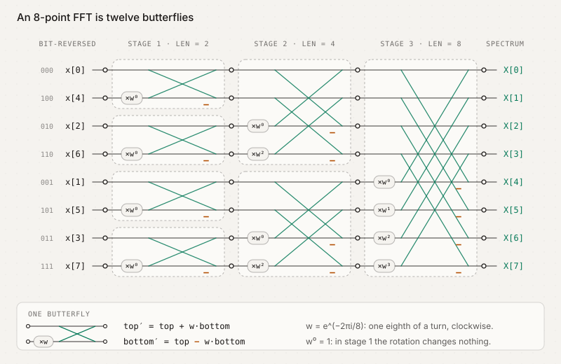
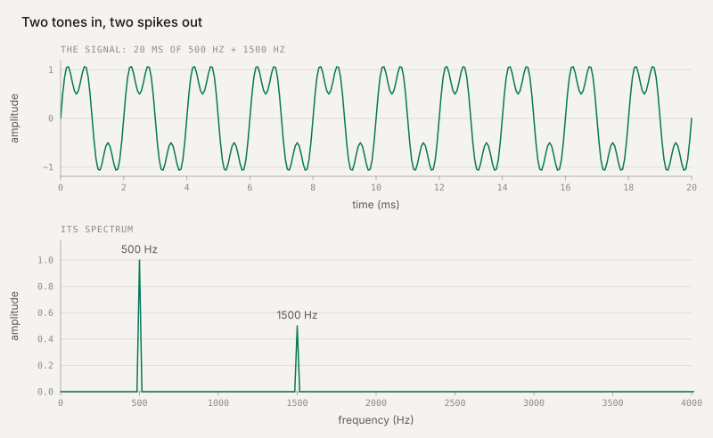
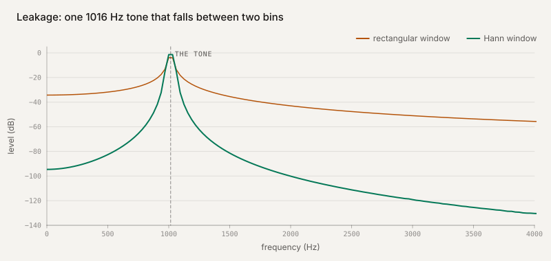
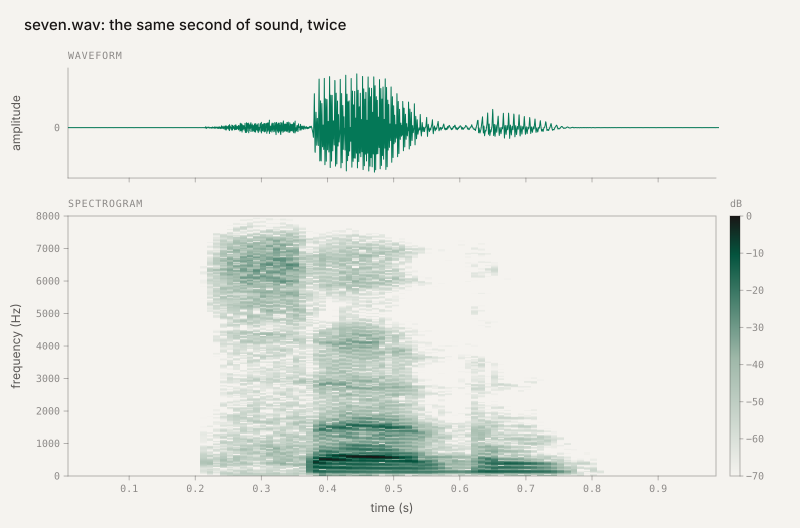

## The Fourier Transform, By Hand

At the end of the last chapter we could cut a recording into 25 millisecond frames, say how loud each frame is, and trim the silence off both ends. Then we ran into a wall: loudness cannot tell "seven" from "eleven". To do better we need to know *which frequencies* are in each frame.

That is today's problem, and it is the centerpiece of the first part of this book. We are going to work out, from nothing, a procedure that takes the 400 samples of one frame and returns a list: this much 100 Hz, this much 200 Hz, this much 300 Hz, and so on. The procedure is called the Fourier transform. We will write it the slow, obvious way first, then the fast way, then settle a claim chapter 2 made about windows without proof, and at the end turn a spoken word into a picture we can read.

### What Your Ear Already Knows

Try this before any maths. Sing "eeee" on one comfortable note, and without changing the note or the loudness, slide to "oooo". Same pitch. Same volume. Our energy meter from chapter 2 would not flinch. Yet nobody would confuse the two sounds.

What changed is the shape of your mouth. A vowel starts in your throat as a buzz: your vocal folds snap open and shut a hundred or two hundred times a second. A buzz is not a pure tone. It contains its basic frequency (the *pitch*, say 120 Hz) and also every multiple of it (240 Hz, 360 Hz, 480 Hz, ...), which are called *harmonics*. Your mouth and throat then act like an oddly shaped bottle: depending on where your tongue and lips are, some of those harmonics ring loudly and others are damped. The word you say is written in *which frequencies are emphasized*, and how that changes over time.

Your ear reads it out directly. Inside the inner ear there is a membrane that is stiff at one end and floppy at the other, so each stretch of it responds to a different frequency, and the nerves along it report "how much" for each place. The ear is a frequency analyzer. (Its quirks are the subject of the next chapter.)

So here is what we want to build: for one frame of samples, a list of numbers answering "how much 100 Hz is in here? How much 200 Hz?". That list is called the *spectrum* of the frame.

### Measuring One Frequency

Here is an idea that sounds too simple to work. To ask "how much 1,000 Hz is in this frame?", generate a clean 1,000 Hz wave of our own (call it the *probe*), multiply the frame by the probe sample by sample, and add up all the products.

Why would that measure anything? Think about the sign of each product. If the frame contains a 1,000 Hz wave that rises and falls in step with our probe, then wherever the probe is positive the frame is positive, and wherever the probe is negative the frame is negative. Either way the product is positive, so every product pushes the sum the same way and it piles up. If the frame contains some other frequency, the two waves drift in and out of step: the products are positive for a while, then negative for a while, and they cancel.

Let's check with numbers small enough to do by hand. Take a tiny frame of 8 samples recorded at 8,000 samples per second, so it lasts one millisecond. A 1,000 Hz cosine completes exactly one cycle in it:

```text
t                    0      1      2      3      4      5      6      7
frame              1.00   0.71   0.00  -0.71  -1.00  -0.71   0.00   0.71

probe: 1,000 Hz    1.00   0.71   0.00  -0.71  -1.00  -0.71   0.00   0.71
frame x probe      1.00   0.50   0.00   0.50   1.00   0.50   0.00   0.50    sum = 4

probe: 2,000 Hz    1.00   0.00  -1.00   0.00   1.00   0.00  -1.00   0.00
frame x probe      1.00   0.00   0.00   0.00  -1.00   0.00   0.00   0.00    sum = 0
```

The matching probe gives 4. The 2,000 Hz probe, which fits two cycles into the frame, gives exactly 0. So does a 3,000 Hz probe. Multiply-and-add (the proper name is *correlation*) is a detector that responds to one frequency and ignores the others.

Notice the 4, by the way. The frame has amplitude 1 and 8 samples, and we got 8 / 2. That is no accident: the products are the squares of a cosine, and a squared cosine averages one half. A wave of amplitude `a` in a frame of `n` samples scores `a * n / 2`. Hold that thought.

### The Phase Problem

There is a hole in this, and it is a big one. Our frame happened to start at the top of its cycle, exactly like the probe. Real frames start wherever they start. Slide the wave a quarter of a cycle later, which turns the cosine into a sine, and probe it again:

```text
t                    0      1      2      3      4      5      6      7
frame (a sine)     0.00   0.71   1.00   0.71   0.00  -0.71  -1.00  -0.71

probe: cosine      1.00   0.71   0.00  -0.71  -1.00  -0.71   0.00   0.71
frame x probe      0.00   0.50   0.00  -0.50   0.00   0.50   0.00  -0.50    sum = 0

probe: sine        0.00   0.71   1.00   0.71   0.00  -0.71  -1.00  -0.71
frame x probe      0.00   0.50   1.00   0.50   0.00   0.50   1.00   0.50    sum = 4
```

The cosine probe reports zero for a full-strength 1,000 Hz wave. A sine probe finds it, but a sine probe would have missed the first frame. Where a wave is in its cycle at the start of the frame is called its *phase*, and one probe cannot cope with an unknown phase.

The fix is to use both probes, always. Call the two sums `C` (against the cosine) and `S` (against the sine). A wave at any phase in between is a mixture of a cosine and a sine, so some of it shows up in `C` and the rest in `S`. For a wave of amplitude 1 that runs an angle φ behind the cosine probe, the sums come out as `C = 4 cos φ` and `S = 4 sin φ`. Neither is reliable alone, but combine them the way Pythagoras would:

```text
sqrt(C² + S²) = sqrt(16 cos²φ + 16 sin²φ) = 4        whatever φ is
```

So the answer to "how much 1,000 Hz?" is a *pair* of numbers. The pair `(C, S)` is a point on a sheet of paper. Its distance from the origin says how strong the frequency is, and its direction says what phase the wave has. For recognizing speech we will only keep the distance, but we need both numbers to compute it.

A pair of numbers treated as a point in the plane, with a length and a direction: there is a ready-made tool for that.

### Complex Numbers, Only What We Need

If complex numbers were presented to you as "the square root of minus one" and you decided they were not for you, I sympathize. Here is the version we need.

A *complex number* is a pair of ordinary numbers, `(re, im)`, drawn as a point: `re` steps to the right, `im` steps up. The two halves have the historical names "real part" and "imaginary part"; think of them as x and y. Every such point also has a *length* (its distance from the origin, `sqrt(re² + im²)`) and an *angle* (the direction from the origin, measured counterclockwise from "due right").

We need three operations on these pairs:

- **Add:** add the parts, `(a, b) + (c, d) = (a + c, b + d)`, like two arrows laid tip to tail.
- **Length:** Pythagoras, as above.
- **Multiply:** the one interesting rule. To multiply two complex numbers, *multiply their lengths and add their angles*. Multiplying by a number of length 1 therefore changes no lengths: it only rotates. That is why we want complex numbers at all.

In terms of the parts, "multiply lengths, add angles" works out to

```text
(a, b) * (c, d) = (a*c - b*d,  a*d + b*c)
```

and you can take that formula as the definition if you prefer. As a sanity check, take the point `(0, 1)`: length 1, straight up, a quarter turn. Multiply it by itself: the angles add to half a turn, so we land on `(-1, 0)`, and the formula agrees. The point `(0, 1)` is traditionally called `i`, and what we just computed is the famous `i * i = -1`: two quarter turns make a half turn.

One piece of notation remains. We will constantly need "the point of length 1 at angle θ", that is, the point `(cos θ, sin θ)` on the circle of radius 1 (the *unit circle*). Mathematicians write this point as

```text
e^(iθ) = cos θ + i sin θ
```

which is Euler's formula. For this book, read `e^(iθ)` as a name: "the point on the unit circle at angle θ". (The exponent is not arbitrary: multiplying two such points adds their angles, the way multiplying powers adds exponents.) Angles are in radians, so a full turn is 2π.

Enough of the talk, let's write some code! Our `Cargo.toml` has no dependencies and it is staying that way, so the complex number type is ours.

```rust
// src/dsp/fft.rs
use std::f64::consts::PI;
use std::ops::{Add, Mul, Sub};

/// A complex number `re + i * im`, with just the operations the FFT needs.
#[derive(Clone, Copy, Debug, PartialEq, Default)]
pub struct Complex {
    /// The real part: how much the signal looks like a cosine.
    pub re: f32,
    /// The imaginary part: how much it looks like a (negated) sine.
    pub im: f32,
}

impl Complex {
    /// The number 0.
    pub const ZERO: Complex = Complex { re: 0.0, im: 0.0 };

    /// `re + i * im`.
    pub fn new(re: f32, im: f32) -> Self {
        Complex { re, im }
    }

    /// The point on the unit circle at `angle` radians:
    /// `e^(i angle) = cos(angle) + i sin(angle)`. The angle is an `f64` so
    /// that the rounding happens once, at the end.
    pub fn from_angle(angle: f64) -> Self {
        Complex { re: angle.cos() as f32, im: angle.sin() as f32 }
    }

    /// The complex conjugate: the same point mirrored in the real axis.
    pub fn conj(self) -> Self {
        Complex { re: self.re, im: -self.im }
    }

    /// The squared length `re^2 + im^2`. For a spectrum bin this is its *power*.
    pub fn norm_sqr(self) -> f32 {
        self.re * self.re + self.im * self.im
    }

    /// The length (magnitude) `sqrt(re^2 + im^2)`.
    pub fn abs(self) -> f32 {
        self.norm_sqr().sqrt()
    }

    /// Multiply by a real number.
    pub fn scale(self, k: f32) -> Self {
        Complex { re: self.re * k, im: self.im * k }
    }
}
```

`from_angle` is Euler's formula as a function. `conj` flips the sign of the angle; we will need it once, for the inverse transform. The arithmetic goes on the operator traits so that we can write `a + b * c`:

```rust
// src/dsp/fft.rs
impl Add for Complex {
    type Output = Complex;
    fn add(self, o: Complex) -> Complex {
        Complex { re: self.re + o.re, im: self.im + o.im }
    }
}

impl Sub for Complex {
    type Output = Complex;
    fn sub(self, o: Complex) -> Complex {
        Complex { re: self.re - o.re, im: self.im - o.im }
    }
}

impl Mul for Complex {
    type Output = Complex;
    /// `(a + ib)(c + id) = (ac - bd) + i(ad + bc)`, because `i * i = -1`.
    /// Geometrically: lengths multiply and angles add.
    fn mul(self, o: Complex) -> Complex {
        Complex { re: self.re * o.re - self.im * o.im, im: self.re * o.im + self.im * o.re }
    }
}
```

That is the whole type. Its test in the repository, `complex_arithmetic`, is the list of facts from this section: `(1+2i)(3-i) = 5+5i`, `i * i = -1`, the length of `3+4i` is 5, a quarter turn lands on `i`.

### The DFT: Every Probe At Once

Now we can package the two probes into one. Instead of multiplying each sample by a cosine value and, separately, by a sine value, we multiply it by a single complex number: the point on the unit circle whose two parts *are* that cosine and that sine. Summing the products gives one complex number whose real part is `C` and whose imaginary part is (up to a sign we will get to) `S`.

Which frequencies should we probe? In a frame of `n` samples, the natural candidates are the waves that fit a whole number of cycles into the frame: 0 cycles, 1 cycle, 2 cycles, up to `n - 1`. Call the number of cycles `k`. At sample `t`, a wave making `k` cycles over `n` samples is a fraction `k * t / n` of the way through its turns, which is an angle of `2π k t / n`. So:

```text
X[k] = sum over t of  x[t] * e^(-2πi k t / n)        for k = 0, 1, ..., n-1
```

where `x[t]` is sample `t` of the frame and `X[k]` is the complex answer for probe `k`. This is the *discrete Fourier transform*, the DFT: "discrete" because it works on samples and not on a continuous wave. Each `X[k]` is called a *bin*, as in a bin that collects everything in the frame that looks like `k` cycles.

There is a second way to see the same formula that I find easier to hold in my head. Read `x[t] * e^(-2πi k t / n)` as "walk a distance `x[t]` in the direction given by the angle". As `t` advances the direction rotates steadily, `k` full turns over the frame, so we are winding the signal round the origin like thread round a spool. If the signal has nothing to do with `k` cycles, the steps point every which way and we end up back where we started. If it swells and shrinks in time with the winding, we march steadily off in one direction. `X[k]` is where we end up.

> **Play with it:** [the DFT as multiply-and-add, and as winding](../interactive/dft.html). Drag the probe across the signal's frequency and watch the sum collapse everywhere except at the match; then change the phase and watch the answer turn without changing length.

The minus sign in the exponent is a convention (the probe turns clockwise) that every library shares. Its only consequence for us is the one noted on our struct: the imaginary part of `X[k]` is the sum against a sine, *negated*.

The code is the formula with a `for` loop for each index:

```rust
// src/dsp/fft.rs
/// The discrete Fourier transform, straight from the definition. Works for
/// any length, and is the reference the fast version is tested against.
pub fn dft(input: &[Complex]) -> Vec<Complex> {
    let n = input.len();
    let mut output = Vec::with_capacity(n);
    for k in 0..n {
        // Correlate the input with a sinusoid that makes k turns over the block.
        let mut sum = Complex::ZERO;
        for (t, &x) in input.iter().enumerate() {
            // The angle is -2 pi k t / n. Only the position on the circle
            // matters, so we reduce k*t modulo n first, with exact integer
            // arithmetic, and keep the angle small and accurate.
            let turns = ((k * t) % n) as f64 / n as f64;
            sum = sum + x * Complex::from_angle(-2.0 * PI * turns);
        }
        output.push(sum);
    }
    output
}
```

The input is complex even though our samples are real numbers (we pass them in with `im = 0`); the inverse transform will need that later.

The `% n` avoids a numerical trap: for a 4,096-sample block the raw angle would be thousands of turns, and a float that spends its digits counting whole turns has few left for the position within the turn, which is all that matters.

Let's point it at the two tiny frames we did by hand: wrap each sample in a `Complex`, call `dft`, and print every bin with its length.

```text
cosine, one cycle in 8 samples:
  X[0] =  0.000 +0.000i    |X[0]| = 0.000
  X[1] =  4.000 +0.000i    |X[1]| = 4.000
  X[2] =  0.000 +0.000i    |X[2]| = 0.000
  ...
  X[6] =  0.000 +0.000i    |X[6]| = 0.000
  X[7] =  4.000 +0.000i    |X[7]| = 4.000
sine, one cycle in 8 samples:
  X[0] =  0.000 +0.000i    |X[0]| = 0.000
  X[1] =  0.000 -4.000i    |X[1]| = 4.000
  X[2] =  0.000 +0.000i    |X[2]| = 0.000
  ...
  X[6] = -0.000 +0.000i    |X[6]| = 0.000
  X[7] =  0.000 +4.000i    |X[7]| = 4.000
```

There is our 4, in bin 1, for both frames. The cosine put it in the real part and the sine in the imaginary part (negated, as promised), and the length does not care which. One bin lights up and the rest are dark. That is amazing.

Except that it is not quite one bin. If you have been paying attention, you'll notice bin 7 lit up as well.

### Reading The Bins

Three things need explaining before we can read a spectrum: what frequency a bin stands for, what that echo in bin 7 is, and what the size of the number means.

**Which frequency is bin k?** Bin `k` is the probe that makes `k` cycles per frame. A frame of `n` samples lasts `n / sample_rate` seconds, so `k` cycles per frame is `k * sample_rate / n` cycles per second:

```rust
// src/dsp/fft.rs
/// The frequency in Hz that bin `k` of a length-`n_fft` transform stands for.
pub fn bin_frequency(k: usize, n_fft: usize, sample_rate: u32) -> f32 {
    k as f32 * sample_rate as f32 / n_fft as f32
}
```

In our toy, bin 1 is `1 * 8000 / 8 = 1000` Hz. Bins are evenly spaced, `sample_rate / n` apart: 31.25 Hz for 512 samples at 16,000 samples per second. Bin 0 is the probe with zero cycles, a constant, so it just adds up the samples (engineers call it "DC", from direct current).

**Why did bin 7 light up?** Between one sample and the next, probe 7 advances seven eighths of a turn clockwise, which lands on the same spot as one eighth of a turn counterclockwise. At the eight sample instants, probe 7 is indistinguishable from probe 1 running backwards: the same cosine values, and the sine values negated. So for a frame of real numbers, bin `n - k` always holds the mirror image (the conjugate) of bin `k`. Look at the output above: `-4i` in bin 1, `+4i` in bin 7.

We have met this before. In chapter 1 we saw that a sampled signal cannot represent anything above half the sample rate, the Nyquist frequency, and that a tone above it shows up disguised as a lower one. Bin 7 of 8 would be 7,000 Hz at 8,000 samples per second, far above the 4,000 Hz limit, and it is an alias of 1,000 Hz. The upshot: for real input, only bins `0` through `n/2` carry information, which is `n/2 + 1` of them. From a 512-point transform we keep 257 numbers, from 0 Hz up to the Nyquist frequency, and throw the mirror half away.

**How big should the number be?** Our forward transform is the bare sum, with no scaling, which is what most libraries do. So bigger frames give bigger numbers:

- a constant signal of value `c` gives `X[0] = c * n`;
- a sine of amplitude `a` that fits exactly `k` cycles gives `|X[k]| = a * n / 2` (the `n / 2` we saw by hand; the other half of its energy is in the mirror bin);
- to turn a bin back into an amplitude, compute `2 * |X[k]| / n`.

### Too Slow

The DFT is correct, and for one frame nobody would notice its cost. But count what our recognizer will ask of it. A 512-point transform needs `512 * 512 = 262,144` complex multiplications (each with a cosine and a sine). A one-second clip has 98 frames, so about 25.7 million multiplications per clip. The Speech Commands dataset we train on later has roughly 105,000 clips: 2.7 trillion multiplications to look at the data once.

The work grows with the square of the frame length. The *fast Fourier transform*, the FFT, computes exactly the same numbers with work proportional to `n * log2(n)`. It approximates nothing. It notices that the naive loop computes the same things over and over.

### The Trick: Even And Odd

Here is the idea. Take a frame of `n` samples (`n` even) and deal it into two piles like a deck of cards: the even-numbered samples `x[0], x[2], x[4], ...` and the odd-numbered ones `x[1], x[3], x[5], ...`. Each pile has `n / 2` samples. Compute the DFT of each pile, and call the results `Even[k]` and `Odd[k]`. The claim is that the full transform can be assembled from those two half-size ones, cheaply.

Start from the definition and split the sum into the two piles. In the even pile, sample `x[2m]` gets angle `2π k (2m) / n`, which is `2π k m / (n/2)`: precisely the angle that sample `m` gets in a DFT of length `n / 2`. So the even half of the sum *is* `Even[k]`. In the odd pile, sample `x[2m + 1]` gets angle `2π k (2m + 1) / n`, which is the same thing plus one extra step of `2π k / n`. That extra step is the same for every term, so it factors out as a single rotation:

```text
X[k] = Even[k] + w^k * Odd[k]            where  w = e^(-2πi / n)
```

`w` is one `n`-th of a turn, and `w^k` is `k` of those steps. In words: the odd samples sit one sample later than their even neighbours, and to probe `k` a delay of one sample is a rotation by `k / n` of a turn.

So far this is rearranging. The payoff is in the top half of the output. `Even` and `Odd` only have `n / 2` bins each. What about `X[k + n/2]`? Ask what probe `k + n/2` does on the even pile: between consecutive even samples it advances `2 * (k + n/2) / n` turns, which is `2k / n` turns *plus one whole turn*. A whole turn is invisible. On the half-size pile, probe `k + n/2` and probe `k` are the same probe, so `Even[k + n/2] = Even[k]`, and likewise for `Odd`. The only thing that changes is the extra rotation: `w^(k + n/2)` is `w^k` followed by another half turn, and a half turn is multiplying by -1. Therefore:

```text
X[k]       = Even[k] + w^k * Odd[k]
X[k + n/2] = Even[k] - w^k * Odd[k]        for k = 0 .. n/2 - 1
```

One multiplication, `w^k * Odd[k]`, gives *two* outputs: add it for the bottom half, subtract it for the top half.

Let's see it concretely with `n = 4` and the frame `[1, 2, 3, 4]`. The even pile is `[1, 3]` and the odd pile is `[2, 4]`. A DFT of length 2 is a sum and a difference, so `Even = [4, -2]` and `Odd = [6, -2]`. For `n = 4`, `w` is a quarter turn clockwise, the point `(0, -1)`, also known as `-i`.

```text
X[0] = Even[0] + w^0 * Odd[0] =  4 + 6         = 10
X[1] = Even[1] + w^1 * Odd[1] = -2 + (-i)(-2)  = -2 + 2i
X[2] = Even[0] - w^0 * Odd[0] =  4 - 6         = -2
X[3] = Even[1] - w^1 * Odd[1] = -2 - (-i)(-2)  = -2 - 2i
```

Two multiplications where the definition uses sixteen. This exact example is in the test suite as `dft_of_four_samples_by_hand`, run against both the slow and the fast code.

Now the part that turns a saving into an avalanche: the two half-size transforms can be computed the same way, from quarter-size ones, and those from eighth-size ones, down to a transform of length 1, which is the sample itself (one sample, zero turns, nothing to do). If `n` is a power of two we can halve it `log2(n)` times. At every level, putting the pieces together costs `n / 2` multiplications in total. So the whole thing costs `(n / 2) * log2(n)`: for 512 samples that is `256 * 9 = 2,304` multiplications where the definition needs 262,144.

The price of admission is that `n` must be a power of two. That is why you see 256, 512 and 1024 everywhere in audio code, and why we will soon be padding our 400-sample frames.

**Aside** <br>

The algorithm is usually credited to James Cooley and John Tukey, whose 1965 paper put it in every engineer's hands. It later turned out that Carl Friedrich Gauss had used essentially the same trick around 1805, in a note that was only published after his death.

### The Recursive FFT

The derivation is recursive, so the most direct code is recursive too. We write this version first because every line of it is a line of the argument above:

```rust
// src/dsp/fft.rs
/// The FFT exactly as the derivation goes. `input.len()` must be a power of two.
pub fn fft_recursive(input: &[Complex]) -> Vec<Complex> {
    let n = input.len();
    assert!(n.is_power_of_two(), "FFT length must be a power of two, got {n}");
    if n == 1 {
        return vec![input[0]];
    }
    let even: Vec<Complex> = input.iter().step_by(2).copied().collect();
    let odd: Vec<Complex> = input.iter().skip(1).step_by(2).copied().collect();
    let (even, odd) = (fft_recursive(&even), fft_recursive(&odd));

    let mut output = vec![Complex::ZERO; n];
    for k in 0..n / 2 {
        let rotated = odd[k] * Complex::from_angle(-2.0 * PI * k as f64 / n as f64);
        output[k] = even[k] + rotated;
        output[k + n / 2] = even[k] - rotated;
    }
    output
}
```

Not bad for fifteen lines. It is already far faster than the naive loop, but look at what it does besides arithmetic: it allocates three vectors at every level of the recursion, and it calls `cos` and `sin` afresh for every multiplication. For a transform we will run a hundred times per second of audio, we can do much better without changing the mathematics.

### The FFT We Ship: In Place, Bottom Up

Two observations get us there.

**The rotations are always the same.** Every `w^k` the recursion ever asks for, at any level, is one of the `n` points evenly spaced round the unit circle, and in fact one of the first `n / 2` of them. If we are going to transform thousands of frames of the same length, we can compute those points once and keep them in a table. In FFT folklore the entries are called *twiddle factors*, and an object that holds the precomputed tables for one transform length is called a *plan*:

```rust
// src/dsp/fft.rs
/// An FFT of one fixed length, with its table of sines and cosines computed
/// once up front. The transform itself needs no trigonometry at all.
#[derive(Clone, Debug)]
pub struct Fft {
    n: usize,
    /// "Twiddle factors": `twiddles[j] = e^(-2 pi i j / n)` for `j < n/2`,
    /// the first half of the `n` points evenly spaced round the unit circle.
    twiddles: Vec<Complex>,
}

impl Fft {
    /// Prepare transforms of length `n`, which must be a power of two.
    pub fn new(n: usize) -> Self {
        assert!(n.is_power_of_two(), "FFT length must be a power of two, got {n}");
        let twiddles = (0..n / 2).map(|j| Complex::from_angle(-2.0 * PI * j as f64 / n as f64)).collect();
        Fft { n, twiddles }
    }

    // ... `len()` returns n, and `is_empty()` returns false to keep Clippy happy

    // forward, inverse and power_spectrum_into follow below
}
```

**The recursion only shuffles, then combines.** On the way down, the recursive version does no arithmetic: it only deals samples into piles. All the arithmetic happens on the way back up. So we can do the shuffling in one go, up front, and then combine in plain loops: first all the transforms of length 2, then all those of length 4, and so on, each written over the buffer that held its two halves. No recursion, no allocation.

Where does the shuffle put each sample? Follow it for `n = 8`. The first deal sends even indices left and odd indices right: `[0 2 4 6 | 1 3 5 7]`. Dealing each half again gives `[0 4 | 2 6 | 1 5 | 3 7]`. Write those indices in binary and read down the list: `000, 100, 010, 110, 001, 101, 011, 111`. Now read each one backwards: `000, 001, 010, 011, ...`, which is just counting. The sample that ends up at position `p` is the one whose index is `p` *with its bits reversed*. The first deal sorts by the lowest bit of the index (even or odd), the second by the next bit, and so on, so the lowest bit becomes the most significant part of the position.

After the shuffle, each combining step is the pair of formulas from before, applied to two values that sit `half` apart in the buffer:

```text
top'    = top + w * bottom
bottom' = top - w * bottom
```

Drawn as a diagram, the two crossing lines of this step look like a bow tie, or with some goodwill a butterfly, and *butterfly* is what everyone calls it. Here is the complete network for 8 samples:



*The 8-point FFT: three stages of four butterflies each. The dashed boxes are the transforms being built, and each one is made from the two boxes to its left.*

Read it left to right. Each box in stage 2 takes two finished transforms of length 2 (the upper one is `Even`, the lower one `Odd`) and makes one of length 4. Stage 3 does it once more. Three stages (`log2(8)`), four butterflies per stage (`8 / 2`), twelve multiplications in all, against 64 for the definition.

And the code:

```rust
// src/dsp/fft.rs (inside impl Fft)
    /// Forward transform, in place.
    pub fn forward(&self, buf: &mut [Complex]) {
        let n = self.n;
        assert_eq!(buf.len(), n, "this FFT was planned for length {n}, got a buffer of {}", buf.len());
        if n < 2 {
            return;
        }

        // Step 1: reorder. Splitting into even/odd again and again sorts the
        // samples by their index *with its bits reversed* (even/odd is the
        // lowest bit, and it is decided first). So sample 1 = 0b001 of 8
        // moves to position 0b100 = 4.
        let bits = n.trailing_zeros();
        for i in 0..n {
            let j = i.reverse_bits() >> (usize::BITS - bits);
            if i < j {
                buf.swap(i, j);
            }
        }

        // Step 2: combine. `len` is the size of the transforms being built.
        let mut len = 2;
        while len <= n {
            let half = len / 2;
            // We need e^(-2 pi i j / len); the table has steps of 1/n of a
            // turn, so we walk through it in strides of n / len.
            let stride = n / len;
            for block in buf.chunks_exact_mut(len) {
                let (even, odd) = block.split_at_mut(half);
                for j in 0..half {
                    let rotated = odd[j] * self.twiddles[j * stride];
                    let e = even[j];
                    even[j] = e + rotated; // the "butterfly": one sum,
                    odd[j] = e - rotated; //  one difference, same two inputs
                }
            }
            len *= 2;
        }
    }
```

A few details are worth a second look.

`n.trailing_zeros()` is `log2(n)` for a power of two: 512 is a 1 followed by nine zeros. `reverse_bits` reverses all 64 bits of a `usize`, which flings our 9 interesting bits to the top of the word, so we shift them back down by `64 - 9`. The `if i < j` makes sure each pair is swapped once; without it we would swap everything and then swap it all back.

`chunks_exact_mut(len)` hands us the dashed boxes of the diagram one at a time, and `split_at_mut(half)` splits a box into its upper and lower halves as two separate mutable slices. The butterfly writes to `block[j]` and `block[j + half]` at the same time, and this is how we prove to the borrow checker that the two never overlap.

The `stride` is the only subtle line. Transforms of length `len` need steps of `1 / len` of a turn, while our table has steps of `1 / n`, so we take every `n / len`-th entry. In stage 1 the only entry used is `twiddles[0]`, which is 1. In the last stage the stride is 1 and we use the whole table.

For callers with one buffer and no plan lying around, `fft(buf)` is a one-line wrapper: `Fft::new(buf.len()).forward(buf)`.

### Going Back: The Inverse Transform

The transform loses nothing: from the `n` complex bins we can rebuild the `n` samples exactly. The recipe is nearly the same sum, turning the other way, divided by `n`:

```text
x[t] = (1/n) * sum over k of  X[k] * e^(+2πi k t / n)
```

In words: play every probe back at the strength and phase measured for it, and add them up. We do not need a second FFT for this. Flipping the sign of every angle is what `conj` does, so we conjugate the input, run the forward transform, conjugate the result, and scale:

```rust
// src/dsp/fft.rs (inside impl Fft)
    /// Inverse transform, in place, including the `1/n` scaling.
    pub fn inverse(&self, buf: &mut [Complex]) {
        for x in buf.iter_mut() {
            *x = x.conj();
        }
        self.forward(buf);
        let scale = 1.0 / self.n as f32;
        for x in buf.iter_mut() {
            *x = x.conj().scale(scale);
        }
    }
```

`ifft(buf)` is the matching wrapper, `Fft::new(buf.len()).inverse(buf)`.

Our recognizer only ever goes forward. The inverse earns its place as a test: if we can go there and back and get our samples again, both directions are almost certainly right.

### How Do We Know It Works?

An FFT with a bug still returns numbers, and they look just as plausible as the right ones. So we pin it down from several sides, and each test is also a small fact about spectra worth knowing. Three helpers appear below: `real` wraps real values in `Complex`, `random` fills a vector from the random number generator we will write in chapter 6, and `assert_close` compares two spectra element by element.

**A click contains every frequency.** A single 1 followed by zeros is called an *impulse*. Only the `t = 0` term of the sum survives, and at `t = 0` every probe is at angle zero, so every bin gets exactly 1. **A constant contains only frequency zero.**

```rust
// src/dsp/fft.rs (tests)
#[test]
fn impulse_has_a_flat_spectrum() {
    // A single click contains every frequency equally.
    let mut buf = vec![Complex::ZERO; 64];
    buf[0] = Complex::new(1.0, 0.0);
    fft(&mut buf);
    assert_close(&buf, &vec![Complex::new(1.0, 0.0); 64], 1e-6);
}

#[test]
fn constant_signal_lands_in_bin_zero() {
    let mut buf = real(&[0.5; 32]);
    fft(&mut buf);
    assert!((buf[0] - Complex::new(16.0, 0.0)).abs() < 1e-5); // c * n
    assert!(buf[1..].iter().all(|x| x.abs() < 1e-5));
}
```

These two are opposites, and that is a general rule: the more sharply something is located in time, the more it spreads out in frequency, and the other way round. It will come back to bite us.

**A sine lands in its bin, at the right height.** This one checks the bin arithmetic and the scaling convention together. (It uses `power_spectrum`, which we will write shortly; it returns `|X[k]|²` for the 257 useful bins.)

```rust
// src/dsp/fft.rs (tests)
#[test]
fn sine_lands_in_its_bin_with_magnitude_a_n_over_2() {
    // 1 kHz at 16 kHz in 512 samples completes exactly 32 cycles.
    let (n, sample_rate, amplitude) = (512, 16000, 0.8f32);
    let frame: Vec<f32> =
        (0..n).map(|t| amplitude * (2.0 * PI * 1000.0 * t as f64 / sample_rate as f64).sin() as f32).collect();
    let power = power_spectrum(&frame, n);
    assert_eq!(power.len(), 257);
    let peak = (0..power.len()).max_by(|&a, &b| power[a].total_cmp(&power[b])).unwrap();
    assert_eq!(peak, 32);
    assert_eq!(bin_frequency(peak, n, sample_rate), 1000.0);
    let expected_magnitude = amplitude * n as f32 / 2.0;
    assert!((power[32].sqrt() - expected_magnitude).abs() < 1e-2, "{} vs {expected_magnitude}", power[32].sqrt());
    // Everything else is rounding noise.
    for (k, &p) in power.iter().enumerate() {
        assert!(k == 32 || p < 1e-4, "bin {k} has power {p}");
    }
}
```

**The fast versions agree with the slow one**, on random input, for sizes from 1 to 1024. The naive `dft` is too simple to be wrong in an interesting way, so it is our reference. **And the inverse undoes the forward.**

```rust
// src/dsp/fft.rs (tests)
#[test]
fn fft_agrees_with_dft_on_random_input() {
    for n in [1, 2, 4, 8, 64, 256, 1024] {
        let input = random(n, n as u64);
        let slow = dft(&input);
        let mut fast = input.clone();
        fft(&mut fast);
        assert_close(&fast, &slow, 2e-3);
        assert_close(&fft_recursive(&input), &slow, 2e-3);
    }
}

#[test]
fn ifft_undoes_fft() {
    let input = random(512, 9);
    let mut buf = input.clone();
    fft(&mut buf);
    ifft(&mut buf);
    assert_close(&buf, &input, 1e-4);
}
```

**Energy is the same on both sides.** In chapter 2 we measured the energy of a frame as the sum of its squared samples. The spectrum holds the same energy, shared out among the bins: the sum of `|X[k]|²`, divided by `n` because of our unscaled convention. This is *Parseval's theorem*: the spectrum is a full account of where the frame's energy went.

```rust
// src/dsp/fft.rs (tests)
#[test]
fn parseval_energy_is_the_same_on_both_sides() {
    let input = random(256, 3);
    let time_energy: f32 = input.iter().map(|x| x.norm_sqr()).sum();
    let mut spectrum = input.clone();
    fft(&mut spectrum);
    let freq_energy: f32 = spectrum.iter().map(|x| x.norm_sqr()).sum::<f32>() / 256.0;
    assert!((time_energy - freq_energy).abs() / time_energy < 1e-5, "{time_energy} vs {freq_energy}");
}
```

There are a few more in the file (the naive DFT on a length that is not a power of two, zero-padding, and a `should_panic` for `fft` on 12 samples). `cargo test fft` runs the lot:

```text
test result: ok. 11 passed; 0 failed; 0 ignored; 0 measured; 238 filtered out; finished in 0.01s
```

### Racing Them

The example for this chapter, `ch03_fft`, does four things, and we will take its output piece by piece. Go ahead and run it:

```text
$ cargo run --release --example ch03_fft
DFT (n^2) against FFT (n log n) on random complex input:

     n      naive DFT            FFT    speed-up    n^2 / (n log2 n)    largest difference
   256    448.24 us        1.02 us        438x              32x        1.9e-5
   512      1.41 ms        2.04 us        691x              57x        5.0e-5
  1024      4.91 ms        4.31 us       1140x             102x        9.3e-5
  2048     19.01 ms        9.55 us       1991x             186x        3.8e-4
  4096     74.61 ms       19.86 us       3757x             341x        5.0e-4

ifft(fft(x)) for 1024 random samples: largest error 7.2e-7
...
```

These timings are from my machine (an Apple M4 Max); yours will differ, but the shape will not. Each time `n` doubles, the naive DFT takes three to four times as long and the FFT a little more than twice as long. That is `n²` against `n log n`, measured. The last column says the two disagree by rounding error only.

For our 512-point frames: 1.41 milliseconds against 2.04 microseconds. Remember the dataset of 105,000 one-second clips, 98 frames each? With the naive transform, one pass over it would spend about four hours in the DFT. With the FFT, about 21 seconds.

Now the honest part. The measured speed-up at 512 is 691x, but the column next to it says theory predicts 57x. Where does the other factor of twelve come from? The comparison is not a fair fight, in three ways:

- The textbook ratio `n² / (n log2 n)` drops a constant. Our FFT does `(n/2) * log2(n)` multiplications, half of `n log2 n`, so in multiplications the ratio at 512 is 114x.
- The naive `dft` computes a cosine and a sine for each of its 262,144 products. The plan looks its rotations up in a table. As a side experiment I gave the naive loop a table too (still two nested loops, still `n²`): it dropped to about 330 microseconds on the same machine, roughly 150 times slower than the FFT. So trigonometry alone was a factor of four or five.
- The rest I have not taken apart. My guess is the integer `%` in the naive inner loop.

The same side experiment timed the recursive version at 512 points: about 53 microseconds, some thirty times faster than the naive loop and about twenty-five times slower than the version we ship. Same algorithm, same multiplications; the difference is all allocation and trigonometry.

### A Spectrum We Can Check

Next the example builds a signal whose contents we know, a 500 Hz sine of amplitude 1 plus a 1,500 Hz sine of amplitude 0.5, and asks our code what is in it:

```text
two tones, 500 Hz (amplitude 1.0) + 1500 Hz (amplitude 0.5), 1024 samples at 16000 Hz:
  513 bins from 0 to 8000 Hz, 15.625 Hz apart
  bin  32 =  500.0 Hz   amplitude 1.0000
  bin  96 = 1500.0 Hz   amplitude 0.5000
  bin 160 = 2500.0 Hz   amplitude 0.0000
  (the third strongest bin is rounding noise)
  wrote ../figures/ch03-spectrum-two-tones.svg
```



*Two tones in, two spikes out. The amplitudes are recovered as `2 |X[k]| / n`.*

Looking at the waveform on top, could you have said what it was made of? The transform reads off both frequencies and both amplitudes to four decimal places. (The figures are drawn by a small SVG helper in the repository, `plot.rs`, which we will not go through.)

This result is a little too clean, though, because the example cheated. With 1,024 samples at 16 kHz the bins are 15.625 Hz apart, and 500 Hz and 1,500 Hz were picked to land exactly on bins 32 and 96. Both tones complete a whole number of cycles in the frame. Speech will not be so considerate.

### Leakage: The Proof We Owed You

In chapter 2 we multiplied every frame by a Hann window, a smooth hump that fades the frame in and out, and claimed that the Fourier transform would behave badly otherwise. Time to pay up.

The DFT has probes for whole numbers of cycles only: 32 cycles per frame, 33 cycles per frame, and nothing in between. What does it say about a tone that completes 32 and a half? No probe matches it, but none cancels it perfectly either, because the cancellation we relied on only works out exactly over whole cycles. Every probe is left with a remainder. The tone's energy *leaks* into all the bins.

There is another way to see it. Lay copies of the frame end to end. A wave with a whole number of cycles continues seamlessly; with 32.5 cycles there is a sudden jump at every seam. A jump is a sharp event in time, a relative of the impulse from our test, and sharp events contain every frequency.

The third part of the example measures the damage. It puts a single tone exactly halfway between bins 32 and 33 of a 512-point FFT, the worst case, and takes its spectrum twice: once on the raw frame (which is the same as applying a *rectangular* window, all ones) and once with a Hann window. Levels are in decibels relative to the tone's true level, so 0 means "all of it" and every -20 dB is a factor of ten in amplitude.

```text
leakage: a 1015.6 Hz tone falls between bins 32 and 33 of a 512-point FFT.
  level in dB (0 = the tone's true level)   at the peak   10 bins away   50 bins away   100 bins away
  rectangular                                    -3.9          -30.6          -48.1           -56.1
  Hann                                           -1.4          -68.5         -112.3          -131.8
  wrote ../figures/ch03-leakage.svg
```



*One tone, two windows. The rectangular window (amber) spreads the tone over the entire spectrum; the Hann window (green) keeps it where it belongs.*

Remember that there is one frequency in this signal. With the rectangular window, a hundred bins away (more than 3,000 Hz from the tone) the spectrum still reads -56 dB. That may sound small. For speech it is not: as we are about to see, the upper bands of a vowel sit 30 to 50 dB below its strongest low harmonic, so the leakage from the loud part of the spectrum would be about as strong as the quiet parts we are trying to see. With the Hann window the leak at ten bins is already down at -68 dB, and further out it falls below -110 dB.

The window is not free. Fading out the edges means effectively looking at a shorter stretch of signal, and a shorter look gives a blurrier frequency reading: the Hann peak is spread over about four bins where the rectangular one takes two. It is the impulse-and-constant trade again. We give up a little sharpness near the tone for a clean floor everywhere else, and for speech that is a bargain.

> **Play with it:** [windows and leakage](../interactive/windowing.html). Slide the tone's frequency slowly from one bin to the next and watch the rectangular spectrum bloom and collapse, then add a second, quiet tone and try to find it without the Hann window.

### The Power Spectrum

We now have everything needed for the function the rest of the book calls: take one windowed frame of real samples, return how much energy is at each frequency. Three decisions go into it.

We return `|X[k]|²`, the squared length, which is called *power*. It fits the energy we have used since chapter 2 (Parseval again) and saves a square root per bin. The phase is thrown away: which word was said depends very little on where each harmonic is in its cycle, and a great deal on how strong it is.

We return only bins `0 ..= n/2`, since the rest is the mirror image.

And we *zero-pad*: our frames are 400 samples, the FFT wants a power of two, so we append 112 zeros to make 512. More on what that does in a moment.

Since this runs for every frame of every clip, the workhorse is a method on the plan that does not allocate; the caller owns the scratch buffer and the output:

```rust
// src/dsp/fft.rs (inside impl Fft)
    /// Power spectrum of a real frame: `|X[k]|^2` for `k = 0 ..= n/2`,
    /// written to `out`. The frame is zero-padded up to the FFT length.
    ///
    /// `scratch` is working memory that the caller keeps between calls so
    /// that we do not allocate once per frame.
    pub fn power_spectrum_into(&self, frame: &[f32], scratch: &mut Vec<Complex>, out: &mut [f32]) {
        assert!(frame.len() <= self.n, "frame of {} samples does not fit in an FFT of length {}", frame.len(), self.n);
        assert_eq!(out.len(), self.n / 2 + 1, "a length-{} FFT has {} bins up to Nyquist", self.n, self.n / 2 + 1);
        scratch.clear();
        scratch.extend(frame.iter().map(|&x| Complex::new(x, 0.0)));
        scratch.resize(self.n, Complex::ZERO);
        self.forward(scratch);
        for (power, bin) in out.iter_mut().zip(scratch.iter()) {
            *power = bin.norm_sqr();
        }
    }
```

The `zip` stops when `out` runs out, so the mirror half of `scratch` is never read. For one-off use there is a plain function that builds a plan and throws it away:

```rust
// src/dsp/fft.rs
/// Power spectrum of a real frame: `|X[k]|^2` for `k = 0 ..= n_fft/2`.
pub fn power_spectrum(frame: &[f32], n_fft: usize) -> Vec<f32> {
    let mut out = vec![0.0; n_fft / 2 + 1];
    Fft::new(n_fft).power_spectrum_into(frame, &mut Vec::new(), &mut out);
    out
}
```

**What zero-padding buys, and what it does not.** Padding 400 samples to 512 changes the bin spacing from 40 Hz to 31.25 Hz, which looks like better resolution for free. It is not. The zeros carry no information about the sound. Our frame is still 25 milliseconds long, and two tones closer together than roughly `1 / 0.025 = 40` Hz still melt into one bump. Padding samples the *same* blurry spectrum at more points. Pad the loudest frame of "seven" all the way to 4,096 and I get a peak at 585.9 Hz where 512 said 593.75 Hz: the same bump read off a finer ruler. What padding really buys is permission to use the fast algorithm on a frame length chosen for speech reasons (25 ms) and not arithmetic ones. The alternative, cutting the frame to 256 samples, would throw away a third of it.

### The Spectrogram

One spectrum describes 25 milliseconds. A word is a sequence of sounds, so we do what chapter 2 taught us: slide along the signal in hops of 10 ms and compute a spectrum for every frame. Stack the results and we get a grid, with one row per frame and one column per frequency bin. This is the *spectrogram* (the procedure has the grander name *short-time Fourier transform*, or STFT).

The grid needs a type. We use `Mat`, a `Vec<f32>` that knows its number of rows and columns, with `row_mut(i)` handing out one row as a slice. It lives in `src/mat.rs` and we will write it properly in chapter 6; for now a grid of numbers is all it is. `frames` is the framing function from chapter 2.

```rust
// src/dsp/spectrogram.rs
use crate::dsp::fft::{Complex, Fft};
use crate::dsp::frame::frames;
use crate::mat::Mat;

/// Power spectrogram: one row per frame, one column per frequency bin
/// (`n_fft / 2 + 1` of them, from 0 Hz up to half the sample rate).
pub fn power_spectrogram(samples: &[f32], window: &[f32], hop_len: usize, n_fft: usize) -> Mat {
    let fft = Fft::new(n_fft);
    let n_bins = n_fft / 2 + 1;
    let all_frames = frames(samples, window.len(), hop_len);

    let mut out = Mat::zeros(all_frames.len(), n_bins);
    // Two buffers reused for every frame, so the loop does not allocate.
    let mut windowed = vec![0.0f32; window.len()];
    let mut scratch: Vec<Complex> = Vec::with_capacity(n_fft);
    for (i, frame) in all_frames.into_iter().enumerate() {
        for ((w, x), win) in windowed.iter_mut().zip(frame).zip(window) {
            *w = x * win;
        }
        fft.power_spectrum_into(&windowed, &mut scratch, out.row_mut(i));
    }
    out
}
```

Frame, window, pad, transform, square: everything so far is in those few lines. One plan serves every frame, and each spectrum is written straight into its row of the output.

If we plotted these numbers as they are, we would see almost nothing. In the spectrogram of our sample "seven", the largest cell is about 340 million times the median cell, and only 276 of the 25,186 cells are above one percent of the maximum. Drawn on a linear scale, the picture is a few dark specks on a blank page. It is the problem we had with energy in chapter 2, with the same solution: decibels.

```rust
// src/dsp/spectrogram.rs
/// Convert one power value to decibels: `10 log10(power)`, with a floor at
/// -100 dB so that zero does not become minus infinity.
pub fn db(power: f32) -> f32 {
    10.0 * power.max(1e-10).log10()
}

/// Convert a power spectrogram to decibels **relative to its loudest cell**
/// (which becomes 0 dB), keeping only the top `dynamic_range_db`.
pub fn power_to_db(power: &Mat, dynamic_range_db: f32) -> Mat {
    let peak = power.data.iter().copied().fold(0.0f32, f32::max);
    let peak_db = db(peak);
    power.map(|p| (db(p) - peak_db).max(-dynamic_range_db))
}
```

It is `10 log10` here and not the `20 log10` used for amplitudes, because power is already amplitude squared. Clipping the bottom matters as much as the logarithm: digital silence would otherwise sit a hundred decibels or more down and use up most of the color scale.

The last function in the file, `time_extent`, is bookkeeping for the plot: a frame is best represented by its middle, so the first cell of the picture is centred half a frame in, and `time_extent` works out where the time axis starts and ends so that the picture lines up with the waveform above it.

The tests pin the shape (one second at 16 kHz gives 98 rows of 257 bins) and check the spectrogram's reason for existing in miniature: a tone that jumps from 1,000 Hz to 3,000 Hz halfway through is loudest in bin 32 early on and in bin 96 at the end.

### Reading "Seven"

The last part of the example runs all of this on a real recording, `samples/seven.wav`, the clip we have been carrying since chapter 1. Here is the rest of the output:

```text
spectrogram of ../samples/seven.wav:
  400-sample Hann frames every 160 samples, FFT length 512
  98 frames x 257 bins; a bin is 31.25 Hz wide, the top one is 8000 Hz
  loudest frame: #45 (0.45 s), strongest at bin 19 = 594 Hz

  time left to right, 0 Hz at the bottom to 8000 Hz at the top, darker = louder (70 dB range):

                     ░  ░ ░                                               
                   ░░▒▒▒▒▒▒▒░░ ░░░░░░░░░                                  
                  ░▒▒▒▒▒▓▓▓▓░░▒░▒░░▒░░░░░                                 
                  ░▒▒▒▒▓▒▒▓▓▒░░░▒▒▒▒░░░░░                                 
                  ░▒▒▒▒▒▒▒▓▒░░░░░░▒▒░░░ ░                                 
                  ░░░▒▒▒▒▒▒▒░░                                            
                   ░░░░░░░░▒░░ ░▒░░░░░                                    
                    ░░░░▒░░░░░▒▒▒▒▒▒▒▒░░                                  
                     ░░░░░░░ ░░░▒▒▒▒▒▒▒▒░░                                
                      ░  ░░░░░░░▒░▒░░▒░░░       ░                         
                     ░░░░░░░░▒▒▒▒▒▒▒▒▒▒▒▒░     ░░ ░                       
                     ░░░░ ░░░░░░▒▒░▒░▒▒░░░     ░                          
                    ░░░░░░░░░▒▓▓▓▓▓▓▓▓▒▒▒▒░    ░░░░░░                     
                   ░░░░░░░░░░▓▓▓▓▓▓▓▓█▓▓▓▒▒░░ ░░▒░░░░░░░                  
                 ░░░░▒░░▒▒▒░▒████████████▒▒▒▒▒▒▒▓▓▒▒▒░░░░                 
                 ░░░░░░░▒▒▒▒▒████████████▓▓▓▓▓▓▓▓█▓▓▓▓▓▓▓▓░░░             

  wrote ../figures/ch03-spectrogram.svg
```

Even in sixteen rows of terminal characters there is a shape, and it is not the waveform's. Here is the proper picture:



*"Seven", twice: as air pressure over time, and as frequency content over time. Darker is louder, over a range of 70 dB.*

Time runs left to right, and in the lower panel frequency runs bottom to top. Let's read it together, one sound at a time.

**"s", from about 0.22 to 0.37 s.** In the waveform this is the unimpressive fuzz before the main event. In the spectrogram it is a tall cloud sitting high up: in these frames, over 90% of the energy is above 4,000 Hz. An "s" is not made by the vocal folds at all. It is air forced through a narrow gap behind the teeth, which makes noise, and noise has no pitch and no harmonics, so the cloud has no regular structure. A telephone line carries nothing above about 3,400 Hz, which is why "s" and "f" are so hard to tell apart on the phone.

**The first "e", from about 0.38 to 0.53 s.** The picture flips. Now the vocal folds are buzzing, the energy drops to the bottom of the plot (less than 1% of it is above 4,000 Hz) and it arranges itself in dark horizontal bands: the strongest around 600 Hz, another near 1,500 Hz, and fainter ones higher up. These bands are the resonances of the mouth from the start of the chapter, the frequencies this mouth shape lets ring. They are called *formants*, and their positions are what makes this vowel an "e" and not an "o". We are looking at the shape of someone's mouth.

**The fine stripes.** Look closely inside the vowel and the dark bands are themselves made of thin horizontal lines. Those are the harmonics of the buzz. In frame 45 the peaks of the spectrum sit at about 125, 219, 344, 469 and 594 Hz: evenly spaced, a little under 120 Hz apart. That spacing is the pitch of the speaker's voice. So two things are superimposed in a vowel's spectrum: a fine comb of harmonics, set by the vocal folds, and a broad envelope over the comb, set by the mouth. The loudest harmonic, at 594 Hz, is just the one that happened to fall nearest the first formant.

**"v", around 0.55 to 0.62 s.** The pale gap. The lower lip touches the upper teeth, the mouth is nearly closed, and the level drops to about 25 dB below the vowel before it. But look at the very bottom: a faint line survives near 125 Hz. A "v" is a *voiced* consonant, which means the vocal folds keep buzzing through it. That thin line is the difference between "v" and "f".

**The second "e" and the "n", from about 0.63 to 0.78 s.** Voicing comes back up, quieter than the first vowel, with nearly all the energy below 500 Hz. For the "n" the mouth is closed and the sound comes out through the nose, which muffles everything higher.

Different sounds, visibly different patches. "Eleven" would start with a vowel's bands and have no hissing cloud at all. We can tell seven from eleven now, by eye, which means a program has a fighting chance too.

### Try It Yourself

- **Find the alias.** Run `dft` on a cosine that makes 7 cycles in 8 samples (`(2.0 * PI * 7.0 * t / 8.0).cos()`) and on one that makes 1 cycle. The two printouts should match to three decimals: at eight sample instants the two waves are the same numbers.
- **Break the bit reversal.** In a copy of `forward`, delete the `if i < j` guard so that every pair is swapped twice, and run the tests. `fft_agrees_with_dft_on_random_input` should fail for every size above 2, while `impulse_has_a_flat_spectrum` and `constant_signal_lands_in_bin_zero` still pass. Why can those two not see the bug?
- **Move the tone.** In `leakage` in `examples/ch03_fft.rs`, change `32.5` to `32.0` and then to `32.25`. On the bin, the rectangular window is perfect: everything away from the peak drops to the -140 dB floor of the printout. A quarter of a bin off, it is back to about -32 dB at ten bins. Windows are insurance against the case we cannot avoid.
- **Trade time for frequency.** Call `power_spectrogram` on `seven.wav` with a 64-sample Hann window (4 ms) and a hop of 16, keeping `n_fft` at 512, and plot it the way the example does. A 4 ms frame is shorter than one cycle of this voice, so the horizontal harmonic stripes should give way to vertical ones: the individual pulses of the vocal folds. Then try a 1,024-sample window with `n_fft` 1024 and watch the harmonics sharpen while the edges of the "s" smear.

### Loose Ends

- **Powers of two only.** There are fast algorithms for every length (mixed-radix transforms, Bluestein's trick for primes). We pad instead.
- **Half the work is wasted.** For real input the top half of the output mirrors the bottom half, yet we compute both. A "real FFT" exploits the symmetry, and production libraries add SIMD on top.
- **The time-frequency trade is a law, not a bug in our code.** We said that being sharp in time means being blurry in frequency and never proved it. It is a theorem, and it is why the frame length is a compromise: 25 ms is long enough to resolve a voice's harmonics and short enough that the mouth has barely moved.

What's next on our agenda? Take stock first: we built complex numbers and the Fourier transform in three versions, raced the fast one against the slow one, saw for ourselves that windows matter, and turned a recording into a picture in which different speech sounds look different. But look at what we are now holding: 257 numbers for every frame, 25,186 for one short word. Much of that detail is not about *which word* was said. The fine comb of harmonics tells us the pitch of the speaker's voice, and "seven" is "seven" whether it is said high or low. And half of our bins are spent resolving the region above 4,000 Hz in 31 Hz steps, where our ears make no such fine distinctions. In the next chapter we squeeze the spectrogram the way the ear does: wide, overlapping frequency bands on a scale that matches human hearing, which keeps the formants, smooths away the harmonics, and leaves a few dozen numbers per frame. That compact picture is what every recognizer in the rest of this book will look at.

### References

- [`code/src/dsp/fft.rs`](../code/src/dsp/fft.rs): `Complex`, `dft`, `fft_recursive`, the `Fft` plan, `fft`, `ifft`, `power_spectrum`, and their tests.
- [`code/src/dsp/spectrogram.rs`](../code/src/dsp/spectrogram.rs): `power_spectrogram`, `power_to_db`, `time_extent`.
- [`code/examples/ch03_fft.rs`](../code/examples/ch03_fft.rs): the benchmark, the two tones, the leakage measurement and the spectrogram of "seven".
- J. W. Cooley and J. W. Tukey, [An Algorithm for the Machine Calculation of Complex Fourier Series](https://www.ams.org/journals/mcom/1965-19-090/S0025-5718-1965-0178586-1/), Mathematics of Computation, 1965.
- M. T. Heideman, D. H. Johnson and C. S. Burrus, [Gauss and the History of the Fast Fourier Transform](https://doi.org/10.1109/MASSP.1984.1162257), IEEE ASSP Magazine, 1984. Where the Gauss story comes from.
- F. J. Harris, [On the Use of Windows for Harmonic Analysis with the Discrete Fourier Transform](https://doi.org/10.1109/PROC.1978.10837), Proceedings of the IEEE, 1978. The standard reference on leakage and windows.
- Steven W. Smith, [The Scientist and Engineer's Guide to Digital Signal Processing](https://www.dspguide.com/), chapters 8 to 12. Free online; explains the DFT by correlation, the way we did.
- Julius O. Smith III, [Mathematics of the Discrete Fourier Transform](https://ccrma.stanford.edu/~jos/mdft/). For when you want the proofs we skipped.
- 3Blue1Brown, [But what is the Fourier Transform? A visual introduction](https://www.youtube.com/watch?v=spUNpyF58BY). The winding picture, animated.

[← Previous: Slicing Time](02-slicing-time.md) · [Contents](../README.md) · [Next: Hearing Like A Human →](04-hearing-like-a-human.md)
