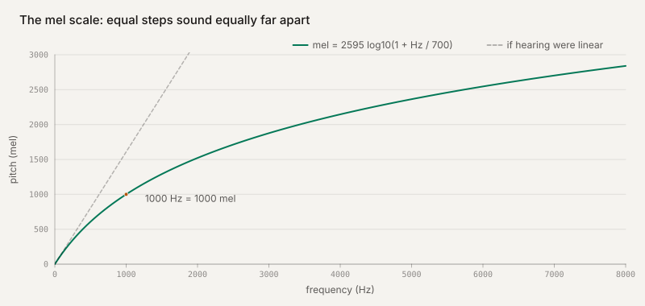
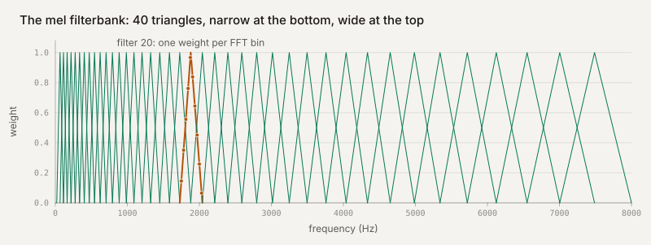
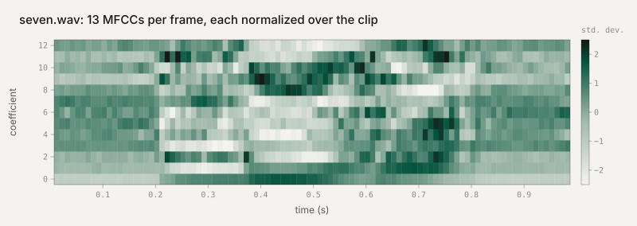

## Hearing Like A Human

We ended the previous chapter with a spectrogram: for every 25 ms frame of audio, 257 numbers that say how much energy there is at each frequency from 0 to 8000 Hz. We also ended it with a complaint. 257 numbers per frame is a lot, and most of that detail is not what distinguishes one word from another.

In this chapter we are going to throw most of it away, on purpose, and what is left will be a better description of speech than what we started with. We will squeeze the 257 bins into 40 bands spaced the way our ears space them, take a logarithm, and end up with the *log-mel spectrogram*: the picture that every recognizer in the rest of this book looks at, including (with different constants) Whisper in chapter 12. Then we will go one step further to MFCCs, the features that ruled speech recognition for thirty years, because the recognizer in the next chapter likes them.

### What Can We Afford To Lose?

Go back and look at the spectrogram of "seven" from the last chapter (it is the top half of a figure further down, if you want to peek). During the vowel we found two kinds of structure in it.

The first is the comb of thin horizontal stripes, evenly spaced: the *harmonics* of the voice, at whole multiples of its *pitch*. I measured the speaker in `seven.wav` at about 120 Hz during the vowel, so the stripes sit near 120, 240, 360 Hz and so on.

The second is the handful of broad dark regions, each a few hundred Hz wide, that the stripes pass through: the formants, the resonances of the throat and mouth, which move around when the tongue and lips move. The smooth outline you would get by draping a cloth over the tops of the harmonics is called the *spectral envelope*.

Here is the thing: the word is in the envelope. Chapter 3 opened with "ee" sliding into "oo" on one note: the comb does not move at all, only the envelope changes. Now say "ee" low and then high: the comb stretches, the envelope stays, and it is still "ee". A recognizer fed raw FFT bins has to discover for itself that the comb is somebody's voice and not somebody's word, and it has to discover it from examples. We know it already, so let's hand the recognizer something where the comb is mostly smoothed away.

There is a second thing we know. Our ears are sharp at low frequencies and blurry at high ones. The step from 200 Hz to 400 Hz sounds huge (it is an octave), the step from 6200 Hz to 6400 Hz is barely audible. Speech evolved to be heard by ears, so it is a fair bet that the distinctions that matter are spread out the way ears spread them: lots of detail needed at the bottom, little at the top. The FFT does the opposite of what we want here. Its bins are 31.25 Hz apart everywhere, so half of our 257 numbers describe the range from 4000 to 8000 Hz.

So that is the plan: average neighboring bins together, a few at a time at the bottom and many at a time at the top. We need a ruler that tells us how many.

### The Mel Scale

In 1937 Stevens, Volkmann and Newman sat listeners down with a tone generator and asked them to do things like "adjust this tone until it sounds half as high as that one". From the answers they built [a scale of pitch as people perceive it](https://doi.org/10.1121/1.1915893), where equal steps sound equally far apart, and called its unit the *mel* (from "melody"). The scale is pinned down by declaring that a 1000 Hz tone has a pitch of 1000 mels. Below that, mels and Hz stay close together; above it, you need bigger and bigger steps in Hz to climb the same number of mels.

Experimental data is a table, and code wants a formula. Several curves have been fitted to those measurements over the years. The one we use is the one found in most speech papers and toolkits:

```text
mel = 2595 * log10(1 + hz / 700)
```

`hz` is a frequency in Hz and `mel` is the same pitch in mels. For small `hz` the logarithm of "one plus a little" is nearly proportional to the little, so the curve starts out straight. Once `hz` is well above 700 the `1 +` stops mattering and the curve becomes a plain logarithm. The 2595 is there to make 1000 Hz come out as 1000 mel.

Enough of the talk, let's write some code! The formula and its inverse (solve for `hz`) are one line each:

```rust
// src/dsp/mel.rs

/// Convert a frequency in Hz to mels: `2595 * log10(1 + hz / 700)`.
pub fn hz_to_mel(hz: f32) -> f32 {
    2595.0 * (1.0 + hz / 700.0).log10()
}

/// Convert mels back to Hz: the inverse of [`hz_to_mel`].
pub fn mel_to_hz(mel: f32) -> f32 {
    700.0 * (10.0f32.powf(mel / 2595.0) - 1.0)
}
```

How do we know it works? We check the one point the scale was built around, the top of our frequency range worked out by hand, and that going there and back gets us home:

```rust
// src/dsp/mel.rs (tests)

#[test]
fn mel_scale_reference_points() {
    assert_eq!(hz_to_mel(0.0), 0.0);
    // 2595 * log10(1 + 1000/700) = 2595 * 0.385351 = 999.99
    assert!((hz_to_mel(1000.0) - 1000.0).abs() < 0.1);
    // 2595 * log10(1 + 8000/700) = 2595 * 1.094421 = 2840.02
    assert!((hz_to_mel(8000.0) - 2840.02).abs() < 0.01);
}

#[test]
fn mel_and_hz_are_inverses() {
    for hz in [0.0, 20.0, 440.0, 1000.0, 4000.0, 8000.0] {
        assert!((mel_to_hz(hz_to_mel(hz)) - hz).abs() < hz * 1e-4 + 1e-2, "{hz}");
    }
}
```

This chapter's example program, `ch04_mel`, prints a lot, so we will look at its output a piece at a time. It starts with a table of the scale:

```text
$ cargo run --release --example ch04_mel
the mel scale, mel = 2595 * log10(1 + hz / 700):

      Hz      mel    back to Hz
       0      0.0        0.0
     100    150.5      100.0
     200    283.2      200.0
     500    607.4      500.0
    1000   1000.0     1000.0
    2000   1521.4     2000.0
    4000   2146.1     4000.0
    8000   2840.0     8000.0
  100 Hz -> 200 Hz is 133 mel; 7900 Hz -> 8000 Hz is 13 mel
```

Look at the last line. The same 100 Hz step is worth ten times as much at the bottom of the range as at the top. And look at the 4000 row: the lower half of our frequency range (0 to 4000 Hz) takes up three quarters of the mel range (2146 of 2840).



*The mel scale. The dashed line is what it would be if we heard pitch linearly.*

**Aside** <br>
There is no single "the" mel scale. The formula above is the one used by HTK (the Hidden Markov Model Toolkit, a hugely influential speech toolkit from Cambridge) and it is usually credited to O'Shaughnessy's 1987 textbook. The other common one is Malcolm Slaney's, from his Auditory Toolbox: exactly linear below 1000 Hz and logarithmic above. Whisper was trained with Slaney's, so when we get to chapter 12 we will have to write that one too. The two differ by a few percent. Neither is "right"; what matters is that you extract features for recognition exactly the way you extracted them for training.

### A Bank Of Triangles

Now we use the ruler. We want 40 bands, narrow at the bottom and wide at the top, and the recipe is short:

1. Convert the bottom and top of our frequency range (20 Hz and 8000 Hz) to mels.
2. Place 42 points between them, *equally spaced in mels*.
3. Convert the 42 points back to Hz. They are now crowded together at the low end and spread out at the high end.

Why 42 points for 40 bands? Because each band is going to be a triangle that needs three of them: band `m` starts at point `m`, peaks at point `m + 1`, and ends at point `m + 2`. Every band's peak is where its neighbors begin and end.

```rust
// src/dsp/mel.rs

/// `n_mels + 2` frequencies in Hz, evenly spaced on the mel scale from `fmin`
/// to `fmax` inclusive.
pub fn mel_points(n_mels: usize, fmin: f32, fmax: f32) -> Vec<f32> {
    let (mel_min, mel_max) = (hz_to_mel(fmin), hz_to_mel(fmax));
    let step = (mel_max - mel_min) / (n_mels + 1) as f32;
    let mut points: Vec<f32> = (0..n_mels + 2).map(|i| mel_to_hz(mel_min + step * i as f32)).collect();
    // Converting to mels and back picks up a little rounding error. Pin the
    // two ends, so that the bank covers exactly fmin..fmax and not a hair more.
    points[0] = fmin;
    points[n_mels + 1] = fmax;
    points
}
```

Why a triangle and not a plain box that averages the bins between two points? With boxes, a harmonic that drifts across the border between two bands would jump from one to the other in a single step. With overlapping triangles it fades out of one band while it fades into the next. A band's weight for a frequency is 1 at the band's peak and falls in a straight line to 0 at the peaks of its two neighbors.

A set of bands like this is called a *filterbank*, and each triangle is a *filter*: something that lets some frequencies through and blocks others. We need each filter's weight at each of the 257 FFT bins. That is 40 lists of 257 numbers, which is a grid, and for grids we have a type.

We met `Mat` in the last chapter, which returned the spectrogram as one: a grid of `f32` with a number of rows and a number of columns. `m[(r, c)]` reads one entry and `m.row(r)` borrows a whole row as a slice. That is all we need to know for now; chapter 6 looks inside it, because neural networks are made of little else.

```rust
// src/dsp/mel.rs

/// A bank of `n_mels` triangular filters as a matrix: one row per filter,
/// one column per FFT bin (`n_fft / 2 + 1`). Multiplying it with a power
/// spectrum gives the mel energies.
pub fn mel_filterbank(n_mels: usize, n_fft: usize, sample_rate: u32, fmin: f32, fmax: f32) -> Mat {
    assert!(fmin >= 0.0 && fmin < fmax, "need 0 <= fmin < fmax, got {fmin} and {fmax}");
    assert!(fmax <= sample_rate as f32 / 2.0 + 1e-3, "fmax {fmax} Hz is above the Nyquist frequency of {sample_rate} Hz audio");
    let points = mel_points(n_mels, fmin, fmax);
    let n_bins = n_fft / 2 + 1;
    let hz_per_bin = sample_rate as f32 / n_fft as f32;

    Mat::from_fn(n_mels, n_bins, |m, bin| {
        let (left, peak, right) = (points[m], points[m + 1], points[m + 2]);
        let hz = bin as f32 * hz_per_bin;
        let rising = (hz - left) / (peak - left);
        let falling = (right - hz) / (right - peak);
        // Inside the triangle the lower of the two lines is the triangle;
        // outside, one of them is negative and we clamp to zero.
        rising.min(falling).max(0.0)
    })
}
```

`Mat::from_fn` calls our closure once for every (row, column) pair, and the closure has a neat trick in it. A triangle is two straight lines: `rising` goes from 0 at `left` to 1 at `peak` and keeps going up, `falling` goes from 1 at `peak` down to 0 at `right` and keeps going down. Under the triangle, the triangle is whichever line is lower. Outside it, one of the lines has gone negative, and `.max(0.0)` flattens that to zero. No `if` needed.

The example prints a few rows of the result:

```text
filterbank for 16000 Hz audio: 40 triangles over 257 FFT bins (20 Hz to 8000 Hz)
  filter   from Hz   peak Hz   to Hz   bins it touches
       0        20        65     113       3
       1        65       113     164       3
       2       113       164     218       3
      20      1728      1880    2042      10
      38      6550      7004    7487      30
      39      7004      7487    8000      31
```

The bottom filter is 93 Hz wide and collects 3 FFT bins. The top one is almost 1000 Hz wide and collects 31. Fourteen of the forty filters have their peak below 1000 Hz, which is one eighth of the frequency range, and only ten have it above 4000 Hz, which is half of it. That is exactly the trade we said we wanted.



*The filterbank. The dots on filter 20 are the ten weights that row of the matrix really holds, one per FFT bin.*

> **Play with it:** [the mel filterbank](../interactive/mel.html)

Does it also get rid of the comb? Partly, and it is worth being exact about it. Harmonics 120 Hz apart are about four FFT bins apart. Filter 20 spans 314 Hz, so it always has two or three harmonics under it and reports something close to the envelope. Filter 0 spans 93 Hz, less than the gap between two harmonics, so the lowest bands still see individual harmonics come and go. The smoothing gets better the higher we go. We will finish the job later in the chapter.

For a function like this I do not trust myself until I have computed a small case by hand. The repository has a test that builds a bank of 2 filters over 5 bins, small enough to work out on paper:

```rust
// src/dsp/mel.rs (tests)

#[test]
fn a_tiny_filterbank_by_hand() {
    // 2 filters over 0..4000 Hz with 1000 Hz bins (n_fft = 8 at 8 kHz).
    // mel(4000) = 2146.06; a third of that is 715.35 mel = 620.6 Hz, two
    // thirds are 1430.7 mel = 1791.4 Hz. So the points are
    // 0, 620.6, 1791.4, 4000 Hz and the bins sit at 0, 1000, ..., 4000.
    let fb = mel_filterbank(2, 8, 8000, 0.0, 4000.0);
    assert_eq!((fb.rows, fb.cols), (2, 5));
    let expected = [
        // filter 0: up 0 -> 620.6, down 620.6 -> 1791.4
        [0.0, (1791.4 - 1000.0) / (1791.4 - 620.6), 0.0, 0.0, 0.0],
        // filter 1: up 620.6 -> 1791.4, down 1791.4 -> 4000
        [
            0.0,
            (1000.0 - 620.6) / (1791.4 - 620.6),
            (4000.0 - 2000.0) / (4000.0 - 1791.4),
            (4000.0 - 3000.0) / (4000.0 - 1791.4),
            0.0,
        ],
    ];
    // ... (compare every entry of fb with expected, to within 0.001)
}
```

Two more tests next to it check every filter of the real 16 kHz and 8 kHz banks: a single peak at the right frequency, zero outside the band, and one more property that deserves its own paragraph.

**Aside** <br>
We had a choice to make about how tall the triangles are, and it is one of those choices that libraries quietly disagree on. Ours all have **peak height 1**, the HTK convention. Because each triangle falls exactly as fast as its neighbor rises, the weights at any frequency between the first and last peak add up to exactly 1 (the test checks this for every bin), so no frequency counts more than another. The price is that a wide filter adds up more bins than a narrow one: the weights of filter 0 sum to 1.6 and those of filter 39 to 15.9, so a perfectly flat spectrum would come out sloping upwards. The alternative, Slaney's again, divides each triangle by its width so that every filter has the same area and a flat spectrum stays flat. Since the next thing we do is take a logarithm, the two conventions differ only by a fixed offset per band, which the normalization at the end of this chapter or the first layer of a network removes without noticing.

### Applying It Is A Matrix Product

We have a power spectrum of 257 numbers for a frame and a filterbank of 40 rows of 257 weights. The *mel energy* of band `m` is the weighted sum of the spectrum through triangle `m`: multiply each bin's power by the filter's weight for that bin and add it all up. A first version writes itself:

```rust
// A first version: one frame, one band at a time.
let mut mel_energy = vec![0.0f32; n_mels];
for m in 0..n_mels {
    for bin in 0..n_bins {
        mel_energy[m] += power[bin] * filterbank[(m, bin)];
    }
}
```

The inner loop multiplies two lists element by element and sums the products. That operation is called a *dot product*, and we have seen it before under another name: it is the "how much of this is in that" correlation from chapter 3, with a triangle in place of a sinusoid. Doing one dot product for every pairing of a row from one grid (98 spectra) with a row from another grid (40 triangles) and collecting the answers in a third grid (98 × 40) is called a *matrix product*. `Mat` has a method for precisely this pairing-of-rows form, `matmul_t`, so in the real code the two loops above, and the loop over frames around them, become one line:

```rust
let mel_energy = power.matmul_t(&self.filterbank);
```

Hold that thought. "A big grid of weights, applied with a matrix product" is going to come back in chapter 6, where the weights will not be triangles we designed but numbers the machine learns. A mel filterbank is a layer of a neural network with its weights fixed by hand.

### Why We Take A Logarithm

The mel energies have an awkward range. In `seven.wav` the largest one is about 100 and the quiet stretches are down around a millionth, a ratio of a hundred million to one. Feed that to anything that measures differences and the loud vowels are all it will ever see; the quiet consonants, which carry just as much of the word, vanish in the rounding.

Our ears deal with the same problem, and their solution is to respond to *ratios*. You met this with decibels in chapter 2: doubling the power of a sound adds the same small step to its perceived loudness whether it started as a whisper or a shout. A logarithm turns ratios into differences, so we take the logarithm of every mel energy.

This buys us a second thing. Suppose I record the same word twice, once with the microphone gain turned up so every sample is 10 times larger. Power is amplitude squared, so every mel energy is 100 times larger. After the logarithm, every entry of the feature picture has gone up by the same constant, `ln 100 = 4.6`, and nothing else has changed. Being louder has become a uniform shift of the whole picture, and a uniform shift is easy to remove (we will, shortly).

One trap: the logarithm of zero is minus infinity, and digital silence is exactly zero. So we add a tiny *floor* to every energy before taking the log:

```rust
// src/dsp/features.rs

/// Added to every mel energy before taking the logarithm, so that silence
/// gives `ln(1e-6) = -13.8` instead of minus infinity.
pub const LOG_FLOOR: f32 = 1e-6;
```

So −13.8 is the darkest a log-mel value can ever get, and in our units speech peaks somewhere around +5. We use the natural logarithm `ln`; if you prefer decibels, multiply by 4.34.

### The Whole Pipeline

Everything from chapter 1 up to here now lines up into one pipeline. Here it is with the shape of the data after each stage, for a one-second clip:


*Sixteen thousand samples in, a 98 × 40 grid out.*

Several numbers decide what comes out of that pipeline: frame length, hop, number of bands, frequency range, pre-emphasis. A recognizer trained on features made with one set of numbers is useless on features made with another, so we keep them together in one struct and pass that around:

```rust
// src/dsp/features.rs

/// Everything that determines what the features look like.
#[derive(Clone, Debug, PartialEq)]
pub struct FeatureConfig {
    /// Sample rate of the audio in Hz: 16000 for Speech Commands, 8000 for
    /// the Free Spoken Digit Dataset.
    pub sample_rate: u32,
    /// Frame length in milliseconds. 25 ms is long enough to contain a few
    /// periods of the lowest voices, short enough that the mouth has hardly
    /// moved.
    pub frame_ms: f32,
    /// Time between the starts of consecutive frames, in milliseconds. 10 ms
    /// gives 100 feature rows per second.
    pub hop_ms: f32,
    /// Number of mel bands, i.e. the number of columns of the log-mel output.
    pub n_mels: usize,
    /// Lower edge of the lowest mel band in Hz.
    pub fmin: f32,
    /// Upper edge of the highest mel band in Hz.
    pub fmax: f32,
    /// Pre-emphasis coefficient (0.97 is customary; 0.0 disables it).
    pub preemphasis: f32,
}

impl FeatureConfig {
    /// The defaults used throughout the book: 25 ms frames every 10 ms,
    /// 40 mel bands from 20 Hz to half the sample rate, pre-emphasis 0.97.
    pub fn new(sample_rate: u32) -> Self {
        FeatureConfig {
            sample_rate,
            frame_ms: 25.0,
            hop_ms: 10.0,
            n_mels: 40,
            fmin: 20.0,
            fmax: sample_rate as f32 / 2.0,
            preemphasis: 0.97,
        }
    }

    /// Frame length in samples: 400 at 16 kHz, 200 at 8 kHz.
    pub fn frame_len(&self) -> usize {
        (self.sample_rate as f32 * self.frame_ms / 1000.0).round() as usize
    }

    /// Hop length in samples: 160 at 16 kHz, 80 at 8 kHz.
    pub fn hop_len(&self) -> usize {
        (self.sample_rate as f32 * self.hop_ms / 1000.0).round() as usize
    }

    /// FFT length: the next power of two at or above the frame length (our
    /// FFT only does powers of two). 512 at 16 kHz, 256 at 8 kHz. The frame
    /// is padded with zeros to fill it.
    pub fn n_fft(&self) -> usize {
        self.frame_len().next_power_of_two()
    }

    /// How many feature rows a clip of `n_samples` samples produces. See
    /// [`num_frames`](crate::dsp::frame::num_frames): only whole frames count.
    pub fn num_frames(&self, n_samples: usize) -> usize {
        crate::dsp::frame::num_frames(n_samples, self.frame_len(), self.hop_len())
    }
}
```

Frames are given in milliseconds and converted to samples, so the same config describes 16 kHz and 8 kHz audio. The bands start at 20 Hz and not 0 because what lies below is hum and rumble, not speech.

Next, the thing that does the work. Four ingredients of the pipeline depend only on the config and never on the audio: the Hann window, the FFT's table of sines and cosines from chapter 3, the filterbank, and a table of cosines called `dct` that belongs to the MFCC step at the end of this chapter (skip over it for now). We compute them once and keep them:

```rust
// src/dsp/features.rs

/// A feature extractor with everything that can be computed ahead of time
/// already computed: the window, the mel filterbank, the DCT's cosines and
/// the FFT's table.
///
/// Build one and reuse it for every clip. It is never modified after
/// construction, so many threads can share one `&FeatureExtractor`.
#[derive(Clone, Debug)]
pub struct FeatureExtractor {
    config: FeatureConfig,
    window: Vec<f32>,
    fft: Fft,
    /// `n_mels x (n_fft/2 + 1)`, see [`mel_filterbank`].
    filterbank: Mat,
    /// The full `n_mels x n_mels` DCT, see [`dct_matrix`]. Row `k` does not
    /// depend on how many coefficients are kept, so [`mfcc`](Self::mfcc)
    /// with any `n_coeffs` just uses the first `n_coeffs` rows.
    dct: Mat,
}

impl FeatureExtractor {
    /// Precompute the tables for `config`.
    pub fn new(config: &FeatureConfig) -> Self {
        let n_fft = config.n_fft();
        FeatureExtractor {
            window: hann(config.frame_len()),
            fft: Fft::new(n_fft),
            filterbank: mel_filterbank(config.n_mels, n_fft, config.sample_rate, config.fmin, config.fmax),
            dct: dct_matrix(config.n_mels, config.n_mels),
            config: config.clone(),
        }
    }

    // ... (two getters: config() and filterbank())
```

The first method is stages 2 to 6 of the figure, and every piece of it is something we already built: `preemphasis` and `frames` from chapter 2, the window, and `power_spectrum_into` from chapter 3, which zero-pads the 400-sample frame to 512 and writes the 257 squared magnitudes straight into a row of the output.

```rust
    /// Power spectrogram of `samples` (frames x `n_fft/2 + 1`), after
    /// pre-emphasis and Hann windowing: the stage just before the filterbank.
    pub fn power_spectrogram(&self, samples: &[f32]) -> Mat {
        let emphasized;
        let samples = if self.config.preemphasis != 0.0 {
            emphasized = preemphasis(samples, self.config.preemphasis);
            &emphasized[..]
        } else {
            samples
        };

        let all_frames = frames(samples, self.config.frame_len(), self.config.hop_len());
        let mut power = Mat::zeros(all_frames.len(), self.fft.len() / 2 + 1);
        let mut windowed = vec![0.0f32; self.window.len()];
        let mut scratch: Vec<Complex> = Vec::with_capacity(self.fft.len());
        for (i, frame) in all_frames.into_iter().enumerate() {
            for ((w, x), win) in windowed.iter_mut().zip(frame).zip(&self.window) {
                *w = x * win;
            }
            self.fft.power_spectrum_into(&windowed, &mut scratch, power.row_mut(i));
        }
        power
    }
```

The `let emphasized;` with no value is there so that the pre-emphasized `Vec`, when we make one, lives until the end of the function and `samples` can borrow from it.

And then stages 7 and 8, the new ones, take two lines:

```rust
    /// Log-mel spectrogram: frames x `n_mels`, each entry
    /// `ln(mel energy + 1e-6)`.
    pub fn log_mel(&self, samples: &[f32]) -> Mat {
        let power = self.power_spectrogram(samples);
        // (frames x bins) times (n_mels x bins) transposed: every output
        // entry is the dot product of one spectrum with one triangle.
        let mel_energy = power.matmul_t(&self.filterbank);
        mel_energy.map(|e| (e + LOG_FLOOR).ln())
    }
```

For one-off use there is a free function that builds an extractor and throws it away:

```rust
// src/dsp/features.rs

pub fn log_mel(samples: &[f32], cfg: &FeatureConfig) -> Mat {
    FeatureExtractor::new(cfg).log_mel(samples)
}
```

How do we know it works? Two of the tests are worth reading. The first plays a pure 1000 Hz tone and checks that the loudest band in the output is the one whose triangle peaks nearest 1000 Hz. The second is the microphone-gain argument from the previous section, turned into an assertion:

```rust
// src/dsp/features.rs (tests)

#[test]
fn ten_times_the_amplitude_adds_ln_100_to_every_band() {
    let cfg = FeatureConfig::new(16000);
    let mut rng = Rng::new(4);
    let quiet: Vec<f32> = (0..4000).map(|_| 0.03 * rng.normal()).collect();
    let loud: Vec<f32> = quiet.iter().map(|x| 10.0 * x).collect();
    let (a, b) = (log_mel(&quiet, &cfg), log_mel(&loud, &cfg));
    for (x, y) in a.data.iter().zip(&b.data) {
        assert!((y - x - 100.0f32.ln()).abs() < 0.05, "{x} -> {y}");
    }
}
```

(`Rng` is our own random number generator, which chapter 6 builds. Here it just makes some noise.)

Now for the picture. Here is "seven" before and after:


*The same second of audio as 257 FFT bins (top) and as 40 mel bands (bottom).*

Take a minute with this one. From 0.22 s to 0.36 s is the "s": hiss with all of its energy above 4000 Hz. In the top panel it fills the upper half of the picture; in the bottom panel that same half has been folded into the top ten rows. From 0.37 s is the first vowel, and here it goes the other way: the structure below 2000 Hz, squashed into the bottom quarter of the top panel, is stretched over the lower half of the bottom one. In the upper bands the thin harmonic stripes have been smoothed away, and what remains are the broad dark bands of the envelope. At 0.6 s the "v" briefly closes things off, and the second syllable follows, quieter and lower.

Also notice the left and right edges. In the top panel the silence is blank paper. In the bottom panel it has a faint texture: that is the room noise in the recording, which the logarithm has lifted into view.

### MFCCs: Squeezing 40 Numbers Into 13

For the models we train from chapter 6 onward, the 98 × 40 log-mel picture is the input, and we could stop here. But the next chapter builds a recognizer with no learning in it at all, one that compares two recordings by measuring plain distances between their frames, and for that kind of model log-mel has two flaws.

First, the 40 numbers in a row are far from independent. The triangles overlap and the envelope is smooth, so if band 17 is high, band 18 almost certainly is too. I measured it on `seven.wav`: the correlation between neighboring bands, averaged over the 39 pairs, is 0.99. A distance that adds up 40 differences is counting nearly the same difference many times over. Second, the lowest bands still wiggle with the harmonics of the voice, as we saw.

What we would like is a handful of numbers that describe the *shape* of a log-mel row: how high it is overall, whether it tilts up or down, whether it has one hump or two. If you have been paying attention, you'll notice we have done this before. In chapter 3 we described a wiggly signal by asking "how much of each sinusoid is in it?". A row of 40 log-mel values is just another list of numbers, and we can ask the same question of it.

The tool is the *discrete cosine transform*, DCT for short. It is the Fourier transform's cousin for squeezing a smooth curve into a few numbers. Like the DFT, it correlates the input with a family of waves, one output per wave. Unlike the DFT, the waves are all cosines, each fitting a whole number of *half*-cycles across the input: wave 0 is flat, wave 1 goes from high to low once, wave 2 goes down and back up, and so on. No sines means no complex numbers. For an input `x` of `M` values, output number `k` is

```text
c[k] = s(k) * sum over m of  x[m] * cos(pi * k * (m + 1/2) / M)

       s(0) = sqrt(1/M),  s(k) = sqrt(2/M) for k > 0
```

`m` counts along the input (for us, the 40 mel bands), and the `+ 1/2` samples each cosine in the middle of a band. `s(k)` is a scale factor chosen so that the transform is *orthonormal*: it preserves the length of the vector, and no output is artificially bigger than another. There is a sum in the formula, so there is a `for` loop in the code:

```rust
// src/dsp/features.rs

/// The discrete cosine transform (type II, orthonormal) of `input`, keeping
/// the first `n_coeffs` coefficients.
pub fn dct2(input: &[f32], n_coeffs: usize) -> Vec<f32> {
    let m_total = input.len();
    assert!(n_coeffs <= m_total, "cannot keep {n_coeffs} DCT coefficients of only {m_total} inputs");
    let mut output = Vec::with_capacity(n_coeffs);
    for k in 0..n_coeffs {
        let mut sum = 0.0;
        for (m, &x) in input.iter().enumerate() {
            sum += x * (PI * k as f32 * (m as f32 + 0.5) / m_total as f32).cos();
        }
        output.push(sum * dct_scale(k, m_total));
    }
    output
}

/// The factor `s(k)` that makes the DCT orthonormal.
fn dct_scale(k: usize, n_inputs: usize) -> f32 {
    if k == 0 {
        (1.0 / n_inputs as f32).sqrt()
    } else {
        (2.0 / n_inputs as f32).sqrt()
    }
}
```

("Type II" because there are several ways to line cosines up with samples, and this is the second in the standard list.)

Small cases by hand again. With two inputs `a` and `b`, wave 0 is flat and wave 1 is plus-then-minus, so the outputs should be their scaled sum and difference:

```rust
// src/dsp/features.rs (tests)

#[test]
fn dct_by_hand() {
    // M = 2: c0 = (a + b) / sqrt(2), c1 = (a - b) / sqrt(2).
    let c = dct2(&[3.0, 1.0], 2);
    assert!((c[0] - 4.0 / 2.0f32.sqrt()).abs() < 1e-6 && (c[1] - 2.0 / 2.0f32.sqrt()).abs() < 1e-6);
    // A constant has only a zeroth coefficient: value * sqrt(M).
    let c = dct2(&[2.0; 16], 16);
    assert!((c[0] - 8.0).abs() < 1e-5);
    assert!(c[1..].iter().all(|v| v.abs() < 1e-5));
    // ... (a half-cosine input lands entirely in c[1])
}
```

The middle case tells us what coefficient 0 means: it is the sum of the inputs times a constant, so for a log-mel row, **c0 is the overall loudness of the frame**. The next few coefficients describe tilt and humps, which is the envelope. The high ones describe fast ripple from band to band, which is mostly leftover harmonics. So we keep the first 13 and drop the other 27. What we keep are the *mel-frequency cepstral coefficients*, MFCCs. ("Cepstral" is "spectral" with its first four letters reversed, a 1960s pun for "a spectrum of a spectrum" that stuck.)

Just like the filterbank, a DCT is a fixed set of weights applied by dot products, so we can write it as a matrix and transform all 98 frames at once:

```rust
// src/dsp/features.rs

/// The DCT as a matrix (`n_coeffs x n_inputs`): row `k` is the `k`-th cosine,
/// already scaled, so `dct2(x, n)` equals this matrix times `x`. Used to
/// transform all frames at once without recomputing any cosines.
pub fn dct_matrix(n_coeffs: usize, n_inputs: usize) -> Mat {
    assert!(n_coeffs <= n_inputs, "cannot keep {n_coeffs} DCT coefficients of only {n_inputs} inputs");
    Mat::from_fn(n_coeffs, n_inputs, |k, m| dct_scale(k, n_inputs) * (PI * k as f32 * (m as f32 + 0.5) / n_inputs as f32).cos())
}
```

This is the `dct` table we skipped over in `FeatureExtractor`. Row `k` of the matrix is the same whether we keep 13 coefficients or all 40, so the extractor builds the full 40 × 40 matrix once, in `new`, and `mfcc` takes the first `n_coeffs` rows of it. A `Mat` stores its rows one after another in a single `Vec` called `data`, so the first `n_coeffs` rows are the first `n_coeffs * n_mels` numbers:

```rust
// src/dsp/features.rs (inside impl FeatureExtractor)

    /// MFCCs: frames x `n_coeffs`. See the free function [`mfcc`].
    pub fn mfcc(&self, samples: &[f32], n_coeffs: usize) -> Mat {
        let n_mels = self.config.n_mels;
        assert!(n_coeffs <= n_mels, "cannot keep {n_coeffs} DCT coefficients of only {n_mels} mel bands");
        // The first `n_coeffs` rows of the cached DCT: a copy of a few
        // hundred numbers, with no cosines recomputed.
        let dct = Mat::from_vec(n_coeffs, n_mels, self.dct.data[..n_coeffs * n_mels].to_vec());
        self.log_mel(samples).matmul_t(&dct)
    }
```

And the one-off version, to go with `log_mel`:

```rust
// src/dsp/features.rs

pub fn mfcc(samples: &[f32], cfg: &FeatureConfig, n_coeffs: usize) -> Mat {
    FeatureExtractor::new(cfg).mfcc(samples, n_coeffs)
}
```

A test in the repository, `mfcc_is_the_truncated_dct_of_log_mel`, checks that this matrix route and the plain `dct2` loop give the same numbers, and another that the full 40 × 40 DCT matrix times its own transpose is the identity, which is what orthonormal means.

Did it do what we wanted? On `seven.wav`, the 13 coefficients we keep hold 99.6% of the squared size of the log-mel rows (91% if we leave c0 out of the count), and the average correlation between neighboring coefficients is 0.25, down from 0.99 for neighboring bands. Not zero, but a different world.



*The MFCCs of "seven", each row normalized. Row 0 follows the loudness; the rest are not meant for human eyes.*

I should be honest about where MFCCs stand today. They were introduced by Davis and Mermelstein in 1980 and were *the* speech feature for the next three decades, because the statistical models of that era needed inputs that were compact and uncorrelated. Neural networks have no such need. A network can learn its own version of the DCT if that helps, and learns something better if not, so modern recognizers work as well or better on log-mel directly. That is what we will feed ours, and what Whisper eats. We built MFCCs for two reasons: you will meet them in every older paper and tutorial, and the template matcher in the next chapter is exactly the kind of simple model that benefits from them.

### Deltas: How The Features Are Moving

A row of features is a snapshot of one 25 ms frame. But speech is movement: a "b" is not a spectrum, it is a spectrum rapidly changing into the vowel that follows. A model that looks at one frame at a time cannot see that unless we put it in the frame.

So for every feature we also compute how fast it is changing, its *delta*. The crude way is to subtract the previous frame from the next one. A steadier way is to look two frames in each direction and take the slope of the straight line that best fits those five values:

```text
d[t] = sum for n = 1..=width of  n * (c[t+n] - c[t-n])
       ───────────────────────────────────────────────
                2 * sum for n = 1..=width of n^2
```

`c[t]` is a feature at frame `t` and `width` is how far we look each way. With `width = 2` that is `(c[t+1] - c[t-1] + 2 * (c[t+2] - c[t-2])) / 10`.

```rust
// src/dsp/features.rs

/// Delta features: how fast each feature is changing, frame by frame. Same
/// shape as the input.
pub fn deltas(features: &Mat, width: usize) -> Mat {
    assert!(width >= 1, "delta width must be at least 1");
    let denominator = 2.0 * (1..=width).map(|n| (n * n) as f32).sum::<f32>();
    let last = features.rows.saturating_sub(1);
    let mut out = Mat::zeros(features.rows, features.cols);
    for t in 0..features.rows {
        for n in 1..=width {
            let ahead = features.row((t + n).min(last));
            let behind = features.row(t.saturating_sub(n));
            for ((d, a), b) in out.row_mut(t).iter_mut().zip(ahead).zip(behind) {
                *d += n as f32 * (a - b) / denominator;
            }
        }
    }
    out
}
```

The `.min(last)` and `.saturating_sub(n)` handle the edges: frames before the start or after the end are treated as copies of the first or last frame. The test feeds in a column that rises by 3 per frame and checks that its delta is 3 everywhere away from the edges, and that a constant column has a delta of exactly 0. Run `deltas` on its own output and you get "delta-deltas", the acceleration. The classic recipe was 13 MFCCs plus deltas plus delta-deltas: 39 numbers per frame.

### Normalization: Forgetting The Microphone

We said that a louder recording shifts the whole log-mel picture by a constant. A different microphone or a different room does something similar but per frequency: it boosts some bands and dulls others, by the same factor for the whole recording, which after the log is a different constant added to each column. None of that is the word.

The fix is blunt and effective. For each column, compute its mean and standard deviation over the whole utterance, subtract the mean and divide by the standard deviation. Whatever constant was added to a column is subtracted right back out, and what is left is how each feature *moves* within the utterance.

```rust
// src/dsp/features.rs

/// Normalize each column to mean 0 and variance 1 over the utterance.
pub fn normalize(features: &mut Mat) {
    if features.rows == 0 {
        return;
    }
    let n = features.rows as f32;
    for c in 0..features.cols {
        let mean = (0..features.rows).map(|r| features[(r, c)]).sum::<f32>() / n;
        let variance = (0..features.rows).map(|r| (features[(r, c)] - mean).powi(2)).sum::<f32>() / n;
        let std = variance.sqrt();
        let scale = if std > 1e-6 { 1.0 / std } else { 0.0 };
        for r in 0..features.rows {
            features[(r, c)] = (features[(r, c)] - mean) * scale;
        }
    }
}
```

A column that never changes has a standard deviation of zero, and we set it to zero instead of dividing by it. Applied to MFCCs this goes by the name "cepstral mean and variance normalization".

It has a cost, and it is in the words "over the whole utterance". To normalize the first frame we need to have heard the last one. For a file that is no problem. For a microphone, where we want to start recognizing while the person is still talking, it is a real one. Hold that thought until chapter 11.

One warning before we lean on any of this. Deltas and normalization are a recipe that grew up with long utterances and statistical models, and whether they help depends on the data and the model. The next chapter measures it on one-word clips, and the answer is not the one the recipe promises.

### One More Tool: Changing The Sample Rate

One assumption has been riding along quietly: that the audio arrives at the sample rate our features expect. It often will not. The spoken-digit recordings we use in the next chapter are sampled at 8 kHz, the Speech Commands clips at 16 kHz, and a laptop microphone hands you 44.1 or 48 kHz. `FeatureConfig::new(8000)` will happily make features for 8 kHz audio (frames of 200 samples, a 256-point FFT, 40 bands up to 4000 Hz), but those are *different features*, and a model trained on one kind cannot be fed the other. Sooner or later we have to convert, so the repository has `resample(samples, from_rate, to_rate)` in `src/dsp/resample.rs`.

Going from 16 kHz to 8 kHz looks like the easiest job in the world: keep every other sample. It is also wrong, and chapter 1 told us why. At 8 kHz nothing above the Nyquist frequency of 4000 Hz can be represented, and anything up there that we fail to remove first does not disappear. It *aliases*: it folds back and shows up as a tone that was never in the recording. The test in the repository shows both behaviors side by side:

```rust
// src/dsp/resample.rs (tests)

#[test]
fn a_tone_above_the_new_nyquist_is_removed_not_aliased() {
    // 6 kHz cannot exist at 8 kHz (Nyquist 4 kHz). Without the low-pass
    // it would fold down to a full-strength false tone at 2 kHz.
    let out = resample(&sine(6000.0, 16000, 16000), 16000, 8000);
    let (_, amplitude) = strongest_tone(&out, 8000);
    assert!(amplitude < 0.01, "leftover amplitude {amplitude}");
    // Naive decimation (take every other sample) aliases at full strength.
    let naive: Vec<f32> = sine(6000.0, 16000, 16000).into_iter().step_by(2).collect();
    let (frequency, amplitude) = strongest_tone(&naive, 8000);
    assert!((frequency - 2000.0).abs() < 4.0 && amplitude > 0.9);
}
```

In speech, that false tone would be the hiss of every "s" folded down on top of the vowels.

Our `resample` does it properly. The samples pin down exactly one smooth curve with no frequencies above Nyquist; resampling reads that curve off at the new sample times, and when the rate goes down it first smooths away everything above the *new* Nyquist frequency. We will not walk through it line by line. The function is well commented, and it gets its first use in the next chapter, when a 16 kHz clip meets a recognizer built from 8 kHz recordings. From then on it runs whenever a clip's rate differs from the one a model expects.

One thing resampling cannot do is invent information. I upsampled the 8 kHz `seven_jackson.wav` to 16 kHz (3457 samples become 6914) and took its log-mel: the bands above 4000 Hz sit at −13.8, the floor. The rate is right, but the top of the picture is empty.

### Run It

Here is the rest of the example's output for `seven.wav`:

```text
../samples/seven.wav: 16000 samples at 16000 Hz (1.00 s)
  frames of 400 samples every 160, FFT length 512
  power spectrogram  98 x 257   (frames x FFT bins)
  log-mel            98 x 40    (frames x mel bands)
  MFCC               98 x 13    (frames x coefficients)
  log-mel values run from -13.8 to 4.6 (silence would be ln(1e-6) = -13.8)

  loudest frame (#42):
    log-mel, first 10 bands:    -4.0   -2.6   -2.4    0.1   -0.3    0.6    0.8    2.6    3.9    4.4
    its 13 MFCCs:                0.9    1.8   -3.0   -4.0   -4.2   -2.7   -2.6   -3.9    1.8    2.0    0.6   -0.8   -3.9
    DCT of the log-mel row:      0.9    1.8   -3.0   -4.0   -4.2   -2.7   -2.6   -3.9    1.8    2.0    0.6   -0.8   -3.9   (the same, computed directly)
    normalized MFCCs:            1.7    0.3   -1.7   -0.6   -2.1   -1.1   -1.3   -1.2    1.5    0.8    0.8   -1.3   -2.0
    their deltas:                0.0   -0.0   -0.1   -0.1   -0.1    0.1   -0.2    0.2    0.2   -0.3   -0.3   -0.0    0.1

  log-mel spectrogram (time left to right, band 0 at the bottom, darker = more energy):

                 ▒▓▓████████▓▓▓▓▓▓▓▓▓▓▓▓▓▒▒▒▒░▒▒▒▒░░░░░░░                 
                ░▒▓██████████▓█▓███▓▓▓▓▓▒▒▒▒▒░▒▒▒▒▒▒░░░░░░░░░             
                 ▒▓▓▓▓███▓██▓▓▓▓▓▓▓▓▓▓▒▒▒░░░░░▒▒▒▒░░░░░░░░░░░             
                 ░▒▒▓▓▓▓▓▓▓▓▓▓▓██████▓▓▓▓▒▒▒▒░▒▒▒░░░░░░ ░░░░              
                 ░░▒▒▒▒▒▒▒▒▓▓▓▓▓▓▓▓▓▓▓▓▓▓▒▒▒░░▒▒▒▒▒░░░▒░░░  ░             
                 ░░▒▒▒▒▒▒▒▒▓▓▓███▓▓▓▓▓▓▓▓▒▒▒▒░▒▒▒▒▒▒░▒▒░  ░               
                 ░░▒▒▒▒▒▒▒▒▒▒▒▓▓▓▓▓▓▓▓▓▓▒▒░▒░░░▒▒▒▒▒░░░░░░░               
                 ░░▒▒▒▒▒▒▒▒▒▒▓██████████▓▓▒▒▒░▒▒▒▒▒▒▒▒░░░░                
                 ░░▒▒▒▒▒▒▒▒▒▒▓███████████▓▓▒▒░▒▓▓▒▒▒▒▒▒▒░░░               
                 ░░▒▒▒▒▒▒▓▒▒▒▓▓▓▓███▓▓▓▓▓▓▒▒▒░░▒▓▓▒▒▒▒▒▒░░░ ░             
                 ░░▒▒▒▒▒▒▒▒▒▒▓███████████▓▒▒▒▒▒▒▓▓▒▒▒▒░░░░░ ░             
                 ▒▒▒░▒░░▒▒▒▒▒████████████▓▓▓▒▒▒▒▓▓▓▓▓▓▓▒▒░░░░             
                 ░▒░░░░░▒▒▒▒▒██▓▓▓▓▓▓▓▓▓▓▓▓▓▒▒▒▒▓▓▓▓▓▓▓▓▒▒░░░             
                     ░░ ░░ ░░▓▓▓▓▓▓▓▓▓▓▓▓▒▒▒▒▒▒▓▓▓▓▓▓▓▓▓▒▒░ ░             

timing on this 1.00 s clip (best of 5 batches of 200 runs):
  log-mel with a reused FeatureExtractor     399.0 us   (2507x faster than real time)
  log_mel(), building its tables each time   416.5 us
  mfcc(), building its tables each time      423.1 us
...
```

A few things to check off. The shapes are the ones in the pipeline figure. Frame 42 sits in the middle of the first vowel, and its first MFCC is 0.9: the 40 log-mel values of that row average 0.137, and 0.137 × √40 is 0.87. The line under it is `dct2` applied to that one row, and it agrees with the matrix version to the last printed digit. And there is "seven" in your terminal, "s" at the top left, vowels at the bottom.

When run without arguments, the program also writes this chapter's four generated figures into `../figures/` (drawn by a small SVG helper in the repository). Give it a file name and it analyzes that instead, so try `-- ../samples/seven_jackson.wav` to see the 8 kHz numbers: 129 bins, and a 0.43-second clip that comes out as 41 × 40.

Then the timings, which are from my machine (an Apple M4 Max) and will differ on yours. A whole second of audio becomes a log-mel spectrogram in about 0.4 ms. That is roughly 2,500 times faster than real time, from an FFT we wrote ourselves in the last chapter. Not bad at all.

The other two lines deserve an honest reading. Building the window, the FFT table, the filterbank and the DCT matrix costs about 17 microseconds, so on a one-second clip, reusing the extractor saves about 4%. So why bother with `FeatureExtractor`? Because the saving is per call, not per second of audio, and the calls add up: later we will extract features for tens of thousands of training clips (an extractor is never modified after it is built, so several threads can share one), and the live recognizer of chapter 11 makes features for every utterance it hears. The last line says the DCT step costs next to nothing: under 10 microseconds on top.

### Try It Yourself

1. **Fewer, fatter bands.** In `ch04_mel.rs`, change the config to `FeatureConfig { n_mels: 13, ..FeatureConfig::new(wav.sample_rate) }` (and keep `N_MFCC` at or below 13). The log-mel picture should turn blocky, with the separate dark bands of the vowel starting to smear into each other.
2. **Turn off the logarithm.** In `FeatureExtractor::log_mel`, return `mel_energy` without the `.map(...)`. Several tests should fail, which is the point of having them, and the terminal heatmap should show little more than the loudest part of the vowel, because everything else is tiny next to it.
3. **Turn off pre-emphasis.** Set `preemphasis: 0.0` in the config and compare the heatmaps. The "s" at the top left should fade relative to the vowels: pre-emphasis is what was propping up the high frequencies.
4. **Half the volume.** Multiply every sample of the clip by 0.5 before extracting. The loud parts of the log-mel should drop by `ln 0.25 = -1.39` and nothing else. Then look at the quietest parts: they move by less, because the floor does not scale with the audio. That is why, when I tried it, the normalized features of the two versions were close but not identical (the largest difference was 0.16).
5. **See the comb.** Print all 40 DCT outputs for frame 42 with `dct2(mel.row(loudest), 40)` in place of 13. Compare the sizes of the first 13 with the rest, and remember that the rest is what we are throwing away.

### Loose Ends

* **Our mel scale is not Whisper's.** We use the HTK formula and peak-1 triangles. Whisper needs the Slaney scale, area-normalized triangles, 80 bands, a base-10 log and its own scaling. Chapter 12 writes that variant next to this one.
* **The floor is a fixed number.** `1e-6` assumes samples between −1 and 1. Audio at a very different scale would sit differently against it, and near the floor a change of gain is no longer a clean shift (exercise 4).
* **Normalization needs the whole utterance.** Fine for files, a problem for live audio. Chapter 11 lives with it: the live recognizer waits until the speaker has stopped.
* **The resampler was only toured.** We tested that it does not alias and that tones keep their frequency and loudness, but we did not derive the windowed-sinc filter inside it.

What's next on our agenda? Let's take stock, because this is the end of the first part of the book. We started with air pressure wobbling against a microphone. Chapter 1 turned that into a list of 16,000 numbers per second. Chapter 2 cut the list into overlapping 25 ms frames. Chapter 3 found the frequencies inside each frame. And in this chapter we reshaped the result to match what an ear cares about: 40 mel bands, on a logarithmic scale, 98 rows for one second of sound. A spoken word is now a small picture, 98 × 40, and we can make one in under half a millisecond with nothing but the standard library. Everything from here on consumes that picture and never looks at a raw sample again.

We still have not recognized anything, though. In the next chapter we finally will, and we will do it with no training and no neural network: just the MFCCs we built today, a few example recordings of each digit, and a clever way of comparing two recordings that are never the same length. It is called dynamic time warping.

### References

- Stevens, Volkmann & Newman, [A Scale for the Measurement of the Psychological Magnitude Pitch](https://doi.org/10.1121/1.1915893) (1937): where the mel comes from
- Davis & Mermelstein, [Comparison of Parametric Representations for Monosyllabic Word Recognition in Continuously Spoken Sentences](https://doi.org/10.1109/TASSP.1980.1163420) (1980): the paper that introduced MFCCs
- Malcolm Slaney, [Auditory Toolbox](https://engineering.purdue.edu/~malcolm/interval/1998-010/) (1998): the other mel scale, and the area-normalized filterbank
- [The HTK Book](https://www.danielpovey.com/files/htkbook.pdf), chapter 5, "Speech Input/Output": the conventions we follow for the mel formula, the filterbank, deltas and cepstral normalization
- Haytham Fayek, [Speech Processing for Machine Learning: Filter banks, Mel-Frequency Cepstral Coefficients (MFCCs) and What's In-Between](https://haythamfayek.com/2016/04/21/speech-processing-for-machine-learning.html): a good walk through the same pipeline in Python
- Julius O. Smith, [Digital Audio Resampling Home Page](https://ccrma.stanford.edu/~jos/resample/): the theory behind windowed-sinc resampling
- Corresponding code: [`src/dsp/mel.rs`](../code/src/dsp/mel.rs), [`src/dsp/features.rs`](../code/src/dsp/features.rs), [`src/dsp/resample.rs`](../code/src/dsp/resample.rs), [`examples/ch04_mel.rs`](../code/examples/ch04_mel.rs), and `Mat` in [`src/mat.rs`](../code/src/mat.rs)

[← Previous: The Fourier Transform, By Hand](03-the-fourier-transform-by-hand.md) · [Contents](../README.md) · [Next: Our First Recognizer: Dynamic Time Warping →](05-dynamic-time-warping.md)
