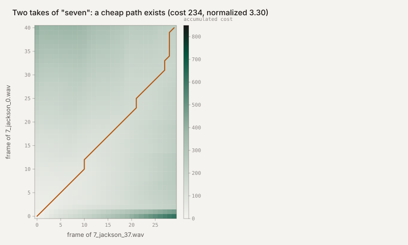
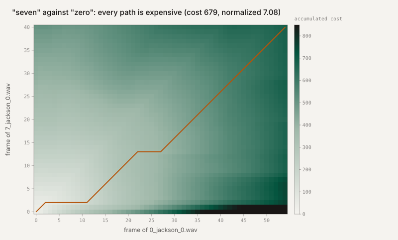
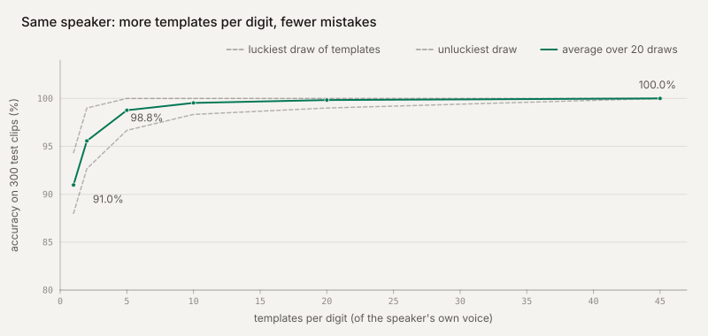
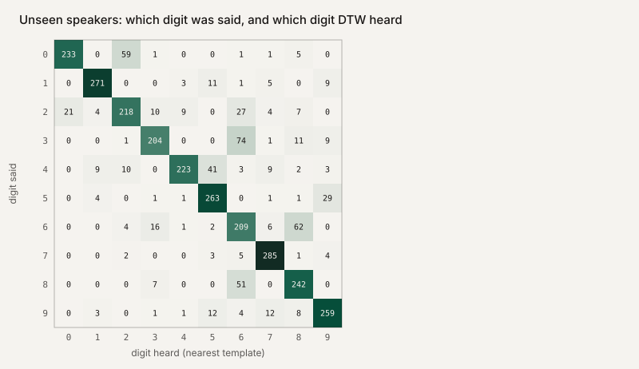

## Our First Recognizer: Dynamic Time Warping

We ended the previous chapter with a promise. Four chapters of work had turned a spoken word into a small picture: one row per 25 ms frame, a new frame every 10 ms hop, and in each row a handful of MFCCs. We had not recognized anything yet. Today we do. By the end of this chapter you will hand our program a recording of a spoken digit and it will tell you which digit it is.

We are going to do it with no training and no neural network: one idea about how to compare two recordings, a couple of hundred lines of Rust, and a folder of examples. It works better than it has any right to, and then it fails in a way that sets up the rest of the book.

### Recognition Without Learning

Here is the simplest recognizer we could think of. Keep one recording of each word we care about. Call these stored recordings *templates*. When a new recording arrives, compare it with every template and answer with the word of the most similar one.

All the difficulty hides in "most similar". A recording, after chapter 4, is a `Mat`: a grid of `f32` with one row per frame. The obvious comparison is frame by frame: row 0 against row 0, row 1 against row 1, add up the differences. Look at what that is up against.


*The same person says "seven" twice. One take is a third longer than the other. The shaded tail is what chapter 2's endpoint detector trims away.*

These are two takes of "seven" by one speaker. With the silence trimmed, one is 41 frames long and the other 30. Frame by frame, we run out of frames in one before the other is finished. Worse, even two takes of equal length would not line up, because people do not speed up evenly: one take holds the "s" longer, the other lingers on the "e".

### A Toy We Can Check By Hand

Real features have 12 numbers per frame and are hard to stare at, so let's shrink the problem. Pretend a frame is a single number, and take two "recordings" of the same shape, a rise and a fall, where the second one dawdles at the start and at the top:

```text
a = [0, 1, 4, 6, 4, 1, 0]             7 frames
b = [0, 0, 1, 5, 4, 6, 6, 3, 1, 0]   10 frames
```

Compare them frame by frame, over the 7 frames they both have:

```text
|0-0| + |1-0| + |4-1| + |6-5| + |4-4| + |1-6| + |0-6| = 16
```

By the end we are comparing the tail of `a` with the peak of `b`. The number 16 says these are very different, and our eyes say they are nearly the same. What we want is permission to stretch: let `a[0]` stand for both of `b`'s leading zeros, let `a[3] = 6` cover both sixes. With the best stretching, we will see, the 16 drops to 2.

Finding the best stretching is called *dynamic time warping*, DTW for short.

### The Distance Between Two Frames

First we need a number that says how different two frames are. For the toy it is `|x - y|`, which is what the function below gives for frames of one feature. For real frames, each a row of 12 features, we use the straight-line distance from geometry, extended from 2 coordinates to 12: square the differences, add them, take the root. It is called the *Euclidean distance*, and we will call it the *local distance* because it compares one frame with one frame.

```rust
// src/dtw.rs

pub fn frame_distance(x: &[f32], y: &[f32]) -> f32 {
    assert_eq!(x.len(), y.len(), "frame_distance: frames have {} and {} features", x.len(), y.len());
    let mut sum = 0.0;
    for (p, q) in x.iter().zip(y) {
        sum += (p - q) * (p - q);
    }
    sum.sqrt()
}
```

### A Grid And A Path Through It

Now the picture that makes the problem tractable. Write `a` down the side and `b` along the top, and in cell `(i, j)` put the local distance between frame `i` of `a` and frame `j` of `b`. For the toy that is a 7 × 10 grid.

A way of stretching one sequence onto the other is a walk through this grid. Every cell on the walk says "frame `i` of `a` and frame `j` of `b` are the same moment of the word". We call such a walk a *warping path*, and it has to obey three rules:

* **It starts at the top-left corner and ends at the bottom-right.** The words start together and end together.
* **It never goes backwards.** Time only runs forward in both recordings.
* **It never skips.** Each step moves one cell right (`b` advances while `a` waits), one cell down (`a` advances, `b` waits), or one cell diagonally (both advance). Every frame of both recordings gets matched to something.

The *cost* of a path is the sum of the local distances in the cells it visits. The frame-by-frame comparison is just one path, straight down the diagonal. DTW asks for the cheapest path of all.

We could try every path. On the toy grid there are 75,517 of them. On a 35 × 35 grid, the size of a typical pair of digit recordings, there are about 10²⁵.

### Three Ways Into A Cell

Pick any cell `(i, j)` and ask: what is the cheapest path from the start to *here*? Whatever that path is, its last step came from one of three places: diagonally from `(i-1, j-1)`, from above, `(i-1, j)`, or from the left, `(i, j-1)`. And the part of the path before that last step must itself be the cheapest way of reaching that neighbor. If it were not, we could swap in a cheaper one.

So if we already know the cheapest cost of reaching each of the three neighbors, the cheapest cost of reaching `(i, j)` needs no search at all. Call it `D(i, j)`, the *accumulated cost*, and write `d(i, j)` for the local distance:

```text
D(i, j) = d(i, j) + min( D(i-1, j-1),   diagonal: both advance
                         D(i-1, j),     up:       a advances, b waits
                         D(i, j-1) )    left:     b advances, a waits
```


*The recurrence on one cell of the toy grid.*

A rule that defines each value from earlier values is called a *recurrence*. Let's work a few cells of the toy by hand. `a` starts `0, 1, 4` and `b` starts `0, 0, 1, 5`.

* `D(0, 0) = |0 - 0| = 0`. Nothing came before the start cell.
* Along the top row there is only one way to arrive, from the left, so the row is a running sum: `0, 0, 1, 6, ...`. The same goes for the left column.
* `D(1, 1) = |1 - 0| + min(0, 0, 1) = 1`.
* `D(1, 2) = |1 - 1| + min(0, 1, 1) = 0`. A zero: we matched `a`'s 1 with `b`'s 1 after letting `a[0]` absorb both leading zeros.
* `D(2, 3) = |4 - 5| + min(0, 4, 3) = 1`, the cell in the figure.

Fill the grid row by row and every cell finds its three neighbors already done. The bottom-right cell then holds the cost of the cheapest complete path. That is 70 cells for the toy, not 75,517 paths.

This trick has a name: *dynamic programming*. Solve a big problem by solving every smaller version of it once, in an order where each answer is built from answers we already have. Remember the shape of it: a grid, a rule for each cell in terms of its neighbors, an answer in the corner. We will meet it again in chapter 8, on a different grid with sums in place of the minimum, and again in chapter 10 when we count the mistakes in a transcript.

Enough of the talk, let's write some code!

### Filling The Grid

The function takes two `Mat`s and returns the grid `D`. One thing in it needs a word: `band_columns` decides which columns of a row get filled. For now read it as "all of them, `0..m`"; we come back to it shortly. `min3` is the smallest of three numbers.

```rust
// src/dtw.rs

/// Fill the accumulated-cost grid, row by row.
fn accumulate(a: &Mat, b: &Mat, band: Option<usize>) -> Mat {
    check_inputs(a, b);
    let (n, m) = (a.rows, b.rows);
    let radius = band_radius(n, m, band);
    let mut acc = Mat::from_fn(n, m, |_, _| f32::INFINITY);
    for i in 0..n {
        for j in band_columns(i, m, radius) {
            let local = frame_distance(a.row(i), b.row(j));
            // The cheapest way to arrive at (i, j). On the top row and left
            // column some neighbors do not exist; a missing neighbor is
            // "infinitely expensive", so `min` never picks it.
            let best_before = if i == 0 && j == 0 {
                0.0 // the start cell: nothing came before
            } else {
                let diagonal = if i > 0 && j > 0 { acc[(i - 1, j - 1)] } else { f32::INFINITY };
                let up = if i > 0 { acc[(i - 1, j)] } else { f32::INFINITY };
                let left = if j > 0 { acc[(i, j - 1)] } else { f32::INFINITY };
                min3(diagonal, up, left)
            };
            acc[(i, j)] = local + best_before;
        }
    }
    acc
}
```

`check_inputs` panics if either sequence is empty or their frames have different numbers of features.

### Walking Back

The corner of `D` tells us what the best path costs, but not where it went. Stand on the end cell and ask which of the three neighbors the recurrence took its minimum from: it is the one with the smallest accumulated cost. Step there, ask again, and repeat until we are back at the start. This is called the *backtrace*.

```rust
// src/dtw.rs

/// Recover the cheapest path from a filled accumulated-cost grid.
fn backtrace(acc: &Mat) -> Vec<(usize, usize)> {
    let (mut i, mut j) = (acc.rows - 1, acc.cols - 1);
    let mut path = vec![(i, j)];
    while i > 0 || j > 0 {
        if i == 0 {
            j -= 1; // on the top row the only way back is left
        } else if j == 0 {
            i -= 1; // on the left column the only way back is up
        } else {
            let (diagonal, up, left) = (acc[(i - 1, j - 1)], acc[(i - 1, j)], acc[(i, j - 1)]);
            if diagonal <= up && diagonal <= left {
                i -= 1;
                j -= 1;
            } else if up <= left {
                i -= 1;
            } else {
                j -= 1;
            }
        }
        path.push((i, j));
    }
    path.reverse();
    path
}
```

On a tie we prefer the diagonal. `dtw_full` glues the two functions together and returns a `DtwResult` (the cost, the path, and a normalized cost we will get to) along with the grid; `dtw(a, b)` is the short form that returns only the result.

The example `ch05_dtw_toy` runs all of this on our two sequences. Go ahead and run it:

```text
$ cargo run --release --example ch05_dtw_toy
...
Accumulated cost D(i, j) = d(i, j) + min(D(i-1, j-1), D(i-1, j), D(i, j-1)), path in [brackets]:
          b:     0      0      1      5      4      6      6      3      1      0 
  a =    0  [    0][    0]     1      6     10     16     22     25     26     26 
  a =    1       1      1 [    0]     4      7     12     17     19     19     20 
  a =    4       5      5      3 [    1][    1]     3      5      6      9     13 
  a =    6      11     11      8      2      3 [    1][    1]     4      9     15 
  a =    4      15     15     11      3      2      3      3 [    2]     5      9 
  a =    1      16     16     11      7      5      7      8      4 [    2]     3 
  a =    0      16     16     12     12      9     11     13      7      3 [    2]

The warping path (a runs down, b runs right):
   # # . . . . . . . .
   . . # . . . . . . .
   . . . # # . . . . .
   . . . . . # # . . .
   . . . . . . . # . .
   . . . . . . . . # .
   . . . . . . . . . #
...
DTW cost (bottom-right corner of D): 2
Normalized by n + m = 7 + 10:       0.1176
Frame-by-frame, no warping (first 7 frames only): 16
```

Find the cells we worked by hand, then read the path. It moves right where `b` dawdles (the two zeros, the two sixes) and diagonally everywhere else. The only costs it could not avoid are `b`'s 5 against `a`'s 4 and `b`'s 3 against `a`'s 4. Cost 2, against 16 without warping.

> **Play with it:** [the DTW grid](../interactive/dtw.html). It opens on this same pair of sequences. Drag a point and watch the grid and the path follow.

### Making Costs Comparable

The cost is a sum over the path, and a path through a small grid has fewer cells to add up. Compare one recording with a short template and a long one, and the short one gets a head start for being short. So before ranking templates, `normalize_cost` divides the cost by `n + m`, which turns the sum into something like an average distance per frame.

Why `n + m` and not the number of cells on the path? Because the path length depends on which path won. "Cost divided by path length" is not what the recurrence minimized, and a longer, wigglier path might score better after dividing than the one we found. `n + m` is fixed before we start. A path has between `max(n, m)` and `n + m - 1` cells, so the two choices never differ by a factor of two.

### Staying Near The Diagonal

Nothing so far stops a path from running along the top edge and then straight down: one frame of `a` matched to nearly all of `b`. No human stretches a word like that. Sakoe and Chiba's fix, in the paper that made DTW famous, is to allow only cells within some distance of the diagonal, `|i - j| <= radius`. This is the *Sakoe-Chiba band*. It forbids absurd warps, and it saves time, because cells outside the band are never computed.

```rust
// src/dtw.rs

pub fn band_radius(n: usize, m: usize, band: Option<usize>) -> usize {
    match band {
        Some(width) => width.max(n.abs_diff(m)),
        None => n.max(m),
    }
}

/// The columns of row `i` that lie inside the band: `i - radius ..= i + radius`,
/// clipped to the grid.
fn band_columns(i: usize, m: usize, radius: usize) -> std::ops::Range<usize> {
    i.saturating_sub(radius)..(i + radius + 1).min(m)
}
```

There is one trap. The end cell `(n-1, m-1)` is itself `|n - m|` away from the diagonal, so a band narrower than that would cut the corner off and leave no path at all. `band_radius` widens the band to at least `|n - m|`. With `None` the radius covers the whole grid, which is how `accumulate` handled both cases with one loop. Cells outside the band stay at infinity, and the recurrence ignores them like missing neighbors.

### Two Rows Are Enough

A recognizer compares one recording with thousands of templates and only wants the final number each time. Look at the recurrence again: row `i` reads row `i - 1` and the part of row `i` already filled. Nothing older. So we can drop the grid and keep two rows.

```rust
// src/dtw.rs

/// The DTW cost alone (not normalized), without the path.
pub fn dtw_cost(a: &Mat, b: &Mat, band: Option<usize>) -> f32 {
    check_inputs(a, b);
    let (n, m) = (a.rows, b.rows);
    let radius = band_radius(n, m, band);
    let mut previous = vec![f32::INFINITY; m];
    let mut current = vec![f32::INFINITY; m];
    for i in 0..n {
        // Cells outside the band must read as infinity, including the ones
        // left over in this buffer from two rows ago.
        current.fill(f32::INFINITY);
        for j in band_columns(i, m, radius) {
            let local = frame_distance(a.row(i), b.row(j));
            let best_before = if i == 0 && j == 0 {
                0.0
            } else {
                let diagonal = if j > 0 { previous[j - 1] } else { f32::INFINITY };
                let up = previous[j];
                let left = if j > 0 { current[j - 1] } else { f32::INFINITY };
                min3(diagonal, up, left)
            };
            current[j] = local + best_before;
        }
        std::mem::swap(&mut previous, &mut current);
    }
    previous[m - 1]
}
```

On row 0, `previous` is all infinity, which plays the part of the missing row above. `dtw_distance` is this cost passed through `normalize_cost`, and it is the number our recognizer ranks by.

How do we know it works? One test states the reason DTW exists: slow a sequence down by repeating its frames, and DTW should not mind at all.

```rust
// src/dtw.rs (tests)

#[test]
fn a_time_stretched_copy_costs_nothing() {
    let mut rng = Rng::new(13);
    let a = random_seq(&mut rng, 12, 3);
    let mut rows = Vec::new();
    for i in 0..a.rows {
        for _ in 0..(2 + i % 2) {
            rows.push(a.row(i).to_vec());
        }
    }
    let stretched = Mat::from_rows(&rows);
    assert_eq!(stretched.rows, 30);
    assert_eq!(dtw(&a, &stretched).cost, 0.0);
    // Comparing frame by frame, without warping, would be far from zero.
    let naive: f32 = (0..a.rows).map(|i| frame_distance(a.row(i), stretched.row(i))).sum();
    assert!(naive > 1.0);
}
```

The other tests check `dtw_cost` against the full grid on awkward shapes with and without a band, work a 3 × 4 grid by hand, check that every path obeys the three rules and that its cells sum to the reported cost, and check that narrowing the band can only raise the cost. `cargo test dtw` runs them all.

### From A Distance To A Recognizer

After all that, the recognizer is short. A `Template` is a label and a feature `Mat`. A `TemplateBank` is a `Vec` of templates and an optional band. To recognize, we measure the distance to every template and sort. `nearest_templates` says *which* templates came closest, as positions in the bank; `nearest` swaps each position for its label, which is all the vote needs.

```rust
// src/dtw.rs

impl TemplateBank {
    /// The `k` templates closest to `query`, nearest first, as
    /// `(index into self.templates, normalized DTW cost)`.
    pub fn nearest_templates(&self, query: &Mat, k: usize) -> Vec<(usize, f32)> {
        let mut scored: Vec<(usize, f32)> =
            self.templates.iter().enumerate().map(|(index, t)| (index, dtw_distance(query, &t.features, self.band))).collect();
        scored.sort_by(|x, y| x.1.total_cmp(&y.1));
        scored.truncate(k);
        scored
    }

    /// The `k` templates closest to `query`, nearest first, as
    /// `(label, normalized DTW cost)`.
    pub fn nearest(&self, query: &Mat, k: usize) -> Vec<(usize, f32)> {
        self.nearest_templates(query, k).into_iter().map(|(index, cost)| (self.templates[index].label, cost)).collect()
    }

    /// Let the `k` closest templates vote. Returns the winning label and the
    /// normalized cost of that label's closest template.
    pub fn classify_knn(&self, query: &Mat, k: usize) -> (usize, f32) {
        assert!(!self.is_empty(), "cannot classify with an empty template bank");
        assert!(k > 0, "k must be at least 1");
        let neighbors = self.nearest(query, k);
        // `neighbors` is sorted nearest first, so the first time we meet a
        // label is that label's closest template. Requiring strictly more
        // votes to take the lead means earlier (nearer) labels win ties.
        let mut winner = neighbors[0];
        let mut winner_votes = 0;
        for (index, &(label, cost)) in neighbors.iter().enumerate() {
            let first_time_seen = neighbors[..index].iter().all(|&(l, _)| l != label);
            if !first_time_seen {
                continue;
            }
            let votes = neighbors.iter().filter(|&&(l, _)| l == label).count();
            if votes > winner_votes {
                winner = (label, cost);
                winner_votes = votes;
            }
        }
        winner
    }
}
```

With `k = 1` the vote has one voter and this is plain nearest-template matching (`classify` is that shorthand). With a larger `k`, one odd template that happens to sit near the query can be outvoted by its neighbors. This is the *k-nearest-neighbors* classifier.

Every query costs one DTW per template, and the queries do not depend on each other, so the work spreads easily over cores. `std::thread::scope` lets the threads borrow `self` and the queries directly, with no `Arc` and no cloning, because the scope guarantees every thread has finished before it returns:

```rust
// src/dtw.rs

    pub fn classify_many(&self, queries: &[Mat], k: usize) -> Vec<(usize, f32)> {
        let threads = std::thread::available_parallelism().map_or(1, |n| n.get());
        let mut results = vec![(0, 0.0); queries.len()];
        if queries.is_empty() {
            return results;
        }
        let chunk_len = queries.len().div_ceil(threads);
        std::thread::scope(|scope| {
            for (query_chunk, result_chunk) in queries.chunks(chunk_len).zip(results.chunks_mut(chunk_len)) {
                scope.spawn(move || {
                    for (query, result) in query_chunk.iter().zip(result_chunk) {
                        *result = self.classify_knn(query, k);
                    }
                });
            }
        });
        results
    }
```

`chunks_mut` hands each thread its own disjoint slice of the output, so no two threads write to the same place.

### The Digits

Time for real speech. The [Free Spoken Digit Dataset](https://github.com/Jakobovski/free-spoken-digit-dataset) is 3,000 recordings: six speakers, the digits zero to nine, fifty takes of each, at 8,000 samples per second. It is licensed CC BY-SA 4.0. From the root of the repository:

```text
$ git clone https://github.com/Jakobovski/free-spoken-digit-dataset data/fsdd
```

Our programs look for datasets in `../data` relative to `code/`, or in `$SPEECH_DATA` if you set it. Without the dataset you can still run the toy, the tests and, in a reduced form we come to at the end, `classify`. The experiments from here on need the download.

The loader in [`src/data/fsdd.rs`](../code/src/data/fsdd.rs) is plumbing, so we describe it without listing it. File names look like `7_jackson_32.wav` (digit, speaker, take), and `load` turns each into a `Clip` with those three fields and the samples from chapter 1's WAV reader. A recognizer must be judged on recordings it has never seen, and the loader offers two honest ways to arrange that:

* `official_split`: the dataset's authors reserve takes 0 to 4 of every digit and speaker for testing (300 clips) and leave takes 5 to 49 as templates (2,700). Every test speaker is also among the templates.
* `leave_speaker_out`: all 500 clips of one speaker are the test, and the templates come from the other five. The recognizer has never heard the voice.

Before any numbers, here is DTW on real features. The two takes of "seven" from the start of the chapter, and then one of them against a "zero":



*Two takes of "seven". Frame 0 is at the bottom here, so the path climbs. Cost 234, or 3.30 per frame after normalizing.*



*"Seven" against "zero" on the same color scale: cost 679, normalized 7.08.*

Between the two sevens the path takes a few vertical steps where the longer take lingers. Against "zero" it stalls in long flat runs and still ends at more than twice the normalized cost. That gap is what the recognizer lives on.

### Which Features?

Chapter 4 built MFCCs for this chapter, and left us a menu: keep or drop c0, add deltas or not, apply per-utterance normalization or not. It called normalization and deltas standard. We measured, and the measurements surprised us.

`ch05_digits` begins with this experiment. To keep ourselves honest it does not touch the official test takes: takes 5 to 19 are the queries and takes 20 to 49 the templates. Each row changes one thing about the recipe we settled on. `1 own` allows a single template per digit from the query's own speaker, `known` allows every template, `unseen` only templates from the other five speakers.

```text
$ cargo run --release --example ch05_digits
...
   recipe                                    dims   1 own   known  unseen     time
   settled: 13 MFCCs, c0 dropped, trimmed      12   94.0%   99.3%   79.6%   0.65 s
     keep c0 (loudness)                        13   87.7%   98.8%   62.7%   0.71 s
     add deltas                                24   93.6%   99.2%   79.1%   0.94 s
     subtract the clip's mean                  12   87.4%   98.3%   67.3%   0.66 s
     normalize mean and variance               12   87.2%   98.0%   76.0%   0.67 s
     do not trim silence                       12   93.0%   98.7%   76.2%   0.98 s
     6 coefficients                             5   91.2%   98.9%   70.0%   0.58 s
     8 coefficients                             7   92.4%   99.1%   76.9%   0.64 s
     20 coefficients                           19   93.4%   99.0%   77.8%   0.82 s
     30 coefficients                           29   92.8%   99.0%   75.6%   1.16 s
     Sakoe-Chiba band of 2 frames              12   94.0%   99.3%   79.4%   0.33 s
     Sakoe-Chiba band of 5 frames              12   94.0%   99.3%   79.6%   0.32 s
     Sakoe-Chiba band of 10 frames             12   94.0%   99.3%   79.2%   0.38 s
   textbook: c0, deltas, mean+variance         26   83.4%   97.7%   74.7%   1.07 s
```

The accuracies are measurements (the times are from my machine and will differ on yours). The explanations that follow are our best guesses.

**Dropping c0 matters a lot.** Keeping it costs 17 points on unseen speakers. c0 is the loudness of the frame. It says more about how far the speaker sat from the microphone than about the word, and it is the coefficient with the largest swings, so it dominates a Euclidean distance.

**Normalization hurts.** Subtracting each clip's mean costs 12 points on unseen speakers. Chapter 4's argument was that the mean of a column over an utterance is the microphone and the room. That holds when the utterance is a sentence, with enough different sounds for them to average out. Here a clip is one word, about 35 frames. Its mean is largely the word itself, and subtracting it throws away part of what tells a "six" from a "two".

**Deltas add nothing.** A plausible reason: deltas describe how the features move, and DTW already compares the frames in order, so the movement is in the alignment.

**The textbook recipe loses.** c0, deltas and mean-and-variance normalization together do worse than the plain 12 numbers in every column, and worst of all rows for a speaker we know.

So was chapter 4 wrong? No, but its advice has a context. That recipe grew up with statistical models trained on long utterances from many speakers and microphones. We have a distance function and one-word clips. A feature recipe is a hypothesis about your data, and it is cheap to test.

For the rest: trimming silence with chapter 2's endpoint detector helps a little, 13 coefficients is the sweet spot, and a band changes nothing we can measure in accuracy while halving the time. We settle on the first row, `MfccRecipe::standard()`, with the band off.

### How Well Does It Work?

Now the official test takes. First the smallest recognizer imaginable: for each speaker, one template per digit from their own voice. Ten recordings.

```text
1. One template per digit, same speaker (template: take 5; test: takes 0-4)

   george     10 templates, 50 test clips   100.0%
   jackson    10 templates, 50 test clips   100.0%
   lucas      10 templates, 50 test clips   100.0%
   nicolas    10 templates, 50 test clips    80.0%
   theo       10 templates, 50 test clips    98.0%
   yweweler   10 templates, 50 test clips    92.0%
   mean                                        95.0%   (2 ms)
```

95% from ten recordings and no training. That is amazing. It is also how speaker-dependent voice dialing worked: you said each name once, the phone kept it.

Take 5 was a kind choice, though (possibly because it was recorded right after the test takes; that is a guess). Picking the templates at random, twenty times for each count, gives a fairer picture:

```text
2. More templates per digit, same speaker (20 random draws of the templates for each count)

   templates  per digit     mean    worst     best
          10          1    91.0%    88.0%    94.3%
          20          2    95.6%    92.7%    99.0%
          50          5    98.8%    96.7%   100.0%
         100         10    99.5%    98.3%   100.0%
         200         20    99.8%    99.0%   100.0%
         450         45   100.0%   100.0%   100.0%
   (81 ms)

3. All six speakers, official split (2700 templates, 300 test clips)

   1-nearest   100.0%   (0 of 300 wrong, 0.33 s)
   3-nearest   100.0%   (0 of 300 wrong, 0.35 s)
   5-nearest   100.0%   (0 of 300 wrong, 0.34 s)
```



*More recordings of your own voice, fewer mistakes.*

One template averages 91%, five reach 98.8%, and with all six speakers' recordings in the bank, experiment 3 gets all 300 test clips right. If we stopped here we would declare speech recognition solved.

### A Voice It Has Never Heard

We should not stop here, because in every experiment so far the recognizer had already heard the person it was listening to. Experiment 4 takes that away: hold one speaker out, use the other five as templates, test on all 500 of the stranger's clips, and do it six times so that everyone gets a turn.

```text
4. A speaker never heard before (leave one speaker out: 2,500 templates from five speakers, 500 test clips)

   held out    1-nearest  5-nearest       time
   george          54.8%      51.2%     1.09 s
   jackson         91.8%      92.4%     1.14 s
   lucas           91.4%      94.2%     1.19 s
   nicolas         64.2%      62.2%     0.95 s
   theo            92.0%      92.6%     0.94 s
   yweweler        87.2%      84.8%     1.02 s
   mean            80.2%      79.6%
```


*The same recognizer and the same clips. The only difference is whether the speaker is among the templates.*

From 100% to 80.2% on average, and for george to 54.8%, barely better than a coin flip. Nothing about the algorithm changed. Voting does not rescue it either: the five nearest templates do slightly worse than the single nearest.

Which digits go wrong? The program counts, over all six rounds, what was said against what was heard. A table like this is called a *confusion matrix*.



*Rows: the digit said. Columns: the digit heard. Each row has 300 clips.*

Read it with us. "Seven" is safest (285 of 300). The mistakes come in families:

* **Three, six and eight** confuse each other: three is heard as six 74 times, six as eight 62 times, eight as six 51 times. All three have a vowel made at the front of the mouth, and what should separate them is the hiss of "s" and "th" and the burst of "t". Most of the energy of those sounds lies above 4,000 Hz, and a recording at 8,000 samples per second cannot hold anything above 4,000 Hz (chapter 1's Nyquist limit). The dataset threw away the best evidence before we arrived.
* **Zero and two** (59 and 21): both end in a long, rounded back vowel.
* **Four and five** (41), **five and nine** (29): the first pair starts with the same "f", the second shares the vowel of "five" and "nine" between weak consonants.

These are plausible stories, not proofs. What the matrix does show is that the errors are not random. The recognizer confuses words that sound alike, and a new voice can move a "three" further than the distance between "three" and "six".

### What An Answer Costs

One more measurement before we judge the method.

```text
5. What one answer costs (one clip against N templates, one core)

    templates      ms per clip    ms per clip, band 5
           10             0.03                   0.02
          100             0.32                   0.16
          450             1.50                   0.74
         2700             9.27                   4.77
```

A typical clip is 35 frames, so one DTW fills 35 × 35 = 1,225 cells. Against 2,700 templates that takes 9.3 ms on one core of my machine (yours will differ). That is fast enough here. But read down the column: ten times the templates, ten times the wait. Every recording we add to become more accurate makes every answer slower, and the bank is the entire dataset held in memory. The vocabulary multiplies it again: ten words at 270 templates each is 2,700 grids, and ten thousand words at the same rate would be a thousand times that, about nine seconds per word.

### Your Turn

`classify` computes the features of one file, compares it with every clip of the dataset and shows its work. If the file is itself in the dataset (the digit clips in `samples/` are), that clip is left out of the templates, since finding yourself proves nothing.

```text
$ cargo run --release --example ch05_digits -- classify ../samples/seven_jackson.wav
../samples/seven_jackson.wav: 0.43 s at 8000 Hz
41 frames of 12 MFCCs after trimming silence
loaded 3000 templates and computed their features in 0.16 s
this recording is in the dataset as 7_jackson_0.wav; leaving that one out of the templates

compared with 2999 templates in 6 ms (all cores)

The ten nearest templates:

   rank  template               digit   distance
      1  7_jackson_1.wav        seven      2.327
      2  7_jackson_3.wav        seven      2.464
      3  7_jackson_23.wav       seven      2.642
...
The nearest template of each digit:

   seven    2.327  ##############                            7_jackson_1.wav
   five     3.961  #######################                   5_jackson_4.wav
   nine     4.465  ##########################                9_theo_32.wav
   zero     5.413  ################################          0_theo_35.wav
...
   eight    6.868  ########################################  8_nicolas_38.wav

It says "seven" (digit 7, distance 2.327 to 7_jackson_1.wav).
```

Our program heard a word. All ten of the nearest templates are jackson saying "seven", and the best wrong answer, a "five", is 70% further away.

Now try a stranger. `samples/seven.wav` is the clip from chapters 1 to 4: another speaker, another microphone, 16,000 samples per second (the example resamples it to 8,000 with chapter 4's resampler).

```text
$ cargo run --release --example ch05_digits -- classify ../samples/seven.wav
...
   seven    5.719  ###########################               7_yweweler_46.wav
   zero     6.201  #############################             0_lucas_20.wav
   nine     6.282  ##############################            9_theo_31.wav
...
It says "seven" (digit 7, distance 5.719 to 7_yweweler_46.wav).
```

Right again, but look at the distances. The nearest "seven" is at 5.7, further than the nearest *wrong* digit was for jackson, and "zero" is breathing down its neck at 6.2. A narrow win.

Then record yourself. With `ffmpeg` installed, two seconds from the default microphone:

```text
$ ffmpeg -f avfoundation -i ":0" -t 2 -ac 1 me.wav    # macOS
$ ffmpeg -f alsa -i default -t 2 -ac 1 me.wav         # Linux
$ cargo run --release --example ch05_digits -- classify me.wav
```

Any mono WAV at any sample rate will do. Say one digit, and do not be surprised if the answer is wrong. You are george in experiment 4: nobody in the bank sounds like you, or like your microphone. That is the lesson of this chapter.

And if you have not downloaded the dataset? `classify` still runs. It says so on its second line and falls back to the six digit clips that ship in `samples/`: a "zero", a "three" and a "seven" from each of jackson and george. Six templates make a very small bank, and it shows:

```text
$ cargo run --release --example ch05_digits -- classify ../samples/seven_jackson.wav
../samples/seven_jackson.wav: 0.43 s at 8000 Hz
no dataset in ../data/fsdd/recordings: using the 6 digit clips in ../samples/ as templates (zero, three and seven only)
41 frames of 12 MFCCs after trimming silence
loaded 6 templates and computed their features in 2 ms
this recording is in the dataset as 7_jackson_0.wav; leaving that one out of the templates

compared with 5 templates in 0 ms (all cores)

All 5 templates, nearest first:

   rank  template               digit   distance
      1  3_jackson_0.wav        three      6.947
      2  0_jackson_0.wav        zero       7.077
      3  7_george_0.wav         seven      7.470
      4  3_george_0.wav         three      8.886
      5  0_george_0.wav         zero      10.152
...
It says "three" (digit 3, distance 6.947 to 3_jackson_0.wav).
```

Wrong, and for a reason we have already met. The file is one of the six, so it is left out, and the only "seven" that remains is george's. Jackson's own "three" and "zero" are both closer to jackson's "seven" than another man's "seven" is: with one template per word, the voice outweighs the word. `../samples/seven.wav` fares better against the same six clips. It comes out as "seven", nearest to jackson's take at a distance of 5.976, with jackson's "zero" next at 6.989. Treat the fallback as a way to watch the machinery run. The accuracy lives in the 3,000 clips.

### Why This Approach Runs Out Of Road

**Aside** <br>
None of this is new. Vintsyuk described dynamic programming for comparing spoken words in 1968, and Sakoe and Chiba's 1978 paper gave the method the form we built here, band included. Through the 1970s, DTW template matchers were the state of the art for recognizing isolated words. They were replaced in the 1980s by statistical models, for the reasons we just measured.

Let's collect those reasons.

* **It memorizes recordings and learns nothing about words.** The bank holds 270 separate "sevens" and no idea of what they have in common. It cannot tell which differences between two recordings matter (the word) and which do not (the voice, the microphone).
* **Every template makes every answer slower**, and all of them stay in memory.
* **A new voice is a new problem.** The only cure on offer is more recordings from more people, which runs into the previous point.
* **A vocabulary of thousands of words is hopeless**: thousands of words times dozens of speakers times several takes.
* **It has no notion of a sequence of words.** A template is a whole word, start to end. "Seven three" is not in the bank, and neither is any other sentence.

### Try It Yourself

1. **Break the toy.** Run `ch05_dtw_toy -- 0,1,4,6,4,1,0 0,5,6,2,1,3,6,5,1,0`: similar numbers, different shape. The cost is 11, not 2, and the path has a long flat run like the "seven" against "zero" figure.
2. **Put c0 back.** In `classify`, replace `MfccRecipe::standard()` with `MfccRecipe { keep_c0: true, ..MfccRecipe::standard() }` and classify `samples/seven.wav` again. Every distance grows, because loudness is now part of each frame. On this one clip "seven" still won when I tried it (6.70, with "zero" at 7.60), which is a reminder that one clip proves little: the 17 points c0 costs on unseen speakers show up over the thousands of clips in the table.
3. **Count the paths.** The number of warping paths obeys its own recurrence: `P(i, j) = P(i-1, j-1) + P(i-1, j) + P(i, j-1)`, with 1 along the top row and left column. Write it and check that a 7 × 10 grid gives 75,517. You have just swapped a `min` for a sum on the same grid. Hold that thought until chapter 8.
4. **Be a template.** Record yourself saying each digit once, add your ten clips to the bank in `classify`, and record a second take of one digit. Experiment 2 suggests one template per digit in your own voice is right about nine times in ten.

### Loose Ends

* **Only three step directions, all weighted equally.** Sakoe and Chiba study other step patterns and weights (a diagonal step counted twice, slope limits). We implemented the simplest.
* **No "none of the above".** The recognizer always answers with a digit, even for a cough. A threshold on the distance would be the start of a fix.
* **Six speakers is a small world.** The unseen-speaker numbers swing from 54.8% to 92.0%, so the mean of 80.2% is a rough figure.
* **Our explanations of the ablation are guesses.** The table is measured; the reasons were not tested one by one.

What's next on our agenda? Let's take stock. We compared recordings of different lengths by finding the cheapest path through a grid, with a recurrence that fills each cell from three neighbors and a backtrace that recovers the path. We wrapped it in a template bank and recognized spoken digits: 95% from ten recordings of one voice, 300 out of 300 with every speaker in the bank, and 80.2% on a voice it had never heard, at a cost that grows with every recording we keep.

If you have been paying attention, you'll notice what is missing. We want a system that listens to many people saying "seven" and distills what those recordings have in common into a set of numbers far smaller than 2,700 stored clips, numbers that still work when a seventh person walks in. That distilling is what *learning* means. In the next chapter we build the machine that does it, a neural network, starting from nothing.

### References

- H. Sakoe & S. Chiba, [Dynamic programming algorithm optimization for spoken word recognition](https://doi.org/10.1109/TASSP.1978.1163055), *IEEE Transactions on Acoustics, Speech, and Signal Processing* 26(1), 43-49 (1978): the paper, the band, and the step patterns we skipped
- T. K. Vintsyuk, [Speech discrimination by dynamic programming](https://doi.org/10.1007/BF01074755), *Cybernetics* 4(1), 52-57 (1968; the English translation of a paper in the Russian journal *Kibernetika*): the earliest description
- Zohar Jackson and contributors, [Free Spoken Digit Dataset](https://github.com/Jakobovski/free-spoken-digit-dataset) (CC BY-SA 4.0)
- [std::thread::scope](https://doc.rust-lang.org/std/thread/fn.scope.html)
- Corresponding code: [`src/dtw.rs`](../code/src/dtw.rs), [`src/data/fsdd.rs`](../code/src/data/fsdd.rs), [`examples/ch05_dtw_toy.rs`](../code/examples/ch05_dtw_toy.rs), [`examples/ch05_digits.rs`](../code/examples/ch05_digits.rs)

[← Previous: Hearing Like A Human](04-hearing-like-a-human.md) · [Contents](../README.md) · [Next: A Neural Network From Nothing →](06-a-neural-network-from-nothing.md)
