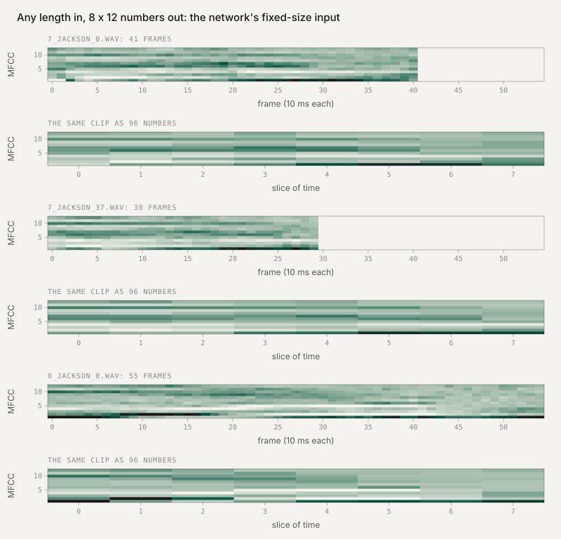
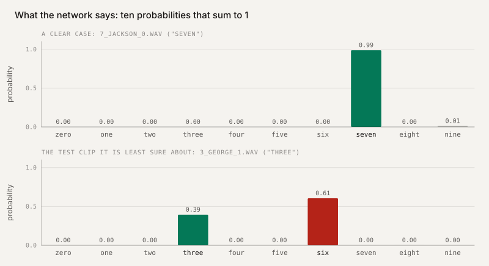

## A Neural Network From Nothing

In the last chapter we recognized spoken digits without learning anything. We kept 2,700 recordings as templates and compared every new clip against all of them with dynamic time warping. It worked: 300 out of 300 on speakers it had templates for, and 80.2% on a speaker it had never heard. It was also expensive, about 8.6 ms per clip and 1.1 million stored numbers, and we ended on a wish: a system that distills what many "sevens" have in common into far fewer numbers.

That distilling is what people mean by *learning*, and today we build the machinery for it: a neural network, the code that trains it, and the tool that tells us whether that code is correct. As always, `[dependencies]` stays empty. I will tell you now how it ends: our network will tie with DTW on accuracy, not beat it. What it wins is cost, by a factor of about a hundred, and the reason it only ties is the most useful thing in the chapter.

### What Learning Means Here

Strip away the vocabulary and there are four ingredients:

1. **A function with adjustable numbers.** It takes the features of a clip and returns ten scores, one per digit. Inside it are thousands of numbers called *weights*. Different weights, different function.
2. **Examples with known answers.** The same 2,700 labelled clips chapter 5 used as templates.
3. **A loss.** One number that says how wrong the function is on an example: near zero when it puts its money on the right digit, large when it does not.
4. **A rule for nudging.** For every weight, work out whether making it slightly larger would make the loss go up or down, and move it a small step in the "down" direction. Repeat a few thousand times.

That is all of it. The function is called a *neural network*, the direction-finding is called *backpropagation*, and the stepping is called *gradient descent*. Nothing in there thinks. Still, after training, the 2,700 clips can be thrown away and what they had in common stays behind in the weights.

We build bottom-up: a grid of numbers, a layer, a loss, the gradients, the checker, the training loop. Then two toy problems, then the digits.

### A Grid Of Numbers

Chapter 4 introduced `Mat` in two sentences and promised a look inside. Here it is, and there is not much to see: a `Vec<f32>` and a shape.

```rust
// src/mat.rs
#[derive(Clone, Debug, PartialEq)]
pub struct Mat {
    pub rows: usize,
    pub cols: usize,
    /// Row-major storage: element (r, c) lives at `data[r * cols + c]`.
    pub data: Vec<f32>,
}

impl Mat {
    /// A `rows x cols` matrix of zeros.
    pub fn zeros(rows: usize, cols: usize) -> Self {
        Mat { rows, cols, data: vec![0.0; rows * cols] }
    }

    /// Row `r` as a slice.
    pub fn row(&self, r: usize) -> &[f32] {
        &self.data[r * self.cols..(r + 1) * self.cols]
    }
    // ... from_vec, from_fn, from_rows, row_mut, transpose, map, add_assign,
    //     scale, fill, and Index/IndexMut so that m[(r, c)] works
}
```

*Row-major* means the rows are stored one after another, so a row is a contiguous slice and `row(r)` costs nothing. Hold that thought.

The one operation that matters is the *matrix product*. For `A` (n × m) and `B` (m × p), the product `A B` is n × p, and its entry (i, j) is the dot product of row i of `A` with column j of `B`. The textbook writes that as three loops: for each `i`, for each `j`, sum over `k`. Ours reorders them:

```rust
// src/mat.rs
    /// Matrix product `self * other`, on the calling thread.
    pub fn matmul(&self, other: &Mat) -> Mat {
        assert_eq!(self.cols, other.rows, "matmul: {}x{} * {}x{}", self.rows, self.cols, other.rows, other.cols);
        let mut out = Mat::zeros(self.rows, other.cols);
        for (a_row, out_row) in self.data.chunks_exact(self.cols.max(1)).zip(out.data.chunks_exact_mut(other.cols.max(1))) {
            matmul_row(a_row, other, out_row);
        }
        out
    }

/// One row of a matrix product: `out_row = a_row * b`.
fn matmul_row(a_row: &[f32], b: &Mat, out_row: &mut [f32]) {
    for (k, &a) in a_row.iter().enumerate() {
        if a == 0.0 {
            continue; // common after a ReLU, and free to skip
        }
        for (o, &bv) in out_row.iter_mut().zip(b.row(k)) {
            *o += a * bv;
        }
    }
}
```

This is i-k-j order. Read `matmul_row` as: "the output row is a mix of the rows of `b`, and `a_row` says how much of each to take". Same arithmetic, different walk through memory. The textbook's inner loop marches down a *column* of `B`, jumping `cols` elements at every step, and funnels everything into one running sum, where each addition has to wait for the one before. Our inner loop walks two rows left to right doing `out += a * b`, with no dependency between one element and the next, so the compiler turns it into SIMD instructions without being asked. I measured both on a 256 × 256 product: 11.3 ms for i-j-k, 1.1 ms for i-k-j, on my machine. Ten times faster for swapping two loops.

How do we know it is right? A product small enough to do on paper:

```rust
// src/mat.rs
    #[test]
    fn matmul_matches_hand_computation() {
        assert_eq!(a().matmul(&b()), Mat::from_vec(2, 2, vec![58.0, 64.0, 139.0, 154.0]));
    }
```

Here `a()` is `[[1, 2, 3], [4, 5, 6]]` and `b()` is `[[7, 8], [9, 10], [11, 12]]`, and 58 is 1·7 + 2·9 + 3·11. `Mat` also has `t_matmul` (Aᵀ B) and `matmul_t` (A Bᵀ, the one chapter 4 used), which avoid building a transpose; both will show up in backprop.

**Aside** <br>
We also need random numbers, for starting weights and for shuffling, and `rand` is a dependency. So `src/rng.rs` holds our own generator, xoshiro256** by Blackman and Vigna. Its whole state is four `u64`s, and one step is a multiply, two rotations, and a few shifts and XORs:

```rust
// src/rng.rs
    pub fn next_u64(&mut self) -> u64 {
        let result = self.s[1].wrapping_mul(5).rotate_left(7).wrapping_mul(9);
        let t = self.s[1] << 17;
        self.s[2] ^= self.s[0];
        self.s[3] ^= self.s[1];
        self.s[1] ^= self.s[2];
        self.s[0] ^= self.s[3];
        self.s[2] ^= t;
        self.s[3] = self.s[3].rotate_left(45);
        result
    }
```

On top of it sit `uniform()`, `normal()` (Box-Muller) and `shuffle()` (Fisher-Yates). It is not for cryptography. What we want is *reproducibility*: `Rng::new(1)` gives the same sequence on every machine, so when this chapter says "seed 1 reaches 99.7%", your run will too.

### Every Output Is A Weighted Sum Of The Inputs

In chapter 4 the mel filterbank turned 257 spectrum values into 40 band energies, and each energy was a weighted sum of all 257 inputs, with the triangle's heights as weights. We chose those weights by hand, from what we know about ears.

A *linear layer* is the same computation with one difference: nobody chooses the weights. They start random and get learned. A row `x` of `n_in` numbers becomes a row `y` of `n_out` numbers:

```text
y[j] = b[j] + sum over i of  x[i] * W[i][j]
```

`W[i][j]` is how strongly input `i` pushes output `j`, and `b[j]`, the *bias*, is output `j`'s value when all the inputs are zero. If we store `W` as an `n_in × n_out` matrix, the formula for a whole stack of rows `X` is one matrix product, `Y = X W + b`:

```rust
// src/nn/linear.rs
pub struct Linear {
    /// `n_in x n_out`: row `i` holds the weights leaving input `i`.
    pub weight: Mat,
    /// `1 x n_out`: one bias per output.
    pub bias: Mat,
}

    /// `Y = X W + b` for a `T x n_in` input; returns `T x n_out`.
    pub fn forward(&self, x: &Mat) -> Mat {
        assert_eq!(x.cols, self.n_in(), "Linear: input has {} columns, the layer expects {}", x.cols, self.n_in());
        let mut y = kernels::matmul(x, &self.weight);
        kernels::add_row_to_each(&mut y, &self.bias.data);
        y
    }
```

(`kernels::matmul` gives the same result as `Mat::matmul`, taking four rows of `W` per pass; `src/nn/kernels.rs` holds a handful of such inner loops, and speed becomes chapter 7's concern. `add_row_to_each` adds the bias to every row.)

The starting weights are small random numbers from our `Rng`. They cannot all be zero, or every output would compute the same thing and receive the same nudge forever. How small matters too; `src/nn/init.rs` has the two standard recipes, Xavier and He, which scale the randomness so a signal keeps roughly its size as it passes through a layer.

### Why Stacking Needs A Bend

One linear layer is limited: each score is a weighted sum, so it can only draw straight boundaries. The natural move is to stack two. It does not help:

```text
(x A) B  =  x (A B)
```

Two linear layers in a row are exactly one linear layer whose matrix is `A B`. A hundred of them, still one. To get anything new we have to do something *non*-linear in between, and the simplest something is ReLU, the "rectified linear unit": replace every negative number by zero.

```rust
// src/nn/activation.rs
/// ReLU, `max(0, x)`: lets positive numbers through, replaces negative ones by 0.
pub fn relu_forward(x: &Mat) -> Mat {
    x.map(|v| v.max(0.0))
}
```

It looks too simple to matter. It puts one bend in each output, different inputs bend different outputs, and the next layer's weighted sums combine those bent pieces into shapes no single line can make. We will watch it happen on a spiral. A stack of linear layers with such *activation functions* between them is a *multi-layer perceptron*, MLP for short, and the layers in the middle are *hidden layers*. The file also has `tanh`, a smooth S-shaped bend that will earn its keep in the gradient checker.

### Scores Into Probabilities, Probabilities Into A Loss

The last layer gives ten unbounded scores, called *logits*. To train we need a single number that says how wrong they are, and it goes in two steps.

**Softmax** turns the logits into probabilities: exponentiate each (now all are positive), then divide by the total (now they sum to 1).

```text
p[c] = e^logit[c] / sum over k of e^logit[k]
```

Logits `[2.0, 1.0, 0.1]` become `[0.659, 0.242, 0.099]`. The largest logit gets the largest share, and no one gets zero.

**Cross-entropy** then looks at one number only, the probability given to the right answer, and takes its negative logarithm: `loss = -ln p[correct]`. Think of it as the model's surprise. If the right answer was class 0, the loss is `-ln 0.659 = 0.42`. If it was class 2, to which the model gave under 10%, the loss is `-ln 0.099 = 2.32`. Certainty in the right answer costs nothing; certainty in a wrong one costs without bound. A model that knows nothing and says 10% for every digit scores `ln 10 = 2.30`, a number worth remembering: it is what a fresh ten-class network should print before training.

Written as above, the code breaks. `e^89` already overflows an `f32`. The cure is to stay in logarithms, `ln p[c] = logit[c] - ln(sum of e^logit[k])`, and to compute that last term, the *log-sum-exp*, after subtracting the largest logit `m` from all of them: `m + ln(sum of e^(logit[k] - m))`. Every exponent is now zero or negative, so nothing overflows, and the largest term is exactly `e^0 = 1`, so the sum cannot vanish either.

```rust
// src/nn/loss.rs
/// Replace a row of logits by its log-probabilities, in place.
fn log_softmax_row(row: &mut [f32]) {
    let max = row.iter().copied().fold(f32::NEG_INFINITY, f32::max);
    if !max.is_finite() {
        return;
    }
    // Subtract the maximum first and the log of the sum second. Folding the
    // two into one number (the log-sum-exp) and subtracting that would be
    // the same on paper, but for logits in the thousands the small `ln(sum)`
    // would be rounded away inside the big `max`.
    let log_sum = row.iter().map(|&v| (v - max).exp()).sum::<f32>().ln();
    for v in row.iter_mut() {
        *v = (*v - max) - log_sum;
    }
}

/// Softmax cross-entropy for one row of logits and the index of the correct
/// class. Returns `(loss, d loss / d logits)`.
pub fn cross_entropy_row(logits: &[f32], class: usize) -> (f32, Vec<f32>) {
    assert!(class < logits.len(), "cross_entropy: class {class} but there are only {} logits", logits.len());
    let mut log_p = logits.to_vec();
    log_softmax_row(&mut log_p);
    let loss = -log_p[class];
    let mut d_logits: Vec<f32> = log_p.iter().map(|&lp| lp.exp()).collect(); // p
    d_logits[class] -= 1.0;
    (loss, d_logits)
}
```

A test in the file feeds it logits of `[1000, 0, -1000]` and gets a loss of exactly 0 or exactly 2000 depending on the class, with every gradient finite. `cross_entropy(&Mat, &[usize])` runs this on every row and sums the losses. And yes, the function returns a second thing, `d_logits`, that we have not explained. That is the next section.

### Backpropagation, By Hand

We want to know, for each of thousands of weights, how the loss responds to a small change in it. That response is the *gradient*: "if this number goes up by a tiny `t`, the loss goes up by `g × t`". I will write `dW` for the gradient of the loss with respect to `W`; it has the same shape as `W`.

The whole trick is the *chain rule*, which in words says: effects multiply along a chain. If nudging `a` moves `b` three times as much, and nudging `b` moves the loss twice as much, then nudging `a` moves the loss six times as much. And when `a` reaches the loss by two routes, add the routes.

So a layer in the middle of a network never needs to see the loss. It is handed `dY`, the gradient at its own output, by whatever comes after it, and has three questions to answer: what is the gradient of my weights, of my bias, and of my input (which the layer before me needs)?

Let's do the linear layer with numbers before letters. Two inputs, two outputs:

```text
W = | 1  2 |     b = [0.5, -0.5]     x = [2, -1]
    | 3  4 |

y[0] = 2*1 + (-1)*3 + 0.5 = -0.5        y[1] = 2*2 + (-1)*4 - 0.5 = -0.5
```

Suppose the rest of the network tells us `dy = [0.5, -1]`: raising `y[0]` by `t` raises the loss by `0.5 t`, and raising `y[1]` lowers it by `t`.

**The weights.** `W[0][0]` appears in one place, `y[0]`, multiplied by `x[0] = 2`. Raise it by `t`, and `y[0]` rises by `2t`, and the loss by `0.5 × 2t`. So `dW[0][0] = x[0] × dy[0] = 1`. Every weight has the same story, input at one end, output gradient at the other:

```text
dW[i][j] = x[i] * dy[j]        dW = |  2*0.5    2*(-1) |  =  |  1    -2 |
                                    | -1*0.5   -1*(-1) |     | -0.5   1 |
```

**The bias.** `b[j]` is added straight onto `y[j]`, so `db = dy = [0.5, -1]`.

**The input.** `x[0]` reaches the loss by two routes: through `y[0]` with weight `W[0][0] = 1`, and through `y[1]` with weight `W[0][1] = 2`. Add the routes: `dx[0] = 0.5×1 + (-1)×2 = -1.5`. Likewise `dx[1] = 0.5×3 + (-1)×4 = -2.5`. Each `dx[i]` is the dot product of `dy` with row `i` of `W`.

Now give the layer a second row of input, say `x = [1, 1]` with `dy = [1, 0]`. The same weights were used for both rows, so each weight's gradient is the sum of its two stories: `dW` gains `[[1, 0], [1, 0]]` and becomes `[[2, -2], [0.5, 1]]`, and `db` becomes `[1.5, -1]`. "Multiply inputs by output gradients and sum over the rows" is a matrix product, and "dot `dy` with every row of `W`" is another. The three results in general:

```text
dW = Xᵀ dY                 inputs transposed, times the upstream gradient
db = column sums of dY     the bias was added to every row
dX = dY Wᵀ                 the upstream gradient, back through the weights
```

A sanity check that needs no calculus: the shapes. `X` is T × n_in and `dY` is T × n_out, so `Xᵀ dY` is n_in × n_out, the shape of `W`. There is no other way to multiply those two and get that. The code is the three lines:

```rust
// src/nn/linear.rs
    /// Given the input `x` that `forward` saw and the gradient `d_out` at the
    /// output, add the weight and bias gradients into `grads` (`[weight,
    /// bias]`) and return the gradient at the input.
    pub fn backward(&self, x: &Mat, d_out: &Mat, grads: &mut [Mat]) -> Mat {
        assert_eq!((d_out.rows, d_out.cols), (x.rows, self.n_out()), "Linear: gradient shape does not match the output");
        kernels::add_t_matmul(x, d_out, &mut grads[0]); // dW += X^T dY
        kernels::add_column_sums(d_out, &mut grads[1].data); // db += column sums of dY
        kernels::matmul_transposed(d_out, &self.weight) // dX = dY W^T
    }
```

And the test is our worked example, both rows at once:

```rust
// src/nn/linear.rs
    #[test]
    fn backward_matches_hand_computation() {
        let x = Mat::from_vec(2, 2, vec![1.0, 1.0, 2.0, -1.0]);
        let d_out = Mat::from_vec(2, 2, vec![1.0, 0.0, 0.5, -1.0]);
        let mut grads = vec![Mat::zeros(2, 2), Mat::zeros(1, 2)];
        let d_in = tiny().backward(&x, &d_out, &mut grads);
        assert_eq!(grads[0].data, vec![2.0, -2.0, 0.5, 1.0]); // dW = X^T dY
        assert_eq!(grads[1].data, vec![1.5, -1.0]); // db = column sums of dY
        assert_eq!(d_in.data, vec![1.0, 3.0, -1.5, -2.5]); // dX = dY W^T
    }
```

**ReLU** has no weights, and each output depends on one input, so there is one route and one multiplication, by the slope. ReLU's slope is 1 where the input was positive and 0 where it was negative: the gradient passes or is blocked. Since the output is positive exactly where the input was, the code can decide from the output alone:

```rust
// src/nn/activation.rs
pub fn relu_backward(y: &Mat, d_out: &Mat) -> Mat {
    combine(y, d_out, |y, d| if y > 0.0 { d } else { 0.0 })
}
```

(`combine` zips two same-shaped matrices through a closure. For tanh, the slope is `1 - y²`.)

**Softmax with cross-entropy** is where the chain starts, and it has the nicest gradient of all. Write `z` for the logits and `y` for the right class. In log form the loss is `-z[y] + ln(sum of e^z[k])`. The first term has slope -1 with respect to `z[y]` and 0 for the others. The slope of the log-sum-exp with respect to `z[c]` is `e^z[c] / sum`, which is `p[c]`, the softmax itself. Together:

```text
d loss / d z[c]  =  p[c] - (1 if c is the right class, else 0)
```

Probabilities minus the truth. For our `[0.659, 0.242, 0.099]` with class 0 correct, the gradient is `[-0.341, 0.242, 0.099]`: push the right logit up by how much belief was missing, push each wrong one down by how much it was wrongly believed. That is the `d_logits[class] -= 1.0` line above.


*One linear layer and one ReLU, forward and backward: the three formulas, and what each pass has to remember for the other.*

### Chaining Layers: Model, Cache, Grads

The figure shows something the formulas glossed over: `backward` needs things `forward` computed. The linear layer needs its input `X`; the ReLU needs its output `H`. Where do they live?

The lazy answer is inside the layer. We do not do that, and the reason is chapter 7, where many threads will push different clips through the same network at once. So three types keep three kinds of state apart:

* `Model` is a `Vec<Layer>` and holds only weights. `forward` and `backward` take `&self` and never modify it.
* `Cache` is what one forward pass remembered: the input, and the output of every layer. One per call.
* `Grads` holds one gradient tensor per weight tensor, same shapes. Backward passes *add* into it, which is why the kernels above are named `add_...`: run backward for 32 clips and `Grads` holds the sum of 32 gradients.

`Layer` is a plain enum (`Linear(Linear)`, `Relu`, `Tanh`, and chapter 7's additions), and its `forward` and `backward` are a `match` that calls the functions we have written. The model walks the list one way, then the other:

```rust
// src/nn/model.rs
    pub fn forward(&self, x: &Mat) -> Cache {
        let mut activations = Vec::with_capacity(self.layers.len() + 1);
        let mut states = Vec::with_capacity(self.layers.len());
        activations.push(x.clone());
        for layer in &self.layers {
            let (y, state) = layer.forward(activations.last().expect("starts non-empty"));
            activations.push(y);
            states.push(state);
        }
        Cache { activations, states }
    }

    pub fn backward(&self, cache: &Cache, d_out: &Mat, grads: &mut Grads) -> Mat {
        // ... two asserts: the cache and `d_out` must match this model
        let mut d = d_out.clone();
        // `grads.tensors` lists every layer's tensors one after another.
        // Walking the layers backward, we peel each layer's share off the end.
        let mut end = grads.tensors.len();
        for (i, layer) in self.layers.iter().enumerate().rev() {
            let start = end - layer.param_names().len();
            let (x, y) = (&cache.activations[i], &cache.activations[i + 1]);
            d = layer.backward(x, y, &cache.states[i], &d, &mut grads.tensors[start..end]);
            end = start;
        }
        assert_eq!(end, 0, "Grads: these gradients were made for a different model");
        d
    }
```

(`states` is empty luggage for now; chapter 7's layers remember more than their input and output.) `d` starts as the loss's gradient and becomes each layer's `d_out` in turn. That loop is backpropagation. All of it.

### The Gradient Checker

Here is the uncomfortable part. A backward pass with a flipped sign or a missing factor does not crash. Often the network still *sort of* trains, only worse, and you spend a week tuning learning rates on a bug. Every backward pass we wrote above is hand-derived, and hand-derived things are wrong more often than their authors believe.

So we want a second opinion that is slow and crude and nearly impossible to get wrong. It is the definition of a gradient: nudge one weight up by a small `eps`, nudge it down by `eps`, and see what the loss did.

```text
d loss / d w  ≈  (loss(w + eps) - loss(w - eps)) / (2 * eps)
```

No chain rule, no transposes, only forward passes. Two per weight, which is hopeless for training and fine for a test.

```rust
// src/nn/gradcheck.rs
pub fn numerical_gradient(values: &mut [f32], eps: f32, mut loss: impl FnMut(&[f32]) -> f64) -> Vec<f32> {
    let mut gradient = Vec::with_capacity(values.len());
    for i in 0..values.len() {
        let original = values[i];
        let (up, down) = (original + eps, original - eps);
        values[i] = up;
        let loss_up = loss(values);
        values[i] = down;
        let loss_down = loss(values);
        values[i] = original;
        // Divide by the nudge we actually made: after rounding to f32,
        // `up - down` is not exactly `2 * eps`.
        gradient.push(((loss_up - loss_down) / (up as f64 - down as f64)) as f32);
    }
    gradient
}
```

To compare the analytic gradient `a` (from backprop) with the numerical one `n`, `compare_gradients` treats each as one long vector and computes

```text
relative error = |a - n| / (|a| + |n|)        (|.| = length of the vector)
```

which is 0 for identical gradients, 1 for a flipped sign, and 1/3 when one is twice the other. `gradcheck(&model, &x, loss_fn, &config)` does this for every weight tensor of a `Model` (up to 40 randomly picked entries each) and for the input.

Enough of the talk, let's see it catch something. `ch06_gradcheck` defines one neuron, `y = tanh(w·x + b)` with a squared-error loss, and writes its backward pass three times: correctly, with a flipped sign, and forgetting tanh's slope.

```text
$ cargo run --release --example ch06_gradcheck
1. The correct backward pass

  parameter    backprop   numerical
  w[0]         0.091443    0.091440
  w[1]        -0.182886   -0.182860
  w[2]         0.365773    0.365565
  b            0.182886    0.182860

  relative error 2.31e-4  =>  ok, the two agree

2. Bug: the weight gradients have the wrong sign

  parameter    backprop   numerical
  w[0]        -0.091443    0.091440
  w[1]         0.182886   -0.182860
  w[2]        -0.365773    0.365565
  b            0.182886    0.182860

  relative error 9.16e-1  =>  MISMATCH, the backward pass is wrong

3. Bug: forgot to multiply by the slope of tanh (1 - y^2)

  parameter    backprop   numerical
  w[0]         0.135835    0.091440
  w[1]        -0.271670   -0.182860
  w[2]         0.543340    0.365565
  b            0.271670    0.182860

  relative error 1.96e-1  =>  MISMATCH, the backward pass is wrong
```

Bug 2 scores 0.92 and not 1 only because its bias gradient was left correct. Now look at bug 3. Every number has the right sign and the right order of magnitude. A network trained with it would learn, badly. Nothing but this comparison would ever tell you. From here to the end of the book the rule is: **no backward pass is trusted until it has passed the checker.** The GRU in chapter 7 and the CTC loss in chapter 8 go through the same gate.

The checker has limits, and we ran into both.

**Our floats are small.** Textbooks suggest `eps = 1e-5`, assuming 64-bit floats. An `f32` carries about 7 significant digits. With a loss near 1, the two losses we subtract are each known to about `1e-7`; divide that by `2e-5` and the "gradient" has noise of 0.005 in it. A larger `eps` shrinks the noise but lets in the other error, the curvature of the loss between the two probes. For `f32` the sweet spot is near `eps = 1e-2`, where a correct backward pass scores between `1e-5` and `1e-3` (the 2.31e-4 above) and a real bug scores 0.1 or more. The default tolerance of `1e-2` sits between the two.

**ReLU has a kink.** The estimate assumes the loss is smooth between `w - eps` and `w + eps`. ReLU is not smooth at zero. Picture a weight of 0.004 feeding a ReLU through an input of 1:


*With a nudge of 0.01 one probe lands on the flat side: the checker measures 0.7 where backprop correctly says 1.*

Backprop is right and the checker is wrong. One such unit among hundreds is enough to spoil a tensor's score. Here is the default checker on the digit network we are about to build (384 ReLUs, four real clips):

```text
   tensor                   checked   max |diff|   rel. error
   0.linear.weight               40      9.70e-5      1.93e-4  ok
   0.linear.bias                 40      1.73e-4      1.90e-4  ok
   2.linear.weight               40      5.71e-5      3.57e-5  ok
   2.linear.bias                 40      3.08e-2      1.32e-2  MISMATCH
   ...
```

A false alarm, and it has a signature. A kink gives an error of a few percent, in one or two tensors, that moves with the seed and vanishes when every ReLU is swapped for tanh (this one drops to 6.41e-5). A bug gives 0.2 to 1 and survives everything. That is why our XOR demo below uses tanh, and why `ch06_digits` checks its ReLU network with `eps = 1e-3` and, if that still complains (on random inputs I saw it happen for one seed in three), repeats the check on a tanh copy before it refuses to train. The linear layers and the loss, where real bugs hide, are the same code in both.

### Gradient Descent

We have gradients we believe. The update rule is one line:

```text
w = w - lr * dw
```

The gradient points uphill, so we step the other way. `lr` is the *learning rate*, the size of the step: too small and training crawls, too large and it overshoots the valley and bounces out.

```rust
// src/nn/optim.rs
    /// Update the model's weights in place from one set of gradients.
    pub fn step(&mut self, model: &mut Model, grads: &Grads) {
        let mut params = model.params_mut();
        assert_eq!(params.len(), grads.tensors.len(), "Sgd: the gradients do not match the model");
        if self.momentum == 0.0 {
            for (p, g) in params.iter_mut().zip(&grads.tensors) {
                for (w, &gw) in p.data.iter_mut().zip(&g.data) {
                    *w -= self.lr * gw;
                }
            }
            return;
        }
        // ... with momentum: a running velocity per weight. Unused in this chapter.
    }
```

This is the only place in the library where weights change. `Sgd` stands for *stochastic gradient descent*, and the "stochastic" is about which examples each step looks at. Computing the gradient over all 2,700 clips for a single step is wasteful, so we take a random handful, a *minibatch* of 32, average their gradients, and step. The average is a noisy estimate of the true gradient, but we get 85 steps for the price of one. One pass over all the training data is an *epoch*, and we reshuffle before each (hence `Rng::shuffle`) so the minibatches are never the same twice.

The first test is the classic. XOR is "one or the other but not both": inputs (0,1) and (1,0) are class 1, (0,0) and (1,1) are class 0. A single linear layer provably cannot do it. Its verdict depends on a score `s = w1·a + w2·b + c`, which would have to be positive at (0,1) and (1,0), so `w1 + w2 + 2c > 0`, and negative at (0,0) and (1,1), so `w1 + w2 + 2c < 0`. Both cannot hold. A hidden layer of four tanh units can, and the entire training loop fits on a screen:

```rust
// examples/ch06_xor.rs
    let mut sgd = Sgd::new(lr, 0.0);
    let mut grads = Grads::zeros_like(&model);
    for step in 0..=steps {
        let cache = model.forward(&x);
        let (loss_sum, mut d_logits) = cross_entropy(cache.output(), &classes);
        // ... print the loss every 100 steps
        d_logits.scale(1.0 / 4.0); // gradient of the *mean* loss over the four points
        grads.zero();
        model.backward(&cache, &d_logits, &mut grads);
        sgd.step(&mut model, &grads);
    }
```

Forward, loss, zero the gradients, backward, step. Every training loop in this book is those five lines with decoration.

```text
$ cargo run --release --example ch06_xor
  0  Linear(2 -> 4)                                              12 params
  1  Tanh                                                         0 params
  2  Linear(4 -> 2)                                              10 params
     total                                                       22 params

Gradient check (analytic backprop vs. nudging each weight by +/- 0.01):

tensor                   checked   max |diff|   rel. error
0.linear.weight                8      2.65e-5      5.99e-5  ok
...
input                          8      1.01e-5      1.98e-5  ok
=> backprop agrees with the numerical gradient

Training with plain SGD, learning rate 0.5:

step     0   loss 0.7167
step   100   loss 0.2570
step   200   loss 0.0352
...
step  1000   loss 0.0021

  a  b    p(a xor b)   prediction
  0  0    0.002        0  correct
  0  1    0.997        1  correct
  1  0    0.999        1  correct
  1  1    0.003        0  correct

accuracy: 4/4
```

The loss starts at 0.72, close to the `ln 2 = 0.69` of a two-class model that knows nothing, and falls to 0.002. Twenty-two numbers, nudged a thousand times, now compute XOR. Nobody told them how.

### A Problem You Can See

XOR has four points. `ch06_spiral` has 300, on three interleaved spiral arms, and the network (two hidden layers of 32 ReLUs, 1,251 weights) must say which arm a point belongs to. This one uses real minibatches and shuffling, and tests on 150 fresh points.

```text
$ cargo run --release --example ch06_spiral
...
epoch    1   loss 0.8838   train accuracy  62.0%
epoch   30   loss 0.1050   train accuracy  95.0%
epoch   60   loss 0.0677   train accuracy  98.7%
...
epoch  300   loss 0.0195   train accuracy  98.7%

accuracy on 150 points it never saw: 98.7%

What the network learned (background: predicted arm; digits: training points):

              ++++++++++++++++++++++++++++++++++++++++++++++++++++
                ++++++++++++++2+2+++++++++++++++++++++++++++++++++
                  +++2++++2++++22+2+2+++++++++++++++++++++++++++++
                   ++++++++++++++++22+2++2++++++++++++++++++++++++
                     ++++++++++++++++++++++++2++++++++++++++++++++
                        ++++++++++++++++++++22++2+++++++++++++++++
                                 ++++++++++++++22+2+++++++++++++++
                                       ++++++++++2++++++++++++++++
                   0  000000000 00        +++++++22+++++++++++++++
                    00 00    0 00000       ++++++2+2++++++++++++++
             0 0 000       0      00 0      ++++++++22++++++++++++
             0000       ....        00       ++++++2++++++++++++++
             0       ..........     0 00     +++222+++++++++++++++
          0000    ...........11...  0000     ++++++2++++++++++++++
          0      .........111111110000     ++++++2++2+++++++++++++
          0      .....1.1111...++200    +++++++++2+2+++++++...1...
        000      .....11.1....+++22++++++++++++22+++++++..........
        000     .......11....++++2222++2+2222+2+++++++............
         0       .....111....+++++++2222222+2+2+++++...........1..
        0         .......1...++++++++++++++++++++............1....
         0         ......111......+++++++++..............111......
       0 0          .....11.1.........................11....1.....
           00        .....1.11.1.....................1.1..........
           0 0       .........11.1..11...1..1.........11..........
               0     ............11..1...1.1..1111................
              0      .................11..1..1....................
                  0  .............................................
                    ..............................................
                   ...............................................
                   ...............................................
```

The background is what the network answers at every position. Three curled regions, with edges made of short straight segments: each segment is one ReLU's bend. This is the "combining bent pieces" from earlier, in your terminal. Notice also that the loss does not fall smoothly (epoch 150 was worse than epoch 120). That is the "stochastic" at work.

### The Real Task: Fitting A Clip Into 96 Numbers

Now chapter 5's digits. One problem stands in the way at once. A linear layer has a fixed number of input columns, and our clips do not have a fixed number of anything: with 12 MFCCs per frame (13 with c0 dropped, silence trimmed, exactly as in chapter 5), "seven" from jackson is 41 frames in one recording and 30 in another. DTW was built for that. An MLP is not.

Our answer in this chapter is blunt. Cut every clip into 8 equal slices of time, however long it is, and average the MFCC frames inside each slice (a frame straddling a cut counts toward both sides in proportion). 8 slices × 12 MFCCs = 96 numbers, always. The function is `slice_averages` in `examples/ch06_digits.rs`.



*Two "sevens" of different lengths and a "zero", before and after slicing. Every clip becomes 8 × 12 numbers.*

Let me say plainly that this is crude. It is a uniform stretch: a word spoken twice as slowly lands in the same slices, but a word with one drawn-out vowel does not, and whatever happens inside a slice is blurred away. We are throwing out timing that DTW used. Chapter 7 replaces this with layers that read the frames themselves.

One more preparation. SGD uses the same step size for every weight, which works best when every input has a similar scale. So we *standardize*: subtract each of the 96 inputs' mean and divide by its standard deviation, **measured on the training clips only**. The test clips are shifted and scaled with the training set's numbers. If they used their own, information about the test set would leak into the model, and the accuracy we report would be a little bit of a lie.

The network is the one we have been building toward:


*The digit network. Everything it will ever know about speech lives in those 59,018 numbers.*

### The Honest Result

Go ahead and run it. This needs the Free Spoken Digit Dataset from chapter 5, in `../data` or wherever `SPEECH_DATA` points. It takes about a minute, because it trains about 250 networks: every experiment on seven splits of the data, the official one and one per held-out speaker, each with three seeds. One run of a small network on a small dataset can be a lucky one.

```text
$ cargo run --release --example ch06_digits
Free Spoken Digit Dataset: 3000 clips. Network input: 8 time slices x 12 MFCCs = 96 numbers per clip.

0. Gradient check (backprop against nudging the weights, on four real clips)

   tensor                   checked   max |diff|   rel. error
   0.linear.weight               40      1.27e-3      1.85e-3  ok
   0.linear.bias                 40      8.82e-4      1.41e-3  ok
   ...
   input                         40      8.96e-4      1.75e-3  ok

   backprop and the numerical gradient agree

1. Which fixed-size input? (plain SGD, mean over seeds [1, 2, 3] with lowest-highest)

   input                                      size   official split         unseen speaker
   8 time slices x 12 MFCCs                     96    99.3% (99.0-99.7)      78.9% (77.4-80.9)
   16 time slices x 12 MFCCs                   192    99.6% (99.3-99.7)      77.5% (76.2-78.5)
   8 time slices x 40 log-mel bands            320    99.1% (99.0-99.3)      65.7% (64.4-66.6)
   mean and spread of 12 MFCCs over time        24    96.9% (96.7-97.3)      62.8% (62.1-63.8)

2. What helps on unseen speakers? (8 time slices x 12 MFCCs; mean over seeds with lowest-highest)

   training recipe                          official split         unseen speaker
   plain SGD, hidden layers 256 and 128      99.3% (99.0-99.7)      78.9% (77.4-80.9)
     smaller network: 32 and 32              98.7% (98.3-99.0)      75.2% (73.7-78.2)
     10 epochs instead of 40                 99.4% (99.3-99.7)      78.6% (77.2-80.4)
     + input noise 0.3                       99.6% (99.3-99.7)      79.6% (78.4-80.8)
     + input noise 0.6 (settled recipe)      99.7% (99.7-99.7)      81.0% (80.7-81.5)
     + input noise 1.0                       99.8% (99.7-100.0)     81.0% (80.7-81.4)
     + input noise 0.6 + weight decay 0.01   99.9% (99.7-100.0)     82.1% (81.8-82.5)

3. The settled recipe: SGD, learning rate 0.05, minibatches of 32, 40 epochs, input noise 0.6
   ...
   epoch  1   train loss 0.7419  accuracy  94.6%   |   test loss 0.2163  accuracy  93.3%
   epoch  2   train loss 0.2610  accuracy  97.9%   |   test loss 0.0773  accuracy  98.7%
   ...
   epoch 40   train loss 0.0449  accuracy 100.0%   |   test loss 0.0076  accuracy  99.7%

   trained in 1.4 s on one core

   DTW against the MLP, same clips, same splits (MLP: mean over seeds [1, 2, 3] with lowest-highest)

   test clips                    DTW 1-NN   MLP                     MLP-DTW
   official split (300 clips)      100.0%    99.7% (99.7-99.7)         -0.3
   unseen speaker: george           54.8%    66.6% (63.2-68.8)        +11.8
   unseen speaker: jackson          91.8%    84.8% (83.0-85.8)         -7.0
   unseen speaker: lucas            91.4%    85.0% (84.0-85.8)         -6.4
   unseen speaker: nicolas          64.2%    68.7% (62.4-72.8)         +4.5
   unseen speaker: theo             92.0%    91.1% (90.2-92.0)         -0.9
   unseen speaker: yweweler         87.2%    89.5% (87.4-92.0)         +2.3
   unseen speaker: mean             80.2%    81.0% (80.7-81.5)         +0.7

   saved ../models/digits-mlp.bin (59018 weights, 236165 bytes; official-split test accuracy 99.7%)

4. What one answer costs (one core, official split, averaged over the 300 test clips)

                                    features         deciding        total     numbers to store
   DTW, 2700 templates                 96 us         10059 us     10155 us              1141404
   MLP                                 90 us           3.2 us        93 us                59018

   Deciding is 3102 times faster with the MLP (109 times counting the features), and it keeps 19 times fewer numbers.
   The price was paid once, in advance: 1.4 s of training on one core. DTW needs no training at all.
```

That is a lot of table. Let's read it slowly.

**Known speakers.** On the official split, where the test speakers are also in the training set, the network gets 99.7%: 299 of 300. DTW got all 300.

**Unseen speakers.** Leave one speaker out entirely, train on the other five, test on the stranger: 81.0% averaged over the six speakers (80.7 to 81.5 across seeds), against DTW's 80.2%. That is a tie, not a win. Three seeds and six speakers cannot tell 0.7 points from luck, and the per-speaker rows swing by more than ten points in both directions.

And the comparison flatters the network a little. Tables 1 and 2 chose the input and the noise level by looking at the unseen-speaker column, the same folds the final number is reported on. DTW had no knobs tuned that way. Without the noise, the network is at 78.9%, *behind* DTW. The last row of table 2 shows one more knob buying one more point, and that is where we stop turning knobs: each one tuned against the same six speakers makes the number less of a measurement and more of a wish.


*Two completely different methods, the same shape: fine on four speakers, poor on george and nicolas.*

**Cost.** This is the decisive win. Once the features are computed, DTW needs about 10 ms per clip on this run to compare against 2,700 templates (chapter 5 measured 8.6 ms; timings wander with the machine's mood). The network needs 3 microseconds: three small matrix products. Counting the features, which now dominate, it is roughly 90 µs against 10 ms, a factor of about a hundred. It stores 59,018 numbers where DTW stores 1.1 million. The price was 1.4 seconds of training, paid once.

So the wish from chapter 5 came true in one sense and not in another. The network did distill 2,700 clips into nineteen times fewer numbers, at the price of one clip in 300. It did not learn something *more general* than the templates knew.

### Learning The Speakers Instead Of The Digits

Look at the bar chart again. A template matcher and a neural network, with nothing in common but their input features, fail on the same two speakers. When two unrelated methods fail in the same place, suspect the data.


*Gray and green: clips from speakers in the training set. Amber: a speaker left out. The amber loss stops improving after five epochs.*

The training accuracy is 100% and the unseen-speaker accuracy is 81%. That gap has a name, *overfitting*: the network has learned things that are true of its training data and not true of the world. Here we can say what things. It has learned how *these five people* say "seven". With five voices to learn from, it has no way to tell which properties of a "seven" belong to the word and which to jackson's vocal tract, and neither had DTW. George and nicolas, it seems, sound least like the rest.

The input noise is the simplest medicine there is, a *regularizer*: every time a clip is used for training, we add random numbers (standard deviation 0.6, on standardized inputs) to all 96 values. The network never sees the same input twice, cannot memorize exact clips, and has to rely on features that survive a shake. It bought two points. But noise cannot invent a sixth voice. The cure for too few speakers is more speakers, and chapter 7 moves to a dataset with thousands.

### Ask It Yourself

The run saved its network to `models/digits-mlp.bin`, which ships with the repository, so this works without the dataset. (`Model::save` and `load` live in `src/nn/io.rs`; chapter 7 looks at the format. The standardizing is folded into the first layer's weights before saving, so the file takes raw slice averages.)

```text
$ cargo run --release --example ch06_digits -- classify ../samples/seven_jackson.wav
../samples/seven_jackson.wav: 0.43 s at 8000 Hz
loaded ../models/digits-mlp.bin: 59018 weights

   zero      0.0%  
   one       0.0%  
   two       0.0%  
   three     0.0%  
   four      0.0%  
   five      0.0%  
   six       0.0%  
   seven    98.8%  ########################################  <--
   eight     0.0%  
   nine      1.2%  

It says "seven" (digit 7), in 167 microseconds including the features.
```

That is amazing, honestly. A file of 59,018 floats that we produced ourselves, from random numbers, with loops we wrote, hears "seven". (Jackson is one of its training speakers, though this recording was held out as a test clip. Try `seven_george.wav`, and then your own voice: the program resamples any WAV to 8 kHz. You are a speaker it has never heard, so expect the 81% kind of behavior, not the 99.7% kind.)

The softmax output tells us more than the winner. Here is the same clip, next to the one test clip of 300 that the network gets wrong:



*A confident right answer, and the network's one mistake on the official test set: a "three" from george heard as "six", with 39% still on "three".*

It was wrong, but it was not sure, and it said so. That will matter later: from chapter 8 on we stop asking for one answer per clip and start working with the probabilities themselves.

### Try It Yourself

1. **Plant a bug.** In `Linear::backward`, comment out the `add_column_sums` line, then run `cargo test linear` and `ch06_xor`. The hand-computed test fails and the checker flags both bias tensors with a relative error of 1.00. Now look at what training does anyway: the loss falls to 0.18 instead of 0.002 and the program still prints 4/4. That is what a silent gradient bug looks like.
2. **Meet the kink.** In `ch06_digits.rs`, change the gradient check's `eps: 1e-3` to `1e-2`. You should get the MISMATCH on `2.linear.bias` shown above, then the tanh copy passing.
3. **Remove the bend.** In `ch06_xor.rs`, delete `Layer::Tanh`. The loss stalls at 0.6931, which is `ln 2`, and the accuracy stays at 2/4, as the two inequalities promised.
4. **Turn the learning rate.** Run `ch06_spiral -- --lr 0.01`, then `--lr 2`. The first crawls (its loss was still 0.18 after 300 epochs when I tried); the second bounces around and ends near 63%.
5. **Starve the network.** In `ch06_spiral.rs`, shrink both hidden layers from 32 to 4. It still scored 97% for me, but look at the picture: with so few bends, the regions are bounded by a handful of long straight edges.

### Loose Ends

* **The fixed-size input discards timing.** Eight uniform slices cannot follow a drawn-out vowel. This is the first thing chapter 7 fixes.
* **Five training speakers.** No model can learn what is speaker-independent from five voices. This is the second.
* **The unseen-speaker number is slightly optimistic.** We tuned the input and the noise on the folds we report. A cleaner experiment would hold a seventh speaker back for the final number; the dataset has six.
* **Plain SGD, one learning rate, dropped by ten for the last third of the epochs.** `Sgd` has momentum, which we did not use, and chapter 7 brings Adam.
* **The gradient checker samples.** It checks up to 40 entries per tensor, in `f32`, and can be fooled by kinks. Passing it is strong evidence, not proof.
* **One clip at a time, one thread.** The library can compute a minibatch's gradients on all cores (`batch_gradients`). We did not need it yet.

What's next on our agenda? Let's take stock. We have a matrix type, a random number generator, linear layers, activations, a loss, backpropagation derived by hand and verified by a checker we now refuse to work without, and SGD: a small but complete neural network library with no dependencies. We trained it on XOR, on a spiral and on spoken digits, where it matched our template recognizer at a hundredth of the cost, and we were honest that matching is all it did.

Two weaknesses are left standing. The input squashes every clip into 96 numbers and throws away how the sound moves through time, and five speakers are too few to learn what a digit is, as opposed to who is saying it. In the next chapter we take on both: layers that understand time, convolutions and recurrent units, trained on 105,000 clips from thousands of speakers.

### References

- Rumelhart, Hinton & Williams, [Learning representations by back-propagating errors](https://doi.org/10.1038/323533a0) (1986): the paper that made backpropagation famous
- Michael Nielsen, [Neural Networks and Deep Learning](http://neuralnetworksanddeeplearning.com/), chapter 2: a patient derivation of the same equations
- Stanford CS231n, [Gradient checks](https://cs231n.github.io/neural-networks-3/#gradcheck): the practical advice on kinks, step sizes and relative error that our checker follows
- Glorot & Bengio, [Understanding the difficulty of training deep feedforward neural networks](https://proceedings.mlr.press/v9/glorot10a.html) (2010) and He et al., [Delving Deep into Rectifiers](https://arxiv.org/abs/1502.01852) (2015): the two initialization recipes
- Blackman & Vigna, [xoshiro / xoroshiro generators](https://prng.di.unimi.it/): the random number generator
- Zohar Jackson et al., [Free Spoken Digit Dataset](https://github.com/Jakobovski/free-spoken-digit-dataset)
- Corresponding code: [`src/mat.rs`](../code/src/mat.rs), [`src/rng.rs`](../code/src/rng.rs), [`src/nn/linear.rs`](../code/src/nn/linear.rs), [`src/nn/activation.rs`](../code/src/nn/activation.rs), [`src/nn/loss.rs`](../code/src/nn/loss.rs), [`src/nn/model.rs`](../code/src/nn/model.rs), [`src/nn/optim.rs`](../code/src/nn/optim.rs), [`src/nn/gradcheck.rs`](../code/src/nn/gradcheck.rs), [`src/nn/init.rs`](../code/src/nn/init.rs), and the examples [`ch06_xor.rs`](../code/examples/ch06_xor.rs), [`ch06_gradcheck.rs`](../code/examples/ch06_gradcheck.rs), [`ch06_spiral.rs`](../code/examples/ch06_spiral.rs), [`ch06_digits.rs`](../code/examples/ch06_digits.rs)

[← Previous: Our First Recognizer: Dynamic Time Warping](05-dynamic-time-warping.md) · [Contents](../README.md) · [Next: Layers That Understand Time →](07-layers-that-understand-time.md)
