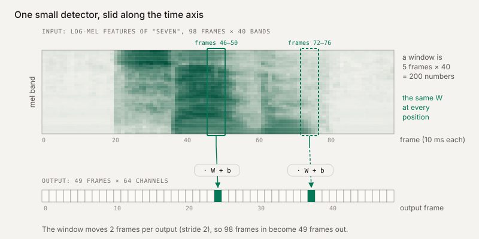
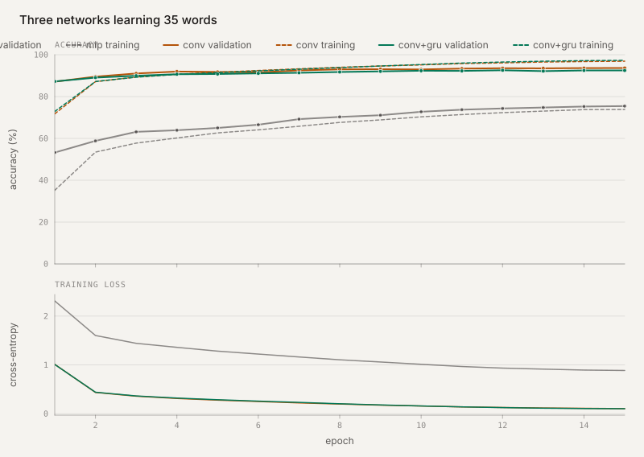
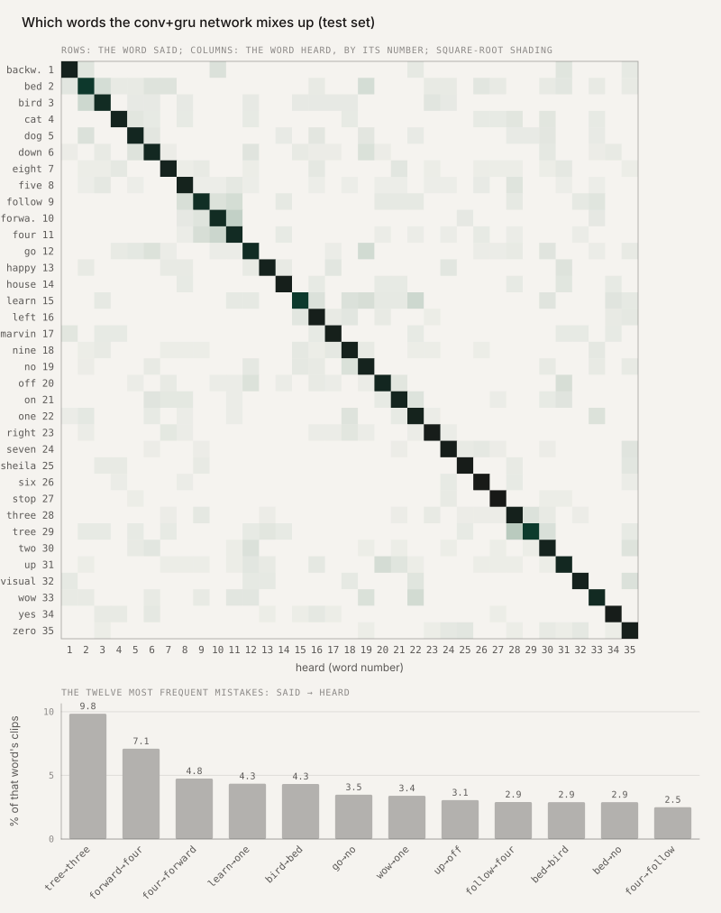

## Layers That Understand Time

In the last chapter we built a neural network library from nothing and trained an MLP on spoken digits. It tied with our template matcher and we left two weaknesses standing: the input squashed every clip into 96 numbers, and five speakers are too few to learn what a word is as opposed to who is saying it.

Today we fix both. The second one is a download: a dataset with thousands of speakers. The first one is the real work. We are going to give the network layers whose *shape* matches the shape of speech, a convolution that slides along the time axis and a recurrent layer that carries a memory from frame to frame, and then train a classifier for 35 words. Along the way we pick up a better optimizer and put every core of the machine to work.

### A Hundred Thousand Clips

[Google Speech Commands](https://arxiv.org/abs/1804.03209) (version 2) is 105,829 recordings of 35 words, "yes", "no", "seven", "marvin" and so on, each at most one second long, at 16,000 samples per second, spoken by a couple of thousand volunteers into whatever microphone they had. `samples/seven.wav`, which we have been using since chapter 1, comes from it. It is a 2.3 GB download, licensed CC BY 4.0. From the root of the repository:

```text
$ mkdir -p data/speech_commands
$ curl -L http://download.tensorflow.org/data/speech_commands_v0.02.tar.gz | tar xz -C data/speech_commands
```

There is one directory per word, full of files named like `seven/0a7c2a8d_nohash_1.wav`: the second take of "seven" by the speaker with the anonymous id `0a7c2a8d`. The loader in [`src/data/speech_commands.rs`](../code/src/data/speech_commands.rs) is plumbing again (list the files, read them on several threads with chapter 1's WAV reader, keep the samples as `i16` so everything fits in 3.3 GB of memory), so we will not list it. One decision in it matters for every number in the rest of the book.

Chapter 6 taught us that a model must be judged on voices it has never heard. The dataset's authors arranged that for us. Two text files list the clips set aside for *validation* (what we look at during training, to choose settings and pick the best weights) and for *testing* (what we look at once, at the end, to report a number). They were made by hashing the speaker id, so every speaker lands in exactly one part, and anything in neither list is training data. Using the official split also means our accuracy can be compared with published ones. Here is what the loader reports (timings are from my machine, with ten threads):

```text
loaded 105829 clips in 5.7 s (3.32 GB of 16-bit audio)
  train       84843 clips, 2112 speakers
  validation   9981 clips,  256 speakers
  test        11005 clips,  250 speakers
computed 98 x 40 log-mel features for every clip in 5.3 s (1.66 GB)
```

That last line is chapters 2 to 4 at work. Every clip is padded with zeros to exactly one second, cut into 25 ms frames every 10 ms, and turned into 40 log-mel bands, normalized per clip. One second is 16,000 samples, so there are `(16000 - 400) / 160 + 1 = 98` frames. Every clip is a 98 × 40 picture.

### The Wrong Shape

What would chapter 6 do with that picture? Flatten it into one row of `98 × 40 = 3,920` numbers and feed it to a linear layer. That runs. But look at what the first layer is: `Linear(3920 -> 64)`, a quarter of a million weights, one for every (frame, band) cell of the picture. A weight is tied to a *position*.

Now say "seven" a tenth of a second later. That is 10 frames. Every one of the 3,920 inputs now holds what a different input held before, and whatever the network learned about a burst of high-frequency noise at frame 30 says nothing about the same burst at frame 40. It would have to learn the "s" of "seven" separately for every position it might start at.

An "s" is an "s" whenever it happens. We want layers with that fact built in.

### One Small Detector, Slid Along Time

The first idea: instead of one big layer that sees the whole clip, use a small one that sees only a few neighboring frames, say 5, and apply *that same layer* at every position along the clip. A window of 5 frames is `5 × 40 = 200` numbers; the layer turns them into, say, 64 outputs. Slide the window along and we get a new sequence, each of whose frames describes a short stretch of the old one. This is a **convolution** over time, and its number of outputs per frame is its number of **channels**.



*The same weights look at every window. A pattern is detected wherever it occurs, and we pay for its weights once.*

Two knobs change how many frames come out. The **stride** is how far the window moves between outputs: with a stride of 2 the output has half the frame rate, which halves the work of every layer after it. The **padding** is a number of imaginary all-zero frames before the first frame and after the last, so the window can hang over the edges. With `T` frames in:

```text
T' = floor((T + 2 * padding - kernel) / stride) + 1
```

where `kernel` is the window's width in frames. Our 98 frames with kernel 5, stride 2 and padding 2 give `floor(97 / 2) + 1 = 49`. In code that is `Conv1d::out_len`.

Now the pleasant surprise: we have already written this layer. Copy each window out into one long row, frame after frame laid end to end, and stack the rows into a matrix with one row per output frame. Each output frame is then chapter 6's linear layer applied to its row:

```text
patches = one row per window          (T' x kernel*c_in)
Y       = patches W + b               (T' x c_out)
```

(The trick goes by the name "im2col".) So the layer needs only one new thing, the copying, and the only fiddly part of the copying is knowing which input frame a given position of a given window looks at:

```rust
// src/nn/conv.rs
    /// Which input frame does position `tap` of output frame `out_frame`'s
    /// window look at? `None` if that position is in the zero padding.
    fn input_frame(&self, out_frame: usize, tap: usize, t_in: usize) -> Option<usize> {
        let position_in_padded = out_frame * self.stride + tap;
        let frame = position_in_padded.checked_sub(self.padding)?;
        (frame < t_in).then_some(frame)
    }

    /// Copy every window out into its own row ("im2col").
    fn gather_patches(&self, x: &Mat) -> Mat {
        let mut patches = Mat::zeros(self.out_len(x.rows), self.kernel * self.c_in);
        for out_frame in 0..patches.rows {
            let patch = patches.row_mut(out_frame);
            for tap in 0..self.kernel {
                if let Some(frame) = self.input_frame(out_frame, tap, x.rows) {
                    patch[tap * self.c_in..(tap + 1) * self.c_in].copy_from_slice(x.row(frame));
                } // else: padding, and the patch is already zero there
            }
        }
        patches
    }

    pub fn forward(&self, x: &Mat) -> (Mat, Mat) {
        assert_eq!(x.cols, self.c_in, "Conv1d: input has {} channels, the layer expects {}", x.cols, self.c_in);
        let patches = self.gather_patches(x);
        let mut y = kernels::matmul(&patches, &self.weight);
        kernels::add_row_to_each(&mut y, &self.bias.data);
        (y, patches)
    }
```

`forward` returns the patches too. They are this layer's contribution to the `states` that chapter 6's `Cache` carried around as "empty luggage".

The backward pass is the same story in reverse. With patches as the input, the weight gradient, bias gradient and patch gradient are exactly the linear layer's three formulas. Then we undo the copy. Each patch entry was a copy of one input entry, and an input frame that appeared in three windows influenced the loss three times, so its gradient is the *sum* of the three patch gradients:

```rust
// src/nn/conv.rs
    /// Add every patch entry's gradient onto the frame it was copied from ("col2im").
    fn scatter_patches(&self, d_patches: &Mat, t_in: usize) -> Mat {
        let mut d_x = Mat::zeros(t_in, self.c_in);
        for out_frame in 0..d_patches.rows {
            let d_patch = d_patches.row(out_frame);
            for tap in 0..self.kernel {
                if let Some(frame) = self.input_frame(out_frame, tap, t_in) {
                    let from = &d_patch[tap * self.c_in..(tap + 1) * self.c_in];
                    for (d, &g) in d_x.row_mut(frame).iter_mut().zip(from) {
                        *d += g;
                    }
                }
            }
        }
        d_x
    }

    pub fn backward(&self, patches: &Mat, t_in: usize, d_out: &Mat, grads: &mut [Mat]) -> Mat {
        assert_eq!((d_out.rows, d_out.cols), (patches.rows, self.c_out), "Conv1d: gradient shape does not match the output");
        // Exactly the linear layer's backward pass, with patches as the input...
        kernels::add_t_matmul(patches, d_out, &mut grads[0]);
        kernels::add_column_sums(d_out, &mut grads[1].data);
        let d_patches = kernels::matmul_transposed(d_out, &self.weight);
        // ...followed by undoing the copy.
        self.scatter_patches(&d_patches, t_in)
    }
```

How do we know it works? First by hand, on a convolution small enough to do in your head: one channel, kernel `[1, 2, 3]`, bias 0.5, the input `1 2 3 4 5`, stride 2, padding 1.

```rust
// src/nn/conv.rs (tests)
    #[test]
    fn backward_by_hand() {
        // Padded input: 0 1 2 3 4 5 0. Stride 2 gives windows [0,1,2], [2,3,4], [4,5,0].
        let conv = tiny(2, 1);
        let (_, patches) = conv.forward(&ramp());
        let d_out = Mat::from_vec(3, 1, vec![1.0, 10.0, 100.0]);
        let mut grads = vec![Mat::zeros(3, 1), Mat::zeros(1, 1)];
        let d_x = conv.backward(&patches, 5, &d_out, &mut grads);
        // Weight j sees the j-th entry of every window:
        //   dW[0] = 0*1 + 2*10 + 4*100 = 420
        //   dW[1] = 1*1 + 3*10 + 5*100 = 531
        //   dW[2] = 2*1 + 4*10 + 0*100 = 42
        assert_eq!(grads[0].data, vec![420.0, 531.0, 42.0]);
        assert_eq!(grads[1].data, vec![111.0]);
        // Frame 1 is the end of window 0 and the start of window 1: 3*1 + 1*10 = 13,
        // frame 3 likewise for windows 1 and 2; the others sit in one window each.
        assert_eq!(d_x.data, vec![2.0, 13.0, 20.0, 130.0, 200.0]);
    }
```

And then by the rule we made in chapter 6: no backward pass is trusted until it has passed the gradient checker. Off-by-one errors in strides and paddings are the classic convolution bug, so the test tries nine combinations, several where `T` is not a multiple of the stride:

```rust
// src/nn/tests.rs
/// Gradcheck `model` on a random `t x n_in` input with a per-row
/// cross-entropy loss, and fail with the full report if anything is off.
fn assert_gradients_ok(mut model: Model, t: usize, n_in: usize, seed: u64) {
    let mut rng = Rng::new(seed);
    randomize_biases(&mut model, &mut rng); // biases start at zero, where some bugs hide
    let x = random_mat(t, n_in, &mut rng);
    let out = model.predict(&x);
    let classes = random_classes(out.rows, out.cols, &mut rng);
    let report = gradcheck(&model, &x, |logits| cross_entropy(logits, &classes), &GradCheckConfig::default());
    assert!(report.passed(), "gradient check failed for\n{}\n{report}", model.summary());
}

#[test]
fn gradcheck_conv1d_across_strides_and_paddings() {
    let mut rng = Rng::new(30);
    // (kernel, stride, padding, T)
    for (kernel, stride, padding, t) in [(3, 1, 0, 7), (3, 1, 1, 7), (5, 2, 2, 11), (5, 2, 0, 10), (3, 2, 1, 8), (4, 3, 0, 11), (4, 3, 2, 13), (1, 1, 0, 4), (3, 4, 1, 9)] {
        let model = Model::new(vec![Layer::conv1d(3, 4, kernel, stride, padding, &mut rng)]);
        assert_gradients_ok(model, t, 3, 31);
    }
}
```

### From A Sequence To One Answer

A convolution turns a sequence into a sequence, but a word classifier must give one answer per clip. The simplest bridge is to average the frames: `T × C` becomes `1 × C`, a single row that summarizes the clip, and a final linear layer turns it into 35 logits. Averaging does not care how many frames there are or where in the clip the interesting ones were.

```rust
// src/nn/model.rs
/// The average of all rows, as a single row.
fn mean_pool_forward(x: &Mat) -> Mat {
    let mut mean = Mat::zeros(1, x.cols);
    super::kernels::add_column_sums(x, &mut mean.data);
    if x.rows > 0 {
        mean.scale(1.0 / x.rows as f32);
    }
    mean
}

/// Every input row contributed `1/T` of itself to the mean, so every input
/// row receives `1/T` of the mean's gradient.
fn mean_pool_backward(t_len: usize, d_out: &Mat) -> Mat {
    assert_eq!(d_out.rows, 1, "MeanPool: the gradient must have exactly one row");
    let share = 1.0 / t_len.max(1) as f32;
    Mat::from_fn(t_len, d_out.cols, |_, c| d_out[(0, c)] * share)
}
```

This is `Layer::MeanPool`. Hold on to the fact that it is the *only* thing that makes our network a one-answer-per-clip machine. Chapter 8 starts by removing it.

### A Memory Carried From Frame To Frame

A convolution sees a fixed window. Stack a few and the window grows, but it stays fixed: nothing outside it can influence an output frame. The second idea of this chapter removes the limit. A **recurrent** layer reads the frames one at a time and carries a row of `H` numbers, its **hidden state** `h`, from each frame to the next. At every frame it reads the new input `x_t` and its own previous state and writes a new state. In principle the state at frame 80 can depend on something heard at frame 3.

The simplest version rewrites the whole state every frame:

```text
h_t = tanh(x_t W + h_{t-1} U)
```

It has a well-known problem. To get from frame 3 to frame 80 a piece of information must survive 77 rounds of "multiply by `U`, squash with tanh", and so must the gradient on its way back. Both fade. What we want is a way for the layer to say "this entry of the state is fine as it is, leave it alone".

That is what a **gate** is: a number between 0 and 1, computed by the layer itself from the input and the old state, that controls how much of something gets through. The gated recurrent unit, or GRU ([Cho et al., 2014](https://arxiv.org/abs/1406.1078)), has two. Let's build it from the end. The new state is a blend, entry by entry, of the old state and a freshly computed **candidate** `n`:

```text
h_t = (1 - z) * n  +  z * h_{t-1}
```

`z` is the **update gate**, and `*` multiplies element by element. Where `z` is 1 the old value is copied through untouched, for as many frames as `z` stays there. Where it is 0 the candidate replaces it. The candidate is the simple recurrent layer from above with one change:

```text
n = tanh(x_t W_xn + b_xn  +  r * (h_{t-1} W_hn + b_hn))
```

`r` is the **reset gate**. With `r` near 0 the candidate is computed from the input alone, as if the clip started here; with `r` near 1 it sees the old state in full. And the gates themselves are linear layers of the input and the old state, pushed through a sigmoid (`1 / (1 + e^-a)`, which squashes any number into 0 to 1):

```text
r = sigmoid(x_t W_xr + b_xr  +  h_{t-1} W_hr + b_hr)
z = sigmoid(x_t W_xz + b_xz  +  h_{t-1} W_hz + b_hz)
```


*Four equations. The green line is the important one: a path along which a value, and later its gradient, can travel many frames unchanged.*

**Aside** <br>
The original paper applies the reset gate before the multiplication, `(r * h) W_hn`. We use the variant PyTorch uses, which resets after. It has a practical advantage: all three products with `h` can be computed as one.

That advantage decides how we store the weights. The three input matrices sit side by side in one `n_in × 3H` matrix `w_x = [W_xr | W_xz | W_xn]`, and likewise `w_h` is `H × 3H`, so one product gives the contribution to all three sums as a row of `3H` numbers that we cut into thirds. Better still, the input's half, `x w_x + b_x`, does not depend on the state at all, so we compute it for *every* frame in one matrix product before the loop begins.

```rust
// src/nn/gru.rs
    pub fn forward(&self, x: &Mat, direction: Direction) -> GruCache {
        // ... assert that x has n_in columns
        let (t_len, h) = (x.rows, self.hidden());

        // The input's contribution to every gate at every frame, in one go.
        // We then overwrite it in place, frame by frame, with the gate values.
        let mut gates = kernels::matmul(x, &self.w_x);
        kernels::add_row_to_each(&mut gates, &self.b_x.data);

        let mut states = Mat::zeros(t_len, h);
        let mut hn = Mat::zeros(t_len, h);
        // Scratch buffers, allocated once and reused at every frame.
        let mut h_prev = vec![0.0; h]; // the state before this frame
        let mut from_state = vec![0.0; 3 * h]; // h_prev W_h + b_h

        for step in 0..t_len {
            let t = direction.frame(step, t_len);

            from_state.copy_from_slice(&self.b_h.data);
            kernels::add_vec_mat(&h_prev, &self.w_h, &mut from_state);
            let (state_r, rest) = from_state.split_at(h);
            let (state_z, state_n) = rest.split_at(h);

            let (gate_r, rest) = gates.row_mut(t).split_at_mut(h);
            let (gate_z, gate_n) = rest.split_at_mut(h);
            let h_new = states.row_mut(t);

            for j in 0..h {
                // On entry gate_r/z/n hold the input's half of each sum.
                let r = sigmoid(gate_r[j] + state_r[j]);
                let z = sigmoid(gate_z[j] + state_z[j]);
                let n = fast_tanh(gate_n[j] + r * state_n[j]);
                h_new[j] = (1.0 - z) * n + z * h_prev[j];
                gate_r[j] = r;
                gate_z[j] = z;
                gate_n[j] = n;
            }
            hn.row_mut(t).copy_from_slice(state_n);
            h_prev.copy_from_slice(h_new);
        }
        GruCache { h: states, gates, hn }
    }
```

The four lines in the inner loop are the four equations. The state starts at zero, and the layer's output is every state, `T × H`. The cache keeps what the backward pass will want: the states, the gate values, and `hn`, the thing `r` multiplied. (`fast_tanh` is `2 * sigmoid(2x) - 1`, the same function computed through the exponential we already have. `direction` we will get to.)

Is that right? `two_steps_by_hand` in `gru.rs` runs a GRU with one input and one state entry, so that every matrix is a single number, through two frames worked out on a calculator, and another test compares the fast loop against a naive one written straight from the equations.

### Backpropagation Through Time

The forward pass is a loop, and the same weights are used at every turn. How do we take a gradient through that?

Unroll it. A GRU over 49 frames is a 49-layer network that happens to use the same weights in every layer. Chapter 6 told us what to do with a stack of layers: walk it backward, handing each layer the gradient at its output and receiving the gradient at its input. The only novelty is that each state `h_t` has *two* readers. The layer above read it as this frame's output, and the next frame read it as its previous state. So its gradient is the sum of two messages. That is all **backpropagation through time** is.

At frame `t` we therefore start with `dh = d_from_above + from_future` and push it through the four equations, last one first. Take one entry of the state, with `a_r`, `a_z`, `a_n` standing for the sums inside the sigmoids and the tanh.

The blend, `h_t = (1 - z) * n + z * h_prev`. Three things fed it, and each gets `dh` times what it was multiplied by:

```text
dn      = dh * (1 - z)
dz      = dh * (h_prev - n)
to_past = dh * z                  (the copy path; more is added below)
```

The candidate, `n = tanh(a_n)` with `a_n = [input side] + r * hn`. The slope of tanh is `1 - n²`:

```text
da_n = dn * (1 - n²)
dr   = da_n * hn
```

The gates, where the slope of a sigmoid `s` is `s * (1 - s)`:

```text
da_r = dr * r * (1 - r)
da_z = dz * z * (1 - z)
```

Now we have the gradient of all three sums. Each sum is "input side plus state side", and a plain sum hands the same gradient to both, with one exception: in `a_n` the state side was multiplied by `r`, so its gradient is `da_n * r`. Finally, the state side read `h_prev` through `w_h`, so, exactly as in a linear layer, `h_prev` receives that gradient times `w_h` transposed, added onto the copy path. Here it is in code, and you can tick the lines off:

```rust
// src/nn/gru.rs
    pub fn backward(&self, x: &Mat, cache: &GruCache, d_out: &Mat, direction: Direction, grads: &mut [Mat]) -> Mat {
        let (t_len, h) = (x.rows, self.hidden());
        // ... assert that d_out is T x H
        // Row t holds the state frame t started from (zeros for the first step).
        let h_prev_all = self.previous_states(&cache.h, direction);

        // Gradients of the two sums inside the gates, for every frame.
        let mut d_input_side = Mat::zeros(t_len, 3 * h);
        let mut d_state_side = Mat::zeros(t_len, 3 * h);
        let w_h_transposed = self.w_h.transpose();

        let mut from_future = vec![0.0; h]; // dLoss/dh_t arriving from the step processed after t
        let mut to_past = vec![0.0; h]; // the same thing, being built for the step before t

        // Walk the steps in the opposite order to the forward pass.
        for step in (0..t_len).rev() {
            let t = direction.frame(step, t_len);
            // ... slice out this frame's h_prev, gate_r/z/n, state_n (= hn), d_from_above,
            //     and the thirds d_in_r/z/n and d_st_r/z/n of the two gradient rows

            for j in 0..h {
                let (r, z, n) = (gate_r[j], gate_z[j], gate_n[j]);
                // Two readers of h_t: the layer above and the next step.
                let dh = d_from_above[j] + from_future[j];

                // h' = (1 - z) * n + z * h_prev
                let dn = dh * (1.0 - z);
                let dz = dh * (h_prev[j] - n);
                to_past[j] = dh * z; // the direct copy path; more is added below

                // n = tanh(a_n), with a_n = [input side] + r * state_n.
                let da_n = dn * (1.0 - n * n);
                let dr = da_n * state_n[j];

                // r = sigmoid(a_r), z = sigmoid(a_z). sigmoid' = s * (1 - s)
                let da_r = dr * r * (1.0 - r);
                let da_z = dz * z * (1.0 - z);

                d_in_r[j] = da_r;
                d_in_z[j] = da_z;
                d_in_n[j] = da_n;
                d_st_r[j] = da_r;
                d_st_z[j] = da_z;
                d_st_n[j] = da_n * r;
            }

            // The state side read h_prev through W_h: dh_prev += d W_h^T.
            kernels::add_vec_mat(d_state_side.row(t), &w_h_transposed, &mut to_past);

            // What we built for the past is the future's message next iteration.
            std::mem::swap(&mut from_future, &mut to_past);
        }

        // State side: (h_prev W_h + b_h) is a linear layer applied to h_prev.
        kernels::add_t_matmul(&h_prev_all, &d_state_side, &mut grads[W_H]);
        kernels::add_column_sums(&d_state_side, &mut grads[B_H].data);
        // Input side: (x W_x + b_x) is a linear layer applied to every frame.
        kernels::add_t_matmul(x, &d_input_side, &mut grads[W_X]);
        kernels::add_column_sums(&d_input_side, &mut grads[B_X].data);
        kernels::matmul_transposed(&d_input_side, &self.w_x)
    }
```

After the loop, both sides turn out to be linear layers in disguise, so the weight gradients fall out of the same three kernels as always, over all frames at once.

Look at `to_past[j] = dh * z` again. Where the update gate is near 1, the gradient passes from frame to frame multiplied by almost exactly 1. That is the green line of the figure, read right to left, and it is the reason a GRU can learn from something 77 frames back when the simple recurrent layer cannot.

I do not trust forty lines like these, and neither should you. The checker:

```rust
// src/nn/tests.rs
#[test]
fn gradcheck_gru() {
    let mut rng = Rng::new(40);
    assert_gradients_ok(Model::new(vec![Layer::gru(3, 5, &mut rng)]), 9, 3, 41);
    // A single frame is an edge case of its own (no previous state at all).
    assert_gradients_ok(Model::new(vec![Layer::gru(3, 5, &mut rng)]), 1, 3, 42);
}
```

```text
$ cargo test --release gradcheck
...
test nn::tests::gradcheck_gru ... ok
test nn::tests::gradcheck_bigru ... ok
test nn::tests::gradcheck_conv1d_across_strides_and_paddings ... ok
test nn::tests::gradcheck_clip_classifier_with_every_layer_type ... ok
```

Green is reassuring only if red is possible, so I planted a bug: I changed the last line of the inner loop to `d_st_n[j] = da_n;`, forgetting the reset gate. The test fails with this report:

```text
tensor                   checked   max |diff|   rel. error
0.gru.w_x                     40      4.31e-1      1.77e-1  MISMATCH
0.gru.w_h                     40      2.21e-1      4.23e-1  MISMATCH
0.gru.b_x                     15      6.16e-1      2.10e-1  MISMATCH
0.gru.b_h                     15      8.98e-1      4.28e-1  MISMATCH
input                         27      2.27e-1      1.61e-1  MISMATCH
```

One forgotten factor, and every tensor is wrong, including `w_x`, which the buggy line never touches: the error rides the `from_future` message back through every earlier frame. With the line restored, the same five rows score between 4e-5 and 5e-4.

### Reading In Both Directions

A GRU that reads first frame to last knows, at frame `t`, only the past. For a recording there is no reason to be so strict: what follows a sound says as much about it as what came before. A **bidirectional** GRU is two independent GRUs, one reading forward and one backward, with their states glued side by side, so the output at each frame is `2H` numbers that between them have seen the whole clip.

That is what the `direction` parameter was for. `Direction::frame(step, t_len)` returns `step` for the forward GRU and `t_len - 1 - step` for the backward one, and nothing else changes. `BiGru::backward` splits the gradient into its two halves, sends each through its own GRU, and adds the two input gradients, because both GRUs read the same input. It has its own gradient check, in the list above.

### Adam, And Why Plain SGD Struggles Here

Chapter 6's update rule was `w -= lr * gradient`, with one `lr` for every weight in the network. That was fine for three linear layers. Here I printed the typical size (root mean square) of each tensor's gradient on the very first minibatch of the conv + GRU network we are about to train:

```text
0.conv1d.weight      4.28e-3
2.bigru.fwd.w_x      3.53e-3
2.bigru.fwd.w_h      1.03e-3
4.linear.bias        3.28e-2
```

The gradients are small, so the learning rate must be large, and nobody tells you how large. And they differ by a factor of 30 between the weights inside the recurrence and the bias of the output layer, so no single learning rate suits both.

**Adam** ([Kingma and Ba, 2014](https://arxiv.org/abs/1412.6980)) deals with both by giving every single weight its own step size. It keeps two running averages per weight:

```text
m = beta1 * m + (1 - beta1) * g        the average gradient
v = beta2 * v + (1 - beta2) * g * g    the average squared gradient
w = w - lr * m / (sqrt(v) + eps)
```

`m` is a smoothed gradient: noise that flips sign from minibatch to minibatch cancels. Dividing by `sqrt(v)`, the typical size of that weight's gradient, is the equalizer. A weight with consistently tiny gradients has its steps scaled up, one with huge gradients has them scaled down, and every weight ends up moving by about `lr` per step whatever the raw scale. (`eps = 1e-8` only prevents a division by zero.)

There is one wrinkle. Both averages start at zero, so early on they underestimate: after one step with `beta1 = 0.9`, `m` is a tenth of the gradient. Dividing by `1 - beta^t`, where `t` counts steps, undoes exactly that, and fades to a division by 1 as `t` grows.

```rust
// src/nn/optim.rs
    pub fn step(&mut self, model: &mut Model, grads: &Grads) {
        // ... `params = model.params_mut()`; on the first call, create `m` and `v` as zeros
        self.steps += 1;
        // The bias corrections are the same for every weight, so compute them
        // once. (In f64: beta2^t is very close to 1 for small t.)
        let correct_m = 1.0 / (1.0 - (self.beta1 as f64).powi(self.steps as i32)) as f32;
        let correct_v = 1.0 / (1.0 - (self.beta2 as f64).powi(self.steps as i32)) as f32;

        for (((p, g), m), v) in params.iter_mut().zip(&grads.tensors).zip(&mut self.m).zip(&mut self.v) {
            // A tensor with one row is a bias; those are not decayed.
            let decay = if p.rows > 1 { self.lr * self.weight_decay } else { 0.0 };
            for (((w, &gw), mw), vw) in p.data.iter_mut().zip(&g.data).zip(&mut m.data).zip(&mut v.data) {
                *mw = self.beta1 * *mw + (1.0 - self.beta1) * gw;
                *vw = self.beta2 * *vw + (1.0 - self.beta2) * gw * gw;
                let m_hat = *mw * correct_m;
                let v_hat = *vw * correct_v;
                *w -= self.lr * m_hat / (v_hat.sqrt() + self.eps) + decay * *w;
            }
        }
    }
```

(`weight_decay` is an optional pull of every weight toward zero, off in this chapter.) The test `adam_first_steps_by_hand` makes the point about scale: with a gradient of 123 and `lr = 0.01`, the first step moves the weight by exactly 0.01. A gradient of 0.00123 would do the same. How much does it matter? I swapped Adam for plain SGD in a small experiment: the conv + GRU network, 300 clips per word, 4 epochs.

| optimizer | learning rate | validation accuracy after 4 epochs |
|---|---:|---:|
| Adam | 0.002 | 80.76% |
| SGD | 0.002 | 2.85% |
| SGD | 0.05 | 21.78% |
| SGD | 0.5 | 74.95% |

One in 35 is 2.9%, so SGD at Adam's learning rate learned nothing at all. It does get going once the rate is 250 times larger, so "struggles" is fairer than "fails": plain SGD needs you to find that number by trial and error for every new network, and Adam's `0.002` mostly just works. From here on we use Adam.

Two small helpers complete the optimizer. Recurrent networks occasionally produce an enormous gradient, because the same matrix is multiplied in dozens of times and sometimes that compounds. One such step can throw the weights somewhere training never recovers from. **Gradient clipping** treats all gradients together as one long vector and, if it is longer than a limit, scales it down to the limit. The direction is kept and only the step is shortened.

```rust
// src/nn/optim.rs
pub fn clip_global_norm(grads: &mut Grads, max_norm: f32) -> f32 {
    let norm = grads.global_norm();
    if norm > max_norm {
        grads.scale(max_norm / norm);
    }
    norm
}
```

And the learning rate should not be constant. Freshly initialized weights give erratic gradients, and Adam's averages are not yet trustworthy, so we begin with small steps and climb in a straight line to the peak rate (the *warm-up*). After that we glide down along half a cosine wave: big steps early to cover ground, small ones late to settle. `LrSchedule::lr_at(step)` computes it: `peak_lr * (step + 1) / warmup_steps` during warm-up, then `final_lr + (peak_lr - final_lr) * 0.5 * (1 + cos(pi * progress))`, where `progress` runs from 0 to 1 over the remaining steps.

### Every Core We Have

84,843 training clips, 20 epochs, a forward and a backward pass through 49 GRU steps in two directions for each. On one thread that is a long wait. Fortunately the examples in a minibatch do not interact: each is its own forward pass, loss and backward pass against the same, unchanging weights.

If you have been paying attention, you'll notice we prepared for this in chapter 6. `Model::forward` and `Model::backward` take `&self` and keep nothing inside the model; everything a pass remembers goes into a `Cache`, and gradients into a `Grads`. So Rust lets us hand one `&Model` to as many threads as we like, with no lock and no `Arc`. Each thread gets a private `Grads` to add into:

```rust
// src/nn/batch.rs
/// Process examples `first`, `first + stride`, `first + 2 * stride`, ...
fn run_worker<T, L>(model: &Model, batch: &[(&Mat, &T)], first: usize, stride: usize, loss_fn: &L) -> WorkerTotal
where
    T: ?Sized,
    L: Fn(&Mat, &T) -> (f32, Mat),
{
    let mut total = WorkerTotal { grads: Grads::zeros_like(model), loss: 0.0, used: 0, skipped: 0 };
    for &(input, target) in batch.iter().skip(first).step_by(stride) {
        let cache = model.forward(input);
        let (loss, d_logits) = loss_fn(cache.output(), target);
        if !loss.is_finite() || d_logits.data.iter().any(|d| !d.is_finite()) {
            total.skipped += 1;
            continue; // before backward, so nothing of it reaches the gradients
        }
        model.backward(&cache, &d_logits, &mut total.grads);
        total.loss += loss as f64;
        total.used += 1;
    }
    total
}
```

(The `skipped` branch drops an example whose loss is not finite. Chapter 8's loss will need it.) `batch_gradients` starts the workers and adds up what they found:

```rust
// src/nn/batch.rs
        // A scope guarantees every thread has finished before it returns,
        // which is what allows the threads to borrow `model` and `batch`.
        std::thread::scope(|scope| {
            let loss_fn = &loss_fn;
            let handles: Vec<_> = (0..n_threads).map(|k| scope.spawn(move || run_worker(model, batch, k, n_threads, loss_fn))).collect();
            for handle in handles {
                totals.push(handle.join().expect("a worker thread panicked"));
            }
        });
        // ... add the workers' gradients and losses together, in order,
        //     and divide by the number of examples used
```

`std::thread::scope` is the whole trick, and it is in the standard library. Because thread `k` always takes the same examples and the totals are added in thread order, the same batch gives the same gradient bit for bit every time. A test, `threaded_batch_matches_one_at_a_time`, compares 1, 2, 3 and 16 threads against a plain loop.

`ch07_bench` measures what it buys on a network shaped like the recognizer we are heading for:

```text
$ cargo run --release --example ch07_bench
...
256 utterances of 100 frames x 40 features (50 output frames each)

1 thread:       1427 utterances/s   (forward 0.24 ms, loss + backward 0.46 ms per utterance)
14 threads:    11247 utterances/s   (7.9x)
...
```

That is on my machine, which has 10 fast cores and 4 slow ones and was busy with other work at the time, so 7.9x and not 14x. Not bad for a hundred lines and no dependencies.

### Thirty-Five Words, Three Ways

Enough of the talk, let's train something. `ch07_words` builds three networks on the same 98 × 40 features:

```rust
// examples/ch07_words.rs
            // ... Arch::Mlp: Linear(3920 -> 64), ReLU, Linear(64 -> 64), ReLU, Linear(64 -> 35)
            // Three convolutions, each looking at 5 neighboring frames of
            // the layer below; the first two halve the frame rate. One
            // output frame sees 29 input frames, about 0.3 s.
            Arch::Conv => Model::new(vec![
                Layer::conv1d(features, 64, 5, 2, 2, rng),
                Layer::Relu,
                Layer::conv1d(64, 96, 5, 2, 2, rng),
                Layer::Relu,
                Layer::conv1d(96, 128, 5, 1, 2, rng),
                Layer::Relu,
                Layer::MeanPool,
                Layer::linear(128, WORDS.len(), rng),
            ]),
            // One convolution to find local patterns and halve the frame
            // rate, then a GRU in each direction that can remember the
            // whole word.
            Arch::ConvGru => Model::new(vec![
                Layer::conv1d(features, 64, 5, 2, 2, rng),
                Layer::Relu,
                Layer::bigru(64, 128, rng),
                Layer::MeanPool,
                Layer::linear(256, WORDS.len(), rng),
            ]),
```

The "29 frames" is the **receptive field** of the stacked convolutions: the top layer sees 5 frames of the middle one, which span 13 frames of the first layer's output, which span 29 frames of the input.

The training step is chapter 6's five lines with this chapter's decoration:

```rust
// examples/ch07_words.rs
            let mut outcome = batch_gradients(&model, &pairs, options.threads, |logits: &Mat, target: &[usize]| {
                // ... count a hit if argmax(logits) is the target, for the training accuracy
                cross_entropy(logits, target)
            });
            clip_global_norm(&mut outcome.grads, 5.0);
            adam.lr = schedule.lr_at(step);
            adam.step(&mut model, &outcome.grads);
            step += 1;
```

Minibatches of 64, a peak learning rate of 0.002 after 200 warm-up steps, 20 epochs. One more thing happens before each minibatch. A network that sees the same 84,843 pictures twenty times starts to recognize the *clips* instead of the words, so every time a clip comes up we change it a little: slide it up to 10 frames (100 ms) earlier or later, and blank out one random stretch of up to 12 frames and one random band of up to 6 mel bands. This is called *augmentation*, and the masking part is borrowed from [SpecAugment](https://arxiv.org/abs/1904.08779). After each epoch we measure the validation set and keep a copy of the weights whenever it improves. The test set is touched once, at the end, with the best copy.

Go ahead and run it (this needs the dataset; all three networks take about ten minutes on my machine):

```text
$ cargo run --release --example ch07_words -- train
...
== mlp ==
...
epoch  1   loss 2.5185   train 29.10%   validation 50.14% *   lr 0.00199   3.3 s (25523 clips/s)
...
epoch 20   loss 1.2440   train 63.27%   validation 72.42%     lr 0.00004   3.3 s (25718 clips/s)
best validation accuracy 72.45% at epoch 19; test accuracy with those weights: 69.32%

== conv ==
...
epoch  1   loss 1.3236   train 62.81%   validation 84.91% *   lr 0.00199   5.2 s (16191 clips/s)
...
epoch 20   loss 0.2374   train 92.71%   validation 93.69%     lr 0.00004   4.9 s (17249 clips/s)
best validation accuracy 93.81% at epoch 19; test accuracy with those weights: 93.84%

== conv+gru ==
...
epoch  1   loss 1.2318   train 65.93%   validation 85.84% *   lr 0.00199   12.3 s (6874 clips/s)
...
epoch 20   loss 0.2229   train 93.15%   validation 93.60% *   lr 0.00004   12.3 s (6872 clips/s)
best validation accuracy 93.60% at epoch 20; test accuracy with those weights: 93.45%

| model    | parameters | best validation | test accuracy | time per epoch |
|----------|-----------:|----------------:|--------------:|---------------:|
| mlp      |     257379 |          72.45% |        69.32% |          3.3 s |
| conv     |     109763 |          93.81% |        93.84% |          5.0 s |
| conv+gru |     170851 |          93.60% |        93.45% |         12.3 s |
```



*Three networks, same data, same optimizer. (Training accuracy is below validation because training clips are shifted and masked and validation clips are not.)*

That is amazing. 93.8% on 35 words, from 11,005 clips by 250 people the network has never heard, with weights that fit in well under a megabyte, trained in under two minutes by code we wrote from the first line.

Now the MLP. It has the most weights of the three and comes 24 points behind, and its *training* accuracy tells you why: 63%. It cannot even fit the clips it is shown, because we slide each one by up to 100 ms and for the MLP every slide is a new picture. The two networks that slide their weights along time shrug the shifts off and reach 93% on the same shifted clips. The shape of the layers was the problem, as promised.

And now the result I did not expect when we started. The convolution-only network is as good as the one with the GRU: 93.84% against 93.45%, a gap of 0.4 points from one run each, at less than half the training time. All that work on gates and backpropagation through time, and on this task it buys nothing.

I think the reason is the task. A single short word is mostly local evidence: with a receptive field of 0.3 seconds each output frame of the conv stack already sees a large part of the word, and mean pooling collects the rest. There is nothing far away to remember. That stops being true in chapter 9, where the input is several words in a row and the network must write out letters, some of which can only be decided by what was said half a second earlier or later. There the GRU earns its place. We save the conv + GRU model to `models/words.bin` because it is the shape we build on.

### What It Gets Wrong

The program finishes by looking closer at the conv + GRU model's mistakes on the test set:

```text
conv+gru: hardest words on the test set: tree 82.9%, learn 83.2%, bed 84.1%, follow 88.4%, go 89.6%, forward 89.7%
most frequent mistakes (said -> heard, count of test clips):
  four     -> forward   19   (4.8% of the "four" clips)
  tree     -> three     19   (9.8% of the "tree" clips)
  go       -> no        14   (3.5% of the "go" clips)
  up       -> off       13   (3.1% of the "up" clips)
  forward  -> four      11   (7.1% of the "forward" clips)
  ...
```



*Rows are the word said, columns the word heard. The mistakes are the ones a person would make on a bad phone line.*

"Tree" and "three" differ in one quiet consonant. "Forward" begins with "four". "Go" and "no" share a vowel. These are honest mistakes, the kind that tell you the network is listening to the right things.

You can try it without the dataset, because the trained model is in the repository:

```text
$ cargo run --release --example ch07_words -- classify ../samples/seven.wav ../samples/stop.wav
../samples/seven.wav  (1.00 s)
  seven     100.0%  ########################################
  two         0.0%  
  ...
../samples/stop.wav  (1.00 s)
  stop       84.5%  ##################################
  dog        10.8%  ####
  down        3.4%  #
  ...
```

Record yourself saying one of the 35 words and give it the file. Then say a word that is not on the list and watch it confidently pick one that is. It has no way to say "none of these".

### Try It Yourself

1. **Plant the bug.** In `Gru::backward`, change `d_st_n[j] = da_n * r;` to `d_st_n[j] = da_n;` and run `cargo test --release gradcheck`. Five tests fail, and in the stacked models you can see where the error stops: everything from the GRU down is a MISMATCH and the linear layer above it is still ok.
2. **Take the shifts away.** Run `ch07_words -- train --no-augment --no-save`. In an earlier 15-epoch run of ours the conv networks reached 96 to 97% on the training clips with validation stuck near 93%: the gap is the network memorizing clips. The MLP did slightly better than with augmentation (71.6% on the test set) and remained far behind.
3. **Go back to SGD.** In `train_one`, replace `Adam::new(options.lr)` with `Sgd::new(options.lr, 0.0)` (import `Sgd`; it has the same `lr` field and `step` method), then run `-- train --model conv+gru --max-per-word 300 --epochs 4 --no-save` with `--lr 0.002` and `--lr 0.5`. You should see the table from the Adam section: a loss stuck near `ln 35 = 3.56`, then a network that learns.
4. **Shrink the receptive field.** Change the three convolutions' kernels from 5 to 3 (and paddings from 2 to 1), which takes the receptive field from 29 frames to 15. On the quick setting of exercise 3 (`--model conv`), validation accuracy after 4 epochs fell from 79.4% to 74.1% for me.

### Loose Ends

* **The GRU did not win.** On single words the convolution-only network matches it. We keep the GRU on a promise that chapter 9 has to make good.
* **One run, one seed.** We did not measure how much these accuracies move from seed to seed, so read nothing into a gap of 0.4 points.
* **The classifier cannot say "I don't know".** Silence, noise and unknown words all get one of the 35 labels. Chapter 8's blank symbol is the beginning of an answer.
* **No dropout, no batch normalization.** The two most common tools against overfitting and for faster training are missing from our library. We regularize with augmentation of the input only.

What's next on our agenda? Let's take stock. We have a convolution that slides one set of weights along time, a GRU with a hand-derived backward pass that the gradient checker signed off on, Adam with clipping and a learning-rate schedule, minibatches spread over every core, and a model that names one of 35 words with 93% accuracy for people it has never heard.

However, if you have been paying attention, you'll notice that it is still a classifier and not a recognizer. One clip goes in and exactly one label comes out, because `MeanPool` squashes all the frames into one row. Say "seven three" and it must pick one. To get a *sequence* out, we have to keep every frame and train the network to write letters, and nobody has told us which frame belongs to which letter. In the next chapter we take on that problem with a loss function called CTC, the conceptual heart of the book.

### References

- Pete Warden, [Speech Commands: A Dataset for Limited-Vocabulary Speech Recognition](https://arxiv.org/abs/1804.03209) (2018): the dataset and its speaker-hashed split
- Cho et al., [Learning Phrase Representations using RNN Encoder-Decoder for Statistical Machine Translation](https://arxiv.org/abs/1406.1078) (2014): the paper that introduced the GRU
- Christopher Olah, [Understanding LSTM Networks](https://colah.github.io/posts/2015-08-Understanding-LSTMs/) (2015): gated recurrent layers in pictures, GRU included
- Kingma & Ba, [Adam: A Method for Stochastic Optimization](https://arxiv.org/abs/1412.6980) (2014)
- Pascanu, Mikolov & Bengio, [On the difficulty of training recurrent neural networks](https://arxiv.org/abs/1211.5063) (2013): why gradients vanish and explode through time, and gradient clipping
- Park et al., [SpecAugment](https://arxiv.org/abs/1904.08779) (2019): masking stretches of time and bands of frequency
- Corresponding code: [`src/nn/conv.rs`](../code/src/nn/conv.rs), [`src/nn/gru.rs`](../code/src/nn/gru.rs), [`src/nn/optim.rs`](../code/src/nn/optim.rs), [`src/nn/batch.rs`](../code/src/nn/batch.rs), [`src/nn/model.rs`](../code/src/nn/model.rs), [`src/nn/tests.rs`](../code/src/nn/tests.rs), [`src/data/speech_commands.rs`](../code/src/data/speech_commands.rs), and the examples [`ch07_words.rs`](../code/examples/ch07_words.rs), [`ch07_bench.rs`](../code/examples/ch07_bench.rs); the full training output is in [`models/words-training.log`](../models/words-training.log)

[← Previous: A Neural Network From Nothing](06-a-neural-network-from-nothing.md) · [Contents](../README.md) · [Next: The Alignment Problem: CTC →](08-the-alignment-problem-ctc.md)
