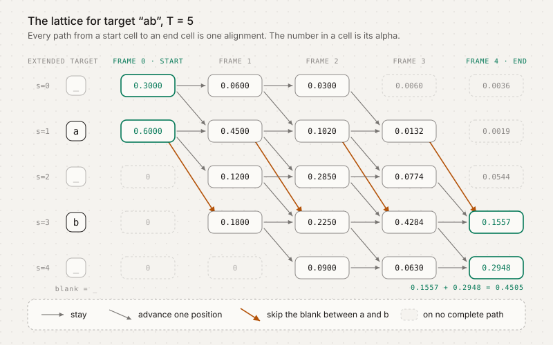
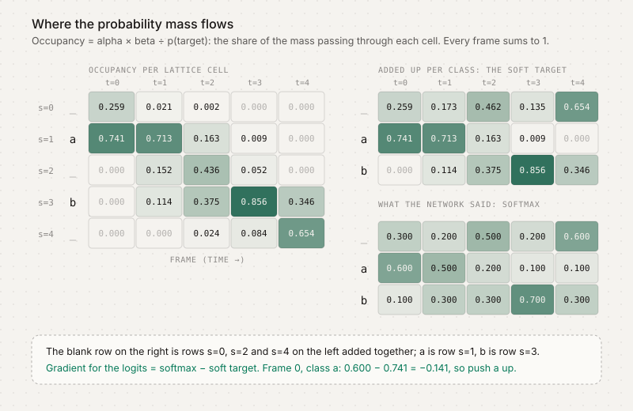

## The Alignment Problem: CTC

In the last chapter we trained a network that listens to a one-second clip and says which of 35 words it heard. It works, and it is also a dead end. The network takes its matrix of logits, one row per frame, squashes all the rows into one by pooling over time, and puts a softmax over 35 classes on top. One clip in, one label out. Say two words in a row, or a word it has never seen, and it has no way to answer.

A speech recognizer has to produce a *sequence*: some unknown number of letters, at unknown times. In this chapter we build the piece that makes that trainable. It is a loss function called connectionist temporal classification, CTC for short, and it is the conceptual heart of the book. There is no audio in this chapter and no network either. Just a grid, a recurrence, and some careful arithmetic.

### What We Would Like To Train

The obvious first move is to stop pooling. Before the pooling layer, chapter 7's model already had a matrix of logits with one row per frame. So let's keep every row and put a softmax on each: one probability distribution over letters every 10 or 20 milliseconds. For the word "cat" spoken over 100 frames, we would love the output to read something like `ccccc...aaaaaa...ttt`.

We know how to train a per-frame softmax. Chapter 6's cross-entropy loss needs the correct class for every row. And that is the problem: our training data says "this clip says `cat`". It does not say which frames are the `c`. We know *what* was said and not *when*. This is the **alignment problem**.

There are three ways around it that people have really used, and all three are bad for us.

- **Label every frame by hand.** Somebody opens each clip in an audio editor and marks where each letter begins. At 100 frames per clip and roughly 85,000 training clips, that is 8.5 million labels. And the boundaries are not even well defined: the `a` in "cat" starts while your mouth is still finishing the `c`.
- **Cut the clip into equal pieces.** Three letters, 100 frames, so frames 0 to 32 are `c`, and so on. But the clip starts with silence, the `a` lasts far longer than the `t`, and no two speakers pace a word the same way. We would be training the network on labels that are mostly wrong.
- **Get the alignment from another recognizer.** This is called forced alignment, and it is how speech systems were built for decades: an older model guesses the boundaries, you train a new model on them, re-align, and repeat. It works, but you need a recognizer in order to train a recognizer, and we do not have one. (Chapter 5's dynamic time warping aligns one recording against another recording. It cannot align a recording against three letters.)

In 2006 Alex Graves and his co-authors published a way out that needs none of this. Their paper describes it as

> a novel method for training RNNs to label unsegmented sequence data directly

([Graves, Fernández, Gomez and Schmidhuber, 2006](https://www.cs.toronto.edu/~graves/icml_2006.pdf)). The idea fits in one sentence: **do not pick an alignment; add up the probability of all of them.** If every way of stretching `cat` over the 100 frames counts as a correct answer, then we never have to say which one is right. The network gets to decide where the letters go, and the loss only checks that, one way or another, the letters come out as `cat`.

That sentence hides two questions. What exactly is "a way of stretching `cat` over 100 frames"? And how do you add up an astronomical number of them?

### The Blank And The Collapse Rule

Let's call a sequence with one class per frame an **alignment** (the paper calls it a path, and we will use both words). The short thing we want out of it, `cat`, is a **labelling**. We need a rule that turns an alignment into a labelling.

A letter lasts several frames, so the first part of the rule is: merge runs of the same class. `cccaaaat` becomes `cat`.

That rule alone breaks on the first word with a double letter. `hhheeellllooo` merges to `helo`, and there is no alignment at all that merges to `hello`. It also gives the network nothing to say during silence.

CTC fixes both with one extra class, the **blank**, which we will write as `_`. Blank means "nothing new to report in this frame". It is not the space character, and it never appears in the output. The full **collapse rule** has two steps, in this order:

1. merge runs of the same class,
2. delete the blanks.

```text
c c _ a a a _ t        ->  c _ a _ t      ->  cat
_ c a _ _ t t _        ->  _ c a _ t _    ->  cat
h h e l l _ l l o      ->  h e l _ l o    ->  hello
h h e l l l l l o      ->  h e l o        ->  helo
```

The order matters. Because we merge first, a blank between two `l`s keeps them apart, and that is the only way to spell a double letter. In our code the blank is class 0, and real labels are classes 1 and up.

Enough of the talk, let's write some code! The collapse rule is a single pass that remembers the previous class:

```rust
// src/ctc.rs
use crate::mat::Mat;

/// The class index reserved for the CTC blank.
pub const BLANK: usize = 0;

/// Merge repeated classes, then drop blanks: the map from an alignment (one
/// class per frame) to the labelling it stands for.
pub fn collapse(path: &[usize]) -> Vec<usize> {
    let mut labels = Vec::new();
    let mut previous = BLANK;
    for &class in path {
        if class != BLANK && class != previous {
            labels.push(class);
        }
        previous = class;
    }
    labels
}
```

Notice that `previous` is updated even when the class is a blank, which is exactly what lets `3, 0, 3` come out as two 3s. The test pins that down:

```rust
// src/ctc.rs (tests)
#[test]
fn collapse_merges_repeats_then_drops_blanks() {
    assert_eq!(collapse(&[1, 1, 0, 1, 2, 2, 0]), vec![1, 1, 2]);
    assert_eq!(collapse(&[0, 0, 0]), Vec::<usize>::new());
    assert_eq!(collapse(&[]), Vec::<usize>::new());
    assert_eq!(collapse(&[3, 3, 3]), vec![3]);
    assert_eq!(collapse(&[3, 0, 3]), vec![3, 3]);
}
```

### The Probability Of A Labelling

Now the "add them all up" part, as arithmetic. The network gives us a table: for each frame `t` and class `k`, a probability `y[t][k]`, each row summing to 1 because it came out of a softmax.

- The probability of one alignment is the product of the probabilities it picks, one per frame.
- The probability of a labelling is the sum of that over every alignment that collapses to it.

```text
p(alignment) = y[0][class at frame 0] * y[1][class at frame 1] * ... * y[T-1][class at frame T-1]
p(labelling) = sum of p(alignment) over all alignments with collapse(alignment) == labelling
```

Here `T` is the number of frames. The loss we will train with is `-ln p(target)`: chapter 6's cross-entropy, with "the correct class" replaced by "any correct alignment".

Before being clever, let's compute this literally, on an example small enough to read. We need to visit every possible alignment: every sequence of `frames` numbers below `classes`. That is counting in base `classes`, like an odometer:

```rust
// src/ctc.rs
/// Call `visit` with every possible alignment of `frames` frames over
/// `classes` classes: all `classes^frames` of them, counting like an odometer
/// from `[0, 0, .., 0]` to `[C-1, C-1, .., C-1]`.
pub fn for_each_alignment(frames: usize, classes: usize, mut visit: impl FnMut(&[usize])) {
    if classes == 0 {
        return;
    }
    let mut path = vec![0; frames];
    loop {
        visit(&path);
        // Add one to the last digit, carrying leftwards.
        let mut digit = frames;
        loop {
            if digit == 0 {
                return; // carried off the left end: every path has been visited
            }
            digit -= 1;
            path[digit] += 1;
            if path[digit] < classes {
                break;
            }
            path[digit] = 0;
        }
    }
}
```

The probability of one alignment is a product, which we compute as a sum of logarithms (hold that thought, there is a whole section on why). And the brute-force probability of a target is a filter over the odometer:

```rust
// src/ctc.rs
/// The log-probability of one alignment: the sum over frames of the
/// log-probability of the class it picks in that frame.
pub fn alignment_log_prob(log_probs: &Mat, path: &[usize]) -> f64 {
    assert_eq!(path.len(), log_probs.rows, "an alignment has one class per frame");
    path.iter().enumerate().map(|(t, &class)| log_probs[(t, class)] as f64).sum()
}

/// Every alignment that collapses to `target`, with its log-probability, by
/// brute force. Small inputs only.
pub fn alignments_of(log_probs: &Mat, target: &[usize]) -> Vec<(Vec<usize>, f64)> {
    let mut found = Vec::new();
    for_each_alignment(log_probs.rows, log_probs.cols, |path| {
        if collapse(path) == target {
            found.push((path.to_vec(), alignment_log_prob(log_probs, path)));
        }
    });
    found
}
```

Our toy for the whole chapter has 5 frames and 3 classes: blank, `a` and `b`. The target is `ab`. Go ahead and run it:

```text
$ cargo run --release --example ch08_ctc_toy
== Part 1: every alignment, then the forward algorithm ==

The network's output, one row per frame:
  frame   p(_)   p(a)   p(b)
    0     0.30   0.60   0.10
    1     0.20   0.50   0.30
    2     0.50   0.20   0.30
    3     0.20   0.10   0.70
    4     0.60   0.10   0.30

Every alignment that collapses to "ab":
  ___ab   0.3 x 0.2 x 0.5 x 0.1 x 0.3 = 0.00090
  __a_b   0.3 x 0.2 x 0.2 x 0.2 x 0.3 = 0.00072
  __aab   0.3 x 0.2 x 0.2 x 0.1 x 0.3 = 0.00036
  __ab_   0.3 x 0.2 x 0.2 x 0.7 x 0.6 = 0.00504
  ...
  aa__b   0.6 x 0.5 x 0.5 x 0.2 x 0.3 = 0.00900
  aa_b_   0.6 x 0.5 x 0.5 x 0.7 x 0.6 = 0.06300
  aa_bb   0.6 x 0.5 x 0.5 x 0.7 x 0.3 = 0.03150
  ...
  abbb_   0.6 x 0.3 x 0.3 x 0.7 x 0.6 = 0.02268
  abbbb   0.6 x 0.3 x 0.3 x 0.7 x 0.3 = 0.01134
  35 alignments (out of 3^5 = 243 paths), total probability 0.450540
```

Of the 243 possible paths, 35 collapse to `ab`, and together they hold 45% of the probability. No single alignment is anywhere near that: the best one, `aa_b_`, has 6.3%. That is the point of summing. The network does not have to bet everything on one alignment to be "right".

Remember the number **0.450540**. We are about to compute it a completely different way.

We have to, because brute force does not scale. Our real model has 28 classes (blank, space and 26 letters). For 100 frames the odometer would visit 28^100 paths, about 5 × 10^144. Even if we only visited the paths that collapse to one particular 20-letter target (with no doubled letters), there are about 10^32 of those. The age of the universe is about 4 × 10^26 nanoseconds.

### The Lattice

In chapter 5 we had the same kind of problem. The number of ways to warp one recording onto another was astronomical, and we beat it with a grid: each cell stored the cost of the best way of reaching it, computed from three neighbors. We never listed a single warping path. This will feel familiar, because CTC uses the same trick.

First we need the right grid. Take the target and put a blank between every pair of labels and at both ends: `ab` becomes `_ a _ b _`. This is the **extended target**. A target of `L` labels has an extended target of `S = 2L + 1` positions, and we index them with `s`.

```rust
// src/ctc.rs
/// Interleave blanks: `[c, a, t]` becomes `[_, c, _, a, _, t, _]`.
/// An empty target becomes a single blank.
pub fn extend_with_blanks(target: &[usize]) -> Vec<usize> {
    let mut extended = Vec::with_capacity(2 * target.len() + 1);
    extended.push(BLANK);
    for &label in target {
        extended.push(label);
        extended.push(BLANK);
    }
    extended
}
```

The claim is that every alignment of `ab` is a walk along `_ a _ b _`, one step per frame, where "being at position `s`" in a frame means "emitting the symbol at position `s`" in that frame. Take `aa_b_`: it sits at positions 1, 1, 2, 3, 4. The walk must obey three rules.

- **Start** at position 0 (the leading blank) or position 1 (the first label). Blanks before the first letter are optional.
- **Move** by staying where you are (the letter or blank lasts another frame), advancing one position, or skipping over a blank by advancing two. The blanks between letters are optional too, so `ab` may go straight from `a` to `b`.
- **End** at the last position (trailing blank) or the one before it (last label).

There is one exception, and it is the double letter again. If the target were `aa`, the extended target would be `_ a _ a _`, and skipping from the first `a` to the second would produce `...aa...`, which collapses to a single `a`. So **the skip is only allowed when it lands on a label different from the one it left**. Between two equal labels the blank is mandatory.

```rust
// src/ctc.rs
/// May a path jump from position `s - 2` straight to position `s`, skipping
/// the blank between them?
///
/// Only when `s` holds a label (odd positions do) that differs from the label
/// two positions back.
fn can_skip_into(extended: &[usize], s: usize) -> bool {
    s >= 2 && extended[s] != BLANK && extended[s] != extended[s - 2]
}
```

Lay the positions against the frames and you get a grid, the **lattice**. Here it is for our toy, with every allowed move drawn in:



*The lattice for `ab` over five frames. Every route from a green cell on the left to a green cell on the right is one of the 35 alignments.*

Now the dynamic programming. Define the **forward variable** `alpha[t][s]` as: the total probability of all the ways to emit frames 0 through `t` and be at position `s` at frame `t`. Every such way arrived from one of at most three cells in the previous frame, and then emitted the symbol at position `s`. So:

```text
alpha[0][0] = y[0][blank]
alpha[0][1] = y[0][first label]            (every other cell of frame 0 is 0)

alpha[t][s] = y[t][ext[s]] * ( alpha[t-1][s]          stay
                             + alpha[t-1][s-1]        advance
                             + alpha[t-1][s-2] )      skip a blank, if allowed

p(target)   = alpha[T-1][S-1] + alpha[T-1][S-2]
```

where `ext[s]` is the class at position `s` of the extended target. Put this next to chapter 5's recurrence and squint. A DTW cell held the *minimum cost* over all the ways of reaching it: `min` of three predecessors, plus a local cost. A CTC cell holds the *total probability* of all the ways of reaching it: `sum` of three predecessors, times a local probability. In both, a cell summarizes every route into it in one number, so the next column never needs to know the routes. That is the whole trick, twice.

Let's fill the first two frames by hand, reading probabilities from the table above. Frame 0 is the start rule:

```text
alpha[0][0] = y[0][_] = 0.3
alpha[0][1] = y[0][a] = 0.6
```

Frame 1, where `y[1]` is `_ 0.2, a 0.5, b 0.3`:

```text
alpha[1][0] = 0.2 * (0.3)             = 0.06     _ can only stay
alpha[1][1] = 0.5 * (0.6 + 0.3)       = 0.45     a: stay, or advance from _
alpha[1][2] = 0.2 * (0   + 0.6)       = 0.12     _: stay (nothing there yet), or advance from a
alpha[1][3] = 0.3 * (0   + 0   + 0.6) = 0.18     b: only the skip from a has anything to offer
alpha[1][4] = 0                                  nothing can be here after two frames
```

And here is the program doing all five frames:

```text
The forward lattice alpha, as probabilities (rows: frames, columns: positions in _a_b_):
  frame    s=0 (_)    s=1 (a)    s=2 (_)    s=3 (b)    s=4 (_) 
    0     0.300000   0.600000   0.000000   0.000000   0.000000 
    1     0.060000   0.450000   0.120000   0.180000   0.000000 
    2     0.030000   0.102000   0.285000   0.225000   0.090000 
    3     0.006000   0.013200   0.077400   0.428400   0.063000 
    4     0.003600   0.001920   0.054360   0.155700   0.294840 
  p("ab") = alpha[4][s=4] + alpha[4][s=3] = 0.450540
  brute force said                          0.450540
```

**0.450540. The same number, to six decimal places**, from 25 cells instead of 243 paths. That is amazing. And the gap only widens: for 100 frames and a 20-letter target the lattice has 100 × 41 = 4,100 cells with at most three additions each, against those 10^32 alignments.

(The program prints one *row* per frame, because the code stores a lattice like every other matrix in the crate, `T` rows by `S` columns. The figure is the same table turned on its side.)

> **Play with it:** [the CTC lattice](../interactive/ctc.html)


### Why We Need Logarithms

The alpha values in the table shrink as we move right, and that is a problem waiting to happen. Every cell is a sum of products of `t` numbers below 1. Suppose an untrained network spreads its probability evenly over 28 classes: a path is then worth 28^-T. In an `f32` that becomes exactly zero at 32 frames. In an `f64` it lasts until 224 frames, a bit over two seconds of audio at 10 ms per frame. After that the lattice is all zeros, the loss is `-ln 0`, and training is over.

The cure is the one chapter 6 used for softmax: store logarithms. The log of a product is a sum of logs, and sums of a few hundred modest negative numbers do not underflow. An impossible cell, probability zero, holds `-inf`.

```rust
// src/ctc.rs
/// The logarithm of zero: the log-probability of something impossible.
const LOG_ZERO: f64 = f64::NEG_INFINITY;
```

Multiplication got easy. Addition got hard: we have `a = ln x` and `b = ln y` and we need `ln(x + y)` without ever computing `x` or `y`, since those are the numbers that underflow. The trick is to factor out the larger one:

```text
ln(e^a + e^b) = hi + ln(1 + e^(lo - hi))        where hi is the larger of a, b and lo the smaller
```

The exponent `lo - hi` is never positive, so `e^(lo - hi)` is between 0 and 1 and nothing overflows or vanishes.

```rust
// src/ctc.rs
/// `ln(e^a + e^b)`: add two probabilities that are stored as logarithms.
pub fn log_add(a: f64, b: f64) -> f64 {
    let (hi, lo) = if a >= b { (a, b) } else { (b, a) };
    if lo == LOG_ZERO {
        return hi; // adding zero probability changes nothing (and avoids inf - inf)
    }
    hi + (lo - hi).exp().ln_1p()
}
```

`ln_1p(x)` is the standard library's `ln(1 + x)`. The early return matters: with both inputs at `-inf`, `lo - hi` would be `-inf - (-inf)`, which is NaN, and one NaN in a lattice spreads to every cell after it.

The network hands us logits, so we also need log-probabilities per frame. `log_softmax_f64` is chapter 6's log-softmax (subtract the row maximum, then the log of the sum) redone in double precision, and a public `log_softmax` wraps it for callers who want an `f32` matrix.

**Aside** <br>
Why `f64` in here when the rest of the crate is `f32`? Inputs and gradients stay `f32`, but the lattice is computed in `f64` and rounded on the way out. The loss is a long chain of additions of numbers of very different sizes, and when we get to the gradient check we will subtract two losses that differ in the sixth decimal place. An `f32` carries about seven digits. The check would be testing rounding noise.

We could now write the recurrence with one `log_add` per term, and the tests of `ctc.rs` contain exactly that, as a slow reference called `forward_reference`. The real `forward` does the same additions more cheaply, and since it will run millions of times in the next chapter, let's go through it.

`log_add` costs an `exp` and a logarithm per addition, and a cell needs up to two additions. But all the cells of frame `t` read from the same row, frame `t - 1`. So we can leave log space *once per row*: find the row's maximum `m`, and compute `e^(value - m)` for each cell. The largest cell becomes exactly 1 and the rest land between 0 and 1. It is `log_add`'s trick applied to a whole row.

```rust
// src/ctc.rs
/// Leave log space for one row of a lattice: fill `scaled[s]` with
/// `e^(row[s] - m)`, where `m` is the largest value in the row, and return `m`.
fn exp_relative_to_max(row: &[f64], scaled: &mut [f64]) -> f64 {
    let row_max = row.iter().fold(LOG_ZERO, |m, &v| m.max(v));
    for (p, &log_value) in scaled.iter_mut().zip(row) {
        *p = (log_value - row_max).exp();
    }
    row_max
}
```

Now a cell adds two or three ordinary numbers from `scaled` and goes back to log space with a single `ln`: the answer is `row_max + ln(sum)`.

There is one way this can go wrong. A cell that is 10^300 times less likely than the row's best cell rescales to 10^-300, and one a bit further down rescales to zero, although its true logarithm is a perfectly good finite number. So we keep a careful lane: if the sum of rescaled values is suspiciously small (or zero), forget the shortcut and `log_add` the original logarithms, which cannot underflow.

```rust
// src/ctc.rs
/// Below this, a sum of rescaled probabilities is too close to the bottom of
/// `f64`'s range to trust.
const SAFE_SUM: f64 = 1e-200;

/// Go back to log space after adding up rescaled probabilities.
///
/// `sum` is a sum of two or three entries of `scaled`, and `cells` says which
/// ones. Normally the answer is just `row_max + ln(sum)`. For cells far below
/// the row's maximum, and for cells nothing can reach (`sum == 0`), we take
/// the careful lane: `log_add` on the logarithms themselves.
fn log_of_sum(sum: f64, row_max: f64, row: &[f64], cells: &[usize]) -> f64 {
    if sum > SAFE_SUM {
        row_max + sum.ln()
    } else {
        cells.iter().fold(LOG_ZERO, |total, &s| log_add(total, row[s]))
    }
}
```

A cell that nothing can reach takes the careful lane too, and the fold over `-inf`s returns `-inf`, as it should. One more helper works out the skip rule once per target instead of once per cell:

```rust
// src/ctc.rs
/// For every position of the extended target: may a path skip into it from
/// two positions back?
fn skip_table(extended: &[usize]) -> Vec<bool> {
    (0..extended.len()).map(|s| can_skip_into(extended, s)).collect()
}
```

And here is the forward recursion the crate uses. The lattice is a flat `T x S` buffer of `f64`; `split_at_mut` lets us read row `t - 1` while writing row `t`, which the borrow checker would otherwise refuse.

```rust
// src/ctc.rs
/// The forward recursion, in double precision. Returns a flat `T x S` buffer.
///
/// `alpha[t][s]` = log of the total probability of all the ways to emit the
/// first `t + 1` frames and be at position `s` of the extended target at
/// frame `t`.
fn forward(lp: &[f64], classes: usize, extended: &[usize]) -> Vec<f64> {
    let s_len = extended.len();
    let t_len = lp.len() / classes;
    let mut alpha = vec![LOG_ZERO; t_len * s_len];
    if t_len == 0 {
        return alpha;
    }
    // Frame 0: a path starts on the leading blank or on the first label.
    alpha[0] = lp[BLANK];
    if s_len > 1 {
        alpha[1] = lp[extended[1]];
    }
    let skip = skip_table(extended);
    let mut scaled = vec![0.0; s_len];
    for t in 1..t_len {
        // Split the buffer so we can read row t-1 while writing row t.
        let (done, rest) = alpha.split_at_mut(t * s_len);
        let previous = &done[(t - 1) * s_len..];
        let current = &mut rest[..s_len];
        let frame = &lp[t * classes..(t + 1) * classes];
        let row_max = exp_relative_to_max(previous, &mut scaled);
        if row_max == LOG_ZERO {
            break; // nothing is reachable any more; the rest stays at -inf
        }
        for s in 0..s_len {
            // Add up the cells of the previous frame a path can arrive from.
            let arriving = if skip[s] {
                // stay, advance, or skip a blank
                log_of_sum(scaled[s] + scaled[s - 1] + scaled[s - 2], row_max, previous, &[s, s - 1, s - 2])
            } else if s >= 1 {
                // stay or advance
                log_of_sum(scaled[s] + scaled[s - 1], row_max, previous, &[s, s - 1])
            } else {
                previous[0] // the leading blank can only stay
            };
            current[s] = arriving + frame[extended[s]];
        }
    }
    alpha
}
```

The `break` guards the same NaN we met in `log_add`: if a whole row is `-inf`, subtracting the maximum would compute `-inf - (-inf)`.

Reading the answer off the last row is the end rule: trailing blank plus last label.

```rust
// src/ctc.rs
/// `ln p(target)` read off a forward lattice: the paths that end at frame
/// `T - 1` on the trailing blank, plus those that end on the last label.
fn total_log_prob(alpha: &[f64], t_len: usize, s_len: usize) -> f64 {
    if t_len == 0 {
        // No frames: the only thing we can have "said" is nothing.
        return if s_len == 1 { 0.0 } else { LOG_ZERO };
    }
    let last_row = &alpha[(t_len - 1) * s_len..];
    if s_len == 1 {
        last_row[0]
    } else {
        log_add(last_row[s_len - 1], last_row[s_len - 2])
    }
}
```

How do we know the fast version is right? Two tests. One compares `forward` cell by cell with `forward_reference`, including on a nasty input where a network is certain of blank for 30 frames, so that some cells sit hundreds of orders of magnitude below their row's maximum and are forced into the careful lane. The other is the one that matters most, the lattice against the odometer, on random logits and a list of awkward targets (empty, repeated letters, too long to fit):

```rust
// src/ctc.rs (tests)
/// p(target) by summing over every alignment: the definition of CTC.
fn brute_force_probability(log_probs: &Mat, target: &[usize]) -> f64 {
    alignments_of(log_probs, target).iter().map(|(_, lp)| lp.exp()).sum()
}

/// (a) The forward algorithm must agree with summing over every alignment.
#[test]
fn loss_matches_brute_force_over_all_alignments() {
    let mut rng = Rng::new(21);
    let targets: [&[usize]; 9] = [&[], &[1], &[2], &[1, 2], &[1, 1], &[2, 1, 2], &[1, 1, 1], &[3, 3, 1], &[1, 2, 3]];
    for (frames, classes) in [(1, 3), (3, 4), (5, 4), (6, 4), (7, 3)] {
        let logits = random_logits(&mut rng, frames, classes, 1.5);
        let lp = log_softmax(&logits);
        for target in targets {
            if target.iter().any(|&l| l >= classes) {
                continue;
            }
            let brute = brute_force_probability(&lp, target);
            let (loss, _) = ctc_loss(&logits, target);
            if brute == 0.0 {
                assert!(loss.is_infinite(), "T={frames} target={target:?}");
            } else {
                let expected = -brute.ln();
                assert!((loss as f64 - expected).abs() < 1e-4, "T={frames} target={target:?}: {loss} vs {expected}");
                assert!((ctc_loss_f64(&logits, target) - expected).abs() < 1e-5);
            }
        }
    }
}
```

### Looking From The Other End

We have the loss. To train with it we need its gradient: for every frame and every class, which way should that logit move? I found this the hardest part of the chapter the first time through, so here is the answer in words before any symbols.

Pick one cell of the lattice and ask: **of all the probability that reaches the end, what share passes through this cell?** If most of the mass that spells `ab` goes through "frame 3 is `b`", then the lattice is telling us that frame 3 ought to be `b`, and by how much. That share, added up per class, will turn out to be the target the network is pulled toward.

`alpha` cannot answer the question alone. It knows how much probability *arrives* at a cell, not whether it can still finish. Look at the dashed cell at frame 4, position 2 in the figure: 0.0544 arrives there, and all of it is wasted, because a path sitting on the middle blank in the last frame never emitted the `b`.

So we need the other half: the **backward variable** `beta[t][s]`, the total probability of all the ways to emit frames `t + 1` onward and finish properly, given that we are at position `s` at frame `t`. It is the forward recursion run from the other end:

```text
beta[T-1][S-1] = beta[T-1][S-2] = 1            (the two legal end positions)

beta[t][s] = y[t+1][ext[s]]   * beta[t+1][s]         stay
           + y[t+1][ext[s+1]] * beta[t+1][s+1]       advance
           + y[t+1][ext[s+2]] * beta[t+1][s+2]       skip a blank, if allowed
```

One detail is easy to get wrong: `beta[t][s]` does *not* include the emission at frame `t` itself. That one is already inside `alpha[t][s]`. With this convention, `alpha[t][s] * beta[t][s]` counts every frame exactly once, and is the total probability of all complete alignments that pass through cell `(t, s)`.

The code mirrors `forward`. The only new thing is the `onward` buffer, which folds the next frame's emission into the next row before the row is rescaled:

```rust
// src/ctc.rs
/// The backward recursion, in double precision. Returns a flat `T x S` buffer.
fn backward(lp: &[f64], classes: usize, extended: &[usize]) -> Vec<f64> {
    let s_len = extended.len();
    let t_len = lp.len() / classes;
    let mut beta = vec![LOG_ZERO; t_len * s_len];
    if t_len == 0 {
        return beta;
    }
    // Last frame: a path may end on the trailing blank or on the last label.
    let last_row = (t_len - 1) * s_len;
    beta[last_row + s_len - 1] = 0.0;
    if s_len > 1 {
        beta[last_row + s_len - 2] = 0.0;
    }
    let skip = skip_table(extended);
    let mut onward = vec![LOG_ZERO; s_len];
    let mut scaled = vec![0.0; s_len];
    for t in (0..t_len - 1).rev() {
        // Split the buffer so we can read row t+1 while writing row t.
        let (head, done) = beta.split_at_mut((t + 1) * s_len);
        let current = &mut head[t * s_len..];
        let next = &done[..s_len];
        let next_frame = &lp[(t + 1) * classes..(t + 2) * classes];
        // onward[s] = "emit ext[s] at frame t+1, then finish from there".
        for s in 0..s_len {
            onward[s] = next_frame[extended[s]] + next[s];
        }
        let row_max = exp_relative_to_max(&onward, &mut scaled);
        if row_max == LOG_ZERO {
            break; // no way to finish from here on back; the rest stays at -inf
        }
        for s in 0..s_len {
            // Add up the cells of the next frame a path can leave to.
            current[s] = if s + 2 < s_len && skip[s + 2] {
                // stay, advance, or skip a blank
                log_of_sum(scaled[s] + scaled[s + 1] + scaled[s + 2], row_max, &onward, &[s, s + 1, s + 2])
            } else if s + 1 < s_len {
                // stay or advance
                log_of_sum(scaled[s] + scaled[s + 1], row_max, &onward, &[s, s + 1])
            } else {
                onward[s] // the trailing blank can only stay
            };
        }
    }
    beta
}
```

(The end cells are set to `0.0` because `ln 1 = 0`.)

Divide `alpha * beta` by `p(target)` and we have the share we asked for. We will call it the **occupancy** of the cell, `gamma[t][s]`. In log space the product and the division are an addition and a subtraction:

```rust
// src/ctc.rs
/// The occupancy (gamma) lattice: where the probability mass flows. Plain
/// probabilities, not logarithms; all zeros if the target is impossible.
pub fn occupancy(log_probs: &Mat, target: &[usize]) -> Mat {
    check_target(target, log_probs.cols);
    let extended = extend_with_blanks(target);
    let lp = widen(log_probs);
    let alpha = forward(&lp, log_probs.cols, &extended);
    let beta = backward(&lp, log_probs.cols, &extended);
    let total = total_log_prob(&alpha, log_probs.rows, extended.len());
    let mut gamma = Mat::zeros(log_probs.rows, extended.len());
    if total == LOG_ZERO {
        return gamma;
    }
    for (g, (a, b)) in gamma.data.iter_mut().zip(alpha.iter().zip(&beta)) {
        *g = (a + b - total).exp() as f32;
    }
    gamma
}
```

`widen` copies an `f32` matrix into an `f64` buffer (and `narrow` does the reverse). `check_target` panics with a readable message if the target contains the blank or a class the network does not have; both are programmer errors, not data errors. The same file has public `forward_log`, `backward_log` and `log_likelihood` functions built from the same pieces, for programs like our toy that want to look at the lattices.

For the toy, the program prints:

```text
Where the probability flows: the occupancy lattice gamma (each row sums to 1):
    0     0.259  0.741  0.000  0.000  0.000
    1     0.021  0.713  0.152  0.114  0.000
    2     0.002  0.163  0.436  0.375  0.024
    3     0.000  0.009  0.052  0.856  0.084
    4     0.000  0.000  0.000  0.346  0.654
  most probable single alignment: aa_b_  (p = 0.06300)
```

We can check one cell by hand. At frame 3, position 3 (`b`), `alpha` is 0.4284. From there a path has one frame left and may stay on `b` (0.3) or advance to the trailing blank (0.6), so `beta` is 0.9. And 0.4284 × 0.9 / 0.45054 = 0.856. Each row sums to 1 because every valid alignment is at exactly one position in each frame. The wasted cell at frame 4, position 2 is 0.000, as promised.



*Left: the occupancy of every lattice cell. Right: the same mass added up per class, above what the network actually output.*

### The Gradient

Here is the result, in words: **the gradient pushes each frame's distribution toward the share of the mass that the lattice says it should have.** As a formula, for frame `t` and class `k`:

```text
d loss / d logit[t][k] = y[t][k] - occ[t][k]

occ[t][k] = sum of gamma[t][s] over the positions s whose symbol is k
```

Softmax minus occupancy. If you recall, chapter 6's cross-entropy gradient was softmax minus one-hot: what the network said, minus a vector with a 1 at the correct class. CTC's gradient has the same shape, with the hard one-hot replaced by a soft target that the lattice worked out for itself. The right-hand panels of the figure are exactly these two things: `occ` on top, `y` below. At frame 0 the network gave `a` 0.6 and the lattice wants 0.741, so the gradient for that logit is −0.141: push `a` up.

Now the derivation, in four steps. Write `p` for `p(target)`.

**Step 1: how does `p` depend on one probability?** Fix a frame `t` and a class `k`, and pretend for a moment that `y[t][k]` is a knob we can turn on its own. `p` is a sum over alignments, each a product of `T` factors. An alignment that emits `k` at frame `t` contains the factor `y[t][k]` exactly once; every other alignment does not contain it at all. A product that contains `y` once has derivative `product / y`. And the total of the alignments that emit `k` at frame `t` is something we already know: `alpha * beta`, summed over the positions that hold `k`. So

```text
d p / d y[t][k] = (1 / y[t][k]) * sum over s with ext[s] == k of alpha[t][s] * beta[t][s]
```

**Step 2: the loss.** `loss = -ln p`, and the derivative of `ln p` is `1 / p` times the derivative of `p`. Dividing `alpha * beta` by `p` is how we defined `gamma`, so

```text
d loss / d y[t][k] = - occ[t][k] / y[t][k]
```

**Step 3: the knobs are not independent.** The `y`s of a frame come out of a softmax, so moving one logit moves all of them. The derivative of softmax output `j` with respect to logit `k` is `y[j] * (1 - y[k])` when `j == k` (raising a logit raises its own probability) and `-y[j] * y[k]` otherwise (and lowers everyone else's). In one expression: `y[j] * ((j == k) - y[k])`.

**Step 4: chain them.** Sum over every class `j` whose probability logit `k` affects:

```text
d loss / d z[t][k] = sum over j of ( -occ[t][j] / y[t][j] ) * y[t][j] * ((j == k) - y[t][k])
                   = -occ[t][k] + y[t][k] * (sum over j of occ[t][j])
                   = y[t][k] - occ[t][k]
```

where `z` is the logit. The `y[t][j]` cancels in the first line, and the last line uses the fact that the occupancies of a frame sum to 1.

Nothing in there is deeper than "a product that contains a factor once", the chain rule, and the softmax derivative. The code is shorter than the derivation:

```rust
// src/ctc.rs
/// The CTC loss and its gradient. `logits` is `T x C`, straight from the
/// network; `target` holds class ids in `1..C`. Returns `-ln p(target)` and
/// its derivative with respect to every logit, also `T x C`.
pub fn ctc_loss(logits: &Mat, target: &[usize]) -> (f32, Mat) {
    check_target(target, logits.cols);
    let (t_len, classes) = (logits.rows, logits.cols);
    let extended = extend_with_blanks(target);
    let s_len = extended.len();

    let lp = log_softmax_f64(logits);
    let alpha = forward(&lp, classes, &extended);
    let total = total_log_prob(&alpha, t_len, s_len);
    let mut gradient = Mat::zeros(t_len, classes);
    if total == LOG_ZERO {
        return (f32::INFINITY, gradient);
    }
    let beta = backward(&lp, classes, &extended);

    for t in 0..t_len {
        let row = gradient.row_mut(t);
        // Start from the softmax probabilities y[t][k] ...
        for (g, &log_y) in row.iter_mut().zip(&lp[t * classes..(t + 1) * classes]) {
            *g = (log_y as f32).exp();
        }
        // ... and subtract the occupancy of every lattice cell from the
        // class that cell emits. (The gradient is f32, so f32's exp will do.)
        for s in 0..s_len {
            let log_gamma = alpha[t * s_len + s] + beta[t * s_len + s] - total;
            row[extended[s]] -= (log_gamma as f32).exp();
        }
    }
    // A probability is at most 1, so the loss is at least 0; rounding can
    // leave a perfectly confident, correct input a hair below that.
    ((-total).max(0.0) as f32, gradient)
}
```

The "sum over positions whose symbol is `k`" from the formula is the inner `for s` loop: each cell subtracts its occupancy from the column of the class it emits, so the three blank positions of `_ a _ b _` all land in column 0.

Look at the signature: logits and a target in, `(f32, Mat)` out, the gradient the same shape as the logits. That is the same shape as chapter 6's `cross_entropy`, and it is what chapter 7's `batch_gradients` asks of a loss, any `Fn(&Mat, &T) -> (f32, Mat)`. So the network does not need to know that the loss changed. Swapping cross-entropy for CTC in a training step is passing a different function: `batch_gradients(&model, &batch, threads, ctc_loss)`.

### The Ritual

We derived a gradient by hand, so you know what comes next. Nudge each logit up and down by a small `eps`, see how the loss moves, and compare with what `ctc_loss` claims. The differences are taken on `ctc_loss_f64`, which is the forward pass alone and returns the loss before it is rounded to `f32`.

The toy program does the check on all 15 logits of our example:

```text
Loss = -ln p("ab") = 0.797308   (and -ln 0.450540 = 0.797308)
...
Gradient check: d loss / d logit, analytic (softmax - occupancy) against central differences:
  frame class   analytic    numeric
    0     _    +0.041111  +0.041111
    0     a    -0.141111  -0.141111
    0     b    +0.100000  +0.100000
    1     _    +0.027008  +0.027008
    ...
    4     _    -0.054415  -0.054415
    4     a    +0.100000  +0.100000
    4     b    -0.045585  -0.045585
  largest difference: 3.46e-8
```

Agreement to seven decimal places. A few of these are worth reading (the full table is in your terminal). Frame 0, `b`: the gradient is +0.1, which is exactly the network's probability for `b` there. No alignment of `ab` can start with `b`, so the occupancy is zero and the whole 0.1 is to be pushed down. Frame 4, `a`: same story at the other end. And frame 2 is interesting: the network favored blank (0.5) and the lattice roughly agrees (0.462), so that logit barely moves.

The unit test `gradient_matches_finite_differences` runs the same check on bigger random cases, up to 30 frames and 28 classes with a doubled letter in the target, and adds a check that costs nothing: every row of the gradient must sum to zero, because adding a constant to all the logits of a frame does not change its softmax.

### Targets That Do Not Fit

A real dataset will hand `ctc_loss` every awkward input there is. Three are worth knowing about.

**Too few frames.** A target of `L` labels needs at least `L` frames, one per label. If the clip is shorter, no alignment exists, `p(target)` is 0, and the loss is infinite. `ctc_loss` notices (`total == LOG_ZERO`), skips the backward pass, and returns `f32::INFINITY` with a gradient of all zeros. An infinite loss must never reach the optimizer, and it does not: `batch_gradients` leaves out any example whose loss is not finite and counts it in `skipped`.

**Repeated letters need an extra frame.** `aa` cannot fit in two frames, because the two `a`s need a blank between them. Each pair of equal neighbors costs one more frame. On our toy table the target `aaa` has exactly one alignment out of 243: `a_a_a`.

**The empty target.** A clip of silence has the target `[]`. Its extended target is a single blank, the only alignment is all blanks, and the gradient reduces to plain cross-entropy toward the blank in every frame.

The test `impossible_targets_give_infinite_loss_and_zero_gradient` pins all of this down, including the two-frame `aa`.

There is also a test for the reason we went to log space in the first place: 500 frames of random logits and a 60-label target. The loss comes out above 745, which means `p(target)` is below `e^-745`, smaller than the smallest positive `f64`. Stored as a plain probability it would have been zero. Stored as a logarithm it is an unremarkable number, and every element of the gradient is finite.

### Watching An Alignment Appear

Time for the payoff. Part 2 of the toy program has no audio and no network. It takes a 16 × 28 matrix of logits, started as tiny random numbers so that every class is about equally likely in every frame, and treats the logits themselves as the parameters. The target is `cat`. Then it runs 200 steps of plain gradient descent on the CTC loss:

```rust
// examples/ch08_ctc_toy.rs (inside part_two)
for step in 0..=200 {
    let (loss, gradient) = ctc::ctc_loss(&logits, &target);
    // ... every so often, print the loss and a heatmap ...
    // Plain gradient descent: step against the gradient.
    for (z, g) in logits.data.iter_mut().zip(&gradient.data) {
        *z -= learning_rate * g;
    }
}
```

Nothing in this loop says where the `c` goes. To show progress the program prints a heatmap of the probabilities of four classes (time runs left to right, a darker character is a higher probability) and a greedy decode: take the most probable class in every frame, the line marked `best`, and collapse it. Chapter 10 has much more to say about decoding; for today that one line is enough.

```text
== Part 2: gradient descent on the logits themselves ==

Target "cat" = classes [4, 2, 21]. The parameters are a 16 x 28 grid of logits,
...
step   0   loss  43.1314   p(target) 0.0000   greedy decode: "zlobjilsmab jml"
    _ |                |
    c |                |
    a |                |
    t |                |
  best |zlobjillsmab jml|

step   5   loss  28.0632   p(target) 0.0000   greedy decode: "ct"
    _ |..            ..|
    c |  ..            |
    a |                |
    t |            ..  |
  best |__cc________tt__|

step  10   loss  15.3221   p(target) 0.0000   greedy decode: "cat"
    _ |+-...-:..:-:..-+|
    c |  ::.           |
    a |       ...      |
    t |           .::  |
  best |__cc____a___tt__|

step  40   loss   1.3391   p(target) 0.2621   greedy decode: "cat"
    _ |@@  #@@  %@%  @@|
    c |  %@.           |
    a |       %%       |
    t |            @%  |
  best |__cc___aa___tt__|
...
step 200   loss   0.1730   p(target) 0.8411   greedy decode: "cat"
    _ |@@  @@@  @@@  @@|
    c |  @@            |
    a |       @@       |
    t |            @@  |
  best |__cc___aa___tt__|
```

At step 0 the decode is noise and the loss is 43.13. That number can be checked: with everything uniform a single 16-frame path is worth 28^-16, and `cat` has 27,132 alignments in 16 frames, which gives a loss of 43.11. By step 10 the greedy decode already reads `cat`. By step 40 the picture has settled: `c` in frames 2 and 3, `a` in 7 and 8, `t` in 12 and 13, and blank everywhere else.

Two things about this are worth dwelling on.

**Nobody told it where the letters go.** We gave the loss three letters and sixteen frames. The alignment `__cc___aa___tt__` was invented by gradient descent. Why there? With uniform probabilities every alignment is equally likely, so the occupancy is pure counting: more of the 27,132 alignments have `c` near the front, `a` in the middle and `t` near the back than any other arrangement. The first gradient step nudges the logits that way, the next step's occupancy is then even more concentrated in the same places, and it snowballs. With a real network there is audio underneath, and the sound of the `c` breaks the symmetry instead of the counting.

**The output is spiky.** The letters are short, confident bursts and most frames are blank. This is the characteristic look of a CTC-trained model: it does not paint a letter over the whole stretch of time the sound lasts, it fires once to say "a `c` happened" and goes back to blank. You can see the first sign of it at step 5, where blank is learned at the edges before any letter is confident. Keep this picture in mind for the next two chapters, because a real model's output looks just like it.

If we want one alignment out of a model, the best single path that spells a given target, there is a function for that too. It is the forward recursion with "sum of the ways to get here" replaced by "best of the ways to get here", plus a note in every cell of which predecessor won, so that we can walk backwards from the end. If that sounds like the DTW backtrace of chapter 5, it is the same thing. Its usual names are the Viterbi path or **forced alignment**: the thing we could not have at the start of the chapter because we had no model to produce it.

In `ctc.rs` it is `best_alignment(log_probs, target)`, which returns an `Alignment`: for each frame the position and the class the best path is at, plus the log-probability of that one path, or `None` if the target does not fit. The loop is `forward`'s with `>` comparisons where the additions were. A maximum needs no `log_add`, since the larger logarithm is the larger probability.

On the part 1 table this function is what printed `most probable single alignment: aa_b_ (p = 0.06300)`, the same winner you can find by eye in the brute-force list.

### What Does It Cost?

The loss runs once per training example per step, so its price matters. The toy program has a benchmark for an input the size of a real example: 100 frames, 28 classes, a 20-label target.

```text
$ cargo run --release --example ch08_ctc_toy -- bench
ctc_loss, T = 100, C = 28, target length 20: 57.9 microseconds per call (best of 10 rounds of 2000; checksum 5500907.5)
```

That is on my machine (an Apple M4 Max, one thread); yours will differ. To put 57.9 microseconds in context: chapter 7's benchmark, run on the same machine, measured about 0.96 milliseconds per utterance for the network's forward and backward passes on one thread. So the loss is around 6% of the work of a training step. Over an epoch of 85,000 clips it adds up to about 5 seconds of single-thread time, spread over however many threads `batch_gradients` is using. The lattice that replaced 10^32 alignments is not the bottleneck, and its cost grows only with the number of cells, `T × S`.

### Try It Yourself

1. **Double letters.** In `part_one`, change the target from `[1, 2]` to `[1, 1]` (`aa`). You should see 15 alignments instead of 35, every one of them with a blank between the two runs of `a`, and the lattice total still matching the brute-force total (0.032250).
2. **A clip that is too short.** In `part_two`, set `frames` to 2. The loss prints as `inf` at every step and the decode never changes, because the gradient is all zeros. Then try 3: there is exactly one alignment, `cat`, with no room for a blank, and the loss falls to about 0.03.
3. **Force a blank.** Change the text in `part_two` from `"cat"` to `"all"`. The final `best` line should show a blank separating two bursts of `l`, something like `__aa___ll___ll__`. The blank between the `c` and the `a` of `cat` was optional; this one is not.
4. **Break the symmetry.** Change the initial logits in `part_two` from `0.01 * rng.normal()` to `3.0 * rng.normal()`. The starting loss roughly doubles, the letters still get learned, but they land wherever the random start happened to favor them (I got `cc_aa_tttt______`), not evenly spread.
5. **More room.** Set `frames` to 40 in `part_two`. The bursts get thinner relative to the blanks around them: after 200 steps my run showed a single frame of `c`, two of `a` and one of `t` in a sea of blanks.

### Loose Ends

- **One example at a time, with fresh buffers.** `ctc_loss` handles a single utterance and allocates its `alpha` and `beta` on every call. We get our parallelism from `batch_gradients` running one utterance per thread, and we have not bothered to reuse buffers because the network dominates the cost.
- **CTC assumes frames are independent.** The probability of an alignment is a plain product of per-frame probabilities: given the audio, what the model says at frame 10 does not depend on what it said at frame 9. That is why a CTC model has no built-in sense that `q` is usually followed by `u`. Fixing that takes a language model or a different kind of loss, which we come back to in chapters 10 and 13.
- **We did not prove the lattice rules.** We argued that walks through the lattice are exactly the alignments of the target and then let the brute-force test convince us. The paper has the careful version.

What's next on our agenda? Let's take stock. We started with a classifier that could only say one word per clip and a training set that says what was spoken but not when. We now have a loss function, about 300 lines of Rust, that takes a matrix of per-frame logits and a short target and returns a number and a gradient, having summed over every possible alignment along the way. We checked it against brute force and against finite differences, and we watched it invent an alignment for `cat` out of noise.

However, if you have been paying attention, you'll notice that we have not shown it a single second of audio. The logits in this chapter were numbers we made up or let gradient descent push around directly. In the next chapter we bolt `ctc_loss` onto the convolution and GRU from chapter 7, feed it log-mel frames from real recordings, and find out whether a network can learn to spell.

### References

- [Connectionist Temporal Classification: Labelling Unsegmented Sequence Data with Recurrent Neural Networks](https://www.cs.toronto.edu/~graves/icml_2006.pdf), Graves, Fernández, Gomez and Schmidhuber, 2006: the original paper. Our `alpha` and `beta` are theirs, except that their `beta` includes the emission at frame `t` and ours does not.
- [Sequence Modeling With CTC](https://distill.pub/2017/ctc/), Awni Hannun, Distill, 2017: the best illustrated explanation I know of.
- [Supervised Sequence Labelling with Recurrent Neural Networks](https://www.cs.toronto.edu/~graves/preprint.pdf), Alex Graves, 2012: chapter 7 is a longer, gentler version of the paper.
- Our code: [`src/ctc.rs`](../code/src/ctc.rs) and [`examples/ch08_ctc_toy.rs`](../code/examples/ch08_ctc_toy.rs). The loss plugs into [`src/nn/batch.rs`](../code/src/nn/batch.rs).

[← Previous: Layers That Understand Time](07-layers-that-understand-time.md) · [Contents](../README.md) · [Next: Training The Recognizer →](09-training-the-recognizer.md)
