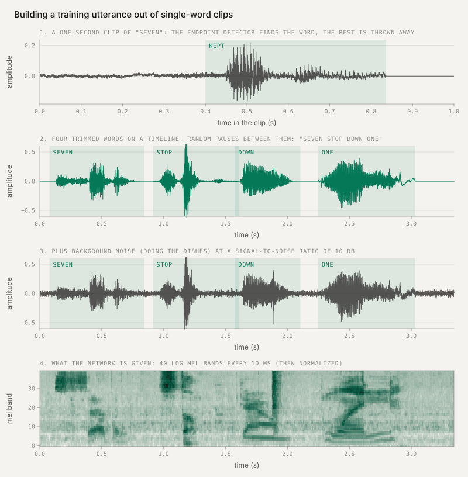
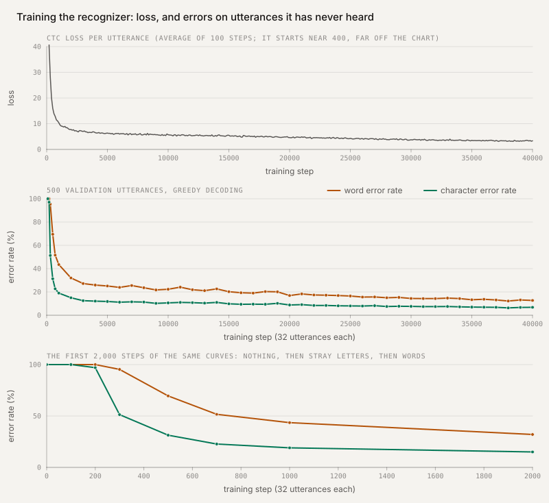
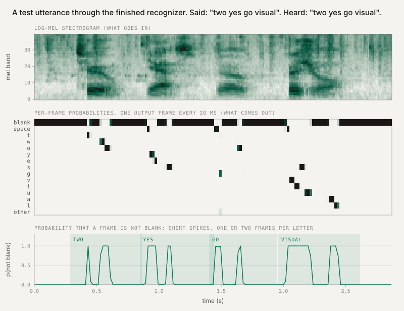

## Training The Recognizer

At the end of the last chapter we had a loss function and nothing to point it at. `ctc_loss` takes a matrix of per-frame logits and a short target, sums over every alignment, and hands back a number and a gradient. We watched it invent an alignment for `cat` on a grid of made-up logits. It has not yet heard a single second of audio.

Today it does. We take the convolution and the GRUs from chapter 7, remove the pooling, put `ctc_loss` on top, and train the result to listen to several words in a row and spell them out, letter by letter. Before we can do that we have to solve a problem that has nothing to do with networks: we do not have the data.

### The Data We Do Not Have

To learn to spell out "seven three go left", a network needs many thousands of recordings of several words in a row, each with its transcript. Such datasets exist. LibriSpeech has about a thousand hours of people reading books aloud. But our network runs on a matrix library we wrote ourselves, on a laptop CPU, and I wanted a training run that finishes while you make lunch. A thousand hours of fluent speech with a vocabulary of tens of thousands of words is far out of reach for that.

What we do have is Speech Commands from chapter 7: about 105,000 one-second clips, each holding one of 35 words. So we are going to *manufacture* our utterances. Pick a few clips, cut the silence off each, lay them end to end with pauses of random length, and mix in background noise. The transcript comes for free, because we chose the words.

Let's be plain about the trade.

- **What it buys.** A real sequence recognizer: variable-length audio in, a variable number of letters out, trained with CTC, by us, in about 40 minutes on a laptop CPU. An endless supply of training data too, since there are far more ways to combine 83,000 clips than we will ever use.
- **What it costs.** The vocabulary is 35 words. The model spells with letters, but it has only ever heard those 35 words, and it will not spell yours. And the rhythm is wrong: in fluent speech words run into each other ("go left" has no silence in the middle, and the "o" is already bending toward the "l"). Glued clips never do that. Our model learns to recognize words spoken one... after... another, which is how people talk to a machine when they want to be understood. Fluent speech is a harder problem than the one we are solving.

Here is the whole recipe in one picture, made from real clips by the code we are about to write:



*From a single-word clip to a training example: trim, lay out on a timeline, add noise, compute features.*

### Cutting Out The Words

A Speech Commands clip is one second long and the word in it lasts maybe half of that. If we glued whole clips together, every word would be followed by half a second of silence and the network would learn that this is what speech is like. So the first job is to find the word inside each clip.

We already own the tool: the endpoint detector from chapter 2. `find_speech` looks at the whole recording and returns where the speech starts and ends, or `None` if nothing stands out from the background. We add a small margin, and we refuse anything too short to be a word:

```rust
// src/data/synth.rs
/// How [`WordBank`] cuts words out of clips.
pub struct TrimConfig {
    /// Extra audio kept on each side of what the endpoint detector found,
    /// in milliseconds. (The detector already keeps 30 ms of its own.)
    pub margin_ms: f32,
    /// A "word" shorter than this (margins included, so 100 ms of them are
    /// padding) is a click or a cough, not a word. Such clips are left out.
    pub min_word_ms: f32,
}
// ... the defaults: margin_ms 20, min_word_ms 200

/// Where the word is inside a clip: `Some((start, end))` in samples, or
/// `None` if the clip should not be used.
pub fn locate_word(samples: &[f32], config: &TrimConfig) -> Option<(usize, usize)> {
    let (start, end) = find_speech(samples, SAMPLE_RATE)?;
    let margin = ms_to_samples(config.margin_ms);
    let (start, end) = (start.saturating_sub(margin), (end + margin).min(samples.len()));
    (end - start >= ms_to_samples(config.min_word_ms)).then_some((start, end))
}
```

What about the clips where it returns `None`? In fewer than one clip in a hundred the detector finds nothing at all: the recording is noise from end to end, or silent. We could keep the whole second, but a second of noise labeled "seven" would teach the recognizer the wrong thing, so we drop those clips, along with the larger number whose "word" is shorter than 200 ms. On the real dataset the two rules together reject 1,825 of the 84,843 training clips, about 2%, and nobody will miss them.

The trimmed words go into a `WordBank`: a `Vec<Word>` (class id, speaker, samples) with two indexes on the side, one by word and one by speaker. The indexes exist for two methods. `draw_any` picks a random word class *first* and then a random clip of it, so all 35 words are equally likely (the dataset has twice as many recordings of "zero" as of "follow", and we do not want the recognizer to inherit that preference). `draw_same_speaker` picks another clip by the speaker of a clip we already have. Trimming all 105,000 clips on ten threads took 0.6 seconds in our run.

### Why We Glue Waveforms, Not Spectrograms

There is a tempting shortcut here. The network never sees a waveform, it sees log-mel features. We could compute the features of every clip once and build utterances by pasting feature matrices side by side. No feature extraction during training at all.

Three things would be subtly wrong.

- **Noise adds before the logarithm.** A microphone records speech plus noise, and the log is taken afterwards. `ln(a + b)` is not `ln a + ln b`, so noise cannot be mixed into log-mel features by adding.
- **Frames look across the joint.** The 25 ms analysis window and the pre-emphasis filter from chapter 2 both straddle the boundary between two words. The frames at a joint are not the frames of either clip.
- **Normalization depends on everything.** We normalize each mel band over the whole utterance, so every frame's value depends on all the other words and the noise.

A microphone will hand us a waveform, so we build waveforms and run the real front end on them. The price is one feature extraction per training example, and as we will see the whole thing still runs at several hundred utterances per second.

### The Recipe

Every random choice in the synthesis is a field of one struct, `SynthConfig`, so that the recipe can be printed, changed and tested. Here are the defaults:

| What | Default |
|---|---|
| Number of words | 1 to 5, uniform |
| Speakers | 30% of utterances use one speaker throughout; otherwise a new draw per word |
| Speed per word | 0.9x to 1.1x |
| Level per word | brought to -26 dB RMS, then a random ±5 dB |
| Gap between words | -40 to 500 ms, short gaps more likely; negative means the clips overlap |
| Silence before and after | 50 to 500 ms each |
| Background noise | in 80% of utterances, at a signal-to-noise ratio of 5 to 30 dB |
| Hiss | always, very faint (-75 to -55 dB) |
| Overall gain | -15 to 0 dB |

Most of these are there to stop the network from learning a shortcut. If every word came from a new speaker, "the voice changed" would be a reliable sign that a new word began, so some utterances keep one voice. If pauses were exact digital silence, the log-mel features would show a wall of the smallest possible value, something no microphone produces, so there is always a little hiss.

Enough of the talk, let's write some code! `Synthesizer` holds a reference to a word bank, a noise bank (the dataset's six long background recordings: dishes, a tap, an exercise bike) and the recipe. Its main method builds one utterance, and it reads like the recipe:

```rust
// src/data/synth.rs
impl<'a> Synthesizer<'a> {
    /// Build one utterance, drawing every random choice from `rng`.
    pub fn utterance(&self, rng: &mut Rng) -> Utterance {
        let c = &self.config;

        // 1. Choose the clips.
        let n_words = c.min_words + rng.below(c.max_words - c.min_words + 1);
        let same_speaker = rng.uniform() < c.same_speaker_prob;
        let first = self.words.draw_any(rng);
        let mut chosen = vec![first];
        for _ in 1..n_words {
            chosen.push(if same_speaker { self.words.draw_same_speaker(first, rng) } else { self.words.draw_any(rng) });
        }

        // 2. Prepare each word: speed, level, soft edges.
        let mut pieces: Vec<Vec<f32>> = Vec::with_capacity(n_words);
        for &position in &chosen {
            let mut piece = change_speed(&to_f32(&self.words.words[position].samples), rng.range(c.speed.0, c.speed.1));
            let target = db_to_gain(c.word_level_db + rng.range(c.word_gain_db.0, c.word_gain_db.1));
            // A near-silent clip would need an absurd gain; cap it.
            let gain = (target / rms(&piece).max(1e-6)).min(100.0);
            piece.iter_mut().for_each(|s| *s *= gain);
            fade_edges(&mut piece, ms_to_samples(c.fade_ms));
            pieces.push(piece);
        }

        // 3. Lay them out on a timeline.
        let lead = ms_to_samples(rng.range(c.lead_ms.0, c.lead_ms.1));
        let mut spans = Vec::with_capacity(n_words);
        let mut cursor = lead as i64;
        for (i, piece) in pieces.iter().enumerate() {
            if i > 0 {
                let u = rng.uniform();
                let gap_ms = c.gap_ms.0 + (c.gap_ms.1 - c.gap_ms.0) * u * u;
                cursor += (gap_ms * SAMPLE_RATE as f32 / 1000.0).round() as i64;
            }
            let start = cursor.max(0) as usize;
            spans.push((start, start + piece.len()));
            cursor = (start + piece.len()) as i64;
        }
        let trail = ms_to_samples(rng.range(c.trail_ms.0, c.trail_ms.1));
        let total = spans.iter().map(|&(_, end)| end).max().unwrap_or(0) + trail;
        let mut samples = vec![0.0f32; total];
        for (piece, &(start, _)) in pieces.iter().zip(&spans) {
            // Adding (not copying) lets overlapping words blend.
            for (out, &s) in samples[start..].iter_mut().zip(piece) {
                *out += s;
            }
        }

        // 4. Background noise at a chosen signal-to-noise ratio.
        let speech_power = {
            let (sum, count) = pieces.iter().fold((0.0f32, 0usize), |(sum, count), piece| (sum + piece.iter().map(|s| s * s).sum::<f32>(), count + piece.len()));
            sum / count.max(1) as f32
        };
        let (mut snr_db, mut noise_track) = (None, None);
        if !self.noise.tracks.is_empty() && rng.uniform() < c.noise_prob {
            let track = rng.below(self.noise.tracks.len());
            let noise = self.noise.excerpt(track, total, rng);
            let snr = rng.range(c.snr_db.0, c.snr_db.1);
            let noise_power = rms(&noise).powi(2).max(1e-12);
            // We want speech_power / (k^2 * noise_power) = 10^(snr / 10).
            let k = (speech_power / (noise_power * 10f32.powf(snr / 10.0))).sqrt();
            for (out, &n) in samples.iter_mut().zip(&noise) {
                *out += k * n;
            }
            (snr_db, noise_track) = (Some(snr), Some(track));
        }

        // 5. ... the faint white hiss, added to every sample ...
        // 6. ... the overall gain, reduced if the peak would pass 0.99 ...

        Utterance { samples, words: chosen.iter().map(|&p| self.words.words[p].word).collect(), spans, same_speaker, snr_db, noise_track }
    }
}
```

A few of these lines deserve a word.

**Step 2.** The clips were recorded by thousands of people on their own laptops and phones, at wildly different volumes, more different than one person's words ever are. So each word is first brought to the same RMS level (root mean square: the square root of the mean-square energy we measured in chapter 2, taken over the whole word) and only then given a small random gain. `change_speed` reads the clip at a different rate with linear interpolation between neighboring samples, like a record played slightly too fast or slow. `fade_edges` ramps the first and last 5 ms so that a cut never produces a click.

**Step 3.** The gap is drawn as `low + (high - low) * u * u` with `u` uniform between 0 and 1. Squaring pushes values toward the low end, so short pauses are common and long ones rare. A negative gap moves the cursor backward, and because we *add* each piece into the timeline, two words can overlap by up to 40 ms. Their trimmed edges are nearly silent, so this just removes the pause.

**Step 4.** The **signal-to-noise ratio**, SNR, is speech power divided by noise power, in decibels: `10 * log10(speech / noise)`. 30 dB is a quiet room, 5 dB is a running tap next to you. We measure speech power over the words only (not the pauses, or a long pause would make the same utterance look quieter), pick a ratio, and solve for the factor `k` to scale the noise by. Scaling a signal by `k` scales its power by `k * k`, which is where the square root comes from.

The function returns more than audio. An `Utterance` remembers which words it holds, where each one sits, and what the SNR was. Training only needs `samples` and `text()` (the words joined by single spaces), but chapter 10 will use the rest to ask "how much worse are we in noise?".

How do we know the noise level is right? The test builds the same utterance twice, once with noise and once without, subtracts, and measures what was added:

```rust
// src/data/synth.rs (tests)
#[test]
fn noise_is_mixed_at_the_requested_snr() {
    let bank = toy_bank();
    let mut rng = Rng::new(9);
    let noise = NoiseBank { tracks: vec![("white".to_string(), (0..40_000).map(|_| rng.uniform() - 0.5).collect())] };
    let config = SynthConfig { noise_prob: 1.0, snr_db: (10.0, 10.0), min_words: 3, max_words: 3, ..plain_config() };
    let noisy = Synthesizer::new(&bank, &noise, config.clone()).utterance_at(2, 0);
    let clean = Synthesizer::new(&bank, &NoiseBank::empty(), config).utterance_at(2, 0);
    assert_eq!(noisy.snr_db, Some(10.0));
    assert_eq!(noisy.noise_track, Some(0));
    assert_eq!(noisy.words, clean.words);
    // What was added is the difference; its power should be a tenth of
    // the speech power (0.1^2), i.e. 10 dB below.
    let added: Vec<f32> = noisy.samples.iter().zip(&clean.samples).map(|(a, b)| a - b).collect();
    let measured_snr = 10.0 * (0.01 / rms(&added).powi(2)).log10();
    assert!((measured_snr - 10.0).abs() < 0.3, "measured {measured_snr} dB");
}
```

`toy_bank` is a bank of fake words (constant signals whose length encodes the word), and `plain_config` is a recipe with every random distortion switched off. Another test, `the_transcript_matches_the_audio`, uses them to check 300 utterances span by span: the right word at the right place, silence in the gaps.

### The Same Utterance Every Time

Training will make its utterances on ten threads. If they all drew from one random generator, the audio would depend on which thread got there first, and no two runs would be the same. When a run goes wrong, I want to be able to run it again and get the same wrong.

The fix is to give every utterance a generator of its own, seeded from the stream's seed and the utterance's number:

```rust
// src/data/synth.rs
/// The seed for utterance number `index` of the stream with seed `seed`.
pub fn utterance_seed(seed: u64, index: u64) -> u64 {
    seed.wrapping_mul(0x9E37_79B9_7F4A_7C15) ^ (index.wrapping_add(1)).wrapping_mul(0xD6E8_FEB8_6659_FD93)
}

impl<'a> Synthesizer<'a> {
    /// Utterance number `index` of the stream with seed `seed`.
    pub fn utterance_at(&self, seed: u64, index: u64) -> Utterance {
        self.utterance(&mut Rng::new(utterance_seed(seed, index)))
    }
}
```

The odd constants only make sure that neighboring indices and neighboring seeds give unrelated generators. Now utterance 1,234,567 of stream 9 is the same audio, bit for bit, no matter which thread makes it or when. The test says exactly that:

```rust
// src/data/synth.rs (tests)
#[test]
fn same_seed_same_utterance_and_threads_do_not_matter() {
    let (bank, noise) = (toy_bank(), NoiseBank { tracks: vec![("hum".to_string(), (0..5000).map(|i| (i as f32 * 0.01).sin() * 0.1).collect())] });
    let synth = Synthesizer::new(&bank, &noise, SynthConfig::default());
    let a = synth.utterance_at(7, 3);
    let b = synth.utterance_at(7, 3);
    assert_eq!(a, b);
    assert_ne!(a.samples, synth.utterance_at(7, 4).samples);
    assert_ne!(a.samples, synth.utterance_at(8, 3).samples);

    let one = synth.utterances(42, 100, 12, 1);
    let many = synth.utterances(42, 100, 12, 5);
    assert_eq!(one, many);
    assert_eq!(one[2], synth.utterance_at(42, 102));
}
```

### Keeping The Test Honest

One rule keeps our numbers meaningful: **nothing the model is tested on may have been available to learn from.** With synthesized data there are three ways to break it, and `Corpus` closes each one.

```rust
// src/data/synth.rs
impl Corpus {
    pub fn new(data: &super::speech_commands::SpeechCommands, noise_tracks: &[(String, Vec<f32>)], trim: &TrimConfig, threads: usize) -> Corpus {
        use super::speech_commands::Split;
        let part = |split: Split, from: f32, to: f32| {
            let clips: Vec<&Clip> = data.split(split).collect();
            Part { words: WordBank::from_clips(&clips, trim, threads), noise: NoiseBank::from_tracks(noise_tracks, from, to) }
        };
        Corpus { train: part(Split::Train, 0.0, 0.8), validation: part(Split::Validation, 0.8, 0.9), test: part(Split::Test, 0.9, 1.0) }
    }
}
```

- **Speakers.** Each part gets its own word bank, built from chapter 7's official split, which assigns every *speaker* to exactly one of train, validation and test. A test utterance is made only of voices the model has never heard. `Corpus::speakers_are_disjoint` collects the speaker ids of the three banks into `HashSet`s and checks that no two sets overlap; the training program asserts it at startup.
- **Noise.** There are only six background recordings and no official split for them, so we split each one by time: the first 80% for training, the next 10% for validation, the last 10% for test.
- **The sets themselves.** The validation and test sets are 2,000 utterances each, generated from fixed seeds (1001 and 2002) with the default recipe. Thanks to `utterance_at`, every program and every run measures on exactly the same audio.

### One Front End For Everyone

A model file holds weights. It does not say what its inputs must look like. If we train on 40 normalized log-mel bands and later feed the model un-normalized ones, nothing will crash. It will just produce nonsense, and we will spend an evening wondering why. Training, evaluation, the command-line tool and the live listener of chapter 11 must agree on every detail, so the chain is written down once, in `pipeline.rs`, and everybody calls it.

```rust
// src/data/pipeline.rs
/// The features both our models are trained on: 40 log-mel bands every
/// 10 ms from 25 ms windows of 16 kHz audio, each band normalized to mean 0
/// and variance 1 over the utterance.
pub struct FrontEnd {
    extractor: FeatureExtractor,
}

impl FrontEnd {
    /// Number of features per frame.
    pub const N_FEATURES: usize = 40;

    pub fn features(&self, samples: &[f32]) -> Mat {
        let mut features = self.extractor.log_mel(samples);
        normalize(&mut features);
        features
    }
}
```

Both calls are chapter 4's. The normalization removes the recording level and the tilt of the microphone, which differ between any two recordings and say nothing about the words. A test confirms it: the features of a signal and of the same signal three times louder agree to two decimal places.

The other half of the chain, from features to text, is `Recognizer`: a model, its front end, and (for chapter 10) a word list.

```rust
// src/data/pipeline.rs
impl Recognizer {
    /// Per-frame log-probabilities for an utterance: output frames x 28.
    /// Empty (zero rows) if the audio is too short to give a single frame.
    pub fn log_probs(&self, samples: &[f32]) -> Mat {
        let features = self.front_end.features(samples);
        if features.rows == 0 || self.model.out_len(features.rows) == 0 {
            return Mat::zeros(0, Alphabet::SIZE);
        }
        log_softmax(&self.model.predict(&features))
    }

    /// Audio in, text out.
    pub fn transcribe(&self, samples: &[f32], decoder: &Decoder) -> String {
        decode(&self.log_probs(samples), decoder, &self.lexicon)
    }
}
```

`Recognizer::load` reads a saved model and refuses one whose first layer does not take 40 inputs or whose last does not give 28 outputs. `Decoder` is an enum with three variants; two of them belong to the next chapter, and we will only use `Decoder::Greedy`.

### The Network

Why 28 outputs? Our targets are characters. `Alphabet` in `decode.rs` is the one place the mapping is written down: class 0 is the CTC blank, class 1 is the space between words, classes 2 to 27 are `a` to `z`. `Alphabet::encode("go left")` gives the seven class ids CTC wants as a target. The space is an ordinary character that the network must learn to emit between words. It is not the blank.

The network is built from chapter 7's parts:

```rust
// examples/ch09_train.rs
fn build_model(options: &Options, rng: &mut Rng) -> Model {
    let mut layers = vec![Layer::conv1d(FrontEnd::N_FEATURES, options.conv, 5, 2, 2, rng), Layer::Relu];
    let mut width = options.conv;
    for _ in 0..options.layers {
        layers.push(Layer::bigru(width, options.hidden, rng));
        width = 2 * options.hidden;
    }
    layers.push(Layer::linear(width, Alphabet::SIZE, rng));
    Model::new(layers)
}
```

With the defaults (`conv` 96, `hidden` 128, `layers` 2), `model.summary()` prints:

```text
  0  Conv1d(40 -> 96, kernel 5, stride 2, padding 2)          19296 params
  1  ReLU                                                         0 params
  2  BiGru(96 -> 2 x 128)                                    173568 params
  3  BiGru(256 -> 2 x 128)                                   296448 params
  4  Linear(256 -> 28)                                         7196 params
     total                                                   496508 params
```

Compare this with chapter 7's classifier and one thing is missing: the mean pooling. That is the whole architectural change. The classifier squashed all frames into one row; this network keeps every row and gives 28 logits for each.

- The **convolution** looks at 5 frames (50 ms) at a time and steps 2 frames forward per output. So the GRUs run at 50 frames per second instead of 100, for half the work, and one output frame covers 20 ms. A letter of slow, careful speech still gets several frames.
- Each **BiGru** reads the utterance in both directions, so the decision about a frame can use what comes after it as well as what came before. That matters for spelling: whether a sound is the `t` of "two" or of "tree" depends on what follows.
- The **linear layer** turns each frame's 256 numbers into 28 logits.

Half a million weights, two megabytes on disk. For scale, the Whisper model we load in chapter 12 has 37.8 million.

### The Training Loop

The loop has the same four beats as every training loop since chapter 6: make a batch, compute gradients, clip, step. Two things are new. The batch does not come from a shuffled list, it is synthesized on the spot. And the loss function passed to `batch_gradients` is `ctc_loss`.

```rust
// examples/ch09_train.rs (inside main)
let synthesizer = Synthesizer::new(&corpus.train.words, &corpus.train.noise, recipe);
// ...
let batch_slots: Vec<usize> = (0..options.batch).collect();
for step in 0..=options.steps {
    // ... every so often: evaluate, print three samples, save a checkpoint ...
    if step == options.steps {
        break;
    }

    // Build this step's batch: synthesize and extract features, in parallel.
    let first = (step * options.batch) as u64;
    let batch: Vec<(Mat, Vec<usize>)> = parallel_map(&batch_slots, threads, |_, &slot| {
        let utterance = synthesizer.utterance_at(options.seed, first + slot as u64);
        (front_end.features(&utterance.samples), Alphabet::encode(&utterance.text()))
    });
    let pairs: Vec<(&Mat, &[usize])> = batch.iter().map(|(x, target)| (x, &target[..])).collect();

    // Forward, CTC loss, backward for every utterance; average; step.
    let mut outcome = batch_gradients(&model, &pairs, threads, ctc_loss);
    let norm = clip_global_norm(&mut outcome.grads, CLIP);
    adam.lr = schedule.lr_at(step);
    adam.step(&mut model, &outcome.grads);

    // ... add to the running loss, print a line every 100 steps ...
}
```

`parallel_map` is the helper from chapter 7's dataset loader: it runs the closure on every item of a slice, on several threads, and returns the results in order. Step `s` uses utterances `32 * s` to `32 * s + 31` of the stream, so the model never sees the same utterance twice. There are no epochs. There is no training *set* either, only a recipe and a counter, so the model cannot memorize its examples: each one is gone after a single step.

`CLIP` is 5.0, and `schedule` is chapter 7's `LrSchedule`: a warm-up over the first 500 steps to a peak learning rate of 0.002, then a cosine decay to a twentieth of that.

The elided "every so often" block is worth describing, because it is what makes the run watchable. At steps 100, 200, 300, 500, 700 and then every 1,000, the program

- measures the error on the first 500 validation utterances,
- prints what it currently hears in three fixed validation utterances of two, three and four words,
- prints the raw per-frame output for the first of them,
- and saves the model. That file is a **checkpoint**: if the run dies at minute 35, minute 34 is on disk.

"What it hears" needs a decoder, and for this chapter we use the simplest one there is, the same one chapter 8's toy used: take the most probable class in every frame, merge repeats, drop the blanks. That is **greedy decoding**. In the training program it is the function `hear`:

```rust
// examples/ch09_train.rs
fn hear(model: &Model, features: &Mat) -> String {
    let text = Alphabet::decode(&greedy(&log_softmax(&model.predict(features))));
    // A space spelled before the first word or after the last is not an error.
    text.split_whitespace().collect::<Vec<_>>().join(" ")
}
```

To put a number on "how wrong", we count mistakes. The **character error rate**, CER, is the number of characters you would have to insert, delete or replace to turn what was heard into the truth, divided by the length of the truth; the **word error rate**, WER, is the same thing counted in whole words. The next chapter defines both properly and builds better decoders; today lower is better and that is all we need.

### Watching It Learn

The trained model ships with the repository as `models/recognizer.bin`, so you can skip the wait and still follow along. To train your own you need Speech Commands on disk (chapter 7 covers the download), in `../data` or wherever `SPEECH_DATA` points:

```text
$ cargo run --release --example ch09_train               # the full run: 40,000 steps
$ cargo run --release --example ch09_train -- --quick    # 4,000 steps
```

Everything below is from the full run that produced the shipped model; the complete output is in `models/recognizer-training.log`. It starts by telling us what it has to work with:

```text
loaded 105829 clips and 6 noise recordings in 4.7 s
  train       83018 words from 2096 speakers, 906.7 min of speech after trimming (1825 clips rejected),  320 s of noise
  validation   9843 words from  255 speakers, 107.6 min of speech after trimming (138 clips rejected),   40 s of noise
  test        10869 words from  249 speakers, 120.5 min of speech after trimming (136 clips rejected),   40 s of noise
trimmed every clip to its word in 0.6 s
built 2000 validation and 2000 test utterances, and features of 11005 single-word test clips, in 2.3 s
```

Fifteen hours of single words from 2,096 people to learn from. Then the loop begins. In the `frames` line, `_` is the blank and `|` is the space.

```text
--- step 0: validation CER 257.8%  WER 100.5%  (500 utterances, greedy, 0.0 min elapsed)
      truth: visual wow                   heard: tixwkfksfkfvpsftxkflnqfvwkxk
      truth: two wow learn                heard: fkxksnfqfqtkxsuvufxsux
      truth: nine eight learn tree        heard: fkfkxkxfvqftfkftfkfkxkxkfvpfsfskxfyqftfkfkfpndusyfsnsfkfxk
      frames: tiiixwkkkkkkkkfffffkksssffkkfffffvpssssffffffffftxkkkkkkkkkflllnnnqqqfvvvvwkkkkkkxkkkkkkkkkkkkkkk
step      1   loss 369.880   lr 0.00000   grad norm 544.51      90 utt/s
```

The untrained network has random weights, so every frame is a vague guess and the decode is noise. (An error rate above 100% is not a bug: it spells far more characters than the truth has, and every extra one counts.)

```text
step    100   loss 193.218   lr 0.00040   grad norm 237.00     484 utt/s
--- step 100: validation CER 100.0%  WER 100.0%  (500 utterances, greedy, 0.1 min elapsed)
      truth: visual wow                   heard: 
      truth: two wow learn                heard: 
      truth: nine eight learn tree        heard: 
      frames: _________________________________________________________________________________________________
```

A hundred steps in, it has learned exactly one thing: say blank, everywhere, always. This is the first rung of every CTC training run, and chapter 8 tells us why. Most positions of the extended target are blanks, and most frames of any valid alignment are blank too. Whatever the audio, "blank" is the safest bet, and betting on it brings the loss down from 370 to about 40 in two hundred steps without knowing anything about speech. The model says nothing, and is rewarded for it.

```text
--- step 300: validation CER 51.3%  WER 95.3%  (500 utterances, greedy, 0.4 min elapsed)
      truth: visual wow                   heard: s o
      truth: two wow learn                heard: steo o b
      truth: nine eight learn tree        heard: nin eigh bn ti
      frames: _________________________________ss_______________________|||__________o_________________________
```

Under half a minute in, the first letters poke through the blanks, and they are not random. The `s` of "visual" and the `o` of "wow" are in the right places, there is a space between them, and "nin eigh" is most of two words. The loudest, most distinctive sounds come first.

```text
--- step 500: validation CER 31.3%  WER 69.5%  (500 utterances, greedy, 0.6 min elapsed)
      truth: visual wow                   heard: se waw
      truth: two wow learn                heard: to wow baed
      truth: nine eight learn tree        heard: nine eigh bern t
      frames: ________________________________sss________e_____________|||w_________aw_________________________
```

```text
--- step 1000: validation CER 19.0%  WER 43.5%  (500 utterances, greedy, 1.2 min elapsed)
      truth: visual wow                   heard: sual lw
      truth: two wow learn                heard: to wow lrn
      truth: nine eight learn tree        heard: nine eight bern t
      frames: ________________________________sssuu______al____________|||l____________w_______________________
```

Gibberish, but the gibberish of someone sounding words out. "to" for "two", "waw" for "wow", "lrn" for "learn": it is spelling what it hears, with no idea yet how English is written.

```text
--- step 5000: validation CER 11.8%  WER 25.1%  (500 utterances, greedy, 5.2 min elapsed)
      truth: visual wow                   heard: visual wow
      truth: two wow learn                heard: two wow lain
      truth: nine eight learn tree        heard: nine eight bir three
      frames: ____________________________viis__uuuu_____aal____________||w__________oww_______________________
```

Five minutes. It now writes "two" with a silent `w`, which no amount of listening could have told it; it has learned that this sound is spelled that way. And "tree" heard as "three" is a mistake a person could make.

```text
--- step 40000: validation CER 6.8%  WER 12.7%  (500 utterances, greedy, 42.4 min elapsed)
      truth: visual wow                   heard: visual wow
      truth: two wow learn                heard: two wow lein
      truth: nine eight learn tree        heard: nine eight learn tree
      frames: ___________________________viisssuuuuu____aall___________||ww__________oww_______________________
```

Read the last `frames` line the way the decoder does. Merge repeats: `v i s u`, some blanks, `a l`, blanks, a space, `w`, blanks, `o w`. Drop the blanks: `visual wow`. Nobody ever told this network which frame holds which letter. That is amazing.

It is also not perfect, and the log is honest about it: after 40,000 steps "learn" still comes out as "lein".



*Loss and validation error over the run. Most of the learning happens in the first two minutes; the remaining forty buy the last few points.*

The same story can be seen inside the network. The training program saves the full per-frame probabilities of one validation utterance at several steps, and `examples/ch09_figures.rs` turns them into a picture (all four figures of this chapter come from that program, drawn by the small SVG helper in the repo):


*What the network believes, frame by frame, at five points in training. Each row is a class, time runs left to right, darker is more probable.*

If you recall the toy at the end of chapter 8, this is the same picture: blank learned first, then letters as short, confident spikes in a sea of blank. There, gradient descent pushed logits around directly. Here the logits come out of half a million weights looking at real audio, and the look is the same.

> **Play with it:** [the CTC lattice](../interactive/ctc.html), if you want to remind yourself where those spikes come from.

### How Good Is It?

When the loop ends, the program evaluates on everything it has, with greedy decoding:

```text
trained on 1280000 utterances in 42.4 minutes

| set (greedy decoding)                 | utterances |   CER |   WER | exact match |
|---------------------------------------|-----------:|------:|------:|------------:|
| synthesized validation                |       2000 |  7.0% | 13.6% |       68.8% |
| synthesized test                      |       2000 |  8.2% | 16.4% |       63.2% |
| single-word test clips, as recorded   |      11005 | 11.0% | 17.7% |       82.4% |
```

On the test set, speakers and noise the model has never heard, about one character in twelve and one word in six is wrong, and 63.2% of the utterances come out exactly right. Not bad for 40 minutes, and not good either. Let's go through what these numbers do and do not say.

**The timing is machine-dependent.** 42.4 minutes is on my machine (an Apple M4 Max, 10 threads), and that machine was busy with other jobs throughout, so the throughput in the log wanders between 370 and 575 utterances per second. Yours will differ. The `--quick` run took 5.4 minutes under the same conditions and reached a WER of 19.8% on validation and 22.4% on test: most of the result for an eighth of the time.

**Test is harder than validation**, 16.4% against 13.6%. We never trained on either, and we did choose the architecture by looking at validation, but with so few experiments I think most of the gap is simply a harder draw of speakers.

**It is worse at single words than chapter 7's classifier.** The last row feeds it the plain one-second test clips. It spells 82.4% of them exactly right. The classifier got 93.5% on the same clips. That is the price of the harder job: the classifier picks one of 35 answers, while this model must get every letter right with nothing to stop it from writing "bir" or "lein". About one in eight of the words it spells are not words at all. Hold that thought; it is the next chapter's opening.

**The gradient is clipped on every single step.** Look at the `grad norm` column of the log: after the first few hundred steps it sits between 17 and 21 for the entire run, and we clip at 5. So `clip_global_norm` is not an emergency brake that fires now and then, it shortens every step to about a quarter. In effect Adam is being fed only the direction of the gradient. Training works fine this way, but be aware that the learning rate and the clip threshold are tangled together here: change one and you have changed the other.

**The loss is heavy-tailed.** The average loss at the end is about 3.3 per utterance, but an average hides the shape. The training program does not print the shape, so this is a measurement we made on the side during development: on the validation set partway through training (around step 24,000), the mean was 4.16 while the median was 0.81; one utterance in ten had a loss above 12 and one in a hundred above 36. The worst 10% of utterances carried 55% of the total loss. The worst cases look like bad clips: a "backward" that the model hears as "teo", or as nothing. So the model is quite sure about most utterances and hopelessly wrong about a few, and a good part of every gradient step is spent on recordings that may not be learnable.

**What we tried.** Before settling on this network we ran some short experiments, 4,000 steps each. These too are numbers from our development runs and not something your run will print (the first row is the `--quick` run, and exercise 2 below reproduces the second). Greedy WER:

| variant | weights | validation | test |
|---|---:|---:|---:|
| the final architecture, peak learning rate 0.002 | 497k | 19.8% | 22.4% |
| one BiGru(128) instead of two | 200k | 37.9% | 38.5% |
| two BiGru(96), convolution 64 wide | 279k | 21.4% | 23.4% |
| peak learning rate 0.001 | 497k | 22.0% | 24.5% |
| trim margin 120 ms instead of 20 ms | 497k | 19.8% | 22.0% |
| drop the 10% highest-loss utterances of each batch | 497k | 19.8% | 22.3% |

The second row is the one chapter 7 has been waiting for. There the GRU bought nothing: on single words a stack of convolutions did just as well, and we kept the recurrent layer on a promise. Here is the payment. Take one of the two BiGrus away and the error nearly doubles, from 19.8% to 37.9%. Spelling several words in a row needs context that reaches further than a convolution's window, and the recurrent layers are what carry it. (We did not train a recognizer with no GRU at all, so that is as far as the evidence goes.) A narrower network is almost as good and trains in half the time. The last two rows were attempts to deal with the bad clips, and neither made a difference, so neither is in the code. More training helps only a little: continuing the finished model for another 12,000 steps at a lower learning rate brought test WER from 16.4% to 15.5%. Whatever is holding this model back, it is not twelve more minutes.

Here is one test utterance going through the finished model:



*A test utterance through the finished recognizer: what goes in, what comes out, and how little of the time the network is saying anything other than blank.*

And you can try it yourself, without any dataset. The `speech` binary wraps `Recognizer`, and `samples/` holds a few synthesized test utterances:

```text
$ cargo run --release --bin speech -- transcribe ../samples/utt_*.wav --decoder greedy
../samples/utt_down_five_three_sheila_nine.wav: down five three sheila nine
    4.83 s of audio, 14 ms to recognize (355x real time), our model (496508 weights), greedy decoder
../samples/utt_four_one_visual.wav: four one visual
    2.92 s of audio, 7 ms to recognize (409x real time), our model (496508 weights), greedy decoder
../samples/utt_two_yes_go_visual.wav: two yes go visual
    2.87 s of audio, 7 ms to recognize (429x real time), our model (496508 weights), greedy decoder
../samples/utt_yes_right.wav: yes right
    2.06 s of audio, 5 ms to recognize (452x real time), our model (496508 weights), greedy decoder
```

All four right, several hundred times faster than real time on my machine. In fairness, these files were picked because they are short, not very noisy, and come out right; they are demonstrations. The benchmark is the table above, where a third of the utterances have at least one mistake.

### Try It Yourself

1. **Watch the three stages.** Run `cargo run --release --example ch09_train -- --quick --out /tmp/r.bin --snapshots /tmp/p.txt` (so the shipped model is not overwritten). You should see all-blank output at step 100, stray letters by step 300 and mostly words by step 2,000.
2. **Remove a layer.** Add `--layers 1` to the quick run. The error should come out much worse (we measured about 38% WER against 20%), and the samples will show which words suffer.
3. **Train without noise.** In `ch09_train.rs`, change the recipe to `SynthConfig { max_words: options.max_words, noise_prob: 0.0, ..SynthConfig::default() }` and do a quick run. The validation set still has noise in 80% of its utterances; compare the training loss and the validation error with the normal quick run and see which one moved.
4. **Longer utterances.** Run the quick training with `--max-words 2`. The model never sees more than two words in a row; look at how it does on the four-word sample line compared to the two-word one.
5. **Hear what the network hears.** In a scratch example, build a `Corpus`, call `corpus.test_set(5, 1)`, and write each utterance out with chapter 1's `Wav` writer. Listening to them tells you more about "glued-word rhythm" than any paragraph here.

### Loose Ends

- **35 words, and it shows.** The model spells letter by letter, but every letter sequence it has ever been rewarded for is one of 35 words. Say "eleven" and you will get the nearest thing it knows how to write.
- **Glued words are not fluent speech.** There is no coarticulation between our words, and no sentence melody. Chapter 11 puts a microphone on this model and we will see what that costs.
- **The trimming is loose.** `find_speech` keeps quiet tails, so many "trimmed" words still end in a stretch of near-silence. Tightening the trim did not change the error rate in our experiment, so we left it alone.
- **Bad clips stay in.** Some recordings in Speech Commands are mislabeled, cut off or drowned in noise, and they carry a large share of the loss. We found no cheap fix.
- **Clipping does more than it should.** With the gradient norm always above the threshold, we are effectively training on normalized gradients. A higher threshold with a lower learning rate might do as well or better; we did not explore it.
- **Reproducibility has a footnote.** The run is repeatable bit for bit, but only for a given `--threads`, because `batch_gradients` adds the threads' gradients in thread order. Reproducing the shipped model exactly needs `--threads 10`.
- **Normalization needs the whole utterance.** `FrontEnd::features` cannot produce a frame until it has seen the last one. Fine for files; for a live microphone it means waiting for the speaker to finish.

What's next on our agenda? Let's take stock. We had 105,000 single words and needed sentences, so we built a small factory: an endpoint detector to cut the words out, a recipe to glue them onto a timeline with pauses, speed changes and noise, and a seeding scheme that makes every utterance reproducible. We wrote the features-to-text chain down in one place. We took chapter 7's layers, removed the pooling, attached chapter 8's loss, and watched half a million weights go from blanks to gibberish to spelling in 40 minutes. On voices it has never heard, the result gets five words in six right.

However, if you have been paying attention, you'll notice that we have been reading the network's output in the laziest way possible: best letter in every frame, and hope. That is how we end up with "lein" and "bir" from a model that has only ever been taught 35 words. The probabilities contain more than the single best letter per frame says, and we know something the decoder does not: which words exist. In the next chapter we build decoders that use both, define our error rates properly, and take that 16.4% down without retraining anything.

### References

- [Speech Commands: A Dataset for Limited-Vocabulary Speech Recognition](https://arxiv.org/abs/1804.03209), Pete Warden, 2018: the dataset, its speaker split and its background noise recordings.
- [Connectionist Temporal Classification: Labelling Unsegmented Sequence Data with Recurrent Neural Networks](https://www.cs.toronto.edu/~graves/icml_2006.pdf), Graves, Fernández, Gomez and Schmidhuber, ICML 2006: the paper's first figure shows the same picture we watched appear, a CTC network predicting "a series of spikes, separated by 'blanks'".
- [Deep Speech 2: End-to-End Speech Recognition in English and Mandarin](https://arxiv.org/abs/1512.02595), Amodei et al., 2015: our network is a miniature of this one (convolution, bidirectional recurrent layers, character CTC), trained there on thousands of hours.
- [Audio Augmentation for Speech Recognition](https://www.danielpovey.com/files/2015_interspeech_augmentation.pdf), Ko, Peddinti, Povey and Khudanpur, Interspeech 2015: the speed change of step 2. They make copies of the training set at 0.9x and 1.1x; we draw a speed between the two for every word.
- [SGDR: Stochastic Gradient Descent with Warm Restarts](https://arxiv.org/abs/1608.03983), Loshchilov and Hutter, 2016: the paper usually credited with the cosine learning-rate decay.
- Our code: [`src/data/synth.rs`](../code/src/data/synth.rs), [`src/data/pipeline.rs`](../code/src/data/pipeline.rs), [`examples/ch09_train.rs`](../code/examples/ch09_train.rs), [`examples/ch09_figures.rs`](../code/examples/ch09_figures.rs). The run's full output: [`models/recognizer-training.log`](../models/recognizer-training.log).

[← Previous: The Alignment Problem: CTC](08-the-alignment-problem-ctc.md) · [Contents](../README.md) · [Next: Decoding: From Probabilities To Words →](10-decoding.md)
