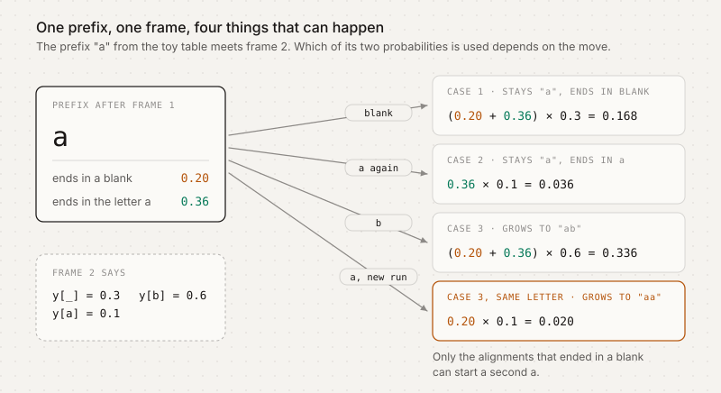
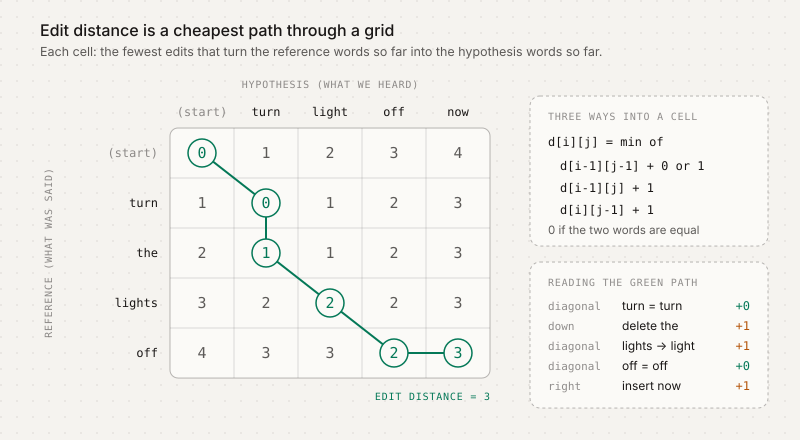
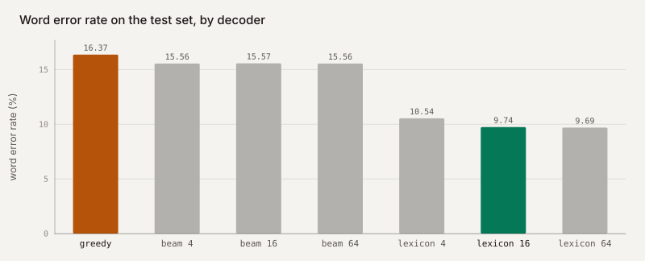
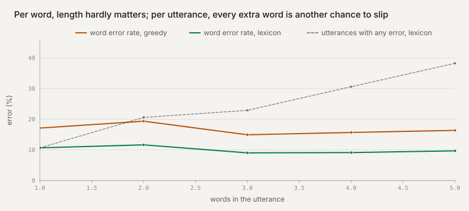

## Decoding: From Probabilities To Words

In the last chapter we trained a recognizer. Log-mel frames go in, and out comes a grid: one row per output frame, 28 numbers per row, a probability for the blank, the space and each letter `a` to `z`. To see what the network had learned we used greedy decoding: take the most probable class in every frame, collapse, print. That gave us a character error rate of 8.2% and a word error rate of 16.4% on the test set, along with spellings like "lein" for "learn" and "bir" for "bird".

We never asked whether the lazy thing is the *right* thing, and the two error rates got one sentence of definition and no code. This chapter fixes both. Turning the grid into text is called **decoding**, and we are going to write three decoders, each a little more careful than the last, plus the scoring code that tells us whether the care paid off. The network is frozen; everything here happens after it has spoken.

### Naming The Classes

One piece of housekeeping first. Chapter 9 used `Alphabet` to turn text into CTC targets and back without showing it. Every decoder below leans on it, so here it is:

```rust
// src/decode.rs
pub struct Alphabet;

impl Alphabet {
    pub const BLANK: usize = 0;
    pub const SPACE: usize = 1;
    /// Class id of the letter `a`; `b` is the next one, and so on.
    pub const FIRST_LETTER: usize = 2;
    /// Number of classes: blank + space + 26 letters.
    pub const SIZE: usize = 28;

    /// Text to class ids. Upper case is folded to lower case; anything that
    /// is not a letter `a`-`z` or a space (digits, punctuation) is dropped.
    /// The blank is never produced: it is not a character.
    pub fn encode(text: &str) -> Vec<usize> {
        let mut labels = Vec::with_capacity(text.len());
        for ch in text.chars() {
            let ch = ch.to_ascii_lowercase();
            if ch == ' ' {
                labels.push(Self::SPACE);
            } else if ch.is_ascii_lowercase() {
                labels.push(Self::FIRST_LETTER + (ch as usize - 'a' as usize));
            }
        }
        labels
    }

    // ... decode(labels) goes the other way, skipping blanks; symbol(class)
    // is the character to print for one class, with '_' for the blank
}
```

Every decoder below takes **log-probabilities**: a `Mat` with one row per output frame and one column per class, each row already through chapter 8's `log_softmax`. That is exactly what chapter 9's `Recognizer::log_probs` returns. In this chapter "frame" always means an output frame, one row of that grid.

### Greedy Decoding

Greedy decoding, which chapter 9 called from its training loop, takes four lines of logic. Pick the best class in every frame, then apply chapter 8's `collapse` (merge repeats, drop blanks):

```rust
// src/decode.rs
/// The most probable class in each frame: the single most probable
/// alignment. Ties go to the lower class id.
pub fn best_path(log_probs: &Mat) -> Vec<usize> {
    let mut path = Vec::with_capacity(log_probs.rows);
    for t in 0..log_probs.rows {
        let row = log_probs.row(t);
        let mut best = 0;
        for (class, &value) in row.iter().enumerate() {
            if value > row[best] {
                best = class;
            }
        }
        path.push(best);
    }
    path
}

/// Greedy decoding: [`best_path`], then [`collapse`].
pub fn greedy(log_probs: &Mat) -> Vec<usize> {
    collapse(&best_path(log_probs))
}
```

Look at the doc comment on `best_path`. Because CTC multiplies per-frame probabilities, choosing the best class in each frame does give the most probable **alignment**. But chapter 8 was built on the idea that we do not care about alignments. We care about the **labeling**, and the probability of a labeling is the *sum* over all the alignments that collapse to it. Training summed. Greedy decoding picks one alignment and ignores the rest. Those are different questions with, sometimes, different answers.

The smallest case I know has two frames and two classes. In both frames the blank gets 0.6 and `a` gets 0.4. Greedy sees the blank win twice and returns the empty string, whose only alignment is `__` with probability 0.6 × 0.6 = 0.36. But "a" can be spelled three ways: `a_`, `_a` and `aa`, worth 0.24 + 0.24 + 0.16 = 0.64. The answer greedy threw away is almost twice as likely as the one it gave.

That is not just a trick with blanks. Here is the table our toy program uses, three frames over the classes blank, `a`, `b`. Go ahead and run it:

```text
$ cargo run --release --example ch10_decode_toy
== Part 1: greedy fails, beam search does not ==

  frame   p(_)   p(a)   p(b)
    0     0.5    0.4    0.1
    1     0.5    0.4    0.1
    2     0.3    0.1    0.6

Greedy: the best class in each frame is __b, which collapses to "b".
That one alignment has probability 0.150.

The truth, by adding up all 27 alignments:
    p(ab     ) = 0.3720
    p(a      ) = 0.2290
    p(b      ) = 0.2190
    p((empty)) = 0.0750
    ...
```

Greedy says "b". The most probable labeling is "ab", and "b" is not even second. Where did the `a` go? It never won a frame. The network was fairly sure there was an `a` near the start, but it split its evidence between "it was in frame 0" and "it was in frame 1", and each half lost to the blank. Add the halves back together (`a_b` 0.120, `_ab` 0.120, `aab` 0.096, `abb` 0.024, `ab_` 0.012) and you get 0.372.

The "truth" column comes from a function that does exactly what the definition says, using the alignment enumerator we wrote for chapter 8's tests:

```rust
// src/decode.rs
/// The exact probability of **every** labeling, by enumerating all `C^T`
/// alignments and adding each one's probability to the labeling it
/// collapses to. Most probable first.
pub fn all_labelings(log_probs: &Mat) -> Vec<Hypothesis> {
    let mut probability: BTreeMap<Vec<usize>, f64> = BTreeMap::new();
    crate::ctc::for_each_alignment(log_probs.rows, log_probs.cols, |path| {
        let p = crate::ctc::alignment_log_prob(log_probs, path).exp();
        *probability.entry(collapse(path)).or_insert(0.0) += p;
    });
    let mut all: Vec<Hypothesis> = probability.into_iter().map(|(labels, p)| Hypothesis { labels, log_prob: p.ln() as f32 }).collect();
    all.sort_by(|a, b| b.log_prob.total_cmp(&a.log_prob));
    all
}
```

A `Hypothesis` is a pair: `labels` and `log_prob`. This function is our ground truth, and it is useless on real input. Three frames and three classes are 27 alignments; 100 frames and 28 classes are 28^100, about 10^145. In chapter 8 the same explosion was tamed by a lattice, but the lattice needed to know the target. Now the target is the thing we are looking for.

### Prefixes Instead Of Alignments

Here is the way out. Sweep over the frames from left to right, as greedy does, but instead of committing to one class per frame, keep a short list of the most promising *labelings so far*. A labeling-so-far is called a **prefix**. After frame 0 of the toy the candidate prefixes are the empty one, "a" and "b". After frame 1 there are more: "ab", "ba" and so on. The list is called the **beam** and its maximum length is the **beam width**. At each frame every prefix in the beam is extended in every possible way, the results are ranked, and only the best `beam_width` survive. This is **prefix beam search**.

The important word is *prefix*. Many alignments collapse to the same prefix: after two frames, `a_`, `_a` and `aa` are all the prefix "a". We keep one entry for "a" and add their probabilities together. That is the same sum over alignments that training did, done on the fly for the labelings we have not yet given up on.

There is one catch, and it is the reason this algorithm looks more complicated than it is. Suppose the prefix is "a" and the next frame says `a` again. What is the new prefix?

- If the alignment so far ended in `a` (like `_a` or `aa`), another `a` just continues the run. `_aa` still collapses to "a".
- If the alignment so far ended in a blank (like `a_`), another `a` starts a new letter. `a_a` collapses to "aa".

Same prefix, same next symbol, two different outcomes. So one probability per prefix is not enough. We have to keep two: how much of the prefix's probability comes from alignments ending in a blank, and how much from alignments ending in its last label.

```rust
// src/decode.rs
/// One prefix being tracked by the beam search, part-way through the input.
#[derive(Clone, Debug, PartialEq)]
pub struct BeamEntry {
    /// The labeling so far.
    pub labels: Vec<usize>,
    /// Log of the summed probability of the alignments of `labels` that end
    /// in a blank.
    pub log_p_blank: f32,
    /// Log of the summed probability of the alignments of `labels` that end
    /// in its last label (not a blank).
    pub log_p_non_blank: f32,
    /// Lexicon decoding only: the trie node reached by the letters of the
    /// word currently being spelled (the root when there is no lexicon).
    node: usize,
    /// Lexicon decoding only: bonuses collected for the words completed so
    /// far (zero when there is no lexicon).
    word_score: f32,
}

impl BeamEntry {
    /// Log of the total probability of this prefix: blank-ending plus
    /// non-blank-ending alignments.
    pub fn log_total(&self) -> f32 {
        log_add(self.log_p_blank, self.log_p_non_blank)
    }

    /// What the beam is ranked by: the acoustic probability plus, in lexicon
    /// decoding, the word bonuses.
    fn score(&self) -> f32 {
        self.log_total() + self.word_score
    }
}
```

Ignore `node` and `word_score` until later in the chapter. Everything is a logarithm, for the reason chapter 8 gave: a product of a hundred probabilities underflows. `log_add` is chapter 8's `ln(e^a + e^b)`, wrapped for `f32`.

With two numbers per prefix, one frame can do exactly three things to a prefix `l`. Write `p_blank` and `p_non_blank` for its two probabilities and `y` for the frame's probabilities:

```text
1. emit a blank:                 l stays l, now ending in blank
       next[l].p_blank     += (p_blank + p_non_blank) * y[blank]

2. emit l's last label again:    l stays l, still ending in that label
       next[l].p_non_blank += p_non_blank * y[last]

3. emit a label c, growing l to l+c
       next[l+c].p_non_blank += (p_blank + p_non_blank) * y[c]     if c != last
       next[l+c].p_non_blank +=  p_blank                * y[c]     if c == last
```

Case 3 with `c == last` is the catch from above: only the blank-ending alignments may start a second copy of the same letter. The non-blank-ending ones went to case 2.



*One step of the search, with the numbers the toy program prints.*

Enough of the talk, let's write some code! The search starts with one prefix, the empty one, with probability 1. We count it as "ending in a blank" so that whatever comes first starts a new run:

```rust
// src/decode.rs
pub fn initial_beam() -> Vec<BeamEntry> {
    vec![BeamEntry { labels: Vec::new(), log_p_blank: 0.0, log_p_non_blank: f32::NEG_INFINITY, node: Lexicon::ROOT, word_score: 0.0 }]
}
```

The `+=` in the three rules is where alignments get summed, and several old prefixes can land on the same new one ("a" arrives both from "a" by case 1 and from the empty prefix by case 3). So the next beam is built in a map keyed by the labels, and one small helper does the adding:

```rust
// src/decode.rs
#[derive(Clone, Copy)]
enum Ending {
    Blank,
    NonBlank,
}

/// Add `log_p` to the entry for `labels` in the next beam, creating the entry
/// if this is the first alignment to reach that prefix.
fn add_mass(next: &mut BTreeMap<Vec<usize>, BeamEntry>, labels: &[usize], node: usize, word_score: f32, ending: Ending, log_p: f32) {
    if log_p == f32::NEG_INFINITY {
        return; // nothing to add
    }
    let entry = next.entry(labels.to_vec()).or_insert_with(|| BeamEntry {
        labels: labels.to_vec(),
        log_p_blank: f32::NEG_INFINITY,
        log_p_non_blank: f32::NEG_INFINITY,
        node,
        word_score,
    });
    match ending {
        Ending::Blank => entry.log_p_blank = log_add(entry.log_p_blank, log_p),
        Ending::NonBlank => entry.log_p_non_blank = log_add(entry.log_p_non_blank, log_p),
    }
}
```

Now the step itself. It takes an optional lexicon, which is `None` for now; read the `match lexicon` as "always the first arm".

```rust
// src/decode.rs
fn advance(beam: &[BeamEntry], frame: &[f32], beam_width: usize, lexicon: Option<(&Lexicon, &LexiconOptions)>) -> Vec<BeamEntry> {
    assert!(beam_width > 0, "the beam must hold at least one prefix");
    let mut next: BTreeMap<Vec<usize>, BeamEntry> = BTreeMap::new();
    let mut extended = Vec::new();
    for entry in beam {
        let total = entry.log_total();
        let last = entry.labels.last().copied();

        // Case 1: a blank.
        add_mass(&mut next, &entry.labels, entry.node, entry.word_score, Ending::Blank, total + frame[BLANK]);

        // Case 2: the last label again, with no blank in between.
        if let Some(last) = last {
            add_mass(&mut next, &entry.labels, entry.node, entry.word_score, Ending::NonBlank, entry.log_p_non_blank + frame[last]);
        }

        // Case 3: grow the prefix by one label.
        for (class, &log_y) in frame.iter().enumerate().skip(1) {
            // With a lexicon, ask whether this letter keeps us inside the
            // vocabulary; if not, this extension is simply never created.
            let (node, word_score) = match lexicon {
                None => (Lexicon::ROOT, 0.0),
                Some((lexicon, options)) => match lexicon.step(entry.node, class, options) {
                    Some((node, bonus)) => (node, entry.word_score + bonus),
                    None => continue,
                },
            };
            let before = if Some(class) == last { entry.log_p_blank } else { total };
            extended.clear();
            extended.extend_from_slice(&entry.labels);
            extended.push(class);
            add_mass(&mut next, &extended, node, word_score, Ending::NonBlank, before + log_y);
        }
    }

    // Keep the best `beam_width` prefixes. The map hands them over in
    // dictionary order and the sort is stable, so ties are broken the same
    // way on every run.
    let mut ranked: Vec<BeamEntry> = next.into_values().collect();
    ranked.sort_by(|a, b| b.score().total_cmp(&a.score()));
    ranked.truncate(beam_width);
    ranked
}
```

Multiplications became additions because we are in log space, and the `+=` became `log_add` inside `add_mass`. Otherwise the code is the three rules, line for line, and `before` is the whole two-probability business in one expression.

**Aside** <br>
Why a `BTreeMap` and not a `HashMap`? Two prefixes can tie exactly, and a `HashMap` iterates in a different order on every run. A decoder that gives a different transcript on Tuesdays is miserable to debug.

The public functions are thin wrappers:

```rust
// src/decode.rs
pub fn beam_step(beam: &[BeamEntry], frame: &[f32], beam_width: usize) -> Vec<BeamEntry> {
    advance(beam, frame, beam_width, None)
}

pub fn prefix_beam_search(log_probs: &Mat, beam_width: usize) -> Vec<Hypothesis> {
    let mut beam = initial_beam();
    for t in 0..log_probs.rows {
        beam = beam_step(&beam, log_probs.row(t), beam_width);
    }
    beam.into_iter().map(|entry| Hypothesis { log_prob: entry.log_total(), labels: entry.labels }).collect()
}
```

### Watching The Beam

`beam_step` is public so that we can print the beam after every frame. The rest of part 1 of the toy's output does that, first with a beam of 3:

```text
Prefix beam search, beam width 3:
    before any frame:
      prefix    p(ends in blank)  p(ends in label)   total
      (empty)         1.0000            0.0000      1.0000
    after frame 0:
      prefix    p(ends in blank)  p(ends in label)   total
      (empty)         0.5000            0.0000      0.5000
      a               0.0000            0.4000      0.4000
      b               0.0000            0.1000      0.1000
    after frame 1:
      prefix    p(ends in blank)  p(ends in label)   total
      a               0.2000            0.3600      0.5600
      (empty)         0.2500            0.0000      0.2500
      b               0.0500            0.0600      0.1100
    after frame 2:
      prefix    p(ends in blank)  p(ends in label)   total
      ab              0.0000            0.3360      0.3360
      a               0.1680            0.0610      0.2290
      b               0.0330            0.1860      0.2190
    answer: "ab" with probability 0.3360
```

Follow "a". After frame 0 it is behind the empty prefix, just as it was for greedy. After frame 1 it has collected `a_` (0.4 × 0.5 = 0.20, ends in blank) and both `_a` and `aa` (0.5 × 0.4 + 0.4 × 0.4 = 0.36, ends in label), and at 0.56 it leads. Those are the two numbers in the figure above. Frame 2 then pushes most of that into "ab".

The answer is right. The probability, 0.336, is not: the truth was 0.372. With a beam of 10 nothing has to be thrown away, and the table after frame 1 has two more rows:

```text
    after frame 1:
      prefix    p(ends in blank)  p(ends in label)   total
      a               0.2000            0.3600      0.5600
      (empty)         0.2500            0.0000      0.2500
      b               0.0500            0.0600      0.1100
      ab              0.0000            0.0400      0.0400
      ba              0.0000            0.0400      0.0400
    ...
    answer: "ab" with probability 0.3720
```

After frame 1 the prefix "ab" (the alignment `ab`, 0.04) was in fourth place. A beam of 3 dropped it, and the alignments `abb` (0.024) and `ab_` (0.012) that would have grown out of it went with it: 0.372 − 0.036 = 0.336. That is the deal beam search offers. If the beam never has to drop anything, the result is exact. Otherwise it is an approximation that can lose probability but can never invent any. A beam of width 1 keeps one prefix per frame and here returns "b", no better than greedy.

How do we know it works? We have an exact answer to compare against, so the tests do that on random tables:

```rust
// src/decode.rs
/// With a beam wide enough to hold every prefix, beam search is exact:
/// same labelings, same probabilities as the enumeration.
#[test]
fn wide_beam_matches_brute_force_exactly() {
    let mut rng = Rng::new(31);
    for (frames, classes) in [(1, 3), (4, 3), (5, 3), (6, 3), (4, 4), (5, 4)] {
        let lp = random_log_probs(&mut rng, frames, classes);
        let exact = all_labelings(&lp);
        let beam = prefix_beam_search(&lp, 100_000);
        assert_eq!(beam.len(), exact.len(), "T={frames} C={classes}");
        assert_eq!(beam[0].labels, exact[0].labels);
        for hypothesis in &beam {
            let truth = exact.iter().find(|h| h.labels == hypothesis.labels).unwrap();
            assert!((hypothesis.log_prob - truth.log_prob).abs() < 1e-4, "{:?}: {} vs {}", hypothesis.labels, hypothesis.log_prob, truth.log_prob);
        }
        assert!(beam.windows(2).all(|w| w[0].log_prob >= w[1].log_prob), "not sorted");
        let total: f32 = beam.iter().map(|h| h.log_prob.exp()).sum();
        assert!((total - 1.0).abs() < 1e-4);
    }
}
```

The last assertion is my favorite: the probabilities of all labelings add up to 1, so no alignment was counted twice or lost. Sibling tests pin the 0.372 and 0.336 of the walk-through, check the two-frame example, and check that a narrow beam never reports more than the true probability.

> **Play with it:** [beam search, frame by frame](../interactive/beam.html). It starts on this chapter's three-frame table. Step through the frames, shrink the beam to 1 and watch "ab" disappear, then drag the probabilities around until greedy and the beam agree again.

### Keeping Score

Before we point the new decoder at the real model we need to say what "better" means. A transcript is rarely all right or all wrong. "three two one go" heard as "tree two one go" is one small mistake, and we want a number that says so.

Chapter 9 gave the recipe in a sentence: count the characters, or the words, you would have to insert, delete or replace. That count is the **edit distance** (or Levenshtein distance): the smallest number of single-token edits that turns one sequence into the other. An edit is a **substitution** (one token replaced by another), a **deletion** (a token of the reference is missing) or an **insertion** (the recognizer made up a token). The correct text is the **reference**; what the recognizer produced is the **hypothesis**.

How do we find the *smallest* number of edits? If you read chapter 5 this will feel familiar. Put the reference down the side of a grid and the hypothesis along the top. Let `d[i][j]` be the distance between the first `i` reference tokens and the first `j` hypothesis tokens. The last step into any cell came from one of three neighbors:

```text
d[0][j] = j                        (insert j tokens into nothing)
d[i][0] = i                        (delete i tokens)
d[i][j] = min( d[i-1][j-1] + cost, (match if equal, else substitute)
               d[i-1][j]   + 1,    (delete a[i-1])
               d[i][j-1]   + 1 )   (insert b[j-1])
          where cost = 0 if a[i-1] == b[j-1], else 1
```



*The grid for "turn the lights off" heard as "turn light off now". The corner says 3.*

This is dynamic time warping's cousin. Same grid, same three neighbors, same "cheapest way to get here" recurrence. DTW lined up two sequences of feature frames and paid a distance in every cell; edit distance lines up two sequences of symbols and pays 0 or 1 per step. (Chapter 8's lattice is the third member of the family: the same kind of grid again, with the `min` swapped for a sum.) And just as in chapter 5, a row only reads the row above, so two rows are enough:

```rust
// src/metrics.rs
pub fn edit_distance<T: PartialEq>(a: &[T], b: &[T]) -> usize {
    // Row 0 of the table: d[0][j] = j.
    let mut previous: Vec<usize> = (0..=b.len()).collect();
    let mut current = vec![0; b.len() + 1];
    for i in 1..=a.len() {
        current[0] = i; // d[i][0] = i
        for j in 1..=b.len() {
            let cost = if a[i - 1] == b[j - 1] { 0 } else { 1 };
            let diagonal = previous[j - 1] + cost;
            let delete = previous[j] + 1;
            let insert = current[j - 1] + 1;
            current[j] = diagonal.min(delete).min(insert);
        }
        std::mem::swap(&mut previous, &mut current);
    }
    previous[b.len()]
}
```

It is generic over the token type, which is the whole trick behind our two metrics. Divide the edit distance by the length of the reference and you have an error rate. With words as tokens it is the **word error rate (WER)**; with characters as tokens (spaces included) it is the **character error rate (CER)**.

```rust
// src/metrics.rs
pub fn words(text: &str) -> Vec<String> {
    text.split_whitespace().map(|w| w.to_lowercase()).collect()
}

/// Split a sentence into characters for CER: lower-cased, with every run of
/// whitespace squeezed to one space and none at the ends. Spaces count as
/// characters, so gluing two words together ("turnon") costs one edit.
pub fn chars(text: &str) -> Vec<char> {
    words(text).join(" ").chars().collect()
}

/// An empty reference has no sensible rate, so we divide by 1 instead of 0:
/// an empty hypothesis scores 0.0 and every invented token costs 1.0.
fn rate(edits: usize, reference_len: usize) -> f32 {
    edits as f32 / reference_len.max(1) as f32
}

pub fn wer(reference: &str, hypothesis: &str) -> f32 {
    let (r, h) = (words(reference), words(hypothesis));
    rate(edit_distance(&r, &h), r.len())
}
// ... cer is the same function with chars() in place of words()
```

A number is good for a table; to *debug* a recognizer we want to see which words went wrong. That needs the path through the grid and not just the corner, so `align` keeps the whole table and walks back from the bottom-right, asking at each cell which neighbor its value came from. It is chapter 5's backtrace again:

```rust
// src/metrics.rs
pub fn align<T: PartialEq>(reference: &[T], hypothesis: &[T]) -> Vec<EditOp> {
    let (n, m) = (reference.len(), hypothesis.len());
    let unit = n.min(m) + 1;
    let step_cost = |i: usize, j: usize| if reference[i - 1] == hypothesis[j - 1] { 0 } else { unit + 1 };
    let width = m + 1;
    // ... fill d[i * width + j] exactly as in edit_distance, except that an
    // insertion or deletion costs `unit` and the diagonal costs `step_cost`

    // Walk back from (n, m) to (0, 0), collecting operations in reverse.
    let mut ops = Vec::with_capacity(n.max(m));
    let (mut i, mut j) = (n, m);
    while i > 0 || j > 0 {
        let here = d[i * width + j];
        if i > 0 && j > 0 && here == d[(i - 1) * width + j - 1] + step_cost(i, j) {
            let same = reference[i - 1] == hypothesis[j - 1];
            ops.push(if same { EditOp::Match } else { EditOp::Substitute });
            i -= 1;
            j -= 1;
        } else if i > 0 && here == d[(i - 1) * width + j] + unit {
            ops.push(EditOp::Delete);
            i -= 1;
        } else {
            ops.push(EditOp::Insert);
            j -= 1;
        }
    }
    ops.reverse();
    ops
}
```

`EditOp` is an enum with the four variants you see. What is that `unit` doing? There is usually more than one cheapest alignment. The sentence in the figure is three edits as "delete *the*, *lights* → *light*, insert *now*", and also three edits as three substitutions in a row (*the* → *light*, *lights* → *off*, *off* → *now*). The second never lines "off" up with "off", and no person would write it. So `align` makes a substitution cost a hair more than an insertion or deletion: `unit + 1` against `unit`. An alignment has at most `min(n, m)` substitutions, so the extra `+ 1`s can never add up to a whole `unit`. The fewest edits still win, and among those the fewest substitutions, which means the most matches.

`format_alignment` runs `align` on the words and prints reference above hypothesis with a marker line. Part 3 of the toy shows it off:

```text
== Part 3: keeping score ==

REF: stop go left
HYP: stob go lest
     S       S
     WER  66.7%   CER  16.7%

REF: turn the lights off ***
HYP: turn *** light  off now
          D   S          I
     WER  75.0%   CER  47.4%

REF: three two one go
HYP: tree  two one go
     S
     WER  25.0%   CER   6.2%

REF: ** ** yes
HYP: no no no
     I  I  S
     WER 300.0%   CER 266.7%
...
All 5 utterances together:
  WER = 9 word edits / 13 reference words = 69.2%
  CER = 20 character edits / 54 reference characters = 37.0%
  (the mean of the five per-utterance WERs would be 93.3%: not the same thing)
```

Three things to notice. WER is harsh on spelling: "stob" is one wrong letter in twelve characters and a wholly wrong word. WER is not capped at 100%: a hypothesis with enough invented words makes more errors than the reference has words. And the rate for a whole test set is *total edits over total reference words*, not the average of the per-utterance rates. Averaging would let a one-word utterance count as much as a ten-word one. `ErrorTally` keeps the running sums (`word_edits`, `reference_words` and the same pair for characters), with one `add(reference, hypothesis)` call per utterance, and divides only at the end.

It also counts **exact matches**, utterances with no word error at all. Hold that thought; it will matter when we read the results.

### What Beam Search Buys Us

Now the real model. `ch10_decode` loads chapter 9's recognizer, runs the network once on each of the 2,000 test utterances, and hands the same grids to every decoder, so any difference between rows is the decoder's doing. It needs the Speech Commands dataset, in `../data` or wherever `SPEECH_DATA` points, and takes about a minute:

```text
$ cargo run --release --example ch10_decode
model: ../models/recognizer.bin (496508 weights)
2000 validation and 2000 test utterances (95 min of test audio) scored in 5.2 s

features + network: 5.3 ms per utterance on one thread (mean length 2.87 s, so 537x faster than real time)
...
| decoder (test set, 2000 utterances) |    CER |    WER | exact match | decode time |
|------------------------------------|-------:|-------:|------------:|------------:|
| greedy                             |  8.24% | 16.37% |       63.2% |     0.01 ms |
| beam search, width 4               |  7.96% | 15.56% |       64.9% |     3.12 ms |
| beam search, width 16              |  7.98% | 15.57% |       64.9% |    14.28 ms |
| beam search, width 64              |  7.98% | 15.56% |       64.9% |    63.28 ms |
```

(Timings are from my machine; yours will differ.)

After all that care: 16.4% becomes 15.6%. Beam search repairs 44 utterances that greedy got wrong and breaks 9 that greedy got right. Widening the beam from 4 to 64 changes nothing except the bill, and at width 16 the decoder already costs more than twice what the network does.

That is disappointing, and here is my reading of why (we measured the effect, not the cause). Beam search finds a better answer to the question "which labeling does *the network* think is most probable?". On our toy table the network was torn, and the question had a surprising answer. A trained CTC network is rarely torn in that way: it puts sharp spikes of high probability on single frames with confident blanks in between, and when one alignment holds most of the probability, the best alignment and the best labeling are the same thing. Where they differ, the improved answer is still the network's opinion. If the network believes it heard "bir", the most careful search in the world returns "bir".

To do better the decoder needs to know something the network does not.

### The Simplest Possible Language Model

We do know something. The recognizer was trained on 35 words, and every utterance in our test set is made of them. "bir" is not one of them; "bird" is. A model of which word sequences are plausible is called a **language model**, and real systems use large statistical ones. Ours will be the smallest one imaginable: a word list, called a **lexicon**. A sequence of words from the list is possible. Anything else is impossible.

The plan is one extra rule in the beam search: a prefix may only be extended if the result can still become a sequence of vocabulary words. The search asks "can this still become a word?" thousands of times per utterance, so the answer has to be cheap. The data structure for that is a **trie**, a tree with one edge per letter. Words that share a beginning share a path:

```text
root ── t ── r ── e ── e*        * = a word ends here
        │
        ├─── h ── r ── e ── e*
        └─── w ── o*
```

A prefix that remembers which node its unfinished word has reached can check any next letter with one array lookup, however large the vocabulary.

```rust
// src/decode.rs
struct TrieNode {
    /// `children[class]` is the node reached by that letter, or `NO_NODE`.
    children: [usize; Alphabet::SIZE],
    /// If the letters from the root to here spell a word, its index in
    /// `Lexicon::words`.
    word: Option<usize>,
}

const NO_NODE: usize = usize::MAX;

// ... Lexicon::new(words) walks each word's letters down from the root
// (node 0, `ROOT`), creating nodes as needed, and marks the last one
```

The rule the beam search consults is `step`. A letter is allowed if the trie has that edge. A space is allowed only when the letters so far spell a whole word; it sends us back to the root for the next word. A space at the root (at the very start, or after another space) is never allowed.

```rust
// src/decode.rs
fn step(&self, node: usize, class: usize, options: &LexiconOptions) -> Option<(usize, f32)> {
    if class == Alphabet::SPACE {
        let word = self.nodes[node].word?;
        Some((Self::ROOT, self.word_reward(word, options)))
    } else {
        self.child(node, class).map(|child| (child, 0.0))
    }
}
```

(`child` is the array lookup; `word_reward` is explained in a moment.) Now look back at case 3 in `advance`. With a lexicon, `step` returning `None` hits the `continue`, and that extension is never created. That is the whole integration. Blanks and repeats (cases 1 and 2) do not change the prefix, so they need no permission.

The second number `step` returns is a reward for completing a word, which `advance` adds to the entry's `word_score`. `LexiconOptions` has two knobs for it besides `beam_width`. `word_bonus` is added once per word; positive values favor more, shorter words, negative ones fewer, longer words. `unigram_weight` scales a per-word log-probability, if the lexicon was built with word frequencies (ours was not, so it stays 0). The beam is ranked by `score()`, the network's log-probability plus these rewards.

The search itself is the same loop with a different ending. A prefix that stops in the middle of a word is not a transcript, so only complete ones are returned:

```rust
// src/decode.rs
pub fn lexicon_beam_search(log_probs: &Mat, lexicon: &Lexicon, options: &LexiconOptions) -> Vec<WordHypothesis> {
    let mut beam = initial_beam();
    for t in 0..log_probs.rows {
        beam = advance(&beam, log_probs.row(t), options.beam_width, Some((lexicon, options)));
    }

    let mut finished = Vec::new();
    for entry in beam {
        // Complete means: nothing at all, or the unfinished word is in fact
        // a whole word. (At the root with labels behind us, the prefix ends
        // in a space and is waiting for a word that never came.)
        let final_reward = match lexicon.nodes[entry.node].word {
            Some(word) => lexicon.word_reward(word, options),
            None if entry.labels.is_empty() => 0.0,
            None => continue,
        };
        let text = Alphabet::decode(&entry.labels);
        finished.push(WordHypothesis {
            words: text.split(' ').filter(|w| !w.is_empty()).map(String::from).collect(),
            log_prob: entry.log_total(),
            score: entry.score() + final_reward,
            labels: entry.labels,
        });
    }
    finished.sort_by(|a, b| b.score.total_cmp(&a.score));
    finished
}
```

Part 2 of the toy tries it on a made-up network output for "stop go left", rigged to slightly prefer `b` over the `p` of "stop" and `s` over the `f` of "left":

```text
== Part 2: a vocabulary to the rescue ==
...
The most probable class in each frame:
    |ss_tt_oo_bb_  _gg_oo_  _ll_ee_ss_tt_|

  greedy:                    "stob go lest"
  prefix beam search (32):   "stob go lest"   ln p = -20.848
  with the 35-word lexicon:  "stop go left"   ln p = -21.954

  The five best word sequences, from a much wider beam (1000):
    ln p =  -21.954   "stop go left"
    ln p =  -29.232   "stop no left"
    ln p =  -29.957   "stop two left"
    ...
```

(The `_` is the blank, as in chapter 9's `frames` lines. Here a space is printed as a space, and the `|` at each end only marks where the line starts and stops.)

The lexicon's answer has a *lower* probability than "stob go lest" (−21.95 against −20.85), and that is fine. It is the most probable labeling among those that are allowed. The runner-up, "stop no left", is about seven units of log-probability behind, a factor of a thousand: once non-words are ruled out, the acoustics leave little doubt.

The tests follow the same pattern as before: on random tables, a wide lexicon search must return exactly the valid labelings from `all_labelings`, with their exact probabilities, and a rigged "lefd" must come out as "left".

One practical wrinkle. `lexicon_beam_search` returns an empty list when no complete word sequence survives in the beam. That happens when the network's favorite spellings are all non-words and the beam is too narrow to keep a real word alive next to them. The `decode` function in `src/data/pipeline.rs`, which the rest of the book calls, gives it a second chance with a beam four times as wide:

```rust
// src/data/pipeline.rs
Decoder::Lexicon { width, word_bonus } => {
    let search = |width: usize| {
        let options = LexiconOptions { word_bonus, ..LexiconOptions::new(width) };
        lexicon_beam_search(log_probs, lexicon, &options).first().map(|best| best.text())
    };
    search(width).or_else(|| search(4 * width)).unwrap_or_default()
}
```

And on the real model? The word bonus has to be chosen somehow, and choosing it on the test set would be cheating, so `ch10_decode` tunes it on the validation set first. From −4 to +4 the validation WER only moves between 8.02% and 8.15%; it picks −2.0 and the knob barely matters. (Validation and test are different utterances from different speakers, so do not compare 8.02% with the numbers below.) The rest of the table:

```text
| lexicon beam, width 4              |  7.95% | 10.54% |       75.0% |     0.45 ms |
| lexicon beam, width 16             |  7.09% |  9.74% |       75.3% |     1.77 ms |
| lexicon beam, width 64             |  7.06% |  9.69% |       75.4% |     7.24 ms |

(the lexicon decoder returned nothing for 2 of 2000 utterances: no sequence of whole words survived in its beam)
```



*Careful search bought 0.8 points. Knowing the vocabulary bought 6.6.*

From 16.4% to 9.7%: four word errors in ten are gone, with the same network and the same weights. The lexicon repairs 245 utterances that greedy got wrong and breaks one. It is also about eight times *faster* than the plain beam at the same width, because most of the 27 possible extensions of each prefix are refused before they cost anything. Here is what the repairs look like:

```text
greedy:
REF: happy wow six eight bird
HYP: happy wow six eight bir
                         S
lexicon:
REF: happy wow six eight bird
HYP: happy wow six eight bird
```

Before the lexicon, 12.2% of the words greedy spelled were not among the 35 at all. Now that number is zero by construction.

### The Price Of A Word List

It would be easy to stop at that bar chart. Three caveats first.

**9.7% is not "90% right".** Look at the exact-match column: 75.3%. One utterance in four still comes back with at least one wrong word (493 of 2,000). Errors are per word and utterances have up to five of them:



*The word error rate does not care how long the utterance is. The chance of a perfect utterance does.*

A five-word command is fully right 61.7% of the time. Noise matters too: the lexicon WER is 8.0% on utterances with no background recording mixed in and 13.9% at signal-to-noise ratios of 5 to 10 dB.

**The lexicon turns visible errors into invisible ones.** When the network's spelling is far from the truth, the constraint cannot recover the right word. It finds the *nearest allowed* word:

```text
greedy:
REF: three sheila yes  marvin three
HYP: three sheila lern marvin three
                  S
lexicon:
REF: three sheila yes  marvin three
HYP: three sheila left marvin three
                  S
```

"lern" at least looks like a mistake. "left" looks like an answer. The list of most frequent errors shows the same shift: under greedy the top ones include `two -> to`, `bed -> be` and `four -> for`, which the lexicon cures. But `forward -> four` goes from 9 to 18 and `learn -> left` from 7 to 12, as misspellings get rounded to the wrong word. And `three -> tree` stays at 23 either way: those two words differ by one soft sound, both are in the vocabulary, and no word list can tell them apart.

**Speech outside the vocabulary is forced into it.** There is no "I did not understand" in this decoder. Try the three decoders on a clip from chapter 5's digit dataset. It was recorded at 8 kHz, so even after upsampling it has nothing above 4 kHz, unlike anything our model was trained on:

```text
$ cargo run --release --example ch10_decode -- files ../samples/seven_jackson.wav
../samples/seven_jackson.wav
  greedy   mn
  beam     mven
  lexicon  marvin
```

Greedy's "mn" is plainly garbage. The lexicon's "marvin" is confident, well-formed and wrong. I also fed the recognizer some synthetic speech from the macOS `say` command (that audio is not in the repository, so take this as an anecdote and not a benchmark). In-vocabulary phrases mostly worked, better with pauses between the words (15 of 16 exactly right) than spoken fluently (9 of 16), as you would expect from a model trained on clips glued together. But "hello world" came out as "follow wow" and "open the door please" as "up one tree". A real system needs a way to reject, a confidence threshold at the least, and ours has none.

So the honest summary: our lexicon is a blunt, effective language model for a closed world of 35 words. It does not make the recognizer hear better. It stops it from saying things that cannot be right, and it has no power over things that can be right but are not.

### Try It Yourself

1. **Find the width that is enough.** In `part_one` of `ch10_decode_toy.rs`, change the widths from `[3, 10]` to `[1, 2, 4]`. Width 1 answers "b" like greedy, width 2 already finds "ab" at 0.336, and width 4 reaches the exact 0.372: "ab" and "ba" tie at 0.04 after frame 1, and the dictionary-order tie-break keeps the one we need.
2. **Make greedy right again.** In the same table, lower `p(a)` in frames 0 and 1 from 0.4 to 0.25 (and raise the blank to 0.65). Now `all_labelings` agrees with greedy: "b" leads with 0.3405. At 0.3 the two labelings tie at 0.297. The [interactive page](../interactive/beam.html) lets you find such points by dragging.
3. **Shrink the vocabulary.** In `part_two`, filter `"left"` out of `VOCABULARY` before building the lexicon. The decoder still returns three well-formed words, "stop go yes", at `ln p` of about −33.3 against −21.954 before.
4. **Pay per word.** In `part_two`, replace `LexiconOptions::new(32)` with `LexiconOptions { word_bonus: -20.0, ..LexiconOptions::new(32) }`. A penalty that large makes two words beat three, and I got "stop house". Anything from −10 to +9 leaves "stop go left" alone, which is why the knob mattered so little on the real model. Then go the other way with a large reward, say +20 or +50. The bonus is paid at the space that ends a word, so prefixes that squeeze in extra short words, or that end in a space and are still waiting for a word, climb the ranking. Expect either a string of short words or the program's "nothing survived the beam" line, which is `lexicon_beam_search` returning an empty list because no prefix left in the beam ended on a whole word. Widen the beam and see whether an answer comes back.
5. **Character-level alignment.** `align` is generic. Call it on `metrics::chars("three")` and `metrics::chars("tree")` and print the operations; you should get one `Delete` among four `Match`es.

### Loose Ends

- **No real language model.** Every sequence of our 35 words is as likely as any other. A real decoder would score "turn left" above "turn loft" using word statistics; `unigram_weight` is the hook for the simplest version, and we never use it on the real model. Chapter 14 points at what a proper one looks like.
- **No rejection.** As shown above, out-of-vocabulary speech becomes vocabulary words. We return no confidence at all.
- **The beam is wasteful.** `advance` clones a `Vec` of labels for every candidate and keys a `BTreeMap` on it. Production decoders store prefixes in a tree and skip classes whose probability is negligible. At 1.8 ms per utterance for the lexicon decoder, against 5.3 ms for the network, we left it readable.

What's next on our agenda? Let's take stock. We have three decoders: greedy, which is free and returns what the network literally spells; prefix beam search, which answers the right question and on our model improves little; and the lexicon-constrained search, which takes the word error rate from 16.4% to 9.7% by refusing to spell non-words. We also have the tools to measure all of this: edit distance, WER, CER, and aligned printouts that show where the errors are.

However, if you have been paying attention, you'll notice that every utterance so far has come from a file that was neatly cut for us. Nobody hands a recognizer a file. In the next chapter we open the microphone, with no audio crate, find where speech starts and stops using the endpoint detector from chapter 2, and let the `speech listen` command print words while we talk.

### References

- [First-Pass Large Vocabulary Continuous Speech Recognition using Bi-Directional Recurrent DNNs](https://arxiv.org/abs/1408.2873), Hannun, Maas, Jurafsky and Ng, 2014: the paper that spells out prefix beam search with the blank and non-blank probabilities, and adds a language model to it.
- [Sequence Modeling With CTC](https://distill.pub/2017/ctc/), Awni Hannun, Distill, 2017: the section on inference draws the same picture as our prefix step.
- [Connectionist Temporal Classification](https://www.cs.toronto.edu/~graves/icml_2006.pdf), Graves et al., 2006: section 3.2 describes best-path and prefix search decoding.
- [Levenshtein distance](https://en.wikipedia.org/wiki/Levenshtein_distance) and [word error rate](https://en.wikipedia.org/wiki/Word_error_rate) on Wikipedia, for the history and the variants we skipped.
- Our code: [`src/decode.rs`](../code/src/decode.rs), [`src/metrics.rs`](../code/src/metrics.rs), the `decode` wrapper in [`src/data/pipeline.rs`](../code/src/data/pipeline.rs), and the examples [`ch10_decode_toy.rs`](../code/examples/ch10_decode_toy.rs) and [`ch10_decode.rs`](../code/examples/ch10_decode.rs). The full output of the evaluation is in [`models/recognizer-evaluation.log`](../models/recognizer-evaluation.log).

[← Previous: Training The Recognizer](09-training-the-recognizer.md) · [Contents](../README.md) · [Next: Listening Live →](11-listening-live.md)
