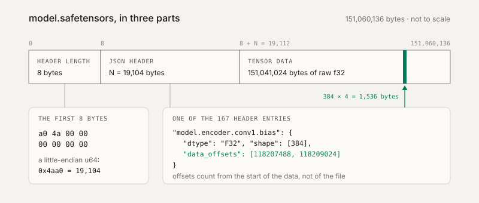

## Reading Someone Else's Weights

In the last chapter we wired our recognizer to a microphone. We can say "seven three stop" at a laptop and watch it spell the words out, with a model we trained ourselves, on features we compute ourselves, decoded by a beam search we wrote ourselves. I still find that a little hard to believe.

We also ended that chapter with the list of what the model cannot do, and with the reason: data and compute, not ideas. Here is the size of that gap. Our model learned from Google Speech Commands, about 105,000 one-second clips, which is roughly 30 hours of people saying single words, and we trained it on a laptop CPU. OpenAI's Whisper was trained on, in the words of [its paper](https://arxiv.org/abs/2212.04356),

> 680,000 hours of multilingual and multitask supervision

That is 77 years of audio, about twenty thousand times what we had. No amount of cleverness in forty lines of Rust closes that gap.

But here is the thing. This book made a promise at the start: no pretrained model until we have built a tiny working recognizer of our own. We have kept it, and the next two chapters are the reward. A trained model is a file full of numbers, and the program that turns those numbers into a transcript is made of parts we now know how to write: a spectrogram, matrix products, a convolution, a softmax and a loop. So we are going to download Whisper's weights and run them with code we write ourselves. `[dependencies]` stays empty.

It takes two chapters. This one is about everything that happens before the first matrix product: getting the files, parsing them, finding out what is inside, and computing the input the model expects. By the end we will have every number the model needs in memory and its input ready. The next chapter does the arithmetic.

### What We Are Going To Run

Whisper comes in several sizes. We will use the smallest, `tiny.en`, the English-only version: 37.8 million parameters in a 151 MB file. (Our own recognizer would fit in the rounding error.) OpenAI released the code and the weights under the MIT license, and the [model card](https://github.com/openai/whisper/blob/main/model-card.md) describes what it was trained for and where it struggles. Keep the second part in mind; we will meet some of it in person in the next chapter.

The code lives in `code/src/whisper/` and it is the largest module in the book, just under 3,000 lines with its tests. I can't show every line, so here is the deal. The parts that teach something new are shown in full. The rest (configuration structs, error plumbing, loading each layer by name) is summarized, and you should have these files open alongside:

| File | What it does | Where |
|---|---|---|
| `json.rs` | a recursive-descent JSON parser | this chapter, core shown |
| `safetensors.rs` | reads the weights: a JSON header and raw `f32`s | this chapter, shown |
| `config.rs` | model sizes and decoding rules from two JSON files | this chapter, summarized |
| `tokenizer.rs` | token ids back to text | this chapter, decoding shown |
| `audio.rs` | any WAV file to 16 kHz mono samples | this chapter, one paragraph |
| `mel.rs` | Whisper's exact log-mel spectrogram | this chapter, shown |
| `parallel.rs` | one helper for using all CPU cores | this chapter, shown |
| `layers.rs` | linear, convolution, GELU, layer norm, attention | chapter 13 |
| `encoder.rs` | spectrogram to audio features | chapter 13 |
| `decoder.rs` | audio features and tokens so far to next-token scores | chapter 13 |
| `transcribe.rs` | the decoding loop that ties it together | chapter 13 |

One more thing before we start. Everything in these two chapters is a *forward pass*. In chapters 6 to 9 every layer came with a `backward` function, and the backward half was always the harder half. Here there is none, because backprop exists to find the weights and somebody else has already found them. Running a model is the easy half of machine learning. That is exactly why we can fit a state-of-the-art one into two chapters.

### Getting The Weights

The weights are published on Hugging Face in the repository [`openai/whisper-tiny.en`](https://huggingface.co/openai/whisper-tiny.en). We need five files from it:

| File | Size | What is in it |
|---|---|---|
| `model.safetensors` | 151 MB | the weights |
| `vocab.json` | 798 KB | the text of each of the 50,257 ordinary tokens |
| `added_tokens.json` | 35 KB | the names of the 1,607 control tokens |
| `config.json` | 2 KB | the architecture's sizes |
| `generation_config.json` | 2 KB | the decoding rules |

From the `code/` directory:

```
mkdir -p ../data/whisper-tiny.en
cd ../data/whisper-tiny.en
for f in model.safetensors vocab.json added_tokens.json config.json generation_config.json; do
  curl -L -O https://huggingface.co/openai/whisper-tiny.en/resolve/main/$f
done
cd ../../code
```

Our programs look for the model in `../data/whisper-tiny.en`. If you keep your datasets somewhere else, set `SPEECH_DATA` to the directory that contains `whisper-tiny.en/`, the same variable the earlier chapters used.

Four of the five files are JSON, and so, it turns out, is the first part of the fifth. We have no JSON parser. You know what that means in this book.

### A JSON Parser In An Afternoon

JSON has six kinds of value, and a Rust enum says so better than a paragraph can:

```rust
// src/whisper/json.rs

/// Any JSON value.
#[derive(Clone, Debug, PartialEq)]
pub enum Json {
    Null,
    Bool(bool),
    /// Every JSON number, integer or not, is kept as an `f64`. That is exact
    /// for integers up to 2^53, far more than any offset or token id we meet.
    Number(f64),
    /// A string, with all escapes already resolved.
    String(String),
    Array(Vec<Json>),
    /// `{"key": value, ...}` as a list of pairs **in file order**. A list
    /// rather than a hash map because order is occasionally interesting (the
    /// tensor listing prints in file order) and lookups in small objects are
    /// just as quick by scanning.
    Object(Vec<(String, Json)>),
}
```

The type is recursive: arrays and objects contain more `Json`. The parser mirrors that with a technique called *recursive descent*: one function per kind of value, each of which looks at the next character, decides what it is looking at, and calls the others for whatever is nested inside. The parser's entire state is the input and a cursor.

```rust
// src/whisper/json.rs

struct Parser<'a> {
    bytes: &'a [u8],
    pos: usize,
}

impl Parser<'_> {
    /// Parse whatever value starts here. The first character decides which.
    fn value(&mut self, depth: usize) -> io::Result<Json> {
        if depth > MAX_DEPTH {
            return Err(self.error("nesting too deep"));
        }
        self.skip_whitespace();
        match self.peek() {
            Some(b'{') => self.object(depth),
            Some(b'[') => self.array(depth),
            Some(b'"') => Ok(Json::String(self.string()?)),
            Some(b't') => self.literal("true", Json::Bool(true)),
            Some(b'f') => self.literal("false", Json::Bool(false)),
            Some(b'n') => self.literal("null", Json::Null),
            Some(b'-' | b'0'..=b'9') => self.number(),
            Some(_) => Err(self.error("unexpected character")),
            None => Err(self.error("unexpected end of input")),
        }
    }
    // ... peek, next, skip_whitespace, expect, error, literal, number: a few lines each
}
```

JSON was designed so that this works: the first character of a value tells you its kind, so the parser never has to guess and back up. `MAX_DEPTH` is 128. Each level of nesting is a level of Rust recursion, and without the limit a hostile file made of a million `[` would overflow our stack. `number` gathers every character that can appear in a number and hands the slice to `str::parse::<f64>`, which is the one place we lean on the standard library.

An array is values separated by commas. Note the call back into `value`: that is the recursion.

```rust
// src/whisper/json.rs

    /// `[ value, value, ... ]`
    fn array(&mut self, depth: usize) -> io::Result<Json> {
        self.expect(b'[')?;
        let mut items = Vec::new();
        self.skip_whitespace();
        if self.peek() == Some(b']') {
            self.pos += 1;
            return Ok(Json::Array(items));
        }
        loop {
            items.push(self.value(depth + 1)?);
            self.skip_whitespace();
            match self.next() {
                Some(b',') => continue,
                Some(b']') => return Ok(Json::Array(items)),
                _ => return Err(self.error("expected ',' or ']' in array")),
            }
        }
    }
```

`object` is the same loop with a string key and a `:` in front of each value. That leaves strings, which hide the only subtle part of JSON.

```rust
// src/whisper/json.rs

    /// A string: everything up to the closing quote, with backslash escapes
    /// replaced by the characters they stand for.
    fn string(&mut self) -> io::Result<String> {
        self.expect(b'"')?;
        let mut out: Vec<u8> = Vec::new();
        loop {
            match self.next() {
                None => return Err(self.error("unterminated string")),
                Some(b'"') => break,
                Some(b'\\') => {
                    let ch = self.escape()?;
                    let mut utf8 = [0u8; 4];
                    out.extend_from_slice(ch.encode_utf8(&mut utf8).as_bytes());
                }
                Some(0..=0x1f) => return Err(self.error("raw control character in string")),
                Some(byte) => out.push(byte),
            }
        }
        String::from_utf8(out).map_err(|_| self.error("string is not valid UTF-8"))
    }
```

We walk over bytes, not `char`s, and copy them through untouched. That is safe because the input is a `&str`, so it is already valid UTF-8, and no byte of a multi-byte UTF-8 character can ever be `"` or `\`. `escape` handles `\n`, `\"` and friends, and `\uXXXX`. The last one has a trap: the escape is only 16 bits wide, so a character beyond U+FFFF is written as two escapes, a *surrogate pair*, and `unicode_escape` in the repository stitches the two halves back together. It is twenty lines and it has its own test (with an emoji).

How do we know it works? The tests feed it documents and compare what comes out, and, just as important, feed it garbage and check that it complains:

```rust
// src/whisper/json.rs (tests)

    #[test]
    fn rejects_malformed_documents() {
        for bad in ["", "{", "[1,]", "{\"a\" 1}", "tru", "\"abc", "1 2", "{\"a\":1,}", "\"\\x\"", "-"] {
            assert!(Json::parse(bad).is_err(), "should reject {bad:?}");
        }
        let deep = "[".repeat(1000);
        assert!(Json::parse(&deep).is_err());
    }
```

The accessors (`get`, `as_usize`, `as_str`, `as_array`, `as_object`) are one `match` each and return an `Option`, so reading a field we expect reads as `json.get("shape").and_then(Json::as_array)`. About 300 lines without the tests, and we have a JSON parser. Not bad for a detour.

### Safetensors: A Header And A Pile Of Floats

A trained model is, physically, a few hundred named arrays of numbers. The safetensors format stores them about as plainly as it can be done:

```
bytes 0..8      N, the length of the header, as a little-endian u64
bytes 8..8+N    the header: one JSON object
bytes 8+N..     the data: every tensor's numbers, back to back
```



*The whole format. A length, a JSON table of contents, and the numbers.*

You can see all three parts with a hex dump of the first bytes of the file:

```
$ xxd -l 96 ../data/whisper-tiny.en/model.safetensors
00000000: a04a 0000 0000 0000 7b22 5f5f 6d65 7461  .J......{"__meta
00000010: 6461 7461 5f5f 223a 7b22 666f 726d 6174  data__":{"format
00000020: 223a 2270 7422 7d2c 226d 6f64 656c 2e64  ":"pt"},"model.d
00000030: 6563 6f64 6572 2e65 6d62 6564 5f70 6f73  ecoder.embed_pos
00000040: 6974 696f 6e73 2e77 6569 6768 7422 3a7b  itions.weight":{
00000050: 2264 7479 7065 223a 2246 3332 222c 2273  "dtype":"F32","s
```

The first eight bytes are `a0 4a 00 ...`, which read little-endian (as in chapter 1's WAV header) is `0x4aa0` = 19,104: the header is 19,104 bytes of JSON. Each entry in it maps a tensor's name to its element type, its shape, and the byte range its numbers occupy within the data section:

```
"model.encoder.conv1.bias": {"dtype":"F32", "shape":[384], "data_offsets":[118207488, 118209024]}
```

A *tensor* is the general word for an array with any number of axes: a vector has one, our `Mat` has two, a convolution's weights have three. Tensors are stored row-major (the last index moves fastest), which is exactly the layout of `Mat`. So loading a model is: read 8 bytes, parse some JSON, and reinterpret byte ranges as `f32`s.

**Aside** <br>
Why "safe"? The format PyTorch used for years is built on Python's `pickle`, which can execute arbitrary code while loading. Downloading a model meant running a stranger's program. A safetensors file contains no code, only a description and data, so the worst a malicious one can do is lie about its offsets. We check those.

We keep one `TensorInfo` record per header entry (`name`, `dtype`, `shape`, and the byte range as `start` and `end`). Reading the header alone lets us list what is in a file without loading 150 MB:

```rust
// src/whisper/safetensors.rs

/// A header larger than this is certainly not a real model file.
const MAX_HEADER_BYTES: u64 = 100 * 1024 * 1024;

pub fn read_header(path: &Path) -> io::Result<Vec<TensorInfo>> {
    let mut file = std::fs::File::open(path)?;
    let mut length_bytes = [0u8; 8];
    file.read_exact(&mut length_bytes)?;
    let length = u64::from_le_bytes(length_bytes);
    if length > MAX_HEADER_BYTES {
        return Err(bad(format!("header claims to be {length} bytes long")));
    }
    let mut header = vec![0u8; length as usize];
    file.read_exact(&mut header)?;
    parse_header_json(&header)
}

/// Turn the header's JSON into a list of `TensorInfo`, in file order.
fn parse_header_json(header: &[u8]) -> io::Result<Vec<TensorInfo>> {
    let text = std::str::from_utf8(header).map_err(|_| bad("header is not UTF-8".into()))?;
    let json = Json::parse(text)?;
    let entries = json.as_object().ok_or_else(|| bad("header is not a JSON object".into()))?;
    let mut infos = Vec::new();
    for (name, entry) in entries {
        if name == "__metadata__" {
            continue; // free-form notes about the file, not a tensor
        }
        infos.push(parse_entry(name, entry)?);
    }
    Ok(infos)
}
```

`parse_entry` pulls the three fields out of one entry with the accessors from the last section (`entry.get("dtype").and_then(Json::as_str)` and so on) and turns a missing or malformed one into an error that names the tensor. The length check is the same reflex as `MAX_DEPTH`: the first eight bytes of an untrusted file are about to become an allocation size, so we look at them first.

Loading the numbers is a loop over the entries. Each tensor's bytes are a slice of the data section, and turning four bytes into an `f32` is `f32::from_le_bytes`:

```rust
// src/whisper/safetensors.rs

/// Reinterpret a tensor's bytes as `f32`s. `None` for types we do not load.
fn decode_floats(dtype: &str, bytes: &[u8]) -> Option<Vec<f32>> {
    match dtype {
        "F32" => Some(bytes.as_chunks::<4>().0.iter().map(|b| f32::from_le_bytes(*b)).collect()),
        "F16" => Some(bytes.as_chunks::<2>().0.iter().map(|b| f16_to_f32(u16::from_le_bytes(*b))).collect()),
        _ => None,
    }
}

impl SafeTensors {
    pub fn from_bytes(file: &[u8]) -> io::Result<SafeTensors> {
        let (infos, data) = parse_header(file)?;
        let mut tensors = BTreeMap::new();
        for info in &infos {
            // Never trust offsets from a file: check them before slicing.
            if info.start > info.end || info.end > data.len() {
                return Err(bad(format!("tensor {}: byte range {}..{} is outside the file", info.name, info.start, info.end)));
            }
            let bytes = &data[info.start..info.end];
            if let Some(size) = bytes_per_element(&info.dtype) {
                if bytes.len() != info.element_count() * size {
                    return Err(bad(format!("tensor {}: shape {:?} does not match {} bytes", info.name, info.shape, bytes.len())));
                }
            }
            if let Some(values) = decode_floats(&info.dtype, bytes) {
                tensors.insert(info.name.clone(), Tensor { shape: info.shape.clone(), data: values });
            }
        }
        Ok(SafeTensors { infos, tensors })
    }
}
```

`parse_header` is `read_header` for a file already in memory: split off 8 bytes, then the header, and return the rest as `data`. `f16_to_f32` decodes half-precision floats (1 sign bit, 5 exponent, 10 fraction), which some checkpoints use to halve their size. `tiny.en` does not, but a loader that only handles the file in front of it breaks on the next one.

The rest of the `SafeTensors` API is `take(name)`, which *moves* a tensor out of the map, with `take_mat` and `take_vec` for the two-axis and one-axis cases. The model takes ownership of each tensor this way, so once loading is done the 150 MB exist in memory once. It also gives us a lovely test for free, as we will see in a moment.

The unit tests build small files in memory and read them back: a 2 × 3 tensor must come out with element (1, 0) equal to the fourth number (row-major), a tensor can only be taken once, and a truncated file, a shape that disagrees with the byte count, and a header length that points past the end must each be refused.

### Reading The Architecture Off The Names

Enough of the talk, let's open the file! `ch12_tensors` calls `read_header` and prints every entry:

```
$ cargo run --release --example ch12_tensors
../data/whisper-tiny.en/model.safetensors
name                                                       dtype shape               elements
model.decoder.embed_positions.weight                       F32   [448, 384]            172032
model.decoder.embed_tokens.weight                          F32   [51864, 384]        19915776
model.decoder.layer_norm.bias                              F32   [384]                    384
model.decoder.layer_norm.weight                            F32   [384]                    384
model.decoder.layers.0.encoder_attn.k_proj.weight          F32   [384, 384]            147456
model.decoder.layers.0.encoder_attn.out_proj.bias          F32   [384]                    384
model.decoder.layers.0.encoder_attn.out_proj.weight        F32   [384, 384]            147456
model.decoder.layers.0.encoder_attn.q_proj.bias            F32   [384]                    384
model.decoder.layers.0.encoder_attn.q_proj.weight          F32   [384, 384]            147456
model.decoder.layers.0.encoder_attn.v_proj.bias            F32   [384]                    384
model.decoder.layers.0.encoder_attn.v_proj.weight          F32   [384, 384]            147456
model.decoder.layers.0.encoder_attn_layer_norm.bias        F32   [384]                    384
model.decoder.layers.0.encoder_attn_layer_norm.weight      F32   [384]                    384
model.decoder.layers.0.fc1.bias                            F32   [1536]                  1536
model.decoder.layers.0.fc1.weight                          F32   [1536, 384]           589824
model.decoder.layers.0.fc2.bias                            F32   [384]                    384
model.decoder.layers.0.fc2.weight                          F32   [384, 1536]           589824
...
model.encoder.conv1.bias                                   F32   [384]                    384
model.encoder.conv1.weight                                 F32   [384, 80, 3]           92160
model.encoder.conv2.bias                                   F32   [384]                    384
model.encoder.conv2.weight                                 F32   [384, 384, 3]         442368
model.encoder.embed_positions.weight                       F32   [1500, 384]           576000
...

167 tensors, 37760256 parameters (37.8 million)
```

Read the names slowly, because they spell out the whole model. We have not met most of these parts yet; the next chapter builds each one. For now we only want the inventory.

There is an `encoder` and a `decoder`. The encoder starts with `conv1`, whose weight is `[384, 80, 3]`: 384 output channels, 80 input channels, kernel 3. That is chapter 7's convolution over time, and 80 is the number of mel bands it expects. The number 384 is everywhere: it is the width of every row that flows through the model. Then `embed_positions` with 1500 rows, then `layers.0` to `layers.3`, each with a `self_attn` made of four 384 × 384 projections named `q`, `k`, `v` and `out`, two layer norms, and two fully connected layers `fc1` and `fc2` that widen to 1536 and narrow back.

The decoder has the same four layers with one extra part each, `encoder_attn`: the place where the decoder looks at the encoder. It has `embed_tokens` with 51,864 rows, one per token the model can write, and 448 positions, so a transcript of one window can be at most 448 tokens long.

Two details are easy to miss. First, `k_proj` has a weight and no bias, while `q_proj` and `v_proj` have both. Hold that thought until the next chapter. Second, there is no output layer. The model must produce a score for each of 51,864 tokens, yet nothing in the listing has 51,864 outputs, apart from `embed_tokens` itself. That one matrix is used twice, once to turn tokens into rows on the way in and once to turn rows into token scores on the way out. It holds 19.9 of the 37.8 million parameters: more than half of this speech recognizer is a table of word pieces.

The sizes also live in `config.json`, and `config.rs` reads them into a `ModelConfig` (`d_model` 384, 4 layers and 6 heads on each side, 80 mel bands, 51,864 tokens, 1500 audio positions, 448 text positions) rather than hardcoding them, so the same code describes the larger Whisper models too. It reads `generation_config.json` the same way into a `GenerationConfig`, the rules for decoding: which tokens start a transcript, which one ends it, which are forbidden. The next chapter's loop uses them.

And here is the test that `take` gives us for free:

```rust
// tests/whisper_transcribe.rs

#[test]
fn every_tensor_in_the_checkpoint_is_used() {
    // ... skip if the weights are not downloaded; read config and weights
    assert_eq!(weights.infos.len(), 167);
    assert_eq!(weights.infos.iter().map(|i| i.element_count()).sum::<usize>(), 37_760_256);
    speech::whisper::encoder::Encoder::load(&mut weights, &config).unwrap();
    speech::whisper::decoder::Decoder::load(&mut weights, &config).unwrap();
    // If the model loaded but left tensors behind, we forgot a layer.
    let leftover: Vec<&str> = weights.names().collect();
    assert!(leftover.is_empty(), "unused tensors: {leftover:?}");
}
```

Every loader takes the tensors it needs by name. If we ask for one that is not there, loading fails. If one is left over, we forgot to implement something. Between them, those two checks pin our code to the file.

### Tokens

So the model can write 51,864 different tokens. What is a token?

Our own recognizer has an output alphabet of 28 symbols: the letters, a space and the CTC blank. Letters are a fine unit when your vocabulary is 35 words. For all of English they are a poor one: the model must spell every word correctly one letter at a time, and a single transcript becomes hundreds of steps. Whole words are the opposite extreme: one step per word, but there is no end to words, and a name the model has never seen cannot be written at all. Whisper uses the standard compromise, *byte-pair encoding* (BPE), with the same vocabulary as the GPT-2 language model. Start with the 256 possible bytes as your tokens. Find the pair of tokens that occurs most often next to each other in a large pile of text, and make that pair a new token. Repeat about 50,000 times. Common words end up as single tokens, rarer ones as a few pieces, and anything at all can still be spelled out byte by byte as a last resort.

The model's answer will therefore be a list of integers. For "the quick brown fox jumps over the lazy dog." it will turn out to be `[262, 2068, 7586, 21831, 18045, 625, 262, 16931, 3290, 13]`, and `vocab.json` is where we find out what they mean:

```
$ grep -o '"Ġthe": [0-9]*' ../data/whisper-tiny.en/vocab.json
"Ġthe": 262
```

Splitting text *into* tokens takes some machinery (you have to replay those merges). We only need the other direction, which is a table lookup: every token stands for a fixed string of bytes, so we look up each id, glue the bytes together, and read the result as UTF-8. But what is that `Ġ`? A token is a string of arbitrary bytes, possibly half of a multi-byte character, but `vocab.json` is a text file and cannot hold arbitrary bytes. GPT-2's authors gave each of the 256 byte values a printable stand-in character, and `byte_to_char_table` rebuilds their table. Printable bytes stand for themselves. The 68 others are handed, in order, the characters U+0100, U+0101 and so on. The space is byte 32, the 33rd unprintable byte, so it becomes U+0120, which is `Ġ`. So `"Ġthe": 262` means " the", with the space in front. Words carry their own leading space, so gluing tokens together needs no rule about where spaces go.

`Tokenizer::from_json` inverts that table, converts every entry of `vocab.json` to bytes, and stores them in a `Vec` indexed by id. The control tokens from `added_tokens.json`, such as `<|endoftext|>` (id 50256), are stored too, for printing. Decoding is then:

```rust
// src/whisper/tokenizer.rs

    /// The text a sequence of token ids stands for, control tokens skipped.
    ///
    /// The bytes of all tokens are concatenated *before* decoding as UTF-8,
    /// because a character such as `é` (two bytes) may be split across two
    /// tokens, and neither half is valid on its own.
    pub fn decode(&self, ids: &[usize]) -> String {
        let mut bytes = Vec::new();
        for &id in ids {
            if !self.is_special(id) {
                bytes.extend_from_slice(self.piece(id));
            }
        }
        String::from_utf8_lossy(&bytes).into_owned()
    }
```

`is_special` is `id >= 50256`: all the control tokens sit above the ordinary ones. The doc comment's case has a test with a seven-token toy vocabulary, in which "é" is split into its two bytes (the file shows them as `Ã` and `©`):

```rust
// src/whisper/tokenizer.rs (tests)

    #[test]
    fn joins_bytes_across_tokens_before_decoding_utf8() {
        let tokenizer = toy();
        assert_eq!(tokenizer.piece(3), [0xC3]);
        assert_eq!(tokenizer.decode(&[5, 3, 4]), " café");
        // Half a character on its own is not text.
        assert_eq!(tokenizer.piece_text(3), "\u{FFFD}");
    }
```

### The Front End, Again, With Someone Else's Constants

We can read the weights and we can read the answer. What is left is the question: the model's input is a log-mel spectrogram, and we built one of those in chapters 2 to 4. Can we feed it ours? No, and the reason is the most practical lesson of this chapter: **a pretrained model is married to the exact front end it was trained with.** The network has only ever seen pictures produced by one recipe. A spectrogram that is "better" by any measure, but different, is a worse input. So we follow OpenAI's recipe to the letter. Side by side:

| | Our front end (chapter 4) | Whisper's |
|---|---|---|
| Sample rate | 16 kHz | 16 kHz |
| Frame and hop | 400 and 160 samples (25 ms, 10 ms) | the same |
| Window | periodic Hann | the same |
| Pre-emphasis | 0.97 | none |
| Framing | frames start at sample 0 | signal mirrored by 200 samples at each end, so frame `t` is centered on sample `160 t` |
| Transform length | 512 (frame padded with zeros) | 400 exactly |
| Frequency bins | 257 | 201 |
| Mel formula | HTK: `2595 log10(1 + f/700)` | Slaney: linear below 1 kHz, logarithmic above |
| Mel bands | 40, from 20 Hz | 80, from 0 Hz |
| Triangles | peak height 1 | area 1 (height `2 / width in Hz`) |
| Logarithm | natural, floor `1e-6` | base 10, floor `1e-10` |
| Afterwards | per-column mean and variance normalization | clamp to 8 below the maximum, then `(x + 4) / 4` |
| Length | whatever the clip is | always 30 s: 3000 frames |

Same ideas, a dozen different constants. The doc comment at the top of `mel.rs` writes the right-hand column as a recipe in six steps: (1) pad or cut to 30 s, (2) mirror the ends, frame and window, (3) power spectrum, (4) mel filterbank, (5) `log10`, (6) clamp and rescale. The comments in the code below refer to those numbers.

Step 1 starts with a file. `audio.rs` is a thin wrapper around two things we already own: chapter 1's `Wav::read` decodes the file and mixes it down to mono, and chapter 4's `resample` brings it to 16 kHz if it has another rate. Any WAV file works, including the 8 kHz digit clips of chapter 5, although resampling cannot give them back what was never recorded above 4 kHz.

The window is the one row of the table that says "the same", and it almost is. `mel.rs` has its own `periodic_hann`: the same curve as chapter 2's `hann`, but with the cosine worked out in `f64` and rounded once at the end, where chapter 2's stays in `f32` throughout. A test asserts that the two tables agree to within `5e-7`. That is close, but it is not bit for bit, so Whisper keeps its own.

Now the mel scale. Chapter 4 mentioned that there are two common curve fits for it; this is the other one.

```rust
// src/whisper/mel.rs

/// Hertz to mels on the Slaney scale: linear below 1 kHz (200/3 Hz per mel),
/// logarithmic above (each 27 mels multiply the frequency by 6.4).
pub fn hz_to_mel(hz: f64) -> f64 {
    const LINEAR_HZ_PER_MEL: f64 = 200.0 / 3.0;
    const BREAK_HZ: f64 = 1000.0;
    if hz < BREAK_HZ {
        hz / LINEAR_HZ_PER_MEL
    } else {
        BREAK_HZ / LINEAR_HZ_PER_MEL + (hz / BREAK_HZ).ln() / (6.4f64.ln() / 27.0)
    }
}
```

`mel_to_hz` is its inverse. The filterbank is built like chapter 4's, with `n_mels + 2` points evenly spaced in mels and a triangle between each three neighbors, plus one new line at the end:

```rust
// src/whisper/mel.rs

pub fn mel_filterbank(n_mels: usize, n_fft: usize, sample_rate: u32) -> Mat {
    let sample_rate = sample_rate as f64;
    let top_mel = hz_to_mel(sample_rate / 2.0);
    let edges_hz: Vec<f64> = (0..n_mels + 2).map(|i| mel_to_hz(top_mel * i as f64 / (n_mels + 1) as f64)).collect();
    Mat::from_fn(n_mels, n_fft / 2 + 1, |band, bin| {
        let hz = bin as f64 * sample_rate / n_fft as f64;
        let (low, peak, high) = (edges_hz[band], edges_hz[band + 1], edges_hz[band + 2]);
        let rising = (hz - low) / (peak - low);
        let falling = (high - hz) / (high - peak);
        let triangle = rising.min(falling).max(0.0);
        (triangle * 2.0 / (high - low)) as f32
    })
}
```

The factor `2.0 / (high - low)` is *area normalization*: a triangle of height `2 / width` has area 1, so the wide bands at the top do not collect more energy than the narrow ones at the bottom just for being wide. The reference implementation does not compute this matrix; it loads one that the Python library `librosa` produced. We are reimplementing a library call, and the way to trust the result is a test with numbers worked out on paper: `filterbank_matches_values_derived_by_hand` does that for the first two triangles, where the scale is linear and the arithmetic is easy.

Now the transform. If you have been paying attention, you'll notice a problem in the table: the transform length is 400, and the FFT we wrote in chapter 3 only handles powers of two. Padding to 512 as we did before would give 257 bins at different frequencies, which is a different picture. The proper answers are a mixed-radix FFT or Bluestein's algorithm. We are going to do something much simpler: go back to chapter 3's "slow" DFT, the one that correlates the frame against every sinusoid directly, and let it earn its keep.

Recall the definition: bin `k` of the DFT of a frame `x` of length `N` is

```
X[k] = sum over n of  x[n] * (cos(2 pi k n / N) - i sin(2 pi k n / N))
```

The real part is the frame's dot product with a cosine, the imaginary part (up to sign) its dot product with a sine. The cosines and sines do not depend on the audio, so we tabulate them once. `MelFrontEnd::new` fills `cos_table[(k, n)]` with `cos(2 pi k n / 400)` and `sin_table` likewise, 201 rows of 400 each. Then:

```rust
// src/whisper/mel.rs

    /// The power spectrum `|X[k]|^2` of one windowed frame, for bins `0..N_BINS`.
    pub fn power_spectrum(&self, frame: &[f32]) -> Vec<f32> {
        assert_eq!(frame.len(), N_FFT, "a frame is {N_FFT} samples");
        (0..N_BINS)
            .map(|k| {
                let real = dot(frame, self.cos_table.row(k));
                let imaginary = dot(frame, self.sin_table.row(k));
                real * real + imaginary * imaginary
            })
            .collect()
    }
```

The sum in the formula is the `dot`. One frame costs 201 bins × 2 dot products × 400 samples, and 3000 frames make about half a billion multiply-adds. That sounds like a lot until you measure it: on my machine the whole spectrogram takes 14 ms. Clarity wins.

The rest is the recipe, line by line:

```rust
// src/whisper/mel.rs

    /// The model's input for one 30 s window: `CHUNK_FRAMES x n_mels`, one
    /// row per 10 ms frame. `samples` is padded with silence or cut to 30 s.
    pub fn log_mel(&self, samples: &[f32]) -> Mat {
        let audio = pad_or_trim(samples, CHUNK_SAMPLES);
        let padded = reflect_pad(&audio, N_FFT / 2);

        // Steps 2-5: each frame's log-mel energies. Frames are independent,
        // so they are computed in parallel. The reference computes one frame
        // more (centered on the last sample) and throws it away; we simply
        // never compute it.
        let mut mel = Mat::zeros(CHUNK_FRAMES, self.n_mels);
        for_each_row_par(&mut mel.data, self.n_mels, |t, mel_row| {
            let start = t * HOP;
            let frame: Vec<f32> = padded[start..start + N_FFT].iter().zip(&self.window).map(|(s, w)| s * w).collect();
            let power = self.power_spectrum(&frame);
            for (band, out) in mel_row.iter_mut().enumerate() {
                *out = dot(self.filters.row(band), &power).max(1e-10).log10();
            }
        });

        // Step 6: limit the dynamic range relative to the loudest cell, then
        // rescale so typical values land roughly in [-1, 1].
        let loudest = mel.data.iter().copied().fold(f32::NEG_INFINITY, f32::max);
        for value in mel.data.iter_mut() {
            *value = (value.max(loudest - 8.0) + 4.0) / 4.0;
        }
        mel
    }
}
```

`pad_or_trim` makes every input exactly 480,000 samples: a 2-second clip becomes 2 seconds of speech and 28 seconds of zeros. The model always looks at a 30-second window, never more and never less. `reflect_pad` mirrors 200 samples at each end (`c b | a b c d | c b`) so that frames are centered on multiples of 160. The last loop is the clamp: anything more than 8 `log10` units (80 dB) below the loudest cell is raised to that floor.

A test pins the edge case: for pure silence the power is 0 everywhere, floored to `1e-10`, `log10` gives −10, and `(−10 + 4) / 4` is −1.5 in every one of the 240,000 cells. Remember that perfectly flat picture. In the next chapter we will ask the model what it hears in it.

### One Helper For All The Cores

`log_mel` called `for_each_row_par`, and so will nearly every heavy loop in the next chapter, because they all have the same shape: fill in row `t` of an output matrix, and no row depends on any other. Here one row is one frame. Rows that do not depend on each other can be computed on different cores, and the standard library has what we need:

```rust
// src/whisper/parallel.rs

/// Below this many rows we do not bother starting threads: starting one costs
/// tens of microseconds, which is more than a few small rows are worth.
const MIN_ROWS_PER_THREAD: usize = 2;

pub fn for_each_row_par(data: &mut [f32], cols: usize, fill: impl Fn(usize, &mut [f32]) + Sync) {
    assert!(cols > 0 && data.len().is_multiple_of(cols), "buffer of {} is not rows of {cols}", data.len());
    let rows = data.len() / cols;
    let threads = std::thread::available_parallelism().map_or(1, |n| n.get());
    if threads == 1 || rows < MIN_ROWS_PER_THREAD * threads {
        for (index, row) in data.chunks_exact_mut(cols).enumerate() {
            fill(index, row);
        }
        return;
    }
    let rows_per_thread = rows.div_ceil(threads);
    let fill = &fill;
    std::thread::scope(|scope| {
        for (chunk_index, chunk) in data.chunks_mut(rows_per_thread * cols).enumerate() {
            scope.spawn(move || {
                let first_row = chunk_index * rows_per_thread;
                for (offset, row) in chunk.chunks_exact_mut(cols).enumerate() {
                    fill(first_row + offset, row);
                }
            });
        }
    });
}
```

`chunks_mut` cuts the output buffer into disjoint `&mut` slices, one per thread, so the borrow checker can see that no two threads write to the same place. `thread::scope` guarantees the threads are finished before the function returns, which is what lets them borrow `fill` and everything it captures. No `unsafe`, no locks, no crate.

### Run It

Nothing in this chapter multiplies a weight by anything, so there is no transcript yet. What we can run is the proof that the groundwork holds. First the tests of the files we covered:

```
$ cargo test --release whisper::json
...
test result: ok. 7 passed; 0 failed; 0 ignored; 0 measured; 296 filtered out; finished in 0.00s
```

Do the same with `whisper::safetensors` (4 tests), `whisper::config` (3), `whisper::tokenizer` (4), `whisper::audio` (4), `whisper::mel` (7) and `whisper::parallel` (1). Then the front end on real audio. The next chapter's example program prints statistics of every stage with `--verbose`, and its first lines are already ours to read. Here it is on one of the 8 kHz digit clips from `samples/`:

```
$ cargo run --release --example ch12_whisper -- --verbose ../samples/seven_jackson.wav
loaded ../data/whisper-tiny.en in 0.057 s
  encoder: 4 layers, decoder: 4 layers, width 384, 6 heads, 80 mel bands, 51864 tokens
  prompt: 50257 "<|startoftranscript|>", 50362 "<|notimestamps|>"

../samples/seven_jackson.wav: 0.43 s of audio (resampled from 8000 Hz to 16000 Hz)
  log-mel spectrogram           3000 x 80   mean  -0.8091  std  0.1135  min  -0.8205  max   1.1795
...
```

Every line of that is something we built today. The 151 MB loaded in 57 ms (on my machine, with the file already in the operating system's cache). The sizes and the prompt came out of the two config files through our JSON parser, and the control tokens' names out of `added_tokens.json`. The clip was resampled, padded from 0.43 seconds to 30, and turned into the 3000 × 80 picture the model expects. And look at the last two numbers: the maximum minus the minimum is 1.1795 + 0.8205 = 2.0000 exactly. That is step 6 at work. The clamp limits the range to 8 in `log10` units, and the division by 4 makes that 2.

The program does not stop there, of course. It goes on to push that picture through 37.8 million weights and print what it heard. Try not to look until the next chapter.

### Try It Yourself

1. **Lie to the loader.** Make a file whose first eight bytes claim an absurd header length, `printf '\xff\xff\xff\xff\xff\xff\xff\xff{}' > liar.safetensors`, and run `ch12_tensors -- liar.safetensors`. You should get a polite `header claims to be 18446744073709551615 bytes long` and no attempt to allocate that much. Then cut a real file short with `head -c 1000 ../data/whisper-tiny.en/model.safetensors > short.safetensors` and see which error that gives.
2. **Read another model.** `ch12_tensors` takes a path, and any safetensors file will do. Download `model.safetensors` from `openai/whisper-base.en` and read its width, its number of layers and its number of mel bands off the names and shapes, then check your answers against its `config.json`.
3. **Write JSON back out.** Add a `to_string` method to `Json` that writes a value as JSON text, escaping strings properly, and a test that `Json::parse(&value.to_string())` returns the value it started from. Run it on `config.json`.
4. **Decode by hand.** Write a ten-line example that loads the `Tokenizer` with `Tokenizer::load(&model_dir(), 50256)` and decodes `[262, 2068, 7586, 21831]`. You should see " the quick brown fox", leading space included. Then find the id of ` Rust` by searching `vocab.json` for `"ĠRust"`, and see what the first few hundred ids are.
5. **One window function or two?** In `MelFrontEnd::new`, replace `periodic_hann(N_FFT)` with chapter 2's `crate::dsp::window::hann(N_FFT)` and run the command above again. The two windows differ by less than `5e-7`; do any of the printed statistics move?

### Loose Ends

- **A reader, not a library.** Our JSON parser keeps every number as an `f64`, so an integer above 2^53 would lose digits, and it cannot write JSON at all.
- **The weights are copied while loading.** `SafeTensors::read` reads the whole file into memory and then decodes it into `Vec<f32>`s, so for a moment both copies exist. Real loaders map the file into memory and use the bytes where they lie. Only `F32` and `F16` tensors are loaded; other types are listed and skipped.
- **The slow Fourier transform.** We used the direct DFT because 400 is not a power of two. It costs 14 ms here; a mixed-radix FFT or Bluestein's algorithm is the right tool and we built neither.
- **The filterbank is checked against arithmetic, not against the reference file.** Two triangles are verified by hand and the rest by their properties. We did not compare all 80 × 201 weights with the matrix OpenAI ships.
- **We only decode tokens.** Learning the byte-pair merges and splitting text into tokens are not in `tokenizer.rs`. The next chapter says what that costs us.

What's next on our agenda? Let's take stock. We have a JSON parser, a safetensors reader that refuses files that lie, a model's worth of named tensors in memory with a test that none of them goes unused, a tokenizer that turns ids back into text, and a front end that produces exactly the picture Whisper was trained on, on all cores. What we do not have is a single layer: 167 tensors are loaded and nothing uses them. In the next chapter we write the arithmetic. There is one new idea in it, attention, and the rest is assembled from matrix products and softmaxes we already own. At the end of it, the file we opened today transcribes English.

### References

- Radford, Kim, Xu, Brockman, McLeavey, Sutskever, [Robust Speech Recognition via Large-Scale Weak Supervision](https://arxiv.org/abs/2212.04356) (2022): the Whisper paper.
- [Whisper model card](https://github.com/openai/whisper/blob/main/model-card.md) and the [reference implementation](https://github.com/openai/whisper) (MIT license). Its `whisper/audio.py` is the front end we reproduced.
- The weights we used: [openai/whisper-tiny.en on Hugging Face](https://huggingface.co/openai/whisper-tiny.en).
- [The safetensors format](https://github.com/huggingface/safetensors), whose README describes the layout we parsed.
- Sennrich, Haddow, Birch, [Neural Machine Translation of Rare Words with Subword Units](https://arxiv.org/abs/1508.07909) (2015): byte-pair encoding for text. The byte-to-character table comes from [GPT-2's `encoder.py`](https://github.com/openai/gpt-2/blob/master/src/encoder.py).
- [RFC 8259](https://www.rfc-editor.org/rfc/rfc8259): JSON, all of it, in sixteen pages.
- [Chapter 4](04-hearing-like-a-human.md), for the HTK mel scale and the resampler this front end is compared with and built on.
- This chapter's code: [`whisper/json.rs`](../code/src/whisper/json.rs), [`safetensors.rs`](../code/src/whisper/safetensors.rs), [`config.rs`](../code/src/whisper/config.rs), [`tokenizer.rs`](../code/src/whisper/tokenizer.rs), [`audio.rs`](../code/src/whisper/audio.rs), [`mel.rs`](../code/src/whisper/mel.rs), [`parallel.rs`](../code/src/whisper/parallel.rs); the example [`ch12_tensors.rs`](../code/examples/ch12_tensors.rs); the integration tests in [`tests/whisper_transcribe.rs`](../code/tests/whisper_transcribe.rs).

[← Previous: Listening Live](11-listening-live.md) · [Contents](../README.md) · [Next: A Transformer That Listens →](13-a-transformer-that-listens.md)
