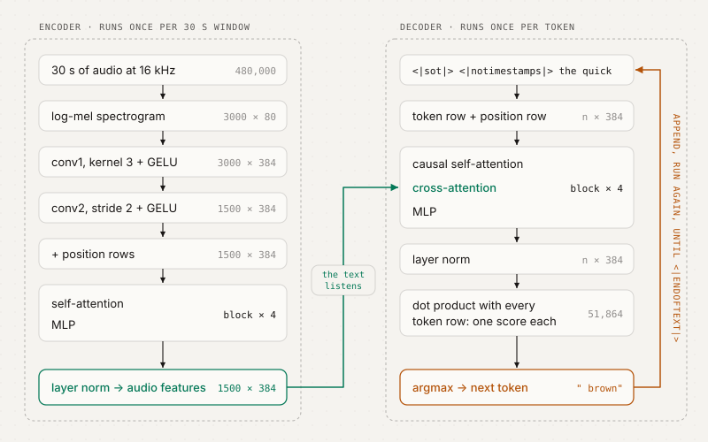
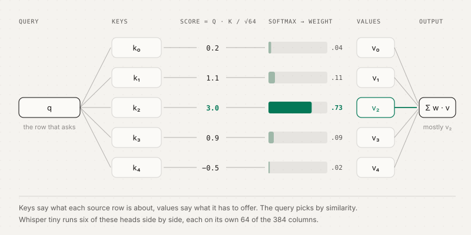

## Reading Someone Else's Weights: Whisper

In the last chapter we wired our recognizer to a microphone. We can say "seven three stop" at a laptop and watch it spell the words out, with a model we trained ourselves, on features we compute ourselves, decoded by a beam search we wrote ourselves. I still find that a little hard to believe.

It is also time to be honest about what that model is. It knows 35 words. It writes lowercase letters and spaces and nothing else. Say "the quick brown fox" to it and the best it can do is answer with words from its list. That is not because we are missing an idea. We have features, layers that understand time, a loss that needs no alignment and a decoder. What we are missing is data and compute: our model learned from Google Speech Commands, about 105,000 one-second clips, which is roughly 30 hours of people saying single words, and we trained it on a laptop CPU. OpenAI's Whisper was trained on, in the words of [its paper](https://arxiv.org/abs/2212.04356),

> 680,000 hours of multilingual and multitask supervision

That is 77 years of audio, about twenty thousand times what we had. No amount of cleverness in forty lines of Rust closes that gap.

But here is the thing. The cover of this book made a promise: no pretrained model until we have built a tiny working recognizer of our own. We have kept it, and this chapter is the reward. A trained model is a file full of numbers, and the program that turns those numbers into a transcript is made of parts we now know how to write: a spectrogram, matrix products, a convolution, a softmax and a loop. So today we are going to download Whisper's weights and run them with code we write ourselves. `[dependencies]` stays empty.

### What We Are Going To Run

Whisper comes in several sizes. We will use the smallest, `tiny.en`, the English-only version: 37.8 million parameters in a 151 MB file. (Our own recognizer would fit in the rounding error.) OpenAI released the code and the weights under the MIT license, and the [model card](https://github.com/openai/whisper/blob/main/model-card.md) describes what it was trained for and where it struggles. Keep the second part in mind; we will meet some of it in person.

The code for this chapter lives in `code/src/whisper/` and it is the largest module in the book, just under 3,000 lines with its tests. I can't show every line, so here is the deal. The parts that teach something new are shown in full: reading the weights file, the differences in the spectrogram, attention, the transformer block, the decoding loop with and without its cache, and turning tokens into text. The rest (configuration structs, error plumbing, loading each layer by name) is summarized, and you should have these files open alongside:

| File | What it does | In this chapter |
|---|---|---|
| `json.rs` | a recursive-descent JSON parser | core shown |
| `safetensors.rs` | reads the weights: a JSON header and raw `f32`s | shown |
| `config.rs` | model sizes and decoding rules from two JSON files | summarized |
| `audio.rs` | reads a WAV file and resamples it to 16 kHz | one sentence |
| `mel.rs` | Whisper's exact log-mel spectrogram | shown |
| `layers.rs` | linear, convolution, GELU, layer norm, attention | attention shown, rest summarized |
| `encoder.rs` | spectrogram to audio features | shown |
| `decoder.rs` | audio features and tokens so far to next-token scores | shown |
| `tokenizer.rs` | token ids back to text | decoding shown |
| `transcribe.rs` | the decoding loop that ties it together | loop shown |
| `parallel.rs` | one helper for using all CPU cores | core shown |

One more thing before we start. Everything in this chapter is a *forward pass*. In chapters 6 to 9 every layer came with a `backward` function, and the backward half was always the harder half. Here there is none, because backprop exists to find the weights and somebody else has already found them. Running a model is the easy half of machine learning. That is exactly why we can fit a state-of-the-art one into a single chapter.

### Getting The Weights

The weights are published on Hugging Face in the repository [`openai/whisper-tiny.en`](https://huggingface.co/openai/whisper-tiny.en). We need five files from it:

| File | Size | What is in it |
|---|---|---|
| `model.safetensors` | 151 MB | the weights |
| `vocab.json` | 798 KB | the text of each of the 50,257 ordinary tokens |
| `added_tokens.json` | 35 KB | the names of the 1,607 control tokens |
| `config.json` | 2 KB | the architecture's sizes |
| `generation_config.json` | 2 KB | the decoding rules |

From the `code/` directory:

```
mkdir -p ../data/whisper-tiny.en
cd ../data/whisper-tiny.en
for f in model.safetensors vocab.json added_tokens.json config.json generation_config.json; do
  curl -L -O https://huggingface.co/openai/whisper-tiny.en/resolve/main/$f
done
cd ../../code
```

Our programs look for the model in `../data/whisper-tiny.en`. If you keep your datasets somewhere else, set `SPEECH_DATA` to the directory that contains `whisper-tiny.en/`, the same variable the earlier chapters used.

Three of the five files are JSON, and so, it turns out, is the first part of the fourth. We have no JSON parser. You know what that means in this book.

### A JSON Parser In An Afternoon

JSON has six kinds of value, and a Rust enum says so better than a paragraph can:

```rust
// src/whisper/json.rs

/// Any JSON value.
#[derive(Clone, Debug, PartialEq)]
pub enum Json {
    Null,
    Bool(bool),
    /// Every JSON number, integer or not, is kept as an `f64`. That is exact
    /// for integers up to 2^53, far more than any offset or token id we meet.
    Number(f64),
    /// A string, with all escapes already resolved.
    String(String),
    Array(Vec<Json>),
    /// `{"key": value, ...}` as a list of pairs **in file order**. A list
    /// rather than a hash map because order is occasionally interesting (the
    /// tensor listing prints in file order) and lookups in small objects are
    /// just as quick by scanning.
    Object(Vec<(String, Json)>),
}
```

The type is recursive: arrays and objects contain more `Json`. The parser mirrors that with a technique called *recursive descent*: one function per kind of value, each of which looks at the next character, decides what it is looking at, and calls the others for whatever is nested inside. The parser's entire state is the input and a cursor.

```rust
// src/whisper/json.rs

struct Parser<'a> {
    bytes: &'a [u8],
    pos: usize,
}

impl Parser<'_> {
    /// Parse whatever value starts here. The first character decides which.
    fn value(&mut self, depth: usize) -> io::Result<Json> {
        if depth > MAX_DEPTH {
            return Err(self.error("nesting too deep"));
        }
        self.skip_whitespace();
        match self.peek() {
            Some(b'{') => self.object(depth),
            Some(b'[') => self.array(depth),
            Some(b'"') => Ok(Json::String(self.string()?)),
            Some(b't') => self.literal("true", Json::Bool(true)),
            Some(b'f') => self.literal("false", Json::Bool(false)),
            Some(b'n') => self.literal("null", Json::Null),
            Some(b'-' | b'0'..=b'9') => self.number(),
            Some(_) => Err(self.error("unexpected character")),
            None => Err(self.error("unexpected end of input")),
        }
    }
    // ... peek, next, skip_whitespace, expect, error, literal, number: a few lines each
}
```

JSON was designed so that this works: the first character of a value tells you its kind, so the parser never has to guess and back up. `MAX_DEPTH` is 128. Each level of nesting is a level of Rust recursion, and without the limit a hostile file made of a million `[` would overflow our stack. `number` gathers every character that can appear in a number and hands the slice to `str::parse::<f64>`, which is the one place we lean on the standard library.

An array is values separated by commas. Note the call back into `value`: that is the recursion.

```rust
// src/whisper/json.rs

    /// `[ value, value, ... ]`
    fn array(&mut self, depth: usize) -> io::Result<Json> {
        self.expect(b'[')?;
        let mut items = Vec::new();
        self.skip_whitespace();
        if self.peek() == Some(b']') {
            self.pos += 1;
            return Ok(Json::Array(items));
        }
        loop {
            items.push(self.value(depth + 1)?);
            self.skip_whitespace();
            match self.next() {
                Some(b',') => continue,
                Some(b']') => return Ok(Json::Array(items)),
                _ => return Err(self.error("expected ',' or ']' in array")),
            }
        }
    }
```

`object` is the same loop with a string key and a `:` in front of each value. That leaves strings, which hide the only subtle part of JSON.

```rust
// src/whisper/json.rs

    /// A string: everything up to the closing quote, with backslash escapes
    /// replaced by the characters they stand for.
    fn string(&mut self) -> io::Result<String> {
        self.expect(b'"')?;
        let mut out: Vec<u8> = Vec::new();
        loop {
            match self.next() {
                None => return Err(self.error("unterminated string")),
                Some(b'"') => break,
                Some(b'\\') => {
                    let ch = self.escape()?;
                    let mut utf8 = [0u8; 4];
                    out.extend_from_slice(ch.encode_utf8(&mut utf8).as_bytes());
                }
                Some(0..=0x1f) => return Err(self.error("raw control character in string")),
                Some(byte) => out.push(byte),
            }
        }
        String::from_utf8(out).map_err(|_| self.error("string is not valid UTF-8"))
    }
```

We walk over bytes, not `char`s, and copy them through untouched. That is safe because the input is a `&str`, so it is already valid UTF-8, and no byte of a multi-byte UTF-8 character can ever be `"` or `\`. `escape` handles `\n`, `\"` and friends, and `\uXXXX`. The last one has a trap: the escape is only 16 bits wide, so a character beyond U+FFFF is written as two escapes, a *surrogate pair*, and `unicode_escape` in the repository stitches the two halves back together. It is twenty lines and it has its own test (with an emoji).

How do we know it works? The tests feed it documents and compare what comes out, and, just as important, feed it garbage and check that it complains:

```rust
// src/whisper/json.rs (tests)

    #[test]
    fn rejects_malformed_documents() {
        for bad in ["", "{", "[1,]", "{\"a\" 1}", "tru", "\"abc", "1 2", "{\"a\":1,}", "\"\\x\"", "-"] {
            assert!(Json::parse(bad).is_err(), "should reject {bad:?}");
        }
        let deep = "[".repeat(1000);
        assert!(Json::parse(&deep).is_err());
    }
```

The accessors (`get`, `as_usize`, `as_str`, `as_array`, `as_object`) are one `match` each and return an `Option`, so reading a field we expect reads as `json.get("shape").and_then(Json::as_array)`. About 300 lines without the tests, and we have a JSON parser. Not bad for an aside.

### Safetensors: A Header And A Pile Of Floats

A trained model is, physically, a few hundred named arrays of numbers. The safetensors format stores them about as plainly as it can be done:

```
bytes 0..8      N, the length of the header, as a little-endian u64
bytes 8..8+N    the header: one JSON object
bytes 8+N..     the data: every tensor's numbers, back to back
```

You can see all three parts with a hex dump of the first bytes of the file:

```
$ xxd -l 96 ../data/whisper-tiny.en/model.safetensors
00000000: a04a 0000 0000 0000 7b22 5f5f 6d65 7461  .J......{"__meta
00000010: 6461 7461 5f5f 223a 7b22 666f 726d 6174  data__":{"format
00000020: 223a 2270 7422 7d2c 226d 6f64 656c 2e64  ":"pt"},"model.d
00000030: 6563 6f64 6572 2e65 6d62 6564 5f70 6f73  ecoder.embed_pos
00000040: 6974 696f 6e73 2e77 6569 6768 7422 3a7b  itions.weight":{
00000050: 2264 7479 7065 223a 2246 3332 222c 2273  "dtype":"F32","s
```

The first eight bytes are `a0 4a 00 ...`, which read little-endian (as in chapter 1's WAV header) is `0x4aa0` = 19,104: the header is 19,104 bytes of JSON. Each entry in it maps a tensor's name to its element type, its shape, and the byte range its numbers occupy within the data section:

```
"model.encoder.conv1.bias": {"dtype":"F32", "shape":[384], "data_offsets":[118207488, 118209024]}
```

A *tensor* is the general word for an array with any number of axes: a vector has one, our `Mat` has two, a convolution's weights have three. Tensors are stored row-major (the last index moves fastest), which is exactly the layout of `Mat`. So loading a model is: read 8 bytes, parse some JSON, and reinterpret byte ranges as `f32`s.

**Aside** <br>
Why "safe"? The format PyTorch used for years is built on Python's `pickle`, which can execute arbitrary code while loading. Downloading a model meant running a stranger's program. A safetensors file contains no code, only a description and data, so the worst a malicious one can do is lie about its offsets. We check those.

We keep one `TensorInfo` record per header entry (`name`, `dtype`, `shape`, and the byte range as `start` and `end`). Reading the header alone lets us list what is in a file without loading 150 MB:

```rust
// src/whisper/safetensors.rs

/// A header larger than this is certainly not a real model file.
const MAX_HEADER_BYTES: u64 = 100 * 1024 * 1024;

pub fn read_header(path: &Path) -> io::Result<Vec<TensorInfo>> {
    let mut file = std::fs::File::open(path)?;
    let mut length_bytes = [0u8; 8];
    file.read_exact(&mut length_bytes)?;
    let length = u64::from_le_bytes(length_bytes);
    if length > MAX_HEADER_BYTES {
        return Err(bad(format!("header claims to be {length} bytes long")));
    }
    let mut header = vec![0u8; length as usize];
    file.read_exact(&mut header)?;
    parse_header_json(&header)
}

/// Turn the header's JSON into a list of `TensorInfo`, in file order.
fn parse_header_json(header: &[u8]) -> io::Result<Vec<TensorInfo>> {
    let text = std::str::from_utf8(header).map_err(|_| bad("header is not UTF-8".into()))?;
    let json = Json::parse(text)?;
    let entries = json.as_object().ok_or_else(|| bad("header is not a JSON object".into()))?;
    let mut infos = Vec::new();
    for (name, entry) in entries {
        if name == "__metadata__" {
            continue; // free-form notes about the file, not a tensor
        }
        infos.push(parse_entry(name, entry)?);
    }
    Ok(infos)
}
```

`parse_entry` pulls the three fields out of one entry with the accessors from the last section (`entry.get("dtype").and_then(Json::as_str)` and so on) and turns a missing or malformed one into an error that names the tensor. The length check is the same reflex as `MAX_DEPTH`: the first eight bytes of an untrusted file are about to become an allocation size, so we look at them first.

Loading the numbers is a loop over the entries. Each tensor's bytes are a slice of the data section, and turning four bytes into an `f32` is `f32::from_le_bytes`:

```rust
// src/whisper/safetensors.rs

/// Reinterpret a tensor's bytes as `f32`s. `None` for types we do not load.
fn decode_floats(dtype: &str, bytes: &[u8]) -> Option<Vec<f32>> {
    match dtype {
        "F32" => Some(bytes.as_chunks::<4>().0.iter().map(|b| f32::from_le_bytes(*b)).collect()),
        "F16" => Some(bytes.as_chunks::<2>().0.iter().map(|b| f16_to_f32(u16::from_le_bytes(*b))).collect()),
        _ => None,
    }
}

impl SafeTensors {
    pub fn from_bytes(file: &[u8]) -> io::Result<SafeTensors> {
        let (infos, data) = parse_header(file)?;
        let mut tensors = BTreeMap::new();
        for info in &infos {
            // Never trust offsets from a file: check them before slicing.
            if info.start > info.end || info.end > data.len() {
                return Err(bad(format!("tensor {}: byte range {}..{} is outside the file", info.name, info.start, info.end)));
            }
            let bytes = &data[info.start..info.end];
            if let Some(size) = bytes_per_element(&info.dtype) {
                if bytes.len() != info.element_count() * size {
                    return Err(bad(format!("tensor {}: shape {:?} does not match {} bytes", info.name, info.shape, bytes.len())));
                }
            }
            if let Some(values) = decode_floats(&info.dtype, bytes) {
                tensors.insert(info.name.clone(), Tensor { shape: info.shape.clone(), data: values });
            }
        }
        Ok(SafeTensors { infos, tensors })
    }
}
```

`parse_header` is `read_header` for a file already in memory: split off 8 bytes, then the header, and return the rest as `data`. `f16_to_f32` decodes half-precision floats (1 sign bit, 5 exponent, 10 fraction), which some checkpoints use to halve their size. `tiny.en` does not, but a loader that only handles the file in front of it breaks on the next one.

The rest of the `SafeTensors` API is `take(name)`, which *moves* a tensor out of the map, with `take_mat` and `take_vec` for the two-axis and one-axis cases. The model takes ownership of each tensor this way, so the 150 MB exist in memory once. It also gives us a lovely test for free, as we will see in a moment.

The unit tests build small files in memory and read them back: a 2 × 3 tensor must come out with element (1, 0) equal to the fourth number (row-major), a tensor can only be taken once, and a truncated file, a shape that disagrees with the byte count, and a header length that points past the end must each be refused.

### Reading The Architecture Off The Names

Enough of the talk, let's open the file! `ch12_tensors` calls `read_header` and prints every entry:

```
$ cargo run --release --example ch12_tensors
../data/whisper-tiny.en/model.safetensors
name                                                       dtype shape               elements
model.decoder.embed_positions.weight                       F32   [448, 384]            172032
model.decoder.embed_tokens.weight                          F32   [51864, 384]        19915776
model.decoder.layer_norm.bias                              F32   [384]                    384
model.decoder.layer_norm.weight                            F32   [384]                    384
model.decoder.layers.0.encoder_attn.k_proj.weight          F32   [384, 384]            147456
model.decoder.layers.0.encoder_attn.out_proj.bias          F32   [384]                    384
model.decoder.layers.0.encoder_attn.out_proj.weight        F32   [384, 384]            147456
model.decoder.layers.0.encoder_attn.q_proj.bias            F32   [384]                    384
model.decoder.layers.0.encoder_attn.q_proj.weight          F32   [384, 384]            147456
model.decoder.layers.0.encoder_attn.v_proj.bias            F32   [384]                    384
model.decoder.layers.0.encoder_attn.v_proj.weight          F32   [384, 384]            147456
model.decoder.layers.0.fc1.bias                            F32   [1536]                  1536
model.decoder.layers.0.fc1.weight                          F32   [1536, 384]           589824
model.decoder.layers.0.fc2.bias                            F32   [384]                    384
model.decoder.layers.0.fc2.weight                          F32   [384, 1536]           589824
model.decoder.layers.0.self_attn.k_proj.weight             F32   [384, 384]            147456
...
model.encoder.conv1.bias                                   F32   [384]                    384
model.encoder.conv1.weight                                 F32   [384, 80, 3]           92160
model.encoder.conv2.bias                                   F32   [384]                    384
model.encoder.conv2.weight                                 F32   [384, 384, 3]         442368
model.encoder.embed_positions.weight                       F32   [1500, 384]           576000
...

167 tensors, 37760256 parameters (37.8 million)
```

Read the names slowly, because they spell out the whole model.

There is an `encoder` and a `decoder`. The encoder starts with `conv1`, whose weight is `[384, 80, 3]`: 384 output channels, 80 input channels, kernel 3. That is chapter 7's convolution over time, and 80 is the number of mel bands it expects. The number 384 is everywhere: it is the width of every row that flows through the model. Then `embed_positions` with 1500 rows, then `layers.0` to `layers.3`, each with a `self_attn` made of four 384 × 384 projections named `q`, `k`, `v` and `out`, two layer norms, and two fully connected layers `fc1` and `fc2` that widen to 1536 and narrow back.

The decoder has the same four layers with one extra part each, `encoder_attn`: the place where the decoder looks at the encoder. It has `embed_tokens` with 51,864 rows, one per token the model can write, and 448 positions, so a transcript of one window can be at most 448 tokens long.

Two details are easy to miss. First, `k_proj` has a weight and no bias, while `q_proj` and `v_proj` have both. Hold that thought. Second, there is no output layer. The model must produce a score for each of 51,864 tokens, yet nothing in the listing has 51,864 outputs, apart from `embed_tokens` itself. That one matrix is used twice, once to turn tokens into rows on the way in and once to turn rows into token scores on the way out. It holds 19.9 of the 37.8 million parameters: more than half of this speech recognizer is a table of word pieces.

The sizes also live in `config.json`, and `config.rs` reads them into a `ModelConfig` (`d_model` 384, 4 layers and 6 heads on each side, 80 mel bands, 51,864 tokens, 1500 audio positions, 448 text positions) rather than hardcoding them, so the same code describes the larger Whisper models too. And here is the test that `take` gives us for free:

```rust
// tests/whisper_transcribe.rs

#[test]
fn every_tensor_in_the_checkpoint_is_used() {
    // ... skip if the weights are not downloaded; read config and weights
    assert_eq!(weights.infos.len(), 167);
    assert_eq!(weights.infos.iter().map(|i| i.element_count()).sum::<usize>(), 37_760_256);
    speech::whisper::encoder::Encoder::load(&mut weights, &config).unwrap();
    speech::whisper::decoder::Decoder::load(&mut weights, &config).unwrap();
    // If the model loaded but left tensors behind, we forgot a layer.
    let leftover: Vec<&str> = weights.names().collect();
    assert!(leftover.is_empty(), "unused tensors: {leftover:?}");
}
```

Every loader takes the tensors it needs by name. If we ask for one that is not there, loading fails. If one is left over, we forgot to implement something. Between them, those two checks pin our code to the file.

### The Front End, Again, With Someone Else's Constants

The model's input is a log-mel spectrogram, and we built one of those in chapters 2 to 4. Can we feed it ours? No, and the reason is the most practical lesson of this chapter: **a pretrained model is married to the exact front end it was trained with.** The network has only ever seen pictures produced by one recipe. A spectrogram that is "better" by any measure, but different, is a worse input. So we follow OpenAI's recipe to the letter. Side by side:

| | Our front end (chapter 4) | Whisper's |
|---|---|---|
| Sample rate | 16 kHz | 16 kHz |
| Frame and hop | 400 and 160 samples (25 ms, 10 ms) | the same |
| Window | periodic Hann | the same |
| Pre-emphasis | 0.97 | none |
| Framing | frames start at sample 0 | signal mirrored by 200 samples at each end, so frame `t` is centered on sample `160 t` |
| Transform length | 512 (frame padded with zeros) | 400 exactly |
| Frequency bins | 257 | 201 |
| Mel formula | HTK: `2595 log10(1 + f/700)` | Slaney: linear below 1 kHz, logarithmic above |
| Mel bands | 40, from 20 Hz | 80, from 0 Hz |
| Triangles | peak height 1 | area 1 (height `2 / width in Hz`) |
| Logarithm | natural, floor `1e-6` | base 10, floor `1e-10` |
| Afterwards | per-column mean and variance normalization | clamp to 8 below the maximum, then `(x + 4) / 4` |
| Length | whatever the clip is | always 30 s: 3000 frames |

Same ideas, a dozen different constants. The audio side is the easy part: `audio.rs` is a thin wrapper in which chapter 1's WAV reader and chapter 4's resampler feed the model 16 kHz mono samples, whatever rate the file had.

The mel scale first. Chapter 4 mentioned that there are two common curve fits for it; this is the other one.

```rust
// src/whisper/mel.rs

/// Hertz to mels on the Slaney scale: linear below 1 kHz (200/3 Hz per mel),
/// logarithmic above (each 27 mels multiply the frequency by 6.4).
pub fn hz_to_mel(hz: f64) -> f64 {
    const LINEAR_HZ_PER_MEL: f64 = 200.0 / 3.0;
    const BREAK_HZ: f64 = 1000.0;
    if hz < BREAK_HZ {
        hz / LINEAR_HZ_PER_MEL
    } else {
        BREAK_HZ / LINEAR_HZ_PER_MEL + (hz / BREAK_HZ).ln() / (6.4f64.ln() / 27.0)
    }
}
```

`mel_to_hz` is its inverse. The filterbank is built like chapter 4's, with `n_mels + 2` points evenly spaced in mels and a triangle between each three neighbors, plus one new line at the end:

```rust
// src/whisper/mel.rs

pub fn mel_filterbank(n_mels: usize, n_fft: usize, sample_rate: u32) -> Mat {
    let sample_rate = sample_rate as f64;
    let top_mel = hz_to_mel(sample_rate / 2.0);
    let edges_hz: Vec<f64> = (0..n_mels + 2).map(|i| mel_to_hz(top_mel * i as f64 / (n_mels + 1) as f64)).collect();
    Mat::from_fn(n_mels, n_fft / 2 + 1, |band, bin| {
        let hz = bin as f64 * sample_rate / n_fft as f64;
        let (low, peak, high) = (edges_hz[band], edges_hz[band + 1], edges_hz[band + 2]);
        let rising = (hz - low) / (peak - low);
        let falling = (high - hz) / (high - peak);
        let triangle = rising.min(falling).max(0.0);
        (triangle * 2.0 / (high - low)) as f32
    })
}
```

The factor `2.0 / (high - low)` is *area normalization*: a triangle of height `2 / width` has area 1, so the wide bands at the top do not collect more energy than the narrow ones at the bottom just for being wide. The reference implementation does not compute this matrix; it loads one that the Python library `librosa` produced. We are reimplementing a library call, and the way to trust the result is a test with numbers worked out on paper: `filterbank_matches_values_derived_by_hand` does that for the first two triangles, where the scale is linear and the arithmetic is easy.

Now the transform. If you have been paying attention, you'll notice a problem in the table: the transform length is 400, and the FFT we wrote in chapter 3 only handles powers of two. Padding to 512 as we did before would give 257 bins at different frequencies, which is a different picture. The proper answers are a mixed-radix FFT or Bluestein's algorithm. We are going to do something much simpler: go back to chapter 3's "slow" DFT, the one that correlates the frame against every sinusoid directly, and let it earn its keep.

Recall the definition: bin `k` of the DFT of a frame `x` of length `N` is

```
X[k] = sum over n of  x[n] * (cos(2 pi k n / N) - i sin(2 pi k n / N))
```

The real part is the frame's dot product with a cosine, the imaginary part (up to sign) its dot product with a sine. The cosines and sines do not depend on the audio, so we tabulate them once. `MelFrontEnd::new` fills `cos_table[(k, n)]` with `cos(2 pi k n / 400)` and `sin_table` likewise, 201 rows of 400 each. Then:

```rust
// src/whisper/mel.rs

    /// The power spectrum `|X[k]|^2` of one windowed frame, for bins `0..N_BINS`.
    pub fn power_spectrum(&self, frame: &[f32]) -> Vec<f32> {
        assert_eq!(frame.len(), N_FFT, "a frame is {N_FFT} samples");
        (0..N_BINS)
            .map(|k| {
                let real = dot(frame, self.cos_table.row(k));
                let imaginary = dot(frame, self.sin_table.row(k));
                real * real + imaginary * imaginary
            })
            .collect()
    }
```

The sum in the formula is the `dot`. One frame costs 201 bins × 2 dot products × 400 samples, and 3000 frames make about half a billion multiply-adds. That sounds like a lot until you measure it: on my machine the whole spectrogram takes 14 ms, well under a tenth of the encoder's time. Clarity wins.

The rest is the recipe, line by line:

```rust
// src/whisper/mel.rs

    /// The model's input for one 30 s window: `CHUNK_FRAMES x n_mels`, one
    /// row per 10 ms frame. `samples` is padded with silence or cut to 30 s.
    pub fn log_mel(&self, samples: &[f32]) -> Mat {
        let audio = pad_or_trim(samples, CHUNK_SAMPLES);
        let padded = reflect_pad(&audio, N_FFT / 2);

        // Each frame's log-mel energies. Frames are independent, so they are
        // computed in parallel. The reference computes one frame more
        // (centred on the last sample) and throws it away; we simply never
        // compute it.
        let mut mel = Mat::zeros(CHUNK_FRAMES, self.n_mels);
        for_each_row_par(&mut mel.data, self.n_mels, |t, mel_row| {
            let start = t * HOP;
            let frame: Vec<f32> = padded[start..start + N_FFT].iter().zip(&self.window).map(|(s, w)| s * w).collect();
            let power = self.power_spectrum(&frame);
            for (band, out) in mel_row.iter_mut().enumerate() {
                *out = dot(self.filters.row(band), &power).max(1e-10).log10();
            }
        });

        // Limit the dynamic range relative to the loudest cell, then
        // rescale so typical values land roughly in [-1, 1].
        let loudest = mel.data.iter().copied().fold(f32::NEG_INFINITY, f32::max);
        for value in mel.data.iter_mut() {
            *value = (value.max(loudest - 8.0) + 4.0) / 4.0;
        }
        mel
    }
}
```

`pad_or_trim` makes every input exactly 480,000 samples: a 2-second clip becomes 2 seconds of speech and 28 seconds of zeros. The model always looks at a 30-second window, never more and never less. `reflect_pad` mirrors 200 samples at each end (`c b | a b c d | c b`) so that frames are centered on multiples of 160. `for_each_row_par` is a helper that fills the rows of a matrix on all cores; we will read it at the end of the chapter. The last loop is the clamp from the table: anything more than 8 `log10` units (80 dB) below the loudest cell is raised to that floor.

A test pins the edge case: for pure silence the power is 0 everywhere, floored to `1e-10`, `log10` gives −10, and `(−10 + 4) / 4` is −1.5 in every one of the 240,000 cells. Remember that perfectly flat picture. We will ask the model what it hears in it.

### The Shape Of The Model

Before the layers, the whole thing from above.



*The whole model. The left column runs once per 30-second window, the right column once per token.*

The left column is the *encoder*. It turns the 3000 × 80 spectrogram into 1500 rows of 384 numbers, one row per 20 ms of audio. I will call these the *audio features*. The right column is the *decoder*. It takes the audio features and the text written so far, and produces a score for every possible next token. We pick one, append it to the text, and run the decoder again. This arrangement is called an *encoder-decoder* model.

Compare that with what we built in chapters 8 to 10. Our model emits one probability distribution per frame, all of them at once, each computed without knowing what the others will say, and then CTC's collapse rule turns the frames into letters. Whisper's decoder writes the transcript one token at a time, and each choice is conditioned on the audio *and on everything it has written so far*. That second condition is the big difference. A model that picks the next word knowing the previous ones has, hidden inside it, a model of how English goes: a *language model*. It is why Whisper can spell words it hears only vaguely, put commas and full stops in sensible places, and capitalize names. It is also, as we will see, why it sometimes writes fluent English that nobody said.

### Old Friends: Convolution, GELU, Layer Norm

Three of the building blocks in `layers.rs` are relatives of things we already have, so we will go through them quickly.

**Linear** is chapter 6's layer, `y = x W^T + b`, forward only. The checkpoint stores `W` as outputs × inputs, so `Linear::new` transposes it once at load time and the forward pass is one matrix product plus the bias.

**Conv1d** is chapter 7's convolution over time: every output row is a linear function of a few neighboring input rows. For each output position we copy the `kernel` input rows it can see side by side into one long row, a *patch*, and a `Linear` maps patches to outputs. One trap: PyTorch stores the weight as `[out][in][tap]` while our patches are laid out `[tap][in]`, so `Conv1d::new` reorders it, and a test (`conv_reads_pytorch_weight_layout`) pins the order. Get it wrong and the model runs happily and outputs nonsense.

**GELU** (Gaussian Error Linear Unit) is the activation function, where chapter 6 used ReLU. ReLU is `max(0, x)`, with a sharp kink at zero. GELU is `x * Phi(x)`, where `Phi(x)` is the probability that a standard normal variable is below `x`. Far from zero the two agree: large positive inputs pass through, large negative ones are blocked. Near zero GELU bends smoothly and even dips slightly below zero.

```rust
// src/whisper/layers.rs

pub fn gelu(x: f32) -> f32 {
    0.5 * x * (1.0 + erf(x * std::f32::consts::FRAC_1_SQRT_2))
}
```

`erf` is the error function, which Rust's standard library does not have, so `layers.rs` computes it with a classic polynomial approximation (Abramowitz and Stegun, formula 7.1.26, accurate to `1.5e-7`). There is also a `tanh`-based approximation of GELU in the wild that older models were trained with. Whisper uses the exact one, so we do too: married to the front end, married to the activation function.

**Layer normalization** is new but small. Deep stacks of layers only train well if the numbers flowing through them stay in a sensible range, and the transformer's way of ensuring that is to rescale each row to mean 0 and variance 1, then apply a learned gain and bias per column:

```rust
// src/whisper/layers.rs

impl LayerNorm {
    /// Added to the variance so that a constant row does not divide by zero.
    pub const EPSILON: f32 = 1e-5;

    /// Normalise every row of `x`.
    pub fn forward(&self, x: &Mat) -> Mat {
        assert_eq!(x.cols, self.gain.len(), "layer norm width mismatch");
        let mut out = x.clone();
        for row in out.data.chunks_exact_mut(x.cols) {
            let n = row.len() as f32;
            let mean = row.iter().sum::<f32>() / n;
            let variance = row.iter().map(|v| (v - mean) * (v - mean)).sum::<f32>() / n;
            let inverse_std = 1.0 / (variance + Self::EPSILON).sqrt();
            for ((value, gain), bias) in row.iter_mut().zip(&self.gain).zip(&self.bias) {
                *value = (*value - mean) * inverse_std * gain + bias;
            }
        }
        out
    }
}
```

Each row is normalized on its own, using nothing but its own 384 numbers, so the result does not depend on how long the sequence is or on what the other rows hold.

### Attention

Now the new idea, the one the whole architecture is named after. (The paper that introduced the transformer is titled "Attention Is All You Need".)

Let's start from the problem. In chapter 7 we needed information to travel across time: to decide that a frame belongs to the "v" of "seven", it helps to know what came before. The GRU solved this with a hidden state that is handed from each time step to the next. Information from one second ago reaches the present only by surviving a hundred updates of that state, one after another. It works, but it is a game of telephone, and it is sequential by nature: step 100 cannot start before step 99 is done.

Attention does it differently: **every position looks directly at every other position and takes what it needs.** No chain. To write the word "fox", the decoder can look straight at the 20 or so audio rows where "fox" was said, wherever in the 30 seconds they are.

Here is the mechanism, concretely. We have a matrix of rows that want information; call the row we are working on the *query*. And we have a matrix of rows that offer information. Each of those is presented twice: as a *key*, which says what the row is about, and as a *value*, which is what the row hands over if chosen. For one query `q`:

1. Score every key by its dot product with the query: `score_j = q . k_j`. A dot product is large when two vectors point the same way, so this measures how well key `j` matches what the query is looking for.
2. Turn the scores into weights with a softmax, the same function that turned scores into probabilities in chapter 6. The weights are positive and sum to 1.
3. The output is the weighted average of the values: `sum over j of weight_j * v_j`.



*One attention head answering one query. The scores are dot products, the weights are their softmax, the output is a weighted average.*

That is the whole idea. It is a soft lookup: a hash map returns the one value whose key equals the query, attention returns a blend of all values, weighted by how similar their keys are to the query. And look at what it is made of. With the queries stacked in a matrix `Q` and the keys in `K`, all the scores at once are `Q K^T`, a matrix product from chapter 6. Softmax over each row, chapter 6. Then `weights * V`, another matrix product. Nothing here is beyond what we already own.

Three details complete it.

**The scale.** Scores are divided by the square root of the vectors' width before the softmax. The dot product of two long vectors tends to be large, and softmax of large numbers puts nearly all the weight on one entry. Dividing keeps the scores in a range where the softmax stays soft.

**Heads.** One softmax gives each query one pattern of weights, but a position may want several things at once: the sound it is on, and the previous word, say. So the 384 columns are split into 6 groups of 64, and the three steps are run separately on each group. Each group is called a *head*. Head 0 uses columns 0..64 of the queries, keys and values and writes columns 0..64 of the output, head 1 uses 64..128, and so on. Six independent lookups for the price of one.

**The causal mask.** When the decoder processes a sequence of tokens, token `t` must not look at the tokens after it, because when the model is used for real those tokens do not exist yet. So with the `causal` flag set, query `t` may only see keys `0..=t`.

Here is all of that in code:

```rust
// src/whisper/layers.rs

pub fn attend(queries: &Mat, keys: &Mat, values: &Mat, n_heads: usize, causal: bool) -> Mat {
    let width = queries.cols;
    assert!(n_heads > 0 && width.is_multiple_of(n_heads), "{width} columns do not split into {n_heads} heads");
    assert_eq!((keys.cols, values.cols), (width, width), "queries, keys and values must be equally wide");
    assert_eq!(keys.rows, values.rows, "one value per key");
    let head_dim = width / n_heads;
    let scale = 1.0 / (head_dim as f32).sqrt();

    let mut out = Mat::zeros(queries.rows, width);
    // Each query's output row depends only on that query: one row per task.
    for_each_row_par(&mut out.data, width, |t, out_row| {
        let visible = if causal { (t + 1).min(keys.rows) } else { keys.rows };
        let mut weights = vec![0.0f32; visible];
        for head in 0..n_heads {
            let columns = head * head_dim..(head + 1) * head_dim;
            let query = &queries.row(t)[columns.clone()];
            // Step 1: score every visible key against the query.
            for (j, weight) in weights.iter_mut().enumerate() {
                *weight = scale * dot(query, &keys.row(j)[columns.clone()]);
            }
            // Step 2: scores to weights.
            softmax_in_place(&mut weights);
            // Step 3: the weighted average of the values.
            let out_head = &mut out_row[columns.clone()];
            for (j, &weight) in weights.iter().enumerate() {
                for (o, &v) in out_head.iter_mut().zip(&values.row(j)[columns.clone()]) {
                    *o += weight * v;
                }
            }
        }
    });
    out
}
```

(The three "Step" comments are mine, added for this page. Everything else is the repository's code.) We wrote the loops out per query rather than as `Q K^T` so that each of the three steps is visible and so that the causal mask is nothing more than a shorter loop. The tests are small enough to check in your head:

```rust
// src/whisper/layers.rs (tests)

    #[test]
    fn attention_weights_follow_the_dot_products() {
        // One head of width 1, so the scale is 1/sqrt(1) = 1.
        // Query ln 3 against keys 0 and 1 gives scores 0 and ln 3:
        // weights 1/4 and 3/4, output 0.25 * 8 + 0.75 * 16 = 14.
        let queries = Mat::from_vec(1, 1, vec![3f32.ln()]);
        let keys = Mat::from_vec(2, 1, vec![0.0, 1.0]);
        let values = Mat::from_vec(2, 1, vec![8.0, 16.0]);
        assert_close(&attend(&queries, &keys, &values, 1, false).data, &[14.0], 1e-5);
    }

    #[test]
    fn causal_attention_cannot_see_the_future() {
        let queries = Mat::zeros(3, 1); // uniform weights over whatever is visible
        let keys = Mat::zeros(3, 1);
        let values = Mat::from_vec(3, 1, vec![3.0, 9.0, 30.0]);
        // Row t averages values 0..=t.
        assert_close(&attend(&queries, &keys, &values, 1, true).data, &[3.0, 6.0, 14.0], 1e-5);
        assert_close(&attend(&queries, &keys, &values, 1, false).data, &[14.0, 14.0, 14.0], 1e-5);
    }
```

Where do queries, keys and values come from? They are learned linear projections of the rows. That is what `q_proj`, `k_proj` and `v_proj` in the tensor listing were, and `out_proj` mixes the six heads' outputs back together afterwards:

```rust
// src/whisper/layers.rs

impl MultiHeadAttention {
    /// Let every row of `x` gather information from the rows of `source`.
    pub fn forward(&self, x: &Mat, source: &Mat, causal: bool) -> Mat {
        let queries = self.query.forward(x);
        let keys = self.key.forward(source);
        let values = self.value.forward(source);
        self.output.forward(&attend(&queries, &keys, &values, self.n_heads, causal))
    }
}
```

The two arguments `x` and `source` give us both flavors of attention the model uses. Pass the same matrix for both and the sequence looks at itself: *self-attention*. Pass the decoder's tokens as `x` and the audio features as `source` and you get *cross-attention*: the one place in the model where the text listens to the audio.

And the thought we were holding: why does `k_proj` have no bias? A bias on the keys would add the same vector to every key, which adds the same number to every one of a query's scores. Softmax only cares about differences between scores, so that number cancels. A bias there could never change the output, and Whisper's authors did not spend 384 parameters on it. We could have worked that out from the tensor listing alone.

### The Transformer Block

Attention moves information between positions. A *transformer block* pairs it with a small network that lets each position digest what it received: `fc1` widens the row from 384 to 1536, GELU, `fc2` narrows it back. `layers.rs` calls this `Mlp` (multi-layer perceptron, the network of chapter 6). An encoder block is these two sub-layers, each wrapped in the same pattern:

```rust
// src/whisper/encoder.rs

impl EncoderBlock {
    /// Apply the block in place.
    pub fn forward(&self, x: &mut Mat) {
        let normed = self.attention_norm.forward(x);
        x.add_assign(&self.attention.forward(&normed, &normed, false));
        let normed = self.mlp_norm.forward(x);
        x.add_assign(&self.mlp.forward(&normed));
    }
}
```

Both halves read `x = x + f(norm(x))`. The `x +` is a *residual connection*: each sub-layer only computes a correction that is added to its input, so information (and, during training, gradients) can flow straight through a deep stack. Normalizing before the sub-layer rather than after is called *pre-norm*; the original transformer did it the other way round, and Whisper's weights only make sense in this order.

The whole encoder is then short:

```rust
// src/whisper/encoder.rs

impl Encoder {
    /// Encode one 30 s spectrogram (`3000 x 80`) into audio features (`1500 x d_model`).
    pub fn forward(&self, mel: &Mat) -> Mat {
        let mut x = self.stem(mel);
        for block in &self.blocks {
            block.forward(&mut x);
        }
        self.final_norm.forward(&x)
    }
}
```

`stem` is the two convolutions, each followed by GELU (the second has stride 2, which halves 3000 frames to 1500), and then one line that needs a comment: `x.add_assign(&self.positions)`. Attention is blind to order: shuffle the rows of a sequence and each row's weighted average comes out the same. A GRU knows about order because it walks the sequence; attention has to be told. So a row that encodes "I am position 731" is added to each feature row before the first block. In Whisper's encoder these 1500 rows are a fixed pattern of sines and cosines of different wavelengths, stored in the checkpoint for convenience.

### A Decoder That Writes

The decoder's job: given the audio features and the tokens written so far, score every token in the vocabulary as the next one. A *token* is a unit of text, usually a word or a piece of one; for now just think of it as an integer between 0 and 51,863, and we will open them up shortly.

A token enters the decoder as a row of 384 numbers: its row of `embed_tokens`, plus a row for its position (learned ones this time, not sinusoids). `Decoder::embed` adds the two.

A decoder block is an encoder block with one more sub-layer in the middle, and the three of them read like a description of how a person takes dictation:

```rust
// src/whisper/decoder.rs

    /// The textbook decoder: process the whole token sequence from scratch.
    pub fn forward(&self, tokens: &[usize], audio_features: &Mat) -> Mat {
        let rows: Vec<Vec<f32>> = tokens.iter().enumerate().map(|(position, &token)| self.embed(token, position)).collect();
        let mut x = Mat::from_rows(&rows);
        for block in &self.blocks {
            // Tokens look at earlier tokens. `causal = true` hides the future.
            let normed = block.self_attention_norm.forward(&x);
            x.add_assign(&block.self_attention.forward(&normed, &normed, true));
            // Tokens look at the audio.
            let normed = block.cross_attention_norm.forward(&x);
            x.add_assign(&block.cross_attention.forward(&normed, audio_features, false));
            // Each token digests what it gathered.
            let normed = block.mlp_norm.forward(&x);
            x.add_assign(&block.mlp.forward(&normed));
        }
        self.final_norm.forward(&x)
    }

    /// Score every vocabulary entry against one final hidden row:
    /// `logits[v] = hidden . token_embedding[v]`.
    pub fn logits(&self, hidden: &[f32]) -> Vec<f32> {
        let mut logits = vec![0.0; self.token_embedding.rows];
        for_each_row_par(&mut logits, 1, |token, logit| logit[0] = dot(hidden, self.token_embedding.row(token)));
        logits
    }
```

What did I write so far? What does the audio say? Think. Four times over. The last row that comes out is then compared, by dot product, with every row of the token embedding. These scores are called *logits*, unnormalized scores that a softmax turns into probabilities. This is the missing output layer from the tensor listing: the same matrix that turned tokens into rows turns a row back into token scores. Sharing it is called *weight tying*.

### The Decoding Loop

A model that scores the next token is not yet a transcriber. We need a loop around it, and three small rules that come from `generation_config.json`:

- **The prompt.** The decoder needs something to start from, so every transcript begins with two control tokens the model was trained to see first: `<|startoftranscript|>` (id 50257) and `<|notimestamps|>` (id 50362), which tells it we want plain text. `config.rs` reads them from `decoder_start_token_id` and `forced_decoder_ids` into `rules.prompt`.
- **Suppressed tokens.** A list of 90 tokens the decoder may never choose, mostly bare punctuation such as brackets and musical notes with which the model would otherwise annotate non-speech sounds, plus control tokens. We give them a score of negative infinity, which softmax turns into probability zero. Two more (a lone space and the end token) are forbidden only as the very first choice, so the model cannot return an empty transcript without trying.
- **The end.** When the best next token is `<|endoftext|>` (id 50256), the transcript is done.

For picking a token we use the simplest strategy there is, the one we called *greedy decoding* in chapter 10: take the single most probable one. With those rules, the first version of the loop almost writes itself:

```rust
// First version: the whole prefix through the whole decoder, every step.
let rules = &self.rules;
let mut tokens = rules.prompt.clone();
while tokens.len() < rules.max_length {
    let hidden = self.decoder.forward(&tokens, audio_features);
    let mut logits = self.decoder.logits(hidden.row(hidden.rows - 1));

    suppress(&mut logits, &rules.suppress);
    if tokens.len() == rules.prompt.len() {
        suppress(&mut logits, &rules.begin_suppress);
    }

    let next = argmax(&logits);
    if next == rules.end_token {
        break;
    }
    tokens.push(next);
}
```

Score, forbid, pick, append, repeat. This is correct, and it is what our example runs with `--no-cache`. It is also wasteful in two ways, and seeing why leads to the one real optimization in this chapter.

### Not Doing The Same Work Twice

Count what the loop above recomputes. At step 50 it runs 52 tokens through four blocks, to get one new row. At step 51 it runs 53 tokens through, and the first 52 rows come out *exactly as they did the step before*. That is what the causal mask guarantees: a row can only see rows before it, so appending a token cannot change anything that was computed for the earlier ones. A test in `decoder.rs` checks precisely this (`earlier_rows_do_not_depend_on_later_tokens`).

The second waste is larger. Every call to `forward` runs cross-attention, which projects all 1500 audio rows into keys and values, in each of the four blocks. The audio does not change while we decode. That is eight 1500 × 384 by 384 × 384 matrix products per step, repeated for every token, to get the same eight matrices.

So we remember things. Per block, a `BlockCache` keeps four matrices: the keys and values of self-attention (`self_keys`, `self_values`, one row per token processed so far) and those of cross-attention (`cross_keys`, `cross_values`, one row per audio position). This is the *key/value cache* (often "KV cache"), and every transformer that generates text uses one. The cross-attention half is filled once per window; the self-attention half grows by one row per token:

```rust
// src/whisper/decoder.rs

    /// Begin decoding a window: project the audio features into every
    /// block's cross-attention keys and values, once.
    pub fn start(&self, audio_features: &Mat) -> DecoderCache {
        let width = self.width();
        let blocks = self
            .blocks
            .iter()
            .map(|block| BlockCache {
                self_keys: Mat::zeros(0, width),
                self_values: Mat::zeros(0, width),
                cross_keys: block.cross_attention.key.forward(audio_features),
                cross_values: block.cross_attention.value.forward(audio_features),
            })
            .collect();
        DecoderCache { blocks, tokens_seen: 0 }
    }

    /// Feed one more token and return the logits for the token after it.
    pub fn step(&self, token: usize, cache: &mut DecoderCache) -> Vec<f32> {
        let mut x = Mat::from_vec(1, self.width(), self.embed(token, cache.tokens_seen));
        for (block, memory) in self.blocks.iter().zip(&mut cache.blocks) {
            let attention = &block.self_attention;
            let normed = block.self_attention_norm.forward(&x);
            append_rows(&mut memory.self_keys, &attention.key.forward(&normed));
            append_rows(&mut memory.self_values, &attention.value.forward(&normed));
            let query = attention.query.forward(&normed);
            let attended = attend(&query, &memory.self_keys, &memory.self_values, attention.n_heads, false);
            x.add_assign(&attention.output.forward(&attended));

            let attention = &block.cross_attention;
            let normed = block.cross_attention_norm.forward(&x);
            let query = attention.query.forward(&normed);
            let attended = attend(&query, &memory.cross_keys, &memory.cross_values, attention.n_heads, false);
            x.add_assign(&attention.output.forward(&attended));

            let normed = block.mlp_norm.forward(&x);
            x.add_assign(&block.mlp.forward(&normed));
        }
        cache.tokens_seen += 1;
        self.logits(self.final_norm.forward(&x).row(0))
    }
```

`step` follows `forward` line for line, except that `x` is a single row, the new token, and what it attends to comes from the cache. Notice that the self-attention call passes `causal = false`. No mask is needed any more: the cache only *contains* the past.

Two implementations of the same function are a gift for testing, because each checks the other:

```rust
// src/whisper/decoder.rs (tests)

    #[test]
    fn stepping_with_the_cache_matches_the_full_forward_pass() {
        let decoder = random_decoder(3);
        let audio = random_mat(&mut Rng::new(4), 7, 8, 1.0);
        let tokens = [4, 0, 10, 4, 7];
        let mut cache = decoder.start(&audio);
        for (n, &token) in tokens.iter().enumerate() {
            let stepped = decoder.step(token, &mut cache);
            let hidden = decoder.forward(&tokens[..=n], &audio);
            let full = decoder.logits(hidden.row(n));
            for (a, b) in stepped.iter().zip(&full) {
                assert!((a - b).abs() < 1e-4, "step {n}: cached {a} vs full {b}");
            }
        }
        assert_eq!(cache.tokens_seen, 5);
        assert_eq!(cache.blocks[0].self_keys.rows, 5);
        assert_eq!(cache.blocks[0].cross_keys.rows, 7);
    }
```

`random_decoder` builds a small decoder (2 blocks, width 8, 11 tokens) with weights from chapter 6's `Rng`, so this runs without the real model. With both in hand, the real loop in the repository chooses between them:

```rust
// src/whisper/transcribe.rs

    /// Greedy decoding of one window's audio features.
    pub fn greedy_decode(&self, audio_features: &Mat, options: &DecodeOptions) -> Decoded {
        let rules = &self.rules;
        let mut tokens = rules.prompt.clone();
        let mut cache = options.use_cache.then(|| self.decoder.start(audio_features));
        let mut trace = Vec::new();
        let mut finished = false;

        while tokens.len() < rules.max_length {
            // Scores for the token that would come after `tokens`.
            let mut logits = match &mut cache {
                Some(cache) => {
                    // Feed whatever the cache has not seen: the whole prompt
                    // the first time round, one new token ever after.
                    let mut logits = Vec::new();
                    while cache.tokens_seen < tokens.len() {
                        logits = self.decoder.step(tokens[cache.tokens_seen], cache);
                    }
                    logits
                }
                None => {
                    let hidden = self.decoder.forward(&tokens, audio_features);
                    self.decoder.logits(hidden.row(hidden.rows - 1))
                }
            };

            suppress(&mut logits, &rules.suppress);
            if tokens.len() == rules.prompt.len() {
                suppress(&mut logits, &rules.begin_suppress);
            }
            if trace.len() < options.trace_steps {
                trace.push(StepTrace { position: tokens.len(), top: top_candidates(&logits, 5) });
            }

            let next = argmax(&logits);
            if next == rules.end_token {
                finished = true;
                break;
            }
            tokens.push(next);
        }
        Decoded { tokens: tokens.split_off(rules.prompt.len()), trace, finished }
    }
```

The `trace` lines record the five most probable tokens at the first few steps, so that we can watch the model make up its mind. `argmax`, `suppress` and `top_candidates` are a handful of lines each in the same file. Around this, `transcribe_window` runs front end, encoder and loop with a stopwatch on each, and `transcribe` cuts longer audio into consecutive 30-second windows.

### Tokens

What comes out of the loop is a list of integers. For "the quick brown fox jumps over the lazy dog." it will turn out to be `[262, 2068, 7586, 21831, 18045, 625, 262, 16931, 3290, 13]`.

Our own recognizer has an output alphabet of 28 symbols: the letters, a space and the CTC blank. Letters are a fine unit when your vocabulary is 35 words. For all of English they are a poor one: the model must spell every word correctly one letter at a time, and a single transcript becomes hundreds of decoder steps. Whole words are the opposite extreme: one step per word, but there is no end to words, and a name the model has never seen cannot be written at all. Whisper uses the standard compromise, *byte-pair encoding* (BPE), with the same vocabulary as the GPT-2 language model. Start with the 256 possible bytes as your tokens. Find the pair of tokens that occurs most often next to each other in a large pile of text, and make that pair a new token. Repeat about 50,000 times. Common words end up as single tokens (` the` is token 262), rarer ones as a few pieces, and anything at all can still be spelled out byte by byte as a last resort.

Splitting text *into* tokens takes some machinery (you have to replay those merges). We only need the other direction, which is a table lookup: every token stands for a fixed string of bytes, so we look up each id, glue the bytes together, and read the result as UTF-8. There is one wrinkle. A token is a string of arbitrary bytes, possibly half of a multi-byte character, but `vocab.json` is a text file and cannot hold arbitrary bytes. GPT-2's authors gave each of the 256 byte values a printable stand-in character, and `byte_to_char_table` rebuilds their table. Printable bytes stand for themselves. The 68 others are handed, in order, the characters U+0100, U+0101 and so on. The space is byte 32, the 33rd unprintable byte, so it becomes U+0120, which is `Ġ`. That is why the vocabulary file is full of entries like `"Ġthe": 262`: it means " the", with the space in front. Words carry their own leading space, so gluing tokens together needs no rule about where spaces go.

`Tokenizer::from_json` inverts that table, converts every entry of `vocab.json` to bytes, and stores them in a `Vec` indexed by id. The control tokens from `added_tokens.json` are stored too, for printing. Decoding is then:

```rust
// src/whisper/tokenizer.rs

    /// The text a sequence of token ids stands for, control tokens skipped.
    ///
    /// The bytes of all tokens are concatenated *before* decoding as UTF-8,
    /// because a character such as `é` (two bytes) may be split across two
    /// tokens, and neither half is valid on its own.
    pub fn decode(&self, ids: &[usize]) -> String {
        let mut bytes = Vec::new();
        for &id in ids {
            if !self.is_special(id) {
                bytes.extend_from_slice(self.piece(id));
            }
        }
        String::from_utf8_lossy(&bytes).into_owned()
    }
```

`is_special` is `id >= 50256`: all the control tokens sit above the ordinary ones.

### Run It

We need some speech. Record ten seconds of your own voice. On macOS:

```
ffmpeg -f avfoundation -i ":default" -t 10 -ar 16000 -ac 1 me.wav
```

and on Linux, `ffmpeg -f pulse -i default -t 10 -ar 16000 -ac 1 me.wav` (or `-f alsa`). Any WAV file will do; `audio.rs` resamples it if needed.

A book cannot ship a recording of your voice, so the runs below use synthetic speech: sentences spoken by the macOS `say` command and converted with `ffmpeg`. Keep that in mind when you read the results. It is clean, studio-quiet audio, and your microphone will be harder.

```
say -o fox.aiff "The quick brown fox jumps over the lazy dog."
ffmpeg -i fox.aiff -ar 16000 -ac 1 -c:a pcm_s16le fox.wav
```

Go ahead and run it with `--verbose`:

```
$ cargo run --release --example ch12_whisper -- --verbose fox.wav
loaded ../data/whisper-tiny.en in 0.183 s
  encoder: 4 layers, decoder: 4 layers, width 384, 6 heads, 80 mel bands, 51864 tokens
  prompt: 50257 "<|startoftranscript|>", 50362 "<|notimestamps|>"

fox.wav: 2.51 s of audio
  log-mel spectrogram           3000 x 80   mean  -0.5574  std  0.2287  min  -0.6140  max   1.3860
  after convolutions+positions  1500 x 384  mean   0.3360  std  0.7604  min  -1.1700  max   4.5948
  ...
  encoder output                1500 x 384  mean  -0.0342  std  1.0796  min -12.9854  max   9.6658

  window 0: 10 tokens
  ids: [262, 2068, 7586, 21831, 18045, 625, 262, 16931, 3290, 13]
    position  2: " the" 52.5%  " The" 37.6%  " quick" 3.0%  " Click" 2.1%  " click" 1.4%
    position  3: " quick" 80.4%  " Quick" 13.5%  " click" 2.5%  " Click" 1.8%  " Q" 0.3%
    position  4: " brown" 65.6%  " round" 21.1%  " Brown" 5.3%  "," 2.3%  "-" 1.9%
    position  5: " fox" 84.4%  " Fox" 14.5%  "-" 0.2%  " FOX" 0.1%  " box" 0.1%
    position  6: " jumps" 94.0%  " ch" 3.8%  " jump" 1.2%  "-" 0.2%  "ch" 0.1%
    position  7: " over" 99.8%  "," 0.0%  "<|endoftext|>" 0.0%  " Over" 0.0%  "." 0.0%

  the quick brown fox jumps over the lazy dog.

  mel spectrogram    0.013 s
  encoder            0.239 s
  decoder            0.053 s   11 tokens, 208 tokens/s
  total              0.305 s   8.2x faster than real time
```

That is amazing. A file of numbers we downloaded, a few thousand lines of Rust we wrote, and a sentence our own model could never produce comes out with a full stop at the end.

Look at the candidates, because this is the language model at work. Positions 0 and 1 are the prompt, so position 2 is the first real choice, and it is close: " the" at 52.5% against " The" at 37.6%. The model heard the word and was unsure about the capital, and greedy decoding took the lowercase one. (A human would have capitalized it. We said this was honest.) At position 4 the runner-up to " brown" is " round": it sounds similar. At position 5, " box" gets a little probability because it rhymes. By position 7 the model is 99.8% sure of " over", and I would bet that is not only the audio: after "the quick brown fox jumps", the next word hardly needs to be heard at all.

The statistics above the tokens (mean, standard deviation, minimum and maximum after each stage) are a debugging aid. When a ported model outputs garbage, numbers like these are how you find the layer where things go wrong: the forward-pass cousin of chapter 6's gradient checker.

Now something longer: 20 seconds of `say` reading a paragraph written for the purpose. This is what it was given:

> Speech recognition used to need a room full of experts. Today, we are going to run a state of the art model with a few thousand lines of Rust and no dependencies at all. It listens to thirty seconds of sound at a time, and it writes down what it hears, one token after another, with commas, capital letters and full stops, until it decides that there is nothing more to say.

```
$ cargo run --release --example ch12_whisper -- long.wav
loaded ../data/whisper-tiny.en in 0.040 s

long.wav: 20.06 s of audio

  Speech recognition used to need a room full of experts. Today, we are going to run a state-of-the-art model with a few thousand lines of rest-in-no dependencies at all. It listens to 30 seconds of sound at a time, and it writes down what it hears. One token after another, with commas, capital letters and full stops, until it decides that there is nothing more to say.

  mel spectrogram    0.014 s
  encoder            0.238 s
  decoder            0.256 s   88 tokens, 344 tokens/s
  total              0.507 s   39.6x faster than real time
```

Sixty-seven words, punctuated and capitalized. It hyphenated "state-of-the-art" and wrote "thirty" as "30" on its own. And it made one real mistake, a rather funny one given the circumstances: "lines of Rust and no dependencies" became "lines of rest-in-no dependencies". The smallest Whisper has apparently not heard much about our programming language. It also split one sentence in two.

Twenty seconds of audio in half a second, on a laptop CPU, with no SIMD intrinsics and no `unsafe`. Now the same file with `--no-cache`, which runs our first version of the loop:

```
$ cargo run --release --example ch12_whisper -- --no-cache long.wav
...
  mel spectrogram    0.013 s
  encoder            0.229 s
  decoder            2.917 s   88 tokens, 30 tokens/s
  total              3.159 s   6.3x faster than real time
```

The transcript is identical, character for character (and an integration test in `tests/whisper_transcribe.rs` asserts that the cached and uncached decoders choose the same tokens on the real model). The decoder went from 2.9 seconds to 0.26: eleven times faster for 88 steps, and the gap widens with every extra token. These timings are from my machine, an Apple M4 Max; yours will differ, but the ratio should not.

### Where It Goes Wrong

Now for the part that the demos usually leave out. The repository's `samples/` directory holds twelve one-word clips: six from Speech Commands (16 kHz, one second each) and six from the Free Spoken Digit Dataset (8 kHz, trimmed tight around the word, resampled to 16 kHz on the way in). This is the kind of audio chapters 5 to 11 were built on. Here is what Whisper makes of each:

| Clip | Said | Whisper tiny.en wrote |
|---|---|---|
| `yes.wav` | yes | `Yes.` |
| `no.wav` | no | `No.` |
| `go.wav` | go | `Go!` |
| `happy.wav` | happy | `Happy!` |
| `seven.wav` | seven | `7` |
| `stop.wav` | stop | `Dump!` |
| `seven_george.wav` | seven | `7` |
| `three_jackson.wav` | three | `three.` |
| `seven_jackson.wav` | seven | `Kevin.` |
| `three_george.wav` | three | `City.` |
| `zero_jackson.wav` | zero | `The Uroom.` |
| `zero_george.wav` | zero | `See you later.` |

Seven of twelve, if we are generous about "7". The model that just transcribed a paragraph nearly perfectly hears a clearly spoken "zero" as "See you later." What is going on?

Look at the candidates for `stop.wav`:

```
$ cargo run --release --example ch12_whisper -- --verbose ../samples/stop.wav
...
  window 0: 3 tokens
  ids: [360, 931, 0]
    position  2: " D" 16.7%  " Jump" 9.9%  " Stop" 9.3%  " Job" 2.9%  " job" 2.4%
    position  3: "ump" 23.6%  "op" 7.1%  "ope" 5.9%  "up" 4.7%  "uh" 3.2%
    position  4: "!" 51.5%  "." 32.7%  "<|endoftext|>" 11.9%  "..." 0.8%  "!!" 0.5%
    position  5: "<|endoftext|>" 99.3%  " ..." 0.0%  " D" 0.0%  " You" 0.0%  "!" 0.0%

  Dump!
```

The right answer was there, in third place with 9.3%. The model was torn between a handful of short words, and greedy decoding committed to the top one, " D" at 16.7%. Having written " D", it could no longer write "Stop"; the best it could do was finish the word it had started, and "ump" won. (You can also see sub-word tokens in action here: "Dump" is two tokens, " D" and "ump".) This is the failure of greedy decoding from chapter 10 all over again, and the fix is the same: a beam search that keeps " Stop" alive for another step. We have not built that for Whisper.

But the deeper reason is in what the model was trained on. It learned from 30-second stretches of real recordings: sentences, conversations, lectures. A single word followed by 29 seconds of zero padding is something it almost never saw. There is no context for the language model to lean on, and when the audio evidence is thin (half a second of an 8 kHz recording has nothing above 4 kHz, so half the spectrogram is empty) the language model's prior takes over and produces whatever short utterance is most plausible in general. To check that this is really what happens, take the audio away completely. Three seconds of digital silence, generated with `ffmpeg -f lavfi -i anullsrc=r=16000:cl=mono -t 3 silence.wav`, which is the flat −1.5 spectrogram from our unit test:

```
$ cargo run --release --example ch12_whisper -- --verbose silence.wav
...
  window 0: 1 tokens
  ids: [345]
    position  2: " you" 48.5%  " You" 13.5%  " ." 3.6%  " Thank" 2.4%  " I" 0.8%
    position  3: "<|endoftext|>" 96.8%  " you" 1.2%  "." 0.6%  " know" 0.2%  "," 0.1%

  you
```

Nothing was said, and the model wrote "you". Remember that `begin_suppress` forbids ending the transcript immediately, so it has to say *something*, and with no evidence at all it says the likeliest thing. This is called *hallucination*, and the candidates hint at where it comes from: " you", " You", " Thank". A good share of the internet's transcribed audio is video subtitles, and what do subtitles say over the silence at the end of a video? "Thank you." "See you later." A model with a language model inside will always say something plausible. That is its strength on real speech and its weakness on everything else.

It is worth sitting with the comparison for a moment. A recognizer that knows only ten digits cannot answer "See you later." A closed vocabulary is a very strong prior, and for a voice-controlled light switch it is the right one. Whisper is not a better version of our recognizer. It is a different trade.

### Where The Time Goes

The timing table says the encoder takes about 0.24 s per window no matter what is in it, and the decoder about 3 ms per token. A back-of-the-envelope count of multiply-adds explains both. In the encoder, each block's attention scores 1500 queries against 1500 keys in 6 heads of 64 columns, and then averages as many values: about 1.7 billion. Its MLP is two 1500 × 384 × 1536 products: another 1.8 billion. Add the four projections and multiply by four blocks, and the encoder comes to roughly 18 billion multiply-adds. In the decoder, a cached step is dominated by the logits, 51,864 dot products of length 384 (20 million), with all four blocks together costing less than that.

Nearly every one of those operations sits in a loop of the same shape: fill in row `t` of an output matrix, and no row depends on any other. Rows that do not depend on each other can be computed on different cores, and the standard library has what we need:

```rust
// src/whisper/parallel.rs

pub fn for_each_row_par(data: &mut [f32], cols: usize, fill: impl Fn(usize, &mut [f32]) + Sync) {
    // ... check the buffer; count rows and cores; with one core or only a
    // handful of rows, run a plain loop instead and return
    let rows_per_thread = rows.div_ceil(threads);
    let fill = &fill;
    std::thread::scope(|scope| {
        for (chunk_index, chunk) in data.chunks_mut(rows_per_thread * cols).enumerate() {
            scope.spawn(move || {
                let first_row = chunk_index * rows_per_thread;
                for (offset, row) in chunk.chunks_exact_mut(cols).enumerate() {
                    fill(first_row + offset, row);
                }
            });
        }
    });
}
```

`chunks_mut` cuts the output buffer into disjoint `&mut` slices, one per thread, so the borrow checker can see that no two threads write to the same place. `thread::scope` guarantees the threads are finished before the function returns, which is what lets them borrow `fill` and everything it captures. No `unsafe`, no locks, no crate. `Mat::matmul_par`, which every `Linear` layer calls, is the same idea applied to the rows of a matrix product, around the same inner loop chapter 6 wrote.

**Aside** <br>
Why is such naive code fast enough? Because the model is small and the machine is not. Eighteen billion multiply-adds spread over a dozen or more cores, in loops simple enough that the compiler turns them into vector instructions by itself (`dot` keeps four running sums to give it permission, a trick from chapter 6), is a quarter of a second. A tuned implementation with hand-written SIMD kernels and a real FFT would be several times faster. For `tiny`, on one window, nobody would notice. For the `large` model, 40 times the parameters, they would.

### Try It Yourself

1. **Break the front end.** In `mel_filterbank`, change the last line to return `triangle as f32`, dropping the area normalization. Transcribe your recording again. The spectrogram still *looks* like a spectrogram; see what the model makes of it, then put the line back. Try the same with `.log10()` replaced by `.ln()`.
2. **Take away the positions.** Comment out `x.add_assign(&self.positions)` in `Encoder::stem`. Attention can no longer tell where in the 30 seconds a sound is. Does the transcript come out scrambled, repeated, or not at all?
3. **Force a different start.** In `greedy_decode`, push the id of " Stop" (find it by searching `vocab.json` for `"ĠStop"`) onto `tokens` right after the prompt, and run `stop.wav`. You have just done by hand what a beam search would do: kept the third-best candidate alive. What does the model write next, and how sure is it?
4. **Listen to silence of different lengths.** Generate 1, 5 and 30 seconds of silence and transcribe each. Then try low-level noise instead (`anoisesrc=d=5:c=pink:a=0.01` in place of `anullsrc`). The hallucination is a property of the model; see how it varies with what you feed it.

### Loose Ends

- **Greedy decoding only.** No beam search, and none of the reference implementation's safety nets: it retries a window with random sampling at increasing "temperature" when the output looks degenerate (too repetitive, or too improbable), and it has a separate check for windows with no speech. We saw the cost on `stop.wav` and on silence.
- **Fixed 30-second windows.** Longer audio is cut wherever 30 s happen to end, possibly in the middle of a word, and each window starts without knowing what came before. A word across a cut may come out wrong, twice, or not at all. The reference asks the model for timestamps and starts the next window where the last complete sentence ended, and feeds the previous text in as a prompt. We do neither.
- **No timestamps.** We always send `<|notimestamps|>`. The model can also emit time tokens (that is what most of the 1,607 control tokens are), and with them, subtitles.
- **English only.** The multilingual models expect a language token and a task token in the prompt. `config.rs` would read them from the file, but we have only run `tiny.en`.
- **A decode-only tokenizer.** We can turn ids into text, not text into ids, so we cannot give the model a text prompt (a list of names to expect, say).
- **Not checked against the reference number by number.** Our tests pin every layer to values worked out by hand and the two decoders to each other. We have not compared our logits with those of OpenAI's Python implementation.

What's next on our agenda? Nothing left to build. Take stock of what is on your disk: a crate with an empty `[dependencies]` section in which `speech transcribe` runs a recognizer you trained yourself, from a WAV parser up through CTC and beam search, and `speech transcribe --whisper` runs OpenAI's, from a JSON parser up through attention and a key/value cache. Both run on code you wrote and can read every line of. One knows 35 words and never invents any; the other knows English and sometimes says "you" to an empty room. In the short final chapter we will put honest numbers on the distance between them, go through what we skipped along the way, and point to where you might go from here.

### References

- Radford, Kim, Xu, Brockman, McLeavey, Sutskever, [Robust Speech Recognition via Large-Scale Weak Supervision](https://arxiv.org/abs/2212.04356) (2022): the Whisper paper.
- [Whisper model card](https://github.com/openai/whisper/blob/main/model-card.md) and the [reference implementation](https://github.com/openai/whisper) (MIT license). `whisper/audio.py`, `model.py` and `decoding.py` are short and readable next to our files.
- The weights we used: [openai/whisper-tiny.en on Hugging Face](https://huggingface.co/openai/whisper-tiny.en).
- [The safetensors format](https://github.com/huggingface/safetensors), whose README describes the layout we parsed.
- Vaswani et al., [Attention Is All You Need](https://arxiv.org/abs/1706.03762) (2017): the transformer.
- Ba, Kiros, Hinton, [Layer Normalization](https://arxiv.org/abs/1607.06450) (2016); Hendrycks and Gimpel, [Gaussian Error Linear Units](https://arxiv.org/abs/1606.08415) (2016).
- Sennrich, Haddow, Birch, [Neural Machine Translation of Rare Words with Subword Units](https://arxiv.org/abs/1508.07909) (2015): byte-pair encoding for text. The byte-to-character table comes from [GPT-2's `encoder.py`](https://github.com/openai/gpt-2/blob/master/src/encoder.py).
- [RFC 8259](https://www.rfc-editor.org/rfc/rfc8259): JSON, all of it, in sixteen pages.
- This chapter's code: [`whisper/json.rs`](../code/src/whisper/json.rs), [`safetensors.rs`](../code/src/whisper/safetensors.rs), [`config.rs`](../code/src/whisper/config.rs), [`audio.rs`](../code/src/whisper/audio.rs), [`mel.rs`](../code/src/whisper/mel.rs), [`layers.rs`](../code/src/whisper/layers.rs), [`encoder.rs`](../code/src/whisper/encoder.rs), [`decoder.rs`](../code/src/whisper/decoder.rs), [`tokenizer.rs`](../code/src/whisper/tokenizer.rs), [`transcribe.rs`](../code/src/whisper/transcribe.rs), [`parallel.rs`](../code/src/whisper/parallel.rs); the examples [`ch12_tensors.rs`](../code/examples/ch12_tensors.rs) and [`ch12_whisper.rs`](../code/examples/ch12_whisper.rs); the integration tests in [`tests/whisper_transcribe.rs`](../code/tests/whisper_transcribe.rs).

[← Previous: Listening Live](11-listening-live.md) · [Contents](../README.md) · [Next: Where To Go From Here →](13-where-to-go-from-here.md)
