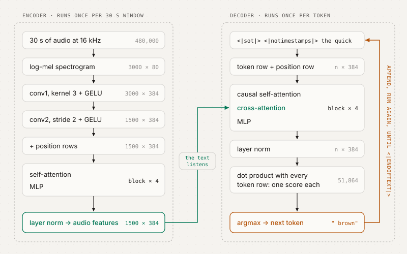
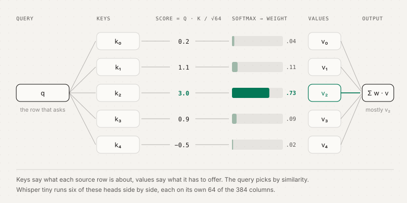

## A Transformer That Listens

In the last chapter we opened OpenAI's Whisper `tiny.en` and did everything except run it. We parsed the safetensors file and found 167 named tensors holding 37.8 million numbers. We can turn the model's output tokens back into text, and we can turn any WAV file into the 3000 × 80 log-mel spectrogram the model was trained on. The program even printed that spectrogram's statistics, and then we looked away.

Today we do the arithmetic that sits between the spectrogram and the tokens. Most of it is assembled from parts we already own: matrix products, a convolution, a softmax. One idea is new, *attention*, and it gets the longest section of the chapter. Then a loop, one optimization that makes the loop eleven times faster, and at the end the file we downloaded transcribes English. As before, everything is a forward pass, and `[dependencies]` stays empty.

The files for today are the four that chapter 12's table left open: `layers.rs`, `encoder.rs`, `decoder.rs` and `transcribe.rs` in `code/src/whisper/`. Attention, the encoder, the decoder and the loop are shown in full; loading each layer by name is not.

### The Shape Of The Model

Before the layers, the whole thing from above.



*The whole model. The left column runs once per 30-second window, the right column once per token.*

The left column is the *encoder*. It turns the 3000 × 80 spectrogram into 1500 rows of 384 numbers, one row per 20 ms of audio. I will call these the *audio features*. The right column is the *decoder*. It takes the audio features and the text written so far, and produces a score for every possible next token. We pick one, append it to the text, and run the decoder again. This arrangement is called an *encoder-decoder* model.

Compare that with what we built in chapters 8 to 10. Our model emits one probability distribution per frame, all of them at once, each computed without knowing what the others will say, and then CTC's collapse rule turns the frames into letters. Whisper's decoder writes the transcript one token at a time, and each choice is conditioned on the audio *and on everything it has written so far*. That second condition is the big difference. Chapter 10's lexicon was a language model in miniature, a list of which words exist. A model that picks the next word knowing the previous ones has a real one hidden inside it: a model of how English goes. It is why Whisper can spell words it hears only vaguely, put commas and periods in sensible places, and capitalize names. It is also, as we will see, why it sometimes writes fluent English that nobody said.

### Old Friends: Convolution, GELU, Layer Norm

Three of the building blocks in `layers.rs` are relatives of things we already have, so we will go through them quickly.

**Linear** is chapter 6's layer, `y = x W^T + b`, forward only. The checkpoint stores `W` as outputs × inputs, so `Linear::new` transposes it once at load time and the forward pass is one matrix product plus the bias.

**Conv1d** is chapter 7's convolution over time: every output row is a linear function of a few neighboring input rows. For each output position we copy the `kernel` input rows it can see side by side into one long row, a *patch*, and a `Linear` maps patches to outputs. One trap: PyTorch stores the weight as `[out][in][tap]` while our patches are laid out `[tap][in]`, so `Conv1d::new` reorders it, and a test (`conv_reads_pytorch_weight_layout`) pins the order. Get it wrong and the model runs happily and outputs nonsense.

**GELU** (Gaussian Error Linear Unit) is the activation function, where chapter 6 used ReLU. ReLU is `max(0, x)`, with a sharp kink at zero. GELU is `x * Phi(x)`, where `Phi(x)` is the probability that a standard normal variable is below `x`. Far from zero the two agree: large positive inputs pass through, large negative ones are blocked. Near zero GELU bends smoothly and even dips slightly below zero.

```rust
// src/whisper/layers.rs

pub fn gelu(x: f32) -> f32 {
    0.5 * x * (1.0 + erf(x * std::f32::consts::FRAC_1_SQRT_2))
}
```

`erf` is the error function, which Rust's standard library does not have, so `layers.rs` computes it with a classic polynomial approximation (Abramowitz and Stegun, formula 7.1.26, accurate to `1.5e-7`). There is also a `tanh`-based approximation of GELU in the wild that older models were trained with. Whisper uses the exact one, so we do too. Chapter 12 said a pretrained model is married to its front end; it is married to its activation function as well.

**Layer normalization** is new but small. Deep stacks of layers only train well if the numbers flowing through them stay in a sensible range, and the transformer's way of ensuring that is to rescale each row to mean 0 and variance 1, then apply a learned gain and bias per column:

```rust
// src/whisper/layers.rs

impl LayerNorm {
    /// Added to the variance so that a constant row does not divide by zero.
    pub const EPSILON: f32 = 1e-5;

    /// Normalize every row of `x`.
    pub fn forward(&self, x: &Mat) -> Mat {
        assert_eq!(x.cols, self.gain.len(), "layer norm width mismatch");
        let mut out = x.clone();
        for row in out.data.chunks_exact_mut(x.cols) {
            let n = row.len() as f32;
            let mean = row.iter().sum::<f32>() / n;
            let variance = row.iter().map(|v| (v - mean) * (v - mean)).sum::<f32>() / n;
            let inverse_std = 1.0 / (variance + Self::EPSILON).sqrt();
            for ((value, gain), bias) in row.iter_mut().zip(&self.gain).zip(&self.bias) {
                *value = (*value - mean) * inverse_std * gain + bias;
            }
        }
        out
    }
}
```

Each row is normalized on its own, using nothing but its own 384 numbers, so the result does not depend on how long the sequence is or on what the other rows hold.

### Attention

Now the new idea, the one the whole architecture is named after. (The paper that introduced the transformer is titled "Attention Is All You Need".)

Let's start from the problem. In chapter 7 we needed information to travel across time: to decide that a frame belongs to the "v" of "seven", it helps to know what came before. The GRU solved this with a hidden state that is handed from each time step to the next. Information from one second ago reaches the present only by surviving a hundred updates of that state, one after another. It works, but it is a game of telephone, and it is sequential by nature: step 100 cannot start before step 99 is done.

Attention does it differently: **every position looks directly at every other position and takes what it needs.** No chain. To write the word "fox", the decoder can look straight at the 20 or so audio rows where "fox" was said, wherever in the 30 seconds they are.

Here is the mechanism, concretely. We have a matrix of rows that want information; call the row we are working on the *query*. And we have a matrix of rows that offer information. Each of those is presented twice: as a *key*, which says what the row is about, and as a *value*, which is what the row hands over if chosen. For one query `q`:

1. Score every key by its dot product with the query: `score_j = q . k_j`. A dot product is large when two vectors point the same way, so this measures how well key `j` matches what the query is looking for.
2. Turn the scores into weights with a softmax, the same function that turned scores into probabilities in chapter 6. The weights are positive and sum to 1.
3. The output is the weighted average of the values: `sum over j of weight_j * v_j`.



*One attention head answering one query. The scores are dot products, the weights are their softmax, the output is a weighted average.*

That is the whole idea. It is a soft lookup: a hash map returns the one value whose key equals the query, attention returns a blend of all values, weighted by how similar their keys are to the query. And look at what it is made of. With the queries stacked in a matrix `Q` and the keys in `K`, all the scores at once are `Q K^T`, a matrix product from chapter 6. Softmax over each row, chapter 6. Then `weights * V`, another matrix product. Nothing here is beyond what we already own.

Three details complete it.

**The scale.** Scores are divided by the square root of the vectors' width before the softmax. The dot product of two long vectors tends to be large, and softmax of large numbers puts nearly all the weight on one entry. Dividing keeps the scores in a range where the softmax stays soft.

**Heads.** One softmax gives each query one pattern of weights, but a position may want several things at once: the sound it is on, and the previous word, say. So the 384 columns are split into 6 groups of 64, and the three steps are run separately on each group. Each group is called a *head*. Head 0 uses columns 0..64 of the queries, keys and values and writes columns 0..64 of the output, head 1 uses 64..128, and so on. Six independent lookups for the price of one.

**The causal mask.** When the decoder processes a sequence of tokens, token `t` must not look at the tokens after it, because when the model is used for real those tokens do not exist yet. So with the `causal` flag set, query `t` may only see keys `0..=t`.

Here is all of that in code:

```rust
// src/whisper/layers.rs

pub fn attend(queries: &Mat, keys: &Mat, values: &Mat, n_heads: usize, causal: bool) -> Mat {
    let width = queries.cols;
    assert!(n_heads > 0 && width.is_multiple_of(n_heads), "{width} columns do not split into {n_heads} heads");
    assert_eq!((keys.cols, values.cols), (width, width), "queries, keys and values must be equally wide");
    assert_eq!(keys.rows, values.rows, "one value per key");
    let head_dim = width / n_heads;
    let scale = 1.0 / (head_dim as f32).sqrt();

    let mut out = Mat::zeros(queries.rows, width);
    // Each query's output row depends only on that query: one row per task.
    for_each_row_par(&mut out.data, width, |t, out_row| {
        let visible = if causal { (t + 1).min(keys.rows) } else { keys.rows };
        let mut weights = vec![0.0f32; visible];
        for head in 0..n_heads {
            let columns = head * head_dim..(head + 1) * head_dim;
            let query = &queries.row(t)[columns.clone()];
            // Step 1: score every visible key against the query.
            for (j, weight) in weights.iter_mut().enumerate() {
                *weight = scale * dot(query, &keys.row(j)[columns.clone()]);
            }
            // Step 2: scores to weights.
            softmax_in_place(&mut weights);
            // Step 3: the weighted average of the values.
            let out_head = &mut out_row[columns.clone()];
            for (j, &weight) in weights.iter().enumerate() {
                for (o, &v) in out_head.iter_mut().zip(&values.row(j)[columns.clone()]) {
                    *o += weight * v;
                }
            }
        }
    });
    out
}
```

We wrote the loops out per query rather than as `Q K^T` so that each of the three steps is visible and so that the causal mask is nothing more than a shorter loop. `for_each_row_par` is chapter 12's helper: one output row per query, spread over the cores. The tests are small enough to check in your head:

```rust
// src/whisper/layers.rs (tests)

    #[test]
    fn attention_weights_follow_the_dot_products() {
        // One head of width 1, so the scale is 1/sqrt(1) = 1.
        // Query ln 3 against keys 0 and 1 gives scores 0 and ln 3:
        // weights 1/4 and 3/4, output 0.25 * 8 + 0.75 * 16 = 14.
        let queries = Mat::from_vec(1, 1, vec![3f32.ln()]);
        let keys = Mat::from_vec(2, 1, vec![0.0, 1.0]);
        let values = Mat::from_vec(2, 1, vec![8.0, 16.0]);
        assert_close(&attend(&queries, &keys, &values, 1, false).data, &[14.0], 1e-5);
    }

    #[test]
    fn causal_attention_cannot_see_the_future() {
        let queries = Mat::zeros(3, 1); // uniform weights over whatever is visible
        let keys = Mat::zeros(3, 1);
        let values = Mat::from_vec(3, 1, vec![3.0, 9.0, 30.0]);
        // Row t averages values 0..=t.
        assert_close(&attend(&queries, &keys, &values, 1, true).data, &[3.0, 6.0, 14.0], 1e-5);
        assert_close(&attend(&queries, &keys, &values, 1, false).data, &[14.0, 14.0, 14.0], 1e-5);
    }
```

Where do queries, keys and values come from? They are learned linear projections of the rows. That is what `q_proj`, `k_proj` and `v_proj` in chapter 12's tensor listing were, and `out_proj` mixes the six heads' outputs back together afterwards:

```rust
// src/whisper/layers.rs

impl MultiHeadAttention {
    /// Let every row of `x` gather information from the rows of `source`.
    pub fn forward(&self, x: &Mat, source: &Mat, causal: bool) -> Mat {
        let queries = self.query.forward(x);
        let keys = self.key.forward(source);
        let values = self.value.forward(source);
        self.output.forward(&attend(&queries, &keys, &values, self.n_heads, causal))
    }
}
```

The two arguments `x` and `source` give us both flavors of attention the model uses. Pass the same matrix for both and the sequence looks at itself: *self-attention*. Pass the decoder's tokens as `x` and the audio features as `source` and you get *cross-attention*: the one place in the model where the text listens to the audio.

And the thought we were holding from the tensor listing: why does `k_proj` have no bias? A bias on the keys would add the same vector to every key, which adds the same number to every one of a query's scores. Softmax only cares about differences between scores, so that number cancels. A bias there could never change the output, and Whisper's authors did not spend 384 parameters on it. We could have worked that out from the listing alone.

### The Transformer Block

Attention moves information between positions. A *transformer block* pairs it with a small network that lets each position digest what it received: `fc1` widens the row from 384 to 1536, GELU, `fc2` narrows it back. `layers.rs` calls this `Mlp` (multi-layer perceptron, the network of chapter 6). An encoder block is these two sub-layers, each wrapped in the same pattern:

```rust
// src/whisper/encoder.rs

impl EncoderBlock {
    /// Apply the block in place.
    pub fn forward(&self, x: &mut Mat) {
        let normed = self.attention_norm.forward(x);
        x.add_assign(&self.attention.forward(&normed, &normed, false));
        let normed = self.mlp_norm.forward(x);
        x.add_assign(&self.mlp.forward(&normed));
    }
}
```

Both halves read `x = x + f(norm(x))`. The `x +` is a *residual connection*: each sub-layer only computes a correction that is added to its input, so information (and, during training, gradients) can flow straight through a deep stack. Normalizing before the sub-layer rather than after is called *pre-norm*; the original transformer did it the other way round, and Whisper's weights only make sense in this order.

The whole encoder is then short:

```rust
// src/whisper/encoder.rs

impl Encoder {
    /// Encode one 30 s spectrogram (`3000 x 80`) into audio features (`1500 x d_model`).
    pub fn forward(&self, mel: &Mat) -> Mat {
        let mut x = self.stem(mel);
        for block in &self.blocks {
            block.forward(&mut x);
        }
        self.final_norm.forward(&x)
    }
}
```

`stem` is the two convolutions, each followed by GELU (the second has stride 2, which halves 3000 frames to 1500), and then one line that needs a comment: `x.add_assign(&self.positions)`. Attention is blind to order: shuffle the rows of a sequence and each row's weighted average comes out the same. A GRU knows about order because it walks the sequence; attention has to be told. So a row that encodes "I am position 731" is added to each feature row before the first block. In Whisper's encoder these 1500 rows are a fixed pattern of sines and cosines of different wavelengths, stored in the checkpoint for convenience.

### A Decoder That Writes

The decoder's job: given the audio features and the tokens written so far, score every one of the 51,864 tokens as the next one. A token enters the decoder as a row of 384 numbers: its row of `embed_tokens`, plus a row for its position (learned ones this time, not sinusoids). `Decoder::embed` adds the two.

A decoder block is an encoder block with one more sub-layer in the middle, and the three of them read like a description of how a person takes dictation:

```rust
// src/whisper/decoder.rs

    /// The textbook decoder: process the whole token sequence from scratch.
    pub fn forward(&self, tokens: &[usize], audio_features: &Mat) -> Mat {
        let rows: Vec<Vec<f32>> = tokens.iter().enumerate().map(|(position, &token)| self.embed(token, position)).collect();
        let mut x = Mat::from_rows(&rows);
        for block in &self.blocks {
            // Tokens look at earlier tokens. `causal = true` hides the future.
            let normed = block.self_attention_norm.forward(&x);
            x.add_assign(&block.self_attention.forward(&normed, &normed, true));
            // Tokens look at the audio.
            let normed = block.cross_attention_norm.forward(&x);
            x.add_assign(&block.cross_attention.forward(&normed, audio_features, false));
            // Each token digests what it gathered.
            let normed = block.mlp_norm.forward(&x);
            x.add_assign(&block.mlp.forward(&normed));
        }
        self.final_norm.forward(&x)
    }

    /// Score every vocabulary entry against one final hidden row:
    /// `logits[v] = hidden . token_embedding[v]`.
    pub fn logits(&self, hidden: &[f32]) -> Vec<f32> {
        let mut logits = vec![0.0; self.token_embedding.rows];
        for_each_row_par(&mut logits, 1, |token, logit| logit[0] = dot(hidden, self.token_embedding.row(token)));
        logits
    }
```

What did I write so far? What does the audio say? Think. Four times over. The last row that comes out is then compared, by dot product, with every row of the token embedding. These scores are called *logits*, unnormalized scores that a softmax turns into probabilities. This is the output layer that was missing from the tensor listing: the same matrix that turned tokens into rows turns a row back into token scores. Sharing it is called *weight tying*.

### The Decoding Loop

A model that scores the next token is not yet a transcriber. We need a loop around it, and three small rules that `config.rs` read from `generation_config.json` in chapter 12:

- **The prompt.** The decoder needs something to start from, so every transcript begins with two control tokens the model was trained to see first: `<|startoftranscript|>` (id 50257) and `<|notimestamps|>` (id 50362), which tells it we want plain text. They come from `decoder_start_token_id` and `forced_decoder_ids` and end up in `rules.prompt`.
- **Suppressed tokens.** A list of 90 tokens the decoder may never choose, mostly bare punctuation such as brackets and musical notes with which the model would otherwise annotate non-speech sounds, plus control tokens. We give them a score of negative infinity, which softmax turns into probability zero. Two more (a lone space and the end token) are forbidden only as the very first choice, so the model cannot return an empty transcript without trying.
- **The end.** When the best next token is `<|endoftext|>` (id 50256), the transcript is done.

For picking a token we use the simplest strategy there is, the one we called *greedy decoding* in chapter 10: take the single most probable one. With those rules, the first version of the loop almost writes itself:

```rust
// First version: the whole prefix through the whole decoder, every step.
let rules = &self.rules;
let mut tokens = rules.prompt.clone();
while tokens.len() < rules.max_length {
    let hidden = self.decoder.forward(&tokens, audio_features);
    let mut logits = self.decoder.logits(hidden.row(hidden.rows - 1));

    suppress(&mut logits, &rules.suppress);
    if tokens.len() == rules.prompt.len() {
        suppress(&mut logits, &rules.begin_suppress);
    }

    let next = argmax(&logits);
    if next == rules.end_token {
        break;
    }
    tokens.push(next);
}
```

Score, forbid, pick, append, repeat. This is correct, and it is what our example runs with `--no-cache`. It is also wasteful in two ways, and seeing why leads to the one real optimization in this chapter.

### Not Doing The Same Work Twice

Count what the loop above recomputes. At step 50 it runs 52 tokens through four blocks, to get one new row. At step 51 it runs 53 tokens through, and the first 52 rows come out *exactly as they did the step before*. That is what the causal mask guarantees: a row can only see rows before it, so appending a token cannot change anything that was computed for the earlier ones. A test in `decoder.rs` checks precisely this (`earlier_rows_do_not_depend_on_later_tokens`).

The second waste is larger. Every call to `forward` runs cross-attention, which projects all 1500 audio rows into keys and values, in each of the four blocks. The audio does not change while we decode. That is eight 1500 × 384 by 384 × 384 matrix products per step, repeated for every token, to get the same eight matrices.

So we remember things. Per block, a `BlockCache` keeps four matrices: the keys and values of self-attention (`self_keys`, `self_values`, one row per token processed so far) and those of cross-attention (`cross_keys`, `cross_values`, one row per audio position). This is the *key/value cache* (often "KV cache"), and every transformer that generates text uses one. The cross-attention half is filled once per window; the self-attention half grows by one row per token:

```rust
// src/whisper/decoder.rs

    /// Begin decoding a window: project the audio features into every
    /// block's cross-attention keys and values, once.
    pub fn start(&self, audio_features: &Mat) -> DecoderCache {
        let width = self.width();
        let blocks = self
            .blocks
            .iter()
            .map(|block| BlockCache {
                self_keys: Mat::zeros(0, width),
                self_values: Mat::zeros(0, width),
                cross_keys: block.cross_attention.key.forward(audio_features),
                cross_values: block.cross_attention.value.forward(audio_features),
            })
            .collect();
        DecoderCache { blocks, tokens_seen: 0 }
    }

    /// Feed one more token and return the logits for the token after it.
    pub fn step(&self, token: usize, cache: &mut DecoderCache) -> Vec<f32> {
        let mut x = Mat::from_vec(1, self.width(), self.embed(token, cache.tokens_seen));
        for (block, memory) in self.blocks.iter().zip(&mut cache.blocks) {
            let attention = &block.self_attention;
            let normed = block.self_attention_norm.forward(&x);
            append_rows(&mut memory.self_keys, &attention.key.forward(&normed));
            append_rows(&mut memory.self_values, &attention.value.forward(&normed));
            let query = attention.query.forward(&normed);
            let attended = attend(&query, &memory.self_keys, &memory.self_values, attention.n_heads, false);
            x.add_assign(&attention.output.forward(&attended));

            let attention = &block.cross_attention;
            let normed = block.cross_attention_norm.forward(&x);
            let query = attention.query.forward(&normed);
            let attended = attend(&query, &memory.cross_keys, &memory.cross_values, attention.n_heads, false);
            x.add_assign(&attention.output.forward(&attended));

            let normed = block.mlp_norm.forward(&x);
            x.add_assign(&block.mlp.forward(&normed));
        }
        cache.tokens_seen += 1;
        self.logits(self.final_norm.forward(&x).row(0))
    }
```

`step` follows `forward` line for line, except that `x` is a single row, the new token, and what it attends to comes from the cache. Notice that the self-attention call passes `causal = false`. No mask is needed any more: the cache only *contains* the past.

Two implementations of the same function are a gift for testing, because each checks the other:

```rust
// src/whisper/decoder.rs (tests)

    #[test]
    fn stepping_with_the_cache_matches_the_full_forward_pass() {
        let decoder = random_decoder(3);
        let audio = random_mat(&mut Rng::new(4), 7, 8, 1.0);
        let tokens = [4, 0, 10, 4, 7];
        let mut cache = decoder.start(&audio);
        for (n, &token) in tokens.iter().enumerate() {
            let stepped = decoder.step(token, &mut cache);
            let hidden = decoder.forward(&tokens[..=n], &audio);
            let full = decoder.logits(hidden.row(n));
            for (a, b) in stepped.iter().zip(&full) {
                assert!((a - b).abs() < 1e-4, "step {n}: cached {a} vs full {b}");
            }
        }
        assert_eq!(cache.tokens_seen, 5);
        assert_eq!(cache.blocks[0].self_keys.rows, 5);
        assert_eq!(cache.blocks[0].cross_keys.rows, 7);
    }
```

`random_decoder` builds a small decoder (2 blocks, width 8, 11 tokens) with weights from chapter 6's `Rng`, so this runs without the real model. With both in hand, the real loop in the repository chooses between them:

```rust
// src/whisper/transcribe.rs

    /// Greedy decoding of one window's audio features.
    pub fn greedy_decode(&self, audio_features: &Mat, options: &DecodeOptions) -> Decoded {
        let rules = &self.rules;
        let mut tokens = rules.prompt.clone();
        let mut cache = options.use_cache.then(|| self.decoder.start(audio_features));
        let mut trace = Vec::new();
        let mut finished = false;

        while tokens.len() < rules.max_length {
            // Scores for the token that would come after `tokens`.
            let mut logits = match &mut cache {
                Some(cache) => {
                    // Feed whatever the cache has not seen: the whole prompt
                    // the first time round, one new token ever after.
                    let mut logits = Vec::new();
                    while cache.tokens_seen < tokens.len() {
                        logits = self.decoder.step(tokens[cache.tokens_seen], cache);
                    }
                    logits
                }
                None => {
                    let hidden = self.decoder.forward(&tokens, audio_features);
                    self.decoder.logits(hidden.row(hidden.rows - 1))
                }
            };

            suppress(&mut logits, &rules.suppress);
            if tokens.len() == rules.prompt.len() {
                suppress(&mut logits, &rules.begin_suppress);
            }
            if trace.len() < options.trace_steps {
                trace.push(StepTrace { position: tokens.len(), top: top_candidates(&logits, 5) });
            }

            let next = argmax(&logits);
            if next == rules.end_token {
                finished = true;
                break;
            }
            tokens.push(next);
        }
        Decoded { tokens: tokens.split_off(rules.prompt.len()), trace, finished }
    }
```

The `trace` lines record the five most probable tokens at the first few steps, so that we can watch the model make up its mind. `argmax`, `suppress` and `top_candidates` are a handful of lines each in the same file. Around this, `transcribe_window` runs chapter 12's front end, the encoder and this loop with a stopwatch on each, hands the tokens to chapter 12's `Tokenizer::decode`, and `transcribe` cuts longer audio into consecutive 30-second windows.

### Run It

We need some speech. Record ten seconds of your own voice. On macOS:

```
ffmpeg -f avfoundation -i ":default" -t 10 -ar 16000 -ac 1 me.wav
```

and on Linux, `ffmpeg -f pulse -i default -t 10 -ar 16000 -ac 1 me.wav` (or `-f alsa`). Any WAV file will do, at any sample rate, mono or stereo.

A book cannot ship a recording of your voice, so the runs below use synthetic speech: sentences spoken by the macOS `say` command and converted with `ffmpeg`. Keep that in mind when you read the results. It is clean, studio-quiet audio, and your microphone will be harder.

```
say -o fox.aiff "The quick brown fox jumps over the lazy dog."
ffmpeg -i fox.aiff -ar 16000 -ac 1 -c:a pcm_s16le fox.wav
```

Go ahead and run it with `--verbose`. (The example keeps the name `ch12_whisper`; it is the program whose first lines we read at the end of the last chapter.)

```
$ cargo run --release --example ch12_whisper -- --verbose fox.wav
loaded ../data/whisper-tiny.en in 0.183 s
  encoder: 4 layers, decoder: 4 layers, width 384, 6 heads, 80 mel bands, 51864 tokens
  prompt: 50257 "<|startoftranscript|>", 50362 "<|notimestamps|>"

fox.wav: 2.51 s of audio
  log-mel spectrogram           3000 x 80   mean  -0.5574  std  0.2287  min  -0.6140  max   1.3860
  after convolutions+positions  1500 x 384  mean   0.3360  std  0.7604  min  -1.1700  max   4.5948
  ...
  encoder output                1500 x 384  mean  -0.0342  std  1.0796  min -12.9854  max   9.6658

  window 0: 10 tokens
  ids: [262, 2068, 7586, 21831, 18045, 625, 262, 16931, 3290, 13]
    position  2: " the" 52.5%  " The" 37.6%  " quick" 3.0%  " Click" 2.1%  " click" 1.4%
    position  3: " quick" 80.4%  " Quick" 13.5%  " click" 2.5%  " Click" 1.8%  " Q" 0.3%
    position  4: " brown" 65.6%  " round" 21.1%  " Brown" 5.3%  "," 2.3%  "-" 1.9%
    position  5: " fox" 84.4%  " Fox" 14.5%  "-" 0.2%  " FOX" 0.1%  " box" 0.1%
    position  6: " jumps" 94.0%  " ch" 3.8%  " jump" 1.2%  "-" 0.2%  "ch" 0.1%
    position  7: " over" 99.8%  "," 0.0%  "<|endoftext|>" 0.0%  " Over" 0.0%  "." 0.0%

  the quick brown fox jumps over the lazy dog.

  mel spectrogram    0.013 s
  encoder            0.239 s
  decoder            0.053 s   11 tokens, 208 tokens/s
  total              0.305 s   8.2x faster than real time
```

That is amazing. A file of numbers we downloaded, a few thousand lines of Rust we wrote, and a sentence our own model could never produce comes out with a period at the end.

Look at the candidates, because this is the language model at work. Positions 0 and 1 are the prompt, so position 2 is the first real choice, and it is close: " the" at 52.5% against " The" at 37.6%. The model heard the word and was unsure about the capital, and greedy decoding took the lowercase one. (A human would have capitalized it. We said this was honest.) At position 4 the runner-up to " brown" is " round": it sounds similar. At position 5, " box" gets a little probability because it rhymes. By position 7 the model is 99.8% sure of " over", and I would bet that is not only the audio: after "the quick brown fox jumps", the next word hardly needs to be heard at all.

The statistics above the tokens (mean, standard deviation, minimum and maximum after each stage) are a debugging aid. When a ported model outputs garbage, numbers like these are how you find the layer where things go wrong: the forward-pass cousin of chapter 6's gradient checker.

Now something longer: 20 seconds of `say` reading a paragraph written for the purpose. This is what it was given:

> Speech recognition used to need a room full of experts. Today, we are going to run a state of the art model with a few thousand lines of Rust and no dependencies at all. It listens to thirty seconds of sound at a time, and it writes down what it hears, one token after another, with commas, capital letters and full stops, until it decides that there is nothing more to say.

```
$ cargo run --release --example ch12_whisper -- long.wav
loaded ../data/whisper-tiny.en in 0.040 s

long.wav: 20.06 s of audio

  Speech recognition used to need a room full of experts. Today, we are going to run a state-of-the-art model with a few thousand lines of rest-in-no dependencies at all. It listens to 30 seconds of sound at a time, and it writes down what it hears. One token after another, with commas, capital letters and full stops, until it decides that there is nothing more to say.

  mel spectrogram    0.014 s
  encoder            0.238 s
  decoder            0.256 s   88 tokens, 344 tokens/s
  total              0.507 s   39.6x faster than real time
```

Sixty-seven words, punctuated and capitalized. It hyphenated "state-of-the-art" and wrote "thirty" as "30" on its own. And it made one real mistake, a rather funny one given the circumstances: "lines of Rust and no dependencies" became "lines of rest-in-no dependencies". The smallest Whisper has apparently not heard much about our programming language. It also split one sentence in two.

Twenty seconds of audio in half a second, on a laptop CPU, with no SIMD intrinsics and no `unsafe`. Now the same file with `--no-cache`, which runs our first version of the loop:

```
$ cargo run --release --example ch12_whisper -- --no-cache long.wav
...
  mel spectrogram    0.013 s
  encoder            0.229 s
  decoder            2.917 s   88 tokens, 30 tokens/s
  total              3.159 s   6.3x faster than real time
```

The transcript is identical, character for character (and an integration test in `tests/whisper_transcribe.rs` asserts that the cached and uncached decoders choose the same tokens on the real model). The decoder went from 2.9 seconds to 0.26: eleven times faster for 88 steps, and the gap widens with every extra token. These timings are from my machine, an Apple M4 Max; yours will differ, but the ratio should not.

The `speech` binary from chapter 11 has a `--whisper` flag that swaps this engine in for our own model, for `transcribe` and for `listen`. So you can now point the microphone at either:

```
$ cargo run --release --bin speech -- transcribe ../samples/utt_yes_right.wav
../samples/utt_yes_right.wav: yes right
    2.06 s of audio, 4 ms to recognize (462x real time), our model (496508 weights), lexicon decoder
$ cargo run --release --bin speech -- transcribe --whisper ../samples/utt_yes_right.wav
../samples/utt_yes_right.wav: Yes. Why?
    2.06 s of audio, 295 ms to recognize (7x real time), Whisper tiny.en
```

Wait. Our model of half a million weights wrote "yes right", which is what was said, and the one with 37.8 million wrote "Yes. Why?". That was not a typo.

### Where It Goes Wrong

Now for the part that the demos usually leave out. The repository's `samples/` directory holds twelve one-word clips: six from Speech Commands (16 kHz, one second each) and six from the Free Spoken Digit Dataset (8 kHz, trimmed tight around the word, resampled to 16 kHz on the way in). This is the kind of audio chapters 5 to 11 were built on. Here is what Whisper makes of each:

| Clip | Said | Whisper tiny.en wrote |
|---|---|---|
| `yes.wav` | yes | `Yes.` |
| `no.wav` | no | `No.` |
| `go.wav` | go | `Go!` |
| `happy.wav` | happy | `Happy!` |
| `seven.wav` | seven | `7` |
| `stop.wav` | stop | `Dump!` |
| `seven_george.wav` | seven | `7` |
| `three_jackson.wav` | three | `three.` |
| `seven_jackson.wav` | seven | `Kevin.` |
| `three_george.wav` | three | `City.` |
| `zero_jackson.wav` | zero | `The Uroom.` |
| `zero_george.wav` | zero | `See you later.` |

Seven of twelve, if we are generous about "7". The same directory has utterances that chapter 9's code glued together from single-word clips, most with background noise mixed in:

| Clip | Said | Whisper tiny.en wrote |
|---|---|---|
| `utt_yes_right.wav` | yes right | `Yes. Why?` |
| `utt_four_one_visual.wav` | four one visual | `for one visual.` |
| `utt_two_yes_go_visual.wav` | two yes go visual | `Two yes, so visual` |
| `utt_down_five_three_sheila_nine.wav` | down five three sheila nine | `Down, five, three, Sheila, nine.` |
| `utterances_with_pauses.wav` | five cat up, left right stop, no down seven, one eight | `Five. Cat. Up. Left. Right. Stop. No. Down. Seven. One. Three.` |

One of the four short ones is right, and "eight" became "Three" in the long one. Our own recognizer gets all five. That is not a fair fight: those files were chosen for `samples/` because our model transcribes them correctly, and they are made of the very kind of clip it was trained on. Still, it is true as far as it goes. On its home turf, our 35-word model beats Whisper tiny. Everywhere else it loses, because everywhere else it cannot play at all.

So the model that just transcribed a paragraph nearly perfectly hears a clearly spoken "zero" as "See you later." What is going on?

Look at the candidates for `stop.wav`:

```
$ cargo run --release --example ch12_whisper -- --verbose ../samples/stop.wav
...
  window 0: 3 tokens
  ids: [360, 931, 0]
    position  2: " D" 16.7%  " Jump" 9.9%  " Stop" 9.3%  " Job" 2.9%  " job" 2.4%
    position  3: "ump" 23.6%  "op" 7.1%  "ope" 5.9%  "up" 4.7%  "uh" 3.2%
    position  4: "!" 51.5%  "." 32.7%  "<|endoftext|>" 11.9%  "..." 0.8%  "!!" 0.5%
    position  5: "<|endoftext|>" 99.3%  " ..." 0.0%  " D" 0.0%  " You" 0.0%  "!" 0.0%

  Dump!
```

The right answer was there, in third place with 9.3%. The model was torn between a handful of short words, and greedy decoding committed to the top one, " D" at 16.7%. Having written " D", it could no longer write "Stop"; the best it could do was finish the word it had started, and "ump" won. (You can also see sub-word tokens in action here: "Dump" is two tokens, " D" and "ump".) This is the failure of greedy decoding from chapter 10 all over again, and the fix is the same: a beam search that keeps " Stop" alive for another step. We have not built that for Whisper.

But the deeper reason is in what the model was trained on. It learned from 30-second stretches of real recordings: sentences, conversations, lectures. A single word followed by 29 seconds of zero padding is something it almost never saw. There is no context for the language model to lean on. "four" and "for" sound the same, and with nothing around them the model has no reason to prefer the number. And when the audio evidence is thin (half a second of an 8 kHz recording has nothing above 4 kHz, so half the spectrogram is empty) the language model's prior takes over and produces whatever short utterance is most plausible in general. To check that this is really what happens, take the audio away completely. Three seconds of digital silence, generated with `ffmpeg -f lavfi -i anullsrc=r=16000:cl=mono -t 3 silence.wav`, which is the flat −1.5 spectrogram from chapter 12's unit test:

```
$ cargo run --release --example ch12_whisper -- --verbose silence.wav
...
silence.wav: 3.00 s of audio
  log-mel spectrogram           3000 x 80   mean  -1.5000  std  0.0000  min  -1.5000  max  -1.5000
  ...
  window 0: 1 tokens
  ids: [345]
    position  2: " you" 48.5%  " You" 13.5%  " ." 3.6%  " Thank" 2.4%  " I" 0.8%
    position  3: "<|endoftext|>" 96.8%  " you" 1.2%  "." 0.6%  " know" 0.2%  "," 0.1%

  you
```

Nothing was said, and the model wrote "you". Remember that `begin_suppress` forbids ending the transcript immediately, so it has to say *something*, and with no evidence at all it says the likeliest thing. This is called *hallucination*, and the candidates hint at where it comes from: " you", " You", " Thank". A good share of the internet's transcribed audio is video subtitles, and what do subtitles say over the silence at the end of a video? "Thank you." "See you later." A model with a language model inside will always say something plausible. That is its strength on real speech and its weakness on everything else.

It is worth sitting with the comparison for a moment. A recognizer that knows only ten digits cannot answer "See you later." A closed vocabulary is a very strong prior, and for a voice-controlled light switch it is the right one. Whisper is not a better version of our recognizer. It is a different trade.

### Where The Time Goes

The timing table says the encoder takes about 0.24 s per window no matter what is in it, and the decoder about 3 ms per token. A back-of-the-envelope count of multiply-adds explains both. In the encoder, each block's attention scores 1500 queries against 1500 keys in 6 heads of 64 columns, and then averages as many values: about 1.7 billion. Its MLP is two 1500 × 384 × 1536 products: another 1.8 billion. Add the four projections and multiply by four blocks, and the encoder comes to roughly 18 billion multiply-adds. In the decoder, a cached step is dominated by the logits, 51,864 dot products of length 384 (20 million), with all four blocks together costing less than that.

Nearly every one of those operations fills independent rows, so it runs on all cores: attention and the logits through chapter 12's `for_each_row_par`, and every `Linear` layer through `Mat::matmul_par`, the same idea applied to the rows of a matrix product.

**Aside** <br>
Why is such naive code fast enough? Because the model is small and the machine is not. Eighteen billion multiply-adds spread over a dozen or more cores, in loops simple enough that the compiler turns them into vector instructions by itself (`dot` in `mat.rs` keeps four running sums to give it permission), is a quarter of a second. A tuned implementation with hand-written SIMD kernels and a real FFT would be several times faster. For `tiny`, on one window, nobody would notice. For the `large` model, 40 times the parameters, they would.

### Try It Yourself

1. **Break the front end.** In `mel_filterbank` (chapter 12), change the last line to return `triangle as f32`, dropping the area normalization. Transcribe your recording again. The spectrogram still *looks* like a spectrogram; see what the model makes of it, then put the line back. Try the same with `.log10()` replaced by `.ln()`.
2. **Take away the positions.** Comment out `x.add_assign(&self.positions)` in `Encoder::stem`. Attention can no longer tell where in the 30 seconds a sound is. Does the transcript come out scrambled, repeated, or not at all?
3. **Force a different start.** In `greedy_decode`, push the id of " Stop" (find it by searching `vocab.json` for `"ĠStop"`) onto `tokens` right after the prompt, and run `stop.wav`. You have just done by hand what a beam search would do: kept the third-best candidate alive. What does the model write next, and how sure is it?
4. **Listen to silence of different lengths.** Generate 1, 5 and 30 seconds of silence and transcribe each. Then try low-level noise instead (`anoisesrc=d=5:c=pink:a=0.01` in place of `anullsrc`). The hallucination is a property of the model; see how it varies with what you feed it.

### Loose Ends

- **Greedy decoding only.** No beam search, and none of the reference implementation's safety nets: it retries a window with random sampling at increasing "temperature" when the output looks degenerate (too repetitive, or too improbable), and it has a separate check for windows with no speech. We saw the cost on `stop.wav` and on silence.
- **Fixed 30-second windows.** Longer audio is cut wherever 30 s happen to end, possibly in the middle of a word, and each window starts without knowing what came before. A word across a cut may come out wrong, twice, or not at all. The reference asks the model for timestamps and starts the next window where the last complete sentence ended, and feeds the previous text in as a prompt. We do neither.
- **No timestamps.** We always send `<|notimestamps|>`. The model can also emit time tokens (that is what most of the 1,607 control tokens are), and with them, subtitles.
- **English only.** The multilingual models expect a language token and a task token in the prompt. `config.rs` would read them from the file, but we have only run `tiny.en`.
- **A decode-only tokenizer.** We can turn ids into text, not text into ids, so we cannot give the model a text prompt (a list of names to expect, say).
- **Not checked against the reference number by number.** Our tests pin every layer to values worked out by hand and the two decoders to each other. We have not compared our logits with those of OpenAI's Python implementation.

What's next on our agenda? No more code. Take stock of what is on your disk: a crate with an empty `[dependencies]` section in which `speech transcribe` runs a recognizer you trained yourself, from a WAV parser up through CTC and beam search, and `speech transcribe --whisper` runs OpenAI's, from a JSON parser up through attention and a key/value cache. Both run on code you wrote and can read every line of. One knows 35 words and never invents any; the other knows English and sometimes says "you" to an empty room. In the short final chapter we will put honest numbers on the distance between them, go through what we skipped along the way, and point to where you might go from here.

### References

- Vaswani, Shazeer, Parmar, Uszkoreit, Jones, Gomez, Kaiser, Polosukhin, [Attention Is All You Need](https://arxiv.org/abs/1706.03762) (2017): the transformer.
- Radford, Kim, Xu, Brockman, McLeavey, Sutskever, [Robust Speech Recognition via Large-Scale Weak Supervision](https://arxiv.org/abs/2212.04356) (2022): the Whisper paper. Its sections on decoding and long-form transcription describe what our loop leaves out.
- The [reference implementation](https://github.com/openai/whisper) (MIT license). `whisper/model.py` and `decoding.py` are short and readable next to our files. The [model card](https://github.com/openai/whisper/blob/main/model-card.md) warns about hallucination and repetition.
- Ba, Kiros, Hinton, [Layer Normalization](https://arxiv.org/abs/1607.06450) (2016); Hendrycks and Gimpel, [Gaussian Error Linear Units (GELUs)](https://arxiv.org/abs/1606.08415) (2016).
- Abramowitz and Stegun, *Handbook of Mathematical Functions* (1964), formula 7.1.26: the approximation behind our `erf`.
- [Chapter 12](12-reading-someone-elses-weights.md), for the weights file, the tokenizer and the front end this chapter builds on.
- This chapter's code: [`whisper/layers.rs`](../code/src/whisper/layers.rs), [`encoder.rs`](../code/src/whisper/encoder.rs), [`decoder.rs`](../code/src/whisper/decoder.rs), [`transcribe.rs`](../code/src/whisper/transcribe.rs); the example [`ch12_whisper.rs`](../code/examples/ch12_whisper.rs); the `--whisper` flag in [`src/main.rs`](../code/src/main.rs); the integration tests in [`tests/whisper_transcribe.rs`](../code/tests/whisper_transcribe.rs).

[← Previous: Reading Someone Else's Weights](12-reading-someone-elses-weights.md) · [Contents](../README.md) · [Next: Where To Go From Here →](14-where-to-go-from-here.md)
